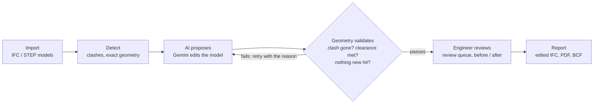
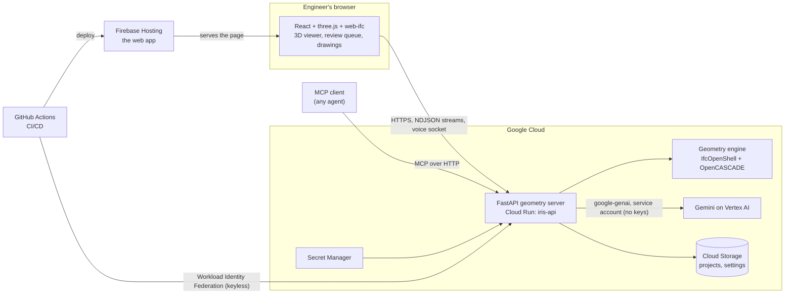
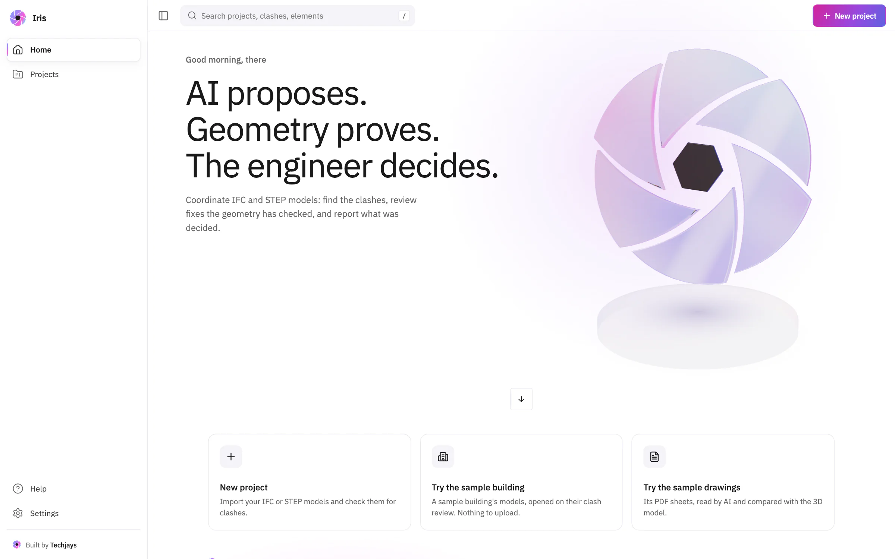
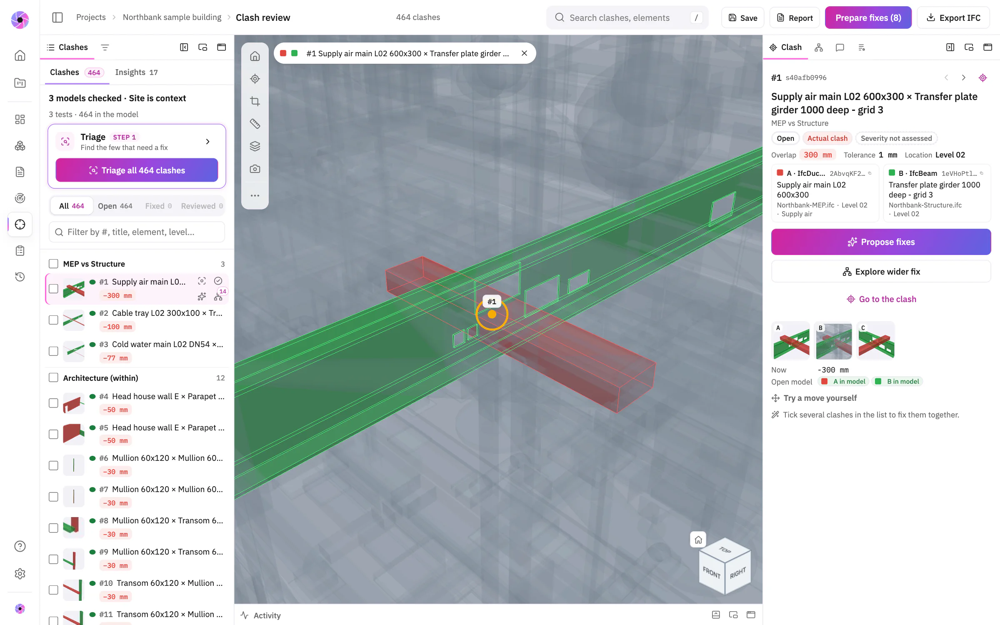
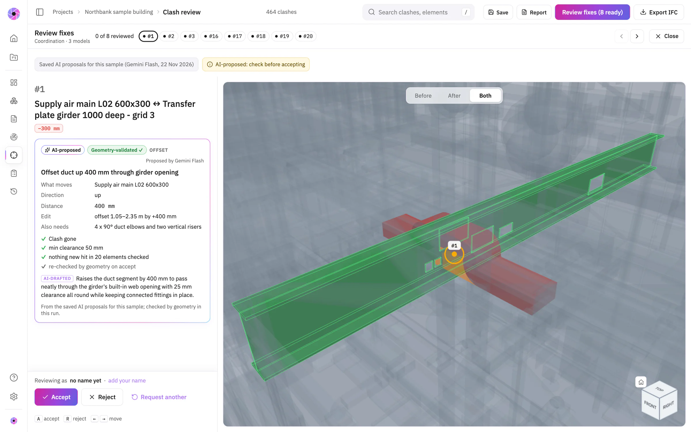
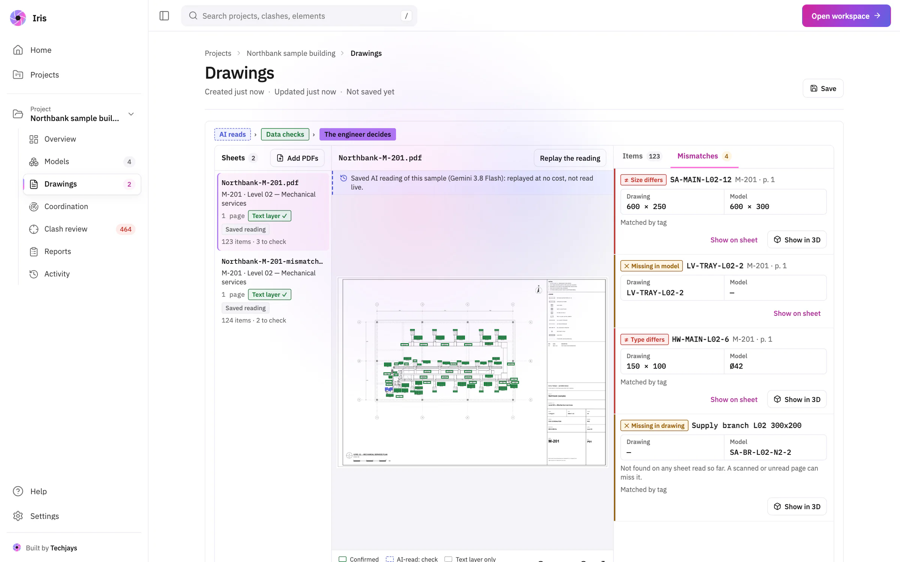
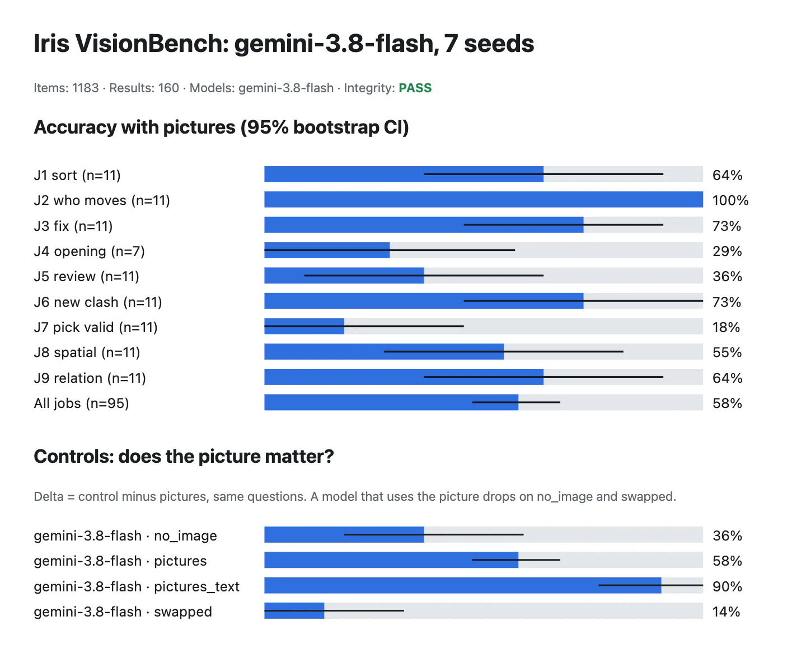

# Iris

**AI proposes. Geometry proves. The engineer decides.**

[](https://iris-techjays.web.app)
[](#team)
[](docs/architecture/17-deployment-and-operations.md)
[](docs/architecture/08-ai-models-prompts-and-spend.md)
[](docs/visionbench.md)

**Live app: <https://iris-techjays.web.app>** · Built by **Techjays** on **Google Cloud** · Our entry to the
**Innodata Frontier AI Hackathon 2026, Track 2 "Visual Task Factory"**

[For judges](#for-judges-5-minute-tour) · [The problem](#the-problem) · [What Iris does](#what-iris-does) ·
[Results](#results) · [How it works](#how-it-works) · [Tech stack](#tech-stack) ·
[Built with](#built-with-open-source-components-we-reused) ·
[Transparency](#transparency-manual-steps-and-corrections) · [Run locally](#run-locally) · [Deploy](#deploy) ·
[Repository map](#repository-map)

---

## For judges: 5-minute tour

**Demo video: <link>**

1. **Open the live app:** <https://iris-techjays.web.app>. No sign-in, and the sample flows below cost nothing.
2. **Try the sample building → Prepare fixes.** Iris finds 464 clashes in the synthetic Northbank building, then the
   review queue shows a geometry-verified fix for each of 8 clashes, with a 3D Before / After view. Accept, reject or
   ask for another. On clash #1 the fix raises the duct 400 mm through the girder's web opening, the designer's own fix.
3. **Try the sample drawings.** Gemini's reading of the sample PDF sheets, each item checked against the PDF's text
   layer, and the 4 planted drawing-vs-model mismatches under Mismatches.
4. **Inspect the benchmark outputs:** [bench/sample-run/](bench/sample-run/README.md) holds a real VisionBench run on
   Gemini 3.8 Flash: 1,183 items, 160 graded answers, the report, the integrity check and the pictures the model saw.
5. **Run the tests** (setup in [Run locally](#run-locally); no credentials, no paid calls):

   ```bash
   uv run --directory server --locked pytest -q              # server, including VisionBench
   uv run --directory server --locked pytest -q tests/bench  # VisionBench only
   npm test --prefix web                                     # web
   ```

6. **Run VisionBench offline for free** with a stand-in model, from `server/`:

   ```bash
   (cd ../bench/render && npm ci && npx playwright install chromium)   # the renderer, once
   uv run iris-bench all --seeds 0:3 --model fake:0.7 --out runs/demo
   ```

The sample flows replay saved Gemini outputs, and the samples are synthetic. Both are explained in
[Transparency](#transparency-manual-steps-and-corrections), with the open-source parts we reused in
[Built with](#built-with-open-source-components-we-reused).

---

## The problem

On a building project, the structure, ducts, pipes and cable trays are designed by different teams in separate 3D
models, and they collide. These collisions are called clashes. Engineers spend days finding them, working out fixes,
and checking the 2D PDF drawings against the 3D model by hand. AI can help, but it can also confidently propose a
fix that is physically wrong.

## What Iris does

Iris is one product in two parts. Both rest on the same idea: an AI answer counts only after geometry has checked it.

### 1. Iris Engineering: the coordination app



- **Import** federated IFC building models and STEP machine assemblies.
- **Detect** clashes with Iris's own geometry engine (IfcOpenShell and OpenCASCADE triangle trees). Navisworks clash
  reports can be imported too.
- **AI proposes.** Gemini reads each clash from three rendered views plus the model data, and proposes one to three
  fixes. Each fix is a real edit to the model: a move, an offset with bends, a reroute, a trim, a penetration, a
  resize or a seat.
- **Geometry validates.** Every proposal is re-checked before anyone sees it: the clash is gone, the required
  clearance is met, and nothing new is hit. A failed idea goes back to Gemini with the reason
  (propose → verify → retry → rank).
- **The engineer reviews.** The [review queue](docs/review-queue.md) prepares fixes in the background, then shows one
  clash per screen: the verified fix next to a 3D **Before / After / Both** view. Accept, reject with a reason, or
  request another. Accepting runs the geometry check again on the server, so the page is never trusted.
- **Report.** Export the edited IFC or STEP, a PDF coordination report, and BCF issues for Revit, Navisworks, Solibri
  and BIMcollab.
- **2D drawing reader.** Upload PDF drawings. Gemini reads the tags and sizes on each sheet, and every reading is
  checked against the PDF's own text layer (confirmed, AI-only, or text-only). The confirmed items are then compared
  with the 3D model to find drawing-vs-model mismatches ([design](docs/drawings.md)).
- **Bring your own agent.** An MCP server exposes the same operations, behind the same geometry check
  ([docs/mcp.md](docs/mcp.md)).

### 2. Iris VisionBench: the Track 2 benchmark

> *The model sees the scene. Iris knows the geometry. The geometry independently verifies the answer.*

VisionBench is a factory of visual engineering tasks for multimodal models ([design](docs/visionbench.md),
[quick start](bench/README.md)):

- **Synthetic scenes.** Each seed gives a deterministic ceiling void: steel beams with web openings, a slab, ducts,
  pipes and cable trays, and planted clashes, near misses and by-design contacts. Each scene is also written out as
  an IFC4 file.
- **Rendered views.** A three.js renderer in headless Chromium draws views A, B and C, top and section views, and
  before/after pictures of proposed fixes. The elements are labelled with neutral letters.
- **8 engineering question categories,** taken from a coordinator's real workflow: clash identification, element
  selection (which element moves), movement estimation, opening selection, resolution validity, new clash detection,
  spatial reasoning, and relationship understanding. Nine jobs (J1 to J9) feed these categories.
- **Ground truth from geometry only.** The reference answers are computed from the scene's geometry and are never
  taken from a model. A fix question has no single "right" answer: the model's proposed move is applied and the
  geometry checker decides whether it works.
- **Controls that separate seeing from guessing:** the same questions with **no image**, with the **wrong image**
  (swapped), and with **images plus measurements as text**.
- **Integrity checks:**
  - the answer key is frozen and hashed before any model call;
  - the truth code never imports the runner or a model client;
  - the picture prompts are scanned for leaked kinds, ids and measurements;
  - a sample of reference answers is re-derived from the scene by geometry;
  - every answer letter must be visible in the item's own pictures.
- **Scoring:** accuracy per category with 95% bootstrap confidence intervals, calibration (ECE, Brier), "confidently
  wrong" rates, an error taxonomy, and a cost-weighted score.

## Results

All numbers below are measured. Model runs use Gemini 3.8 Flash on Vertex AI, and the demo data is synthetic.

### Iris Engineering

| What | Result |
|---|---|
| Clash detection: the Northbank sample building (4 federated IFC models, 1,732 elements) | **464 clashes in about 11 s** on Cloud Run (warm, live geometry) |
| First check of the unchanged samples, with the saved-check replay | About 0.7 s locally, down from 6–7 s. Before a replay is used, it is verified against live geometry |
| Fix engine on the answer key | **31 / 31 proposals verified** by geometry. Gemini Flash solved 9 / 9, at about $0.008 per clash |
| AI fix on a real clash: a supply-air duct through a 1 m transfer girder | 2 options in 12 s, both geometry-validated. The top option (raise the duct 400 mm through the web opening, 50 mm clearance) matches the designer's own fix |
| Review queue: 8 sample clashes | **8 / 8 got a geometry-verified fix**, in 22 s for $0.06. On the 3 hard transfer-girder clashes, the AI's fixes match the designer's real revision: **duct +400 mm, cable tray +250 mm, cold-water main +280 mm** |
| 2D drawing reader: the sample M-201 sheets | **119 / 123 items confirmed** against the PDF text layer. It found **exactly the 4 planted** drawing-vs-model mismatches, with **0 false alarms** on the clean sheet |

### Iris VisionBench: Gemini 3.8 Flash

The first paid run used 7 seeds, 95 picture questions and 21–22 questions per control mode. It cost $2.33 for 170
calls, and the integrity check passed.

| Mode | Accuracy [95% CI] | n |
|---|---|---|
| Pictures | **58%** [47, 67] | 95 |
| No picture | **36%** [18, 59] | 22 |
| Wrong picture (swapped) | **14%** [0, 32] | 22 |
| Pictures + measurements as text | **90%** [76, 100] | 21 |

**Calibration (pictures):**
- Mean confidence was 0.96, against 58% accuracy.
- **ECE was 0.385**, and 42% of the picture answers were confidently wrong (confidence ≥ 0.8).

**Per category (pictures):**

| Category | Accuracy | n |
|---|---|---|
| Element selection (which element moves) | 100% | 11 |
| Movement estimation | 73% | 11 |
| New clash detection | 73% | 11 |
| Clash identification | 64% | 11 |
| Relationship understanding | 64% | 11 |
| Spatial reasoning | 55% | 11 |
| Opening selection | 29% | 7 |
| Resolution validity (is this fix good?) | 27% | 22 |

**What this shows:**
- **The model really uses the picture:** its accuracy falls to 14% with the wrong one.
- **It reasons well from numbers:** 90% with the measurements as text.
- **It is weak at reading geometry from pictures:** 58%, and it is weakest when judging whether a fix works or an
  opening fits.
- **It is overconfident.**

This is why Iris never trusts a model's answer without a geometry check. The samples are small (n = 7–22 per
category, with wide intervals), so read these numbers as a first measurement, not a ranking.

The whole run is committed in [bench/sample-run/](bench/sample-run/README.md): the items and prompts, Gemini's replies,
the graded results, the scores, the integrity check, the report and the pictures. `iris-bench score` and `verify`
re-check it offline.

## How it works



- **The browser** loads the React app from Firebase Hosting. The app calls the Cloud Run API directly, streaming
  progress as NDJSON. The browser never sees a credential and never calls Gemini.
- **The FastAPI server** holds the open models and runs detection, the fix agent, the geometry check, the drawing
  reader, reports and the MCP server. Only the server's geometry supplies clearance numbers.
- **Gemini on Vertex AI** is called only by the server (`server/iris/model_client.py`), through the runtime service
  account. Gemini returns strict JSON (`response_json_schema`), and every call counts against caps and a daily spend
  budget.
- **Cloud Storage** keeps projects and settings across restarts. **Secret Manager** holds the server's secrets.

The full map, with a doc per part checked against the code: [docs/architecture/](docs/architecture/README.md). Start
with [01 · Product and journeys](docs/architecture/01-product-and-journeys.md) and
[02 · System architecture](docs/architecture/02-system-architecture.md).

## Tech stack

| Layer | Technology |
|---|---|
| AI | **Gemini 3.8 Flash** (every role by default: proposals, second tries at thinking high, triage, titles, drawing reading, voice, benchmark runs), **Gemini 4 Argon** (optional, by env var), **Gemini 3.1 Flash Image** (pictures of an accepted fix) · Vertex AI + google-genai SDK · multimodal prompts (3 views per clash plus measurements) · structured JSON output · agentic propose → verify → retry → rank loop · Model Context Protocol server |
| Backend | Python 3.13, uv · FastAPI, Uvicorn, Pydantic · IfcOpenShell 0.9 · OpenCASCADE (cadquery-ocp) · NumPy · pypdfium2 + pdfplumber (PDF drawings) · ReportLab, WeasyPrint (PDF reports) · defusedxml |
| Frontend | React 19, TypeScript 5.9, Vite 8 · three.js + web-ifc (batched meshes) · dockview · lucide-react |
| Benchmark | Seeded scene generator, closed-form geometry checker · three.js renderer in headless Chromium (Playwright) · IFC4 export · bootstrap CIs, ECE, Brier |
| Google Cloud | Cloud Run · Firebase Hosting · Vertex AI · Cloud Storage (+ FUSE) · Secret Manager · Artifact Registry · IAM service accounts |
| DevOps | Docker (multi-stage) · GitHub Actions CI/CD · Workload Identity Federation (keyless deploys) |
| Testing | pytest · Node test runner · Playwright · `tsc --noEmit` |
| Formats | IFC · STEP · BCF · PDF · Navisworks XML · NDJSON · MCP |

## Built with (open-source components we reused)

Iris's own code is the geometry check, detection, the fix agent and fix kinds, the review queue, the drawing reader,
the reports, the web app and the whole VisionBench pipeline. It is built on these open-source libraries and tools,
used as published (licences from each package's metadata):

**Server and benchmark** ([server/pyproject.toml](server/pyproject.toml))

| Component | What we use it for | Licence |
|---|---|---|
| [IfcOpenShell](https://ifcopenshell.org/) | Reading, editing and writing IFC; the clash and clearance trees; VisionBench's IFC4 export | LGPL-3.0-or-later |
| [OpenCASCADE](https://dev.opencascade.org/) via [cadquery-ocp](https://github.com/CadQuery/OCP) | Triangulating IFC geometry, reading and writing STEP | OCCT: LGPL-2.1 with exception; bindings: Apache-2.0 |
| [NumPy](https://numpy.org/) | Geometry and scoring arithmetic | BSD-3-Clause |
| [FastAPI](https://fastapi.tiangolo.com/), [Uvicorn](https://www.uvicorn.org/), [Pydantic](https://docs.pydantic.dev/) | The HTTP API, NDJSON streams, request and reply models | MIT, BSD-3-Clause, MIT |
| [python-multipart](https://github.com/Kludex/python-multipart), [HTTPX](https://www.python-httpx.org/) | File uploads; HTTP client | Apache-2.0, BSD-3-Clause |
| [pdfplumber](https://github.com/jsvine/pdfplumber), [pypdfium2](https://github.com/pypdfium2-team/pypdfium2) | The drawing reader: the PDF text layer and page pictures | MIT; BSD-3-Clause / Apache-2.0 |
| [ReportLab](https://www.reportlab.com/opensource/), [WeasyPrint](https://weasyprint.org/) | PDF coordination reports | BSD, BSD-3-Clause |
| [defusedxml](https://github.com/tiran/defusedxml) | Safe parsing of uploaded XML (Navisworks reports, BCF) | PSF-2.0 |
| [MCP Python SDK](https://github.com/modelcontextprotocol/python-sdk) | The MCP server for outside agents | MIT |
| [google-genai](https://github.com/googleapis/python-genai) | Calling Gemini on Vertex AI | Apache-2.0 |
| [pytest](https://pytest.org/), [uv](https://docs.astral.sh/uv/) | Tests; Python and dependency management | MIT; MIT / Apache-2.0 |

**Web app and renderer** ([web/package.json](web/package.json), [bench/render/package.json](bench/render/package.json))

| Component | What we use it for | Licence |
|---|---|---|
| [React](https://react.dev/) | The web app | MIT |
| [TypeScript](https://www.typescriptlang.org/), [Vite](https://vite.dev/) | Language, dev server and build | Apache-2.0, MIT |
| [three.js](https://threejs.org/) | The 3D viewer, and VisionBench's scene renderer | MIT |
| [web-ifc](https://github.com/ThatOpen/engine_web-ifc) | Loading IFC geometry in the browser (WebAssembly) | MPL-2.0 |
| [dockview](https://dockview.dev/) | Docking panels (the free core only) | MIT |
| [lucide-react](https://lucide.dev/) | Icons | ISC |
| [Playwright](https://playwright.dev/) with headless Chromium | VisionBench's deterministic renders, and browser checks | Apache-2.0 |
| [IBM Plex Sans and Mono](https://github.com/IBM/plex) | Typefaces, from Google Fonts | OFL-1.1 |

**Services and tools, not open source:** Gemini models on Vertex AI, Cloud Run, Firebase Hosting, Cloud Storage,
Secret Manager, Artifact Registry, Docker and GitHub Actions.

## Transparency: manual steps and corrections

What a reviewer should know about how the outputs were made, and what was done by hand.

- **A benchmark labelling bug, fixed and re-run.** In the first VisionBench runs, the J3/J4 questions could offer
  opening letters that the item's own pictures did not show, and Gemini rightly answered that it could not see them.
  We fixed the generator so these jobs offer only openings labelled in the pair's own pictures, added the
  `letters_shown` integrity check (`iris-bench verify` now fails any item whose answer letters its pictures do not
  show), rebuilt the run and discarded the earlier results. The committed run passes the check for all 298 pictures
  items.
- **The live demo replays saved outputs, so visitors cost $0.** Each saved file is keyed by hashes of its inputs and is
  used only when they match exactly. The page labels it as saved.
  - **Review-queue fixes** ([samples/prepared/](samples/prepared/)): real Gemini 3.8 Flash replies from one
    owner-approved run (8 calls, $0.057). On replay, every proposed fix goes through the geometry check again, so a
    saved reply that no longer passes is not shown as ready. Labelled "Saved AI proposals for this sample".
  - **Drawing readings** ([samples/drawings/](samples/drawings/)): Gemini 3.8 Flash's readings of the two sample
    sheets, replayed only for the same file, prompt and page size. Each item is still checked against the PDF's text
    layer and compared with the 3D model. Labelled "Saved AI reading of this sample (Gemini 3.8 Flash)".
  - **The sample clash check** ([samples/saved-checks/](samples/saved-checks/)): a saved geometry result (no AI) for
    the unchanged sample models, per platform, checked against live geometry by a probe before it is used.

  Your own models and PDFs are checked and read live, and AI calls on them run under per-visitor caps.
- **The demo videos** were recorded from these saved outputs, with no live Gemini call, and narrated with Gemini
  text-to-speech.
- **The samples are synthetic.** The Northbank building (6 IFC files, including the designer's fix revision `Rev04`),
  the PC-03 palletising cell (2 STEP files) and the two M-201 PDF drawings, with their planted mismatches, were made by
  our own generator scripts (the generator is not in this repo). They contain no customer data. VisionBench's scenes
  are generated by the code in this repo, from a seed.
- **The error-cost weights are team judgement.** The weights in the cost-weighted score (`false_clear` and
  `approved_bad_fix` 5 … `false_alarm` 1) are illustrative, not measured site costs
  ([docs/visionbench.md](docs/visionbench.md), section 1). Plain accuracy never uses them.
- **The sample run was converted for publishing.** In [bench/sample-run/](bench/sample-run/README.md), local paths
  were made relative and the pictures stored as WebP; no result was edited
  ([what changed](bench/sample-run/README.md#what-was-changed-from-the-raw-run-folder)).
- **Deploy warm-up and settings.** After the Nov 2 deploy, the palletising cell was opened once by hand so its STEP
  conversion was cached for visitors, and pictures of an accepted fix ("Show it built") were switched on in the
  deployed settings.
- **Every model result is measured.** No number in this README was estimated or copied between models. The dated
  record of how each was checked is the build log, [docs/architecture/22-build-log.md](docs/architecture/22-build-log.md).

## Run locally

**Prerequisites:**
- Git, [Node.js](https://nodejs.org/en/download) 22.12 or newer, and [uv](https://docs.astral.sh/uv/), which installs
  Python 3.13.
- A browser with WebGL.
- On Linux, also `sudo apt install libgl1`.
- PDF reports need Pango (see [PDF system libraries](#pdf-system-libraries)).
- On Windows PowerShell, use `npm.cmd` in place of `npm`.

```bash
git clone https://github.com/Saravana-Rajan/IRIS.git
cd IRIS
uv python install 3.13
uv sync --project server --locked --python 3.13
npm ci --prefix web
test -f .env || cp .env.example .env      # at the repo root; git-ignored, never committed
```

Start the two servers in separate terminals from the repo root, then open <http://127.0.0.1:5173>:

```bash
cd server && uv run --locked uvicorn iris.app:app --reload --reload-dir iris --host 127.0.0.1 --port 8000
cd web && npm run dev -- --host 127.0.0.1 --port 5173 --strictPort
```

Vite forwards `/api` to port 8000. To check the server, open <http://127.0.0.1:8000/api/samples>: it should return
JSON with `files` and `demos`. Keep `--reload-dir iris`: a plain `--reload` also watches `server/.venv`, so a package
install would restart the server and drop the open models. Edits live in server memory, so export before you
restart.

Eight synthetic demo models ship in [samples/](samples/README.md). They contain no customer data:
- **Northbank**, an office building: 6 IFC files, including `Northbank-MEP-Rev04.ifc`, the designer's own fixes.
- **PC-03**, a robot palletising cell: 2 STEP revisions.

The two sample M-201 PDF drawings come with answer keys.

### Configuration (`.env`)

Viewing, detection, measuring and checking a move by hand need **no credentials**. Proposals, triage, chat, the
drawing reader and VisionBench runs call Gemini, and live calls are billed. Set these in the root `.env` (no quotes,
no inline comments) or in the environment, then restart the server:

| Variable | Purpose |
|---|---|
| `GOOGLE_CLOUD_PROJECT`, `GOOGLE_CLOUD_LOCATION` | The Vertex AI project and location (default `global`). Sign in once with `gcloud auth application-default login` |
| `GEMINI_API_KEY` | Optional. A Gemini API key, used only when no project is set |
| `GEMINI_MODEL` | The main model: proposals, chat, plans, report text (default `gemini-3.8-flash`, as every role but images) |
| `GEMINI_FAST_MODEL` | Bulk triage, clash titles, STEP part names, voice |
| `GEMINI_ESCALATION_MODEL`, `GEMINI_IMAGE_MODEL` | Second tries on hard clashes, and pictures of an accepted fix |
| `GEMINI_THINKING_LEVEL` (and `_FAST_`, `_ESCALATION_` variants) | The thinking level per role: `minimal`, `low`, `medium` or `high` |
| `IRIS_ESCALATION_MAX_USD_DAY` | The daily spend cap for second tries and image work (default 25 USD) |
| `IRIS_OWNER_TOKEN` | Unlocks the owner settings (open the page with `#owner`) |
| `IRIS_ALLOWED_ORIGINS` | The web app's origins, when it is served from another origin (as on Firebase) |

The per-visitor caps (`IRIS_PROPOSE_PER_HOUR`, `IRIS_CHAT_PER_DAY`, …) are off locally unless you set them. Every
variable, its default and its cloud value is in
[15 · Requirements, settings and configuration](docs/architecture/15-requirements-settings-and-config.md).

### Tests

From the repo root, after installing the dependencies (the PDF tests need the PDF libraries below):

```bash
uv run --directory server --locked pytest -q        # server, including tests/bench (VisionBench)
npm test --prefix web
npm run build --prefix web                          # tsc --noEmit + vite build
```

At this commit, pytest collects 1,393 server tests, 212 of them for VisionBench. All the unit tests use synthetic
models and scripted AI replies, so they need no credentials and make no paid calls. VisionBench's renderer tests
are skipped unless `bench/render` is installed (next section). CI runs the server, web and VisionBench suites on
every push and pull request ([.github/workflows/ci.yml](.github/workflows/ci.yml)). The real-model evals in
[evals/](evals/README.md) are separate and make paid calls.

### Run VisionBench

Start free and offline, then add a capped real run. All of these run from `server/`, after the setup above.

```bash
# 1. The renderer, once (three.js in headless Chromium)
(cd ../bench/render && npm ci && npx playwright install chromium)

# 2. Free, offline: a stand-in model that is right 70% of the time. Its report carries a FAKE MODEL banner.
uv run iris-bench all --seeds 0:3 --model fake:0.7 --out runs/demo
open runs/demo/report.html                     # xdg-open on Linux

# 3. Paid, always capped: run refuses a real model without --max-usd
uv run iris-bench run    --out runs/demo --model gemini-3.8-flash --max-usd 2 --concurrency 8
uv run iris-bench score  --out runs/demo
uv run iris-bench verify --out runs/demo --sample 100
uv run iris-bench report --out runs/demo
```

- **`all`** runs every stage in order: generate, render, build, run, score, verify and report. It returns 2 when
  an integrity check fails.
- **Without the renderer,** the pipeline still runs, but without pictures.
- **`--max-usd` stops new model calls** once that run's new spend reaches the cap. In-flight calls can overshoot by
  at most `--concurrency` calls. The run then returns 3, and `all` scores and reports the partial results.
- **Cost on Nov 22:** a Gemini 3.8 Flash call averaged $0.0137, so $2.50 buys about 180 calls.
- **Replies are cached,** so a rerun of the same items is free.
- **More options:** every stage, flag and output is in [bench/README.md](bench/README.md).

The review queue's saved Gemini fixes have their own estimate-first script. Run
`uv run python ../evals/prepare_saved.py --dry-run` to count the calls, tokens and USD with no model call, or add
`--model scripted` for a free, offline run.

### PDF system libraries

WeasyPrint needs Pango ([platform instructions](https://doc.courtbouillon.org/weasyprint/stable/first_steps.html#installation)):

- **Ubuntu/Debian:** `sudo apt install libpango-1.0-0 libpangoft2-1.0-0 libharfbuzz0b libharfbuzz-subset0 fonts-dejavu-core`
- **macOS:** `brew install pango libffi`
- **Windows:** [MSYS2](https://www.msys2.org/), then `pacman -S mingw-w64-ucrt-x86_64-pango` in its UCRT64 shell.
  Set `WEASYPRINT_DLL_DIRECTORIES=C:\msys64\ucrt64\bin` if Python cannot find the DLLs.

Check with `uv run --directory server --locked python -m weasyprint --info`.

### Troubleshooting

| Symptom | Check |
|---|---|
| The page loads but API requests fail | Are both servers running? Check `/api/samples` on port 8000 and the Python terminal |
| The viewer reports missing `.wasm` files | Run `npm run copy-wasm --prefix web`, then refresh |
| An AI request fails | Check `GOOGLE_CLOUD_PROJECT` / `GOOGLE_CLOUD_LOCATION`, ADC or `GEMINI_API_KEY`, model access and quota |
| Open models vanish ("Open them again") | The server was started without `--reload-dir iris` |
| An MCP client cannot connect through 5173 | Use `http://127.0.0.1:8000/mcp`: Vite proxies `/api`, not `/mcp` |

## Deploy

A push to `main` runs [deploy.yml](.github/workflows/deploy.yml):
1. It runs the full CI first.
2. It signs in to Google Cloud through **Workload Identity Federation**, so no key file exists anywhere.
3. It builds the Docker image into Artifact Registry and deploys the FastAPI server to **Cloud Run** (`iris-api`,
   scale to zero, startup CPU boost, demo caps from `deploy/env.yaml`).
4. It builds the React app against that API URL and deploys it to **Firebase Hosting**
   (<https://iris-techjays.web.app>).
5. It smoke-tests both ends.

Gemini is reached through the service's own service account. Secrets come from Secret Manager, never from git. The
one-time setup is `deploy/github-setup.sh`, and `deploy/deploy.sh` still deploys by hand. Full guide:
[17 · Deployment and operations](docs/architecture/17-deployment-and-operations.md) and
[deploy/README.md](deploy/README.md).

## Repository map

| Path | What is there |
|---|---|
| [`server/iris/`](server/iris/) | The FastAPI server: API, MCP server, geometry engine, detection, fix agent, review queue, drawing reader, reports |
| [`server/iris/domain_packs/`](server/iris/domain_packs/) | The prompts sent to Gemini |
| [`server/iris_bench/`](server/iris_bench/) | VisionBench: scenes, geometry truth, jobs, runner, scoring, integrity checks, report, CLI (`iris-bench`) |
| [`server/tests/`](server/tests/) | The pytest suites (VisionBench in `tests/bench/`) |
| [`bench/`](bench/README.md) | VisionBench quick start and the headless three.js renderer (`bench/render/`) |
| [`bench/sample-run/`](bench/sample-run/README.md) | A real VisionBench run on Gemini 3.8 Flash: items, replies, grades, scores, integrity check, report and pictures |
| [`web/`](web/) | The React + three.js web app (`web/src/`) and its tests |
| [`samples/`](samples/README.md) | Synthetic demo models, sample PDF drawings with answer keys, saved checks and saved AI replies |
| [`evals/`](evals/README.md) | Real-model evals and the scripts that make the saved sample data |
| [`deploy/`](deploy/README.md) | Cloud Run and Firebase setup and deploy scripts |
| [`.github/workflows/`](.github/workflows/) | CI (`ci.yml`) and CD (`deploy.yml`) |
| [`docs/architecture/`](docs/architecture/README.md) | The architecture map: one doc per part, checked against the code |
| [`docs/`](docs/) | Feature designs, for example [review queue](docs/review-queue.md), [drawings](docs/drawings.md), [detection](docs/detection.md), [VisionBench](docs/visionbench.md), [edits](docs/edits.md), [MCP](docs/mcp.md) |
| [`assets/brand/iris/`](assets/brand/iris/) | The Iris brand kit |

## Screenshots

See it live at <https://iris-techjays.web.app>.

**Home:** start a project, or try the sample building or its drawings.



**Clash review:** the sample building with clash #1 (supply air main × transfer girder) selected in 3D.



**Review queue:** on #1, the geometry-verified fix "Offset duct up 400 mm", before and after together ("Both").



**Drawings:** the sample PDF sheet read by AI and checked against the model: four mismatches.



**VisionBench:** `gemini-3.8-flash`, 7 seeds: accuracy per job with pictures, and the picture controls.



## Team

Built by **Techjays** for the Innodata AI Hackathon 2026 (Track 2, Visual Task Factory).

Four Google Cloud certified AI engineers.

| Member | Role | Google Cloud certifications |
|---|---|---|
| **Saravana Rajan B** (team lead) | Senior AI Engineer | Professional Cloud Architect |
| **Kanish V** | Senior AI Engineer | Professional ML Engineer · Associate Cloud Engineer |
| **Ishwarya KB** | Staff AI Engineer | Associate Cloud Engineer |
| **Sarmitha S** | AI Engineer | Professional ML Engineer · Associate Cloud Engineer |

Earlier wins as Team Techjays: **1st place**, Google Cloud Build with AI: Code for Communities (national, India) · **2nd place**, India AI Impact Summit Buildathon by HCL GUVI (national, India).
