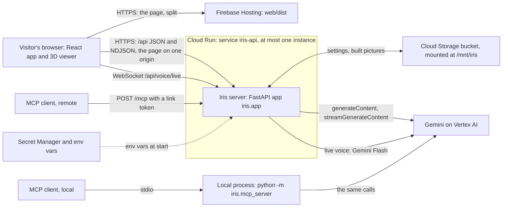
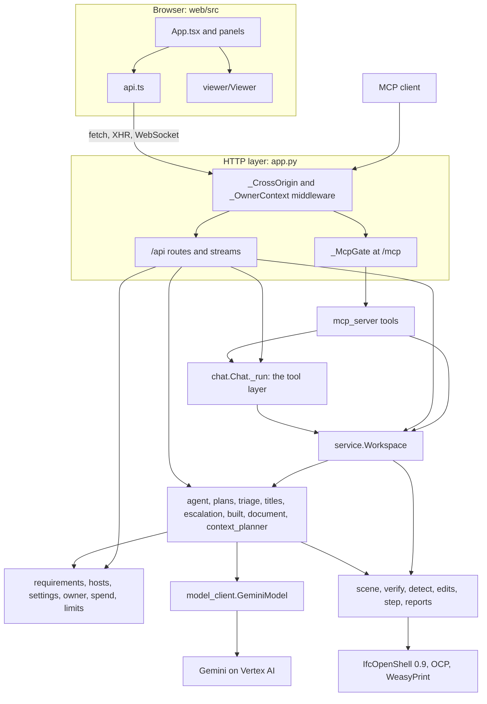
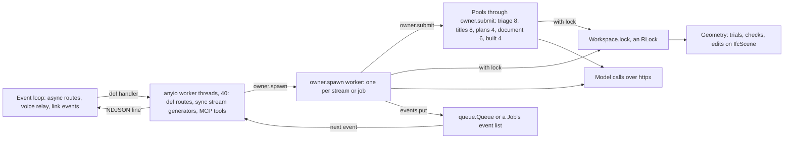
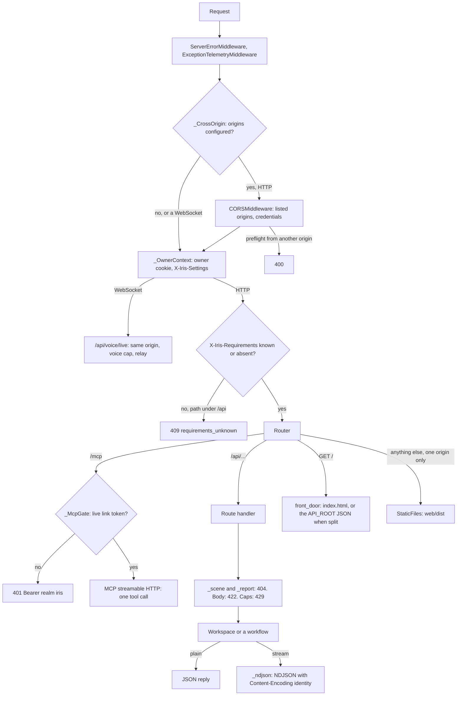

# 02 · System architecture

> **Covers:** `server/iris/app.py`, `server/iris/service.py`, `server/iris/owner.py`,
> `server/iris/model_client.py`, `server/iris/limits.py`, `server/iris/agents.py`, `server/iris/origins.py`,
> `deploy/deploy.sh`, `firebase.json`, `.github/workflows/deploy.yml`, `web/src/api.ts`, `web/src/App.tsx` (as the
> caller), `server/pyproject.toml`, `web/package.json` ·
> **Checked against code:** re-branded on 2026-11-11; hosting, the middleware stack and the request lifecycle
> re-checked on 2026-11-22 ·
> **Deeper design:** none of its own; the docs in the last table link to the feature designs in `docs/*.md`.

Iris is one web app: a React page with a three.js viewer, and one Python process that holds the open models, checks
geometry, edits IFC and calls Gemini on Vertex AI. In production that process runs on Cloud Run (service `iris-api`),
with a Cloud Storage bucket for the files that must outlive it, and the page is served by Firebase Hosting ("Two
ways to host", below). The browser previews; the server is the only source of clearance numbers
and the only holder of credentials. This doc is the big picture: who talks to whom, the main parts, how one process does
many things at once, what happens to every request, and which stack it runs on and why.

## System context

| Who | Talks to | How |
|---|---|---|
| The visitor's browser | Firebase Hosting (split) or the Iris server (one origin) | HTTPS: the built web app (`web/dist`), its tour JSON, demo clips, logos and `.wasm` files |
| The visitor's browser | the Iris server, directly: another origin when split, the same origin otherwise | HTTPS: JSON and NDJSON streams under `/api/`, one WebSocket (`/api/voice/live`); split, with CORS and credentials for the origins in `IRIS_ALLOWED_ORIGINS` |
| The Iris server | Gemini on Vertex AI (`GOOGLE_CLOUD_PROJECT`, `GOOGLE_CLOUD_LOCATION`; Application Default Credentials, or an optional `GEMINI_API_KEY`) | `google-genai` calls: `generateContent` (plain, with function declarations, or with an image out) and `streamGenerateContent` (streamed thought summaries); voice on `GEMINI_FAST_MODEL` |
| The Iris server | Cloud Run | hosting (service `iris-api`, at most one instance, scaled to zero when idle), env vars from `deploy/env.yaml` and `deploy/deploy.sh`, secrets from Secret Manager |
| GitHub Actions | Cloud Run, Artifact Registry, Firebase Hosting | a push to `main` runs `.github/workflows/deploy.yml`: the tests, then the image, `deploy/deploy.sh` and the hosting deploy, signed in by Workload Identity Federation ([17](17-deployment-and-operations.md)) |
| The Iris server | Cloud Storage | an optional bucket mounted at `/mnt/iris` (Cloud Storage FUSE): settings for everyone and the Show it built picture cache |
| A remote MCP client (Gemini CLI, an IDE, any agent) | the Iris server's `/mcp` | streamable HTTP, stateless, one JSON reply per call, `Authorization: Bearer iris_…` (a pairing link token) |
| A local MCP client | `python -m iris.mcp_server` | stdio, a separate process with its own session and no browser |

### Two ways to host

`IRIS_ALLOWED_ORIGINS` (`server/iris/origins.py`) picks the mode; the server reads it at start, and a malformed value
stops it there.

| | One origin | Split |
|---|---|---|
| When | local dev (Vite's proxy), and a plain `deploy/deploy.sh` with `IRIS_ALLOWED_ORIGINS` empty | the auto-deploy (`.github/workflows/deploy.yml`) |
| The page | the Iris server: `GET /` is `web/dist/index.html`, `StaticFiles` serves the rest | Firebase Hosting (`firebase.json`): `web/dist` built with `VITE_API_BASE` = the Cloud Run URL |
| The Iris server | the web app and the API | the API only: `/api/*`, `/docs`, `/openapi.json`, `/mcp`, the voice socket; no static mount, and `GET /` answers a small JSON (`front_door`) |
| How the page calls it | same origin, relative paths | `web/src/api.ts` prefixes every server path with `VITE_API_BASE` and sends credentials; the server answers CORS for the listed origins only (`_CrossOrigin`) |
| The owner cookie | `SameSite=Strict` | `SameSite=None; Secure; Partitioned` (`owner.set_cookie`) |
| The voice socket | same origin only | also from the listed origins (`voice_live.same_origin`) |

The browser calls Cloud Run directly. Firebase Hosting does not proxy the API: its rewrites to Cloud Run cut a
request at 60 s and carry no WebSockets, and Iris streams NDJSON for minutes and opens a WebSocket for voice. The
Cloud Run URL still serves the web app itself when the image is deployed without `IRIS_ALLOWED_ORIGINS`
([17](17-deployment-and-operations.md), [16](16-security-caps-and-cost.md) for the cookie and CORS).

Which model answers what (the plumbing is [08](08-ai-models-prompts-and-spend.md)):

| Model (env var) | Call | Used by |
|---|---|---|
| Gemini Pro (`GEMINI_MODEL`) | `generateContent`; streamed with thought summaries when someone watches (`GeminiModel.complete_json_reasoning`) | proposals (`agent.resolve`), chat and the wider-fix search (`GeminiModel.chat` with tools), root causes and patterns (`plans`), report text (`document`), requirement drafts |
| Gemini Flash (`GEMINI_FAST_MODEL`) | `generateContent` (streamed for triage: `complete_json_streamed`); the live voice session | `model_client.triage_model()`: titles, triage, host readings (`Workspace.hosts_model`), STEP part classes (`app._classifier`); `model_client.transcribe`, `voice_live.relay`; Show it built's lighter judges (`built.main_judge_model`, low thinking) |
| The escalation model (`GEMINI_ESCALATION_MODEL`) | the same calls; every call's cost charged (`spend.charge`) | second tries (`model_client.escalation_model`), Show it built's judges (`built.judge_model`) |
| The Gemini image model (`GEMINI_IMAGE_MODEL`) | `generateContent` with an image out | `built.restyle` |

The thinking level comes from `GEMINI_THINKING_LEVEL` (`GEMINI_FAST_THINKING_LEVEL` for the fast model, `GEMINI_ESCALATION_THINKING_LEVEL` for second tries); thought
summaries are streamed when `GEMINI_INCLUDE_THOUGHTS` is on.

## The main parts

| Layer | Code | Job | Doc |
|---|---|---|---|
| Browser app | `web/src/App.tsx`, `web/src/api.ts`, `web/src/pilot.ts`, `web/src/voice.ts`, `web/src/uploads.ts` and the panels | state and flows; every server call (`call`, `ndjson`, `send` with the requirements retry); the agent driving the viewer; voice; uploads | [12](12-web-app.md) |
| Viewer | `web/src/viewer/` (`Viewer.ts`, `ifcLoader.ts`, `patch.ts`) | web-ifc parsing, one `THREE.BatchedMesh` per file (plus a `glass` batch), previews, captures, accept-in-place patches | [13](13-3d-viewer.md) |
| HTTP layer | `server/iris/app.py`, `server/iris/origins.py` | routes, the `_CrossOrigin` and `_OwnerContext` middleware, the `_McpGate` route, caps (`ProposeLimit` instances), streams (`_ndjson`, `_RequestEvents`), shared job tables (triage, titles, documents), static files on one origin | [10](10-http-api-and-streams.md) |
| Operations | `server/iris/service.py` (`Workspace`) | open and evict scenes and reports, check and keep every fix kind, propose and escalate, detect, match and measure, export, patches; shared by the API, the chat and the MCP server | [04](04-server-code-map.md), [05](05-domain-model-and-state.md) |
| AI workflows | `agent.py`, `plans.py`, `triage.py`, `titles.py`, `chat.py`, `escalation.py`, `built.py`, `document.py`, `context_planner.py`, `context_eval.py`, `hosts.py` | the propose, verify, retry and rank loop; plans and root causes; bulk triage; titles; the chat's tool loop; second tries; built views; reports; the wider-fix search | [09](09-agent-workflows.md) |
| Rules and money | `requirements.py`, `settings.py`, `owner.py`, `spend.py`, `limits.py` | coordination requirements, settings for everyone, the owner, the day's escalation budget, demo caps | [15](15-requirements-settings-and-config.md), [16](16-security-caps-and-cost.md) |
| Model plumbing | `model_client.py` | one Gemini client (`GeminiModel`) for every role, usage and cost, thinking level per role | [08](08-ai-models-prompts-and-spend.md) |
| Geometry | `scene.py` (`IfcScene`), `verify.py`, `detect.py`, `edits.py` | the federated scene, the neighbourhood check, detection, every model edit | [06](06-geometry-and-detection.md), [07](07-fixes-and-edits.md) |
| Files | `step.py`, `reports.py`, `document.py` (PDF, BCF) | STEP to IFC and back, Navisworks XML, reports | [14](14-files-in-and-out.md) |
| Agents | `agents.py`, `mcp_server.py` | pairing links, the page's event channel, jobs; the MCP tools | [11](11-mcp-and-agent-links.md) |

Three rules hold the parts together:
- **One set of operations.** The web API, the chat (`Chat._run`) and the MCP tools all call `Workspace` and the same
  workflow modules, so a fix checked from chat or by an outside agent is checked exactly as one from the page.
- **Elements by GlobalId, distances in metres.** Every layer addresses elements by IFC GlobalId; the server works in
  SI metres, Z up; the viewer converts to three.js's Y up (`(dx, dz, −dy)`).
- **The browser never sees a credential.** Only the Python server calls Gemini; the live voice relay exists so the
  model session is opened with the server's credentials (`voice_live.handshake`).

## Process and concurrency model

**One process.** On Cloud Run the service runs as at most one instance (`--max-instances 1`, up to 64 requests at
once: `--concurrency 64`; `deploy/deploy.sh`), scaled to zero when idle (`MIN_INSTANCES=0`) and given CPU only while a
request is open (`--cpu-throttling`; `CPU_THROTTLING=0` keeps it between requests); locally, one uvicorn process. Everything lives in that process's memory: the one
`Workspace` (`app.ws`) with its scenes and reports, the job tables, links, caps and the day's spend. A second process
would not see the first one's scenes ("Model not loaded. Open it again."), which is why there is exactly one
([17](17-deployment-and-operations.md)). Scaling to zero ends that process after an idle spell, so a cold start
begins with no open models.

**Kinds of thread.**

| Thread | Created by | Runs |
|---|---|---|
| The asyncio event loop | uvicorn | `async def` routes: model and report uploads (`_receive_models`, `upload_report`), requirements register and preview, `transcribe_voice`, `save_view`, link events and captures; the voice relay (`voice_live.relay`, pure I/O); `_RequestEvents.stream`, which polls its queue every 50 ms |
| anyio worker threads (one `CapacityLimiter(40)` at anyio 4.15.1) | Starlette and FastAPI | every plain `def` route; every `next()` of a stream whose body is a sync generator (`propose/stream`, `detect/stream`, `plan/stream`, `document/stream`, `triage/stream`, `titles/stream`, `upload/stream`), so such a stream holds a worker thread while it waits for its next event; `run_in_threadpool` work (`_unpack`, `transcribe`, preview counts); MCP tool calls (the MCP SDK runs sync tools with `anyio.to_thread.run_sync`) |
| Daemon workers | `owner.spawn` | the work behind each streamed request (propose, detect, plan, document, chat, built, context, upload stream), each `triage.Job` and `titles.Job` run, MCP jobs (`agents.Link.start` with `hooks.spawn`) |
| Pools inside a workflow | `ThreadPoolExecutor`, each task through `owner.submit` | see the next table |
| IfcOpenShell's own threads | `ifcopenshell.geom.iterator` | element boxes at open (`scene.THREADS`, the CPUs from `sched_getaffinity`), detection's triangle tree (`os.cpu_count()`) |

| Pool | Size | What runs in parallel |
|---|---|---|
| `triage.triage_report` | `IRIS_TRIAGE_WORKERS` (24) | one strict-JSON call per clash or group of alike clashes; a stop shuts the pool without waiting for calls under way |
| `titles.title_report` | `titles.WORKERS` (8) | one call per 40 clashes (`titles.BATCH`) |
| `plans._resolve_items` | 4 | one `agent.resolve` per plan item |
| `document.explain` | 6 | Gemini Pro's explanation of each report page |
| `built._make` | `PICTURES × judges`: 4, or 6 with Gemini Pro's three judges | two restyles, then the judges of each picture |

**`Workspace.lock`** is a `threading.RLock` and the one rule of geometry concurrency: "anything touching a scene's
geometry holds this" (`service.py`). A trial edits the in-memory IFC and undoes it, so two trials at once would see each
other's edits. It is taken by every `Workspace` geometry method (`verify_move`, each `check_*` and `apply_*`, `file`,
`export`, `detect`, `measure`, `classes`, `fix_settings`, `patch`), by `agent.resolve` around `_describe` and around
each trial (never around the model call), by `plans` (the joint check and keeping), by `escalation.brief`, by
`_with_patch` (keeping a fix and building its patch in one hold), by `_triage_facts`, `report_teams` and the requirements
preview's `detect.run`, and by MCP's `apply_fix` and `apply_plan`. It is re-entrant because those outer holds call
`Workspace` methods that take it again. Not under it: opening a scene (`Workspace.open_paths` builds the `IfcScene` and
its boxes before adding it to `ws.scenes`), `requirements_default` (read-only), and the wider-fix search, which works on
a private copy (`IfcScene.snapshot()`) and takes the lock only to copy, store and accept.

The result: **model calls overlap, geometry takes turns.** Four plan items think at once and eight triage calls run at
once, while a detection run or a trial briefly blocks other geometry, never another visitor's model wait.

**Streams from worker threads.** A streamed route checks and charges first (plain HTTP errors), then:
1. makes a `queue.Queue()` (or a `_RequestEvents`),
2. defines `work()`, which calls the operation with `on_event=events.put`, puts `{"type": "result", …}` (or `done`,
   `plan`, `ready`) or `{"type": "error", "detail": …}`, then `None`,
3. starts it with `owner.spawn(work)`,
4. returns `_ndjson(stream())`, where `stream()` yields `json.dumps(event) + "\n"` until `None`.

Variants:
- **Shared jobs** (`triage.Job`, `titles.Job`) keep every event in a list under a `threading.Condition`; `follow()`
  replays it to each subscriber, then waits, and yields `{"type": "ping"}` after 15 s of quiet.
- **`_RequestEvents`** (Show it built, the wider-fix search, chat) keeps at most 64 events, drops progress first when the
  reader is slow, and sets `cancel` when the client goes away (the chat's turn and the wider-fix search stop on it; a
  built view's drawing runs on).
- **The plain queues** (propose, detect, plan, document, upload) do not notice a disconnect: their worker runs to the
  end.

**Context carried into threads.** `owner.spawn` and `owner.submit` run the function inside
`contextvars.copy_context()`, so a worker or pool task sees what the request set: whether it is the owner's and the
owner's settings (`owner.py`), the coordination requirements in force (`requirements.enter`), and the request's spend
claim (`spend.claim` → `spend.held`). Without it the owner's thinking level, the requirements and the escalation budget hold
would be lost the moment work left the request's thread.

## Request lifecycle

The ASGI stack, outermost first (FastAPI 0.162's `build_middleware_stack` plus the app's two `add_middleware`):

1. `ServerErrorMiddleware` and `ExceptionTelemetryMiddleware` (FastAPI's): an unhandled exception becomes a plain 500.
2. **`_CrossOrigin`** (`app.py`), added last so it is outside `_OwnerContext`: with `IRIS_ALLOWED_ORIGINS` empty it
   passes everything through and adds no CORS headers. With origins set, HTTP requests go through Starlette's
   `CORSMiddleware` for exactly those origins, with credentials (methods GET, POST, PUT, DELETE; request headers
   `Content-Type`, `X-Iris-Settings`, `X-Iris-Requirements`; exposed `X-Iris-Gone`, `Content-Disposition`). A
   preflight from another origin gets 400; a 409 that `_OwnerContext` gives itself carries the headers too. WebSockets
   pass through (the voice socket checks its own `Origin`). It only adds headers, so streams are unchanged.
3. **`_OwnerContext`** (`app.py`), for HTTP and WebSocket scopes (lifespan passes through):
   - reads the `iris_owner` cookie and checks it (`owner.cookie_ok`: HMAC with a key made from
     `IRIS_OWNER_TOKEN`, not expired);
   - reads `X-Iris-Settings` only when the cookie checks out, and sets the owner's context variables
     (`owner.enter`);
   - a WebSocket gets only that and goes on;
   - for HTTP, reads `X-Iris-Requirements`: an id the registry does not know, on a path under `/api/`, is answered
     409 `{"detail": "requirements_unknown"}` before any route runs; otherwise `requirements.enter(rid)`;
   - calls the app, then resets both on the way out.
4. `ExceptionMiddleware` (turns `HTTPException` into JSON) and `AsyncExitStackMiddleware` (FastAPI's).
5. The router, in this order:
   - `Route("/mcp")`, inserted at index 0, whose endpoint is `_McpGate`;
   - the FastAPI routes in the order `app.py` defines them, including the WebSocket `/api/voice/live`, then `GET /`
     (`front_door`: `web/dist/index.html` on one origin, else the JSON `API_ROOT`);
   - `StaticFiles` mounted at `/` last, and only when `web/dist/index.html` exists at import (`WEB_DIST`,
     `IRIS_WEB_DIST`) and `IRIS_ALLOWED_ORIGINS` is empty, so `/api` routes always win and a split server serves no
     page.

**`_McpGate`** takes the token from `Authorization: Bearer …` or `?key=` (`agents.token_from`); a token with no live
link (`links.get(token, touch=False)`) gets 401 JSON with `WWW-Authenticate: Bearer realm="iris"`; a `?key=` token is
copied into an `Authorization` header for the tools to read; the response gets `content-encoding: identity`. Then the
MCP SDK's streamable-HTTP app (`_mcp_transport`: stateless, JSON responses, DNS-rebinding check off), whose session
manager starts in the app's lifespan (`_lifespan`). Each tool call runs inside `requirements.using(link.requirements)`.

**In a route handler**, typically:
- `_scene(sid)` / `_report(rid)` answer 404 "Model not loaded. Open it again." / "Clash report not loaded. Open it
  again." when the server no longer holds them, with `X-Iris-Gone: scene:<id>` (or `report:<id>`) so the page
  offers to open them again ([10](10-http-api-and-streams.md));
- pydantic validates the body (FastAPI's 422);
- a cap is taken: `_take(limit, request)` → `limits.client_id` → `ProposeLimit.take`, 429 with a sentence that says
  why; the owner (`owner.no_caps()`) skips caps. Plans take several at once (`take_many`), a second try takes one
  escalation and one proposal (`take_all`) and claims the day's escalation budget (`spend.claim`);
- the work answers JSON, or streams NDJSON through `_ndjson`.

**Who the caller is.** There are no accounts:
- a visitor is an address: `limits.client_id` takes the peer address, or behind N trusted proxies (`IRIS_TRUST_FORWARDED=N`;
  1 on Cloud Run, whose front end appends the visitor's address) the N-th `X-Forwarded-For` entry
  from the right ([16](16-security-caps-and-cost.md));
- the owner is a signed cookie;
- an agent is a link token, charged to the visitor who made the link (`Link.visitor`; `Link.owner` skips caps).

| Header | Read by | For |
|---|---|---|
| `Cookie: iris_owner` | `_OwnerContext` | the owner |
| `X-Iris-Settings` | `_OwnerContext` → `owner.settings`, owner only | thinking level, triage thinking level, escalation and its thinking level, built views, no caps |
| `X-Iris-Requirements` | `_OwnerContext` → `requirements.enter` | the requirements id the page registered; 409 when unknown |
| `X-Forwarded-For` | `limits.client_id` | the visitor, only with `IRIS_TRUST_FORWARDED=N` (N-th from the right; 1 on Cloud Run) |
| `X-Forwarded-Host`, `X-Forwarded-Proto`, `Host` | `create_link`, `mcp_server` `base_url` | the `/mcp` URL and download links handed to agents |
| `Authorization: Bearer iris_…`, or `?key=` | `_McpGate`, `mcp_server` `link_of` | the link token |
| `Origin` | `_CrossOrigin` (Starlette's `CORSMiddleware`) | CORS answers for the origins in `IRIS_ALLOWED_ORIGINS` only; none configured, ignored |
| `Origin`, `Host` | `voice_live.same_origin` | a socket from another site is closed (1008) before it is accepted; the origins in `IRIS_ALLOWED_ORIGINS` are let in |
| `Content-Length` | `_receive_models` | 411 without it, 413 over the cap, before the body is read |

**How errors are shaped.**
- `HTTPException` → `{"detail": "<a sentence>"}` with its status: 403 (owner only, a feature switched off), 404 (not
  loaded, expired), 409 (state: nothing to export, triage first, requirements unknown, nothing may be edited), 411,
  413, 415, 422 (an edit the shape cannot take), 429 (a cap or the budget, with the reason), 502 (the model or the
  transcriber failed).
- Validation errors: FastAPI's 422 with a `detail` list.
- Inside a stream: `{"type": "error", "detail": "<Type>: <message>"}`, then the stream ends. The report stream says
  `message`, the upload stream adds `status`.
- MCP: expected failures become a `ToolError` with the sentence (the `tool()` wrapper maps `KeyError`,
  `PermissionError`, `LookupError`, `FileNotFoundError`, `ValueError`, `RuntimeError`, `edits.Unsupported`).
- The page: `api.ts` `call` throws `ApiError(detail, status)`; `send` re-registers the requirements and retries once
  on 409 `requirements_unknown`.

## Technology stack

Server: Python 3.13 or later (`requires-python = ">=3.13"`; the Cloud Run image is built from the root `Dockerfile`, by
Cloud Build from `cloudbuild.yaml` when `deploy/deploy.sh` runs by hand, by `docker buildx` in
`.github/workflows/deploy.yml`).
`server/pyproject.toml` sets minimums and `server/uv.lock` pins them.

| Package | `pyproject.toml` | Locked | For |
|---|---|---|---|
| `fastapi` | `>=0.162.0` | 0.162.0 | the HTTP API |
| `uvicorn[standard]` | `>=0.54.0` | 0.54.0 | the ASGI server, locally and in the container |
| `ifcopenshell` | `>=0.9.0.post1` | 0.9.0.post1 | IFC read and write, geometry, triangle trees, edits (`ifcopenshell.api`) |
| `cadquery-ocp` | `==8.0.1.1.0` | 8.0.1.1.0 | OpenCASCADE bindings: STEP in and out (`step.py`) |
| `mcp` | `>=2.3.0` | 2.3.0 | the MCP server (`MCPServer`, streamable HTTP, stdio) |
| `google-genai` | `>=3.1.0` | see `server/uv.lock` | every call to Gemini on Vertex AI |
| `httpx` | `>=0.28.1` | 0.28.1 | HTTP calls outside the Gemini SDK |
| `numpy` | `>=2.5.4` | 2.5.4 | geometry maths |
| `pydantic` | `>=2.14.1` | 2.14.1 | request bodies |
| `python-multipart` | `>=0.0.32` | 0.0.32 | multipart uploads |
| `weasyprint` | `>=70.0` | 70.0 | HTML to PDF for reports |
| `defusedxml` | `>=0.7.1` | 0.7.1 | Navisworks XML, parsed safely |
| transitive | | starlette 1.10.0, anyio 4.15.1, websockets 17.3, pillow 13.0.0 | the ASGI core, threads, the voice relay's client socket, pictures (built views, the PDF) |
| `pytest` (dev group) | `>=9.1.1` | 9.1.1 | server tests |

Web: Node 22 or later (README). `web/package.json` pins exact versions.

| Package | Version | For |
|---|---|---|
| `react`, `react-dom` | 19.3.1 | the UI |
| `three` | 0.186.1 | the viewer |
| `web-ifc` | 0.0.77 | IFC parsing in the browser; its `.wasm` files are copied to `public/wasm/` by `scripts/copy-wasm.mjs` (`postinstall`) |
| `lucide-react` | 1.48.0 | icons |
| `three-mesh-bvh` | 0.9.16 | declared, but no file under `web/` imports it at HEAD |
| `typescript`, `vite`, `@vitejs/plugin-react` (dev) | 5.9.3, 8.3.5, 6.1.2 | type-check and build (`npm run build` = `tsc --noEmit && vite build`) |
| `@types/react`, `@types/react-dom`, `@types/three` (dev) | 19.3.0, 19.3.0, 0.186.0 | types |

Why this stack (CLAUDE.md "Stack and why", checked against the code where it is code):
- **No That Open.** The viewer is plain three.js over web-ifc. Each IFC file is one `THREE.BatchedMesh`
  (`viewer/ifcLoader.ts`), plus a `glass` batch for see-through elements, so every element keeps its own transform,
  colour and visibility and a preview is one matrix update.
- **`COORDINATE_TO_ORIGIN` off.** `ifc.OpenModel(bytes, { COORDINATE_TO_ORIGIN: false })`: federated discipline files
  share coordinates, and shifting each by its own origin would pull them apart.
- **Not Blazor.** Telerik is commercial with a private feed (a public repo must build for anyone), there would be
  JS-to-.NET interop on every viewer event, and WASM starts slowly (an owner decision, not code).
- **Python and IfcOpenShell on the server**, because only the server's geometry supplies clearance numbers, and the
  same operations serve the API, the chat and the MCP server.
- **Google only:** Gemini on Vertex AI through `google-genai`, so one small client (`model_client.py`, `GeminiModel`)
  serves every model role; Cloud Run hosts the one process, Firebase Hosting serves the page and Cloud Storage keeps
  what must survive it.

## Where state lives

The full inventory, with limits and lifecycles, is [05](05-domain-model-and-state.md). In short:

| Where | What | Survives |
|---|---|---|
| Process memory, `app.ws` (`Workspace`) | open scenes (`IfcScene` with every kept edit), reports, matches, detection runs and their diffs, last tries per pair, pattern readings, STEP sources | until evicted or the process restarts |
| Process memory, other modules | triage and title jobs, pattern verdicts, built documents, preview counts, chat sessions, links, cap counters, the requirements registry, the day's spend, host readings, wider-fix proposals (kept on the `Workspace` by `context_planner`) | until the process restarts |
| Instance disk (in memory on Cloud Run), `tempfile.gettempdir()` | `iris-models` (uploads, STEP conversions), `iris-reports` (uploaded reports), `iris-exports` (written models, exports, PDF copies; an hour), `iris-built` (built views, `IRIS_BUILT_CACHE`, on the bucket when one is mounted) | until the instance goes |
| The image | `samples/` (models, sample reports, `step-cache`; an image built in CI has only what git has), `web/dist` | until the next deploy |
| Durable | settings for everyone: `IRIS_SETTINGS_FILE` on the Cloud Storage bucket (`/mnt/iris/settings.json`), else `server/.iris-settings.json` | restarts and redeploys |
| The browser | `localStorage` keys `iris.*` (the saved session for resume, owner settings, requirements, reviews, panel choices) | that browser |

## How the pieces map to docs

| To understand | Read |
|---|---|
| Every server module and what it depends on | [04 · Server code map](04-server-code-map.md) |
| Objects, ids, lifecycles, where state lives | [05 · Domain model and state](05-domain-model-and-state.md) |
| Scene loading, the check, detection | [06 · Geometry engine and detection](06-geometry-and-detection.md) |
| Fix kinds, the registry, edits, accept in place | [07 · Fixes and model edits](07-fixes-and-edits.md) |
| Gemini roles, prompts, thinking level, spend | [08 · AI models, prompts and spend](08-ai-models-prompts-and-spend.md) |
| The agent loop, plans, triage, titles, chat, escalation, built views | [09 · Agent workflows](09-agent-workflows.md) |
| Every route, stream event, header and error | [10 · HTTP API and streams](10-http-api-and-streams.md) |
| MCP tools and pairing links | [11 · MCP and agent links](11-mcp-and-agent-links.md) |
| The React app, its state and modules | [12 · Web app](12-web-app.md) |
| The 3D viewer | [13 · 3D viewer](13-3d-viewer.md) |
| IFC, STEP, Navisworks, uploads, export, PDF, BCF | [14 · Files in and out](14-files-in-and-out.md) |
| Requirements, settings, every env var | [15 · Requirements, settings and configuration](15-requirements-settings-and-config.md) |
| Secrets, the owner, caps, budgets | [16 · Security, caps and cost controls](16-security-caps-and-cost.md) |
| The Cloud Run deploy, Firebase Hosting, CI and running it | [17 · Deployment and operations](17-deployment-and-operations.md) |
| One user action end to end | [03 · End-to-end flows](03-end-to-end-flows.md) |

## When to update this doc

- A new external service or Gemini call (a new model, a new call type, a change to `GOOGLE_CLOUD_LOCATION` handling).
- A new layer or module that other layers call, or a change to who calls whom (for example the MCP tools stop going
  through `Chat._run`).
- A new middleware, a change to the router's order, or a new header the server reads.
- A new thread pool, a changed pool size, or a new place that starts threads without `owner.spawn` / `owner.submit`.
- A change to what `Workspace.lock` covers, or a second lock around geometry.
- A change to how streams are produced (`_ndjson`, `_RequestEvents`, the shared jobs' `follow`).
- A dependency added, removed or moved to a new major version in `server/pyproject.toml` or `web/package.json`.
- Running more than one process or Cloud Run instance, or any state moved out of memory.
- A change to how the page is hosted (Firebase Hosting, the one-origin mode) or to how the browser reaches the server.
