# 03 · End-to-end flows

> **Covers:** `web/src/App.tsx`, `web/src/api.ts`, `web/src/pilot.ts`, `web/src/voice.ts`, `web/src/uploads.ts`,
> `web/src/Chat.tsx`, `web/src/ReportDoc.tsx`, `web/src/Agent.tsx`, `web/src/proposalState.ts`, `web/src/ProposalCard.tsx`,
> `web/src/projectsApi.ts`, `web/src/projectRoute.ts`, `web/src/drawingsApi.ts`, `server/iris/app.py`, `server/iris/service.py`,
> `server/iris/projects.py`, `server/iris/journal.py`, and the workflow modules each flow reaches ·
> **Checked against code:** re-branded on 2026-11-11; the decision and project flows, and trying the sample drawings, on
> 2026-11-22 · **Deeper design:**
> [docs/engineer-workflow.md](../engineer-workflow.md), [docs/detection.md](../detection.md), [docs/edits.md](../edits.md),
> [docs/escalation.md](../escalation.md), [docs/show-it-built.md](../show-it-built.md), [docs/voice.md](../voice.md),
> [docs/mcp.md](../mcp.md), [docs/uploads.md](../uploads.md), [docs/requirements.md](../requirements.md)

One section per thing a person (or an agent) does, traced through the code: what the page calls, which route answers,
what `Workspace` and the workflow modules do, which model is asked, and what comes back. Each step is short and links to
the doc that owns that part. Route paths use `{sid}` (scene id), `{rid}` (report id), `{cid}` (clash id), `{pid}`
(project id); diagrams write them as `:sid`. Every route, event and error is listed in [10](10-http-api-and-streams.md); threads and the lock are in
[02](02-system-architecture.md#process-and-concurrency-model).

Names used in the diagrams:

| Name | Is |
|---|---|
| `App.tsx` | the React app's flows (`web/src/App.tsx`), calling `web/src/api.ts` |
| `Viewer` | `web/src/viewer/Viewer.ts`, with `Pilot` (`web/src/pilot.ts`) where it drives |
| `app.py` | the FastAPI routes (`server/iris/app.py`) |
| `Workspace` | `service.Workspace`, the shared operations |
| `Geometry` | `IfcScene`, `verify`, `detect`, `edits` under `Workspace.lock` |
| a model name | the model host call ([08](08-ai-models-prompts-and-spend.md)) |
| `ProposalCard` | `web/src/ProposalCard.tsx` with `web/src/proposalState.ts` (the four states, `toDecision`) |
| `Journal` | `journal.Journal`, the scene's edit log and its `decisions` |
| `projects.py` | `server/iris/projects.py`: projects on disk under `IRIS_PROJECTS_DIR`, a lock per project |

## Open the Northbank demo and run the check

The landing's **Open the Northbank demo** calls `openDemo()`; **Watch Iris fix a clash** (`startGolden`) also proposes
on the duct × girder clash afterwards. `open()` posts the picked samples (Structure, MEP, Architecture and Site, chosen by
name from `GET /api/samples`); `Workspace.open_paths` builds the `IfcScene` and its element boxes (`IfcScene.bounds`)
before it answers. The page downloads and draws each file, then `runDetect(null, id)` streams the check: a worker runs
`Workspace.detect`, holding `Workspace.lock` for `detect.run`. Once `loadReport` adopts the result, effects fetch which
element each side is (`match`) and start titles: one shared `titles.Job` per report, on the triage model.

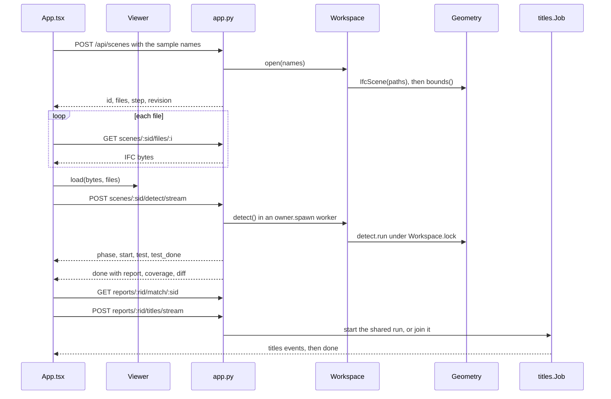

Owned by: [06](06-geometry-and-detection.md) (scene, boxes, detection), [12](12-web-app.md) (`open`, `runDetect`,
`loadReport`), [13](13-3d-viewer.md) (`Viewer.load`), [09](09-agent-workflows.md) (titles),
[19](19-demo-data.md) (Northbank).

### A check on filters

A filter's **What do these hit?** or the Filters panel's **Check clashes** builds one detection test
(`checks.checkTest`: side A the filter's complete conditions, side B everything, none for itself, or another filter;
no id) and App calls `runDetect([test])`, the same stream as above. `Workspace.detect` gives the test its id
(`detect.check_id`) and `detect.run` finds each side against the filters' index (`facets.found`) under the same lock;
the done event carries the tests it ran. The check is kept with the scene's other checks (`checks.Register.keep`)
and the done event's report is the list of every kept check's clashes (`Register.union`): App adopts it without
starting over (`adoptRun`: the selected clash, marks, plans and the chat stay; a fix's mark goes only for a clash the
check still finds) and the picker over the list shows the check. A pair the full check found keeps its id and #N.
**Run again** on the picker (or the summary's Detect again) is `runDetect(null, sid, {check})`; **Run all again**
`{all: true}`; **Check the open models** `runDetect(null)`. Chat and an agent's `detect_clashes` with `a` / `b`
resolve their sides first (`chat.Chat._side`: a filter the page shared by name, or elements described as for
`set_filters`), then run the same test; the page adopts the list (`ui open_report`, with `check` and `checks`).
Design: [docs/filters.md](../filters.md) ("Checks"), [docs/detection.md](../detection.md) ("Kept checks").

## Pick a clash and propose fixes

Picking a row (`selectClash`) frames the pair and fetches Iris's own measure. **Propose fixes** (`runProposal(false)`)
first takes A/B/C views of a detected clash that has none (`captureViews` → `Viewer.captureClash`, waiting at most 4 s),
then streams `propose/stream`: one proposal is charged, and a worker runs `Workspace.propose` → `agent.resolve(trials=True)`
for up to three rounds. Each round asks Gemini Pro on Vertex AI, streamed with thought summaries (`complete_json_reasoning`:
live `reasoning` notes), then checks each candidate under `Workspace.lock`, sending `checking`, `trial` (the candidate in
place, before its check) and `attempt`. `trackAgent` fills the activity table, logs the run for Workings (`runs`,
[docs/workings.md](../workings.md)) and feeds `Pilot`, which plays the trials at a readable pace; the `result` (ranked
verified options with `before` meshes) shows once the pilot has caught up, and the Clash panel scrolls to it. Options
rejected for the pair go with the next request as `notes` ([docs/edits.md](../edits.md), "Rejecting a fix").
A proposal belongs to its clash and runs on while others are opened (one at a time): its row says Proposing…, then how
many fixes are ready with View; `trackAgent` keeps the run's own state (`runState`) and writes the panel only while
its clash is on screen; the result is kept per clash (`doneProposals`), so opening it again shows it without a new
request.

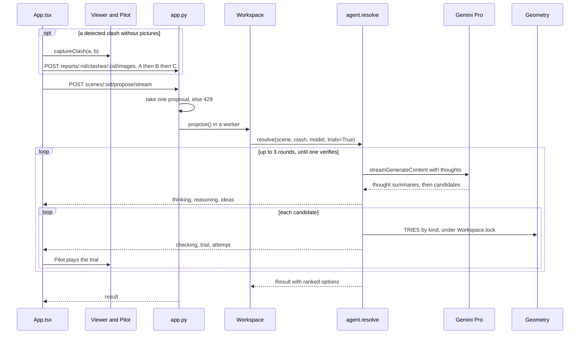

Owned by: [09](09-agent-workflows.md) (`agent.resolve`), [07](07-fixes-and-edits.md) (`agent.TRIES`, the trials),
[08](08-ai-models-prompts-and-spend.md) (streaming and thinking level), [12](12-web-app.md) (`trackAgent`, `Pilot`),
[13](13-3d-viewer.md) (captures and trial drawing), [16](16-security-caps-and-cost.md) (the cap).

## Accept a fix in place

**Accept this fix** (`accept(o)`) takes before and after pictures for the report (`captureFix`), then `api.accept` posts
the option to `fix/apply` for every kind, with the clash it was verified for (`pair`). `plans.apply` tries it again
first (`plans.recheck`: the kind's own trial and check, with the clearance and requirements of that pair) and answers
409 with why when it no longer passes, so nothing the page sends is kept unchecked; then `plans.KEEP` makes what the
trial made, all or nothing. The route goes through `_with_patch`:
under `Workspace.lock` it notes the scene's `revision`, keeps the fix (`mark_edited`, `IfcScene.bump`) and adds
`Workspace.patch` (revisions, `history`, the changed elements' meshes, none past 500,000 vertices). `applyToViewer`
patches the viewer in place when `revision_before` is the page's `sceneRevision`, else reloads the changed and missed
files. `markFixed` then marks every report clash of the pair, and the clash is measured again.

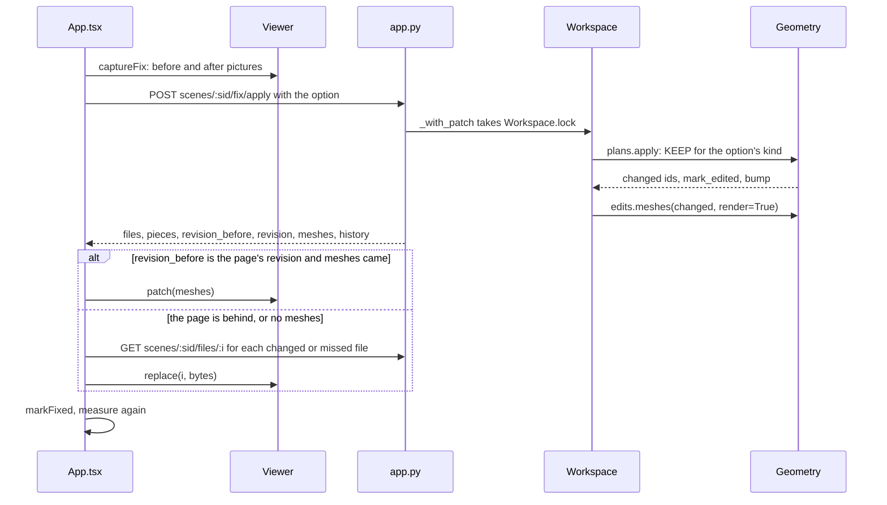

Owned by: [07](07-fixes-and-edits.md) (keeping, `plans.KEEP`, patches), [13](13-3d-viewer.md) (`Viewer.patch`),
[12](12-web-app.md) (`accept`, `applyToViewer`), [05](05-domain-model-and-state.md) (scene revisions).

## Accept or reject a proposal, with the decision recorded

The engineer workflow ([docs/engineer-workflow.md](../engineer-workflow.md), "Decisions") records every decision on a
proposal on the server, with the reviewer, the reason and the time. The server side is built; the page side below is
the contract's, built in `ProposalCard.tsx` and `proposalState.ts` but not mounted by `App` yet
([12](12-web-app.md), "Engineer workflow").

The card shows the proposal in one of four states, which `proposalState.stateOf` reads from the item's shape alone:
only an option from a proposal's `options` or an attempt the check passed is **Geometry-validated**; nothing the model
wrote is read. **Accept** is enabled only then, and it is still the keep route that decides: `fix/apply` (or
`plan/apply` for a plan) with `reviewer`, `reason`, `clash_key` and `number`, which tries the fix again through
`plans.apply` and answers 409 with why when it no longer passes, so nothing is kept or recorded. When it passes, the
kept entry's actor is the reviewer and `_accepted` appends one `accepted` decision per fix kept, stamped
`geometry_validated` with what the re-check found (`min_clearance_m`, `checked_against`); the reply carries
`decisions`. **Reject** (a reason is required), **Modify** and **Request another** build the decision on the page with
`toDecision`, which records no more than the item's shape supports and throws on accepting anything else, and post it
to `POST /api/scenes/{sid}/decisions`; `Journal.add_decision` stamps the server's time and refuses an unknown state or
decision (422). Every decision comes back in `GET /api/scenes/{sid}/edits` (`decisions`), is kept by a project save,
and appears on the clash's page in the PDF.

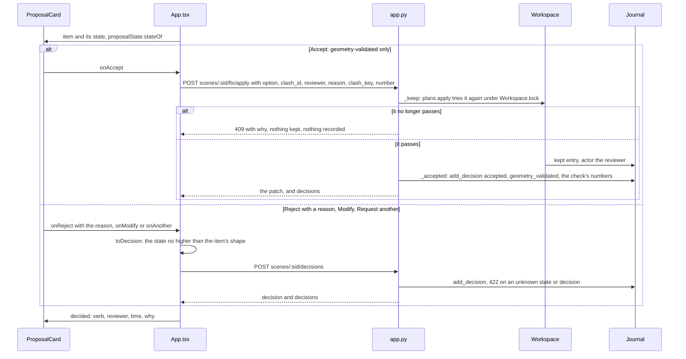

Owned by: [12](12-web-app.md) ("Proposal states"), [07](07-fixes-and-edits.md) (`plans.apply`, keeping),
[05](05-domain-model-and-state.md) (the journal), [10](10-http-api-and-streams.md) (the routes),
[14](14-files-in-and-out.md) (the PDF).

## Triage the report

**Triage all** (`runTriage`) streams `triage/stream`. `_start_triage` joins the report's shared run (`_triage_key`: a
sample report's run serves every visitor; under requirements it is also keyed by prompt and rules) or starts one,
charging one proposal to whoever starts it (free when only the rules changed: it starts from the last run's readings).
The `triage.Job` worker settles sure cases by rule first (`by_rule`, the requirements' by-design rules, and one-element
pairs from `_triage_facts`), then reads each group of alike clashes with one strict-JSON call on the fast model (`GEMINI_FAST_MODEL`), 24 at
a time (biggest groups first), streaming its reasoning. `Job.follow()` replays everything so far to each subscriber,
then each new event; the page overlays what it already knows (`shownTriage`). **Stop** (`stopTriage`) posts
`triage/stop`: the run drops its calls under way and ends with `done` and `stopped`; **Continue · N left** streams
`triage/stream` again, and the new run keeps every reading and asks only the rest (one proposal).

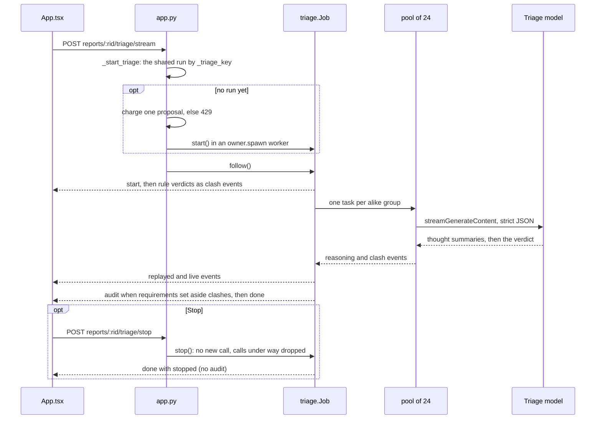

Owned by: [09](09-agent-workflows.md) (triage), [08](08-ai-models-prompts-and-spend.md) (the triage model and its host),
[15](15-requirements-settings-and-config.md) (rules and the audit), [12](12-web-app.md) (the Triage card,
`shownTriage`).

## Fix together, and root causes

**Fix together** (`runPlan({clash_ids})`) and a root cause's **Fix** in Insights (`runPlan({hub})`) stream
`plan/stream`. A batch is charged one proposal per distinct pair, all or none (`take_many`, at most `plans.MAX_ITEMS`,
8); a hub is charged one, and `plans.build_root_cause` charges the fixes only if Gemini Pro's strategy needs edits.
`pairs_for` merges pairs that share an element which can move (`merge_shared`); `_resolve_items` runs `agent.resolve` per
item, 4 at a time (model calls overlap, trials take turns on the lock); `_settle` → `verify_together` checks every fix in
one trial against everything, the others included, swapping in alternatives on a collision. **Accept** posts
`plan/apply` through `_with_patch`; a plan whose scene changed since its check cannot be accepted (`planStale`).

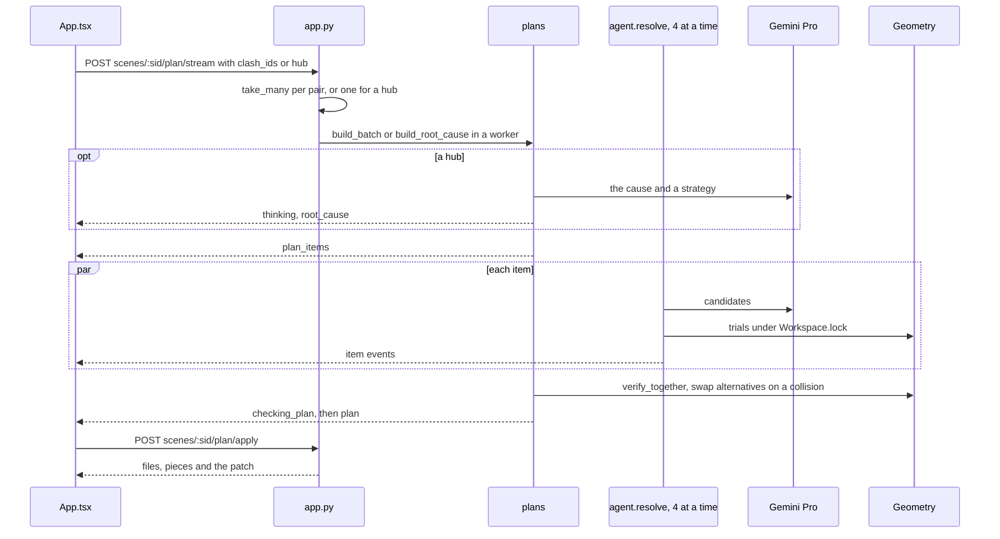

Owned by: [09](09-agent-workflows.md) (plans, root causes), [07](07-fixes-and-edits.md) (the joint check, keeping),
[16](16-security-caps-and-cost.md) (charging), [12](12-web-app.md) (the Plan tab).

## Explore a wider fix

**Explore wider fix** (`exploreContext`) streams `context/stream` for the pair (and its report clash). The route checks
the objective (`context_planner.validate_objective`), takes three proposals at once and streams through
`_RequestEvents`, so closing the tab cancels the search. `context_planner.build` copies the scene under the lock
(`IfcScene.snapshot()`) and searches that private copy with Gemini Pro's tool calls, within `Limits` (6 model calls,
12 trials, 120 s by default), ending with `context_result`: up to three proposals and their review conditions.
**Accept complete proposal** posts `context/apply`; `context_planner.accept` refuses a changed scene revision (409) or
an unacknowledged condition (422), then keeps it through `_with_patch`.

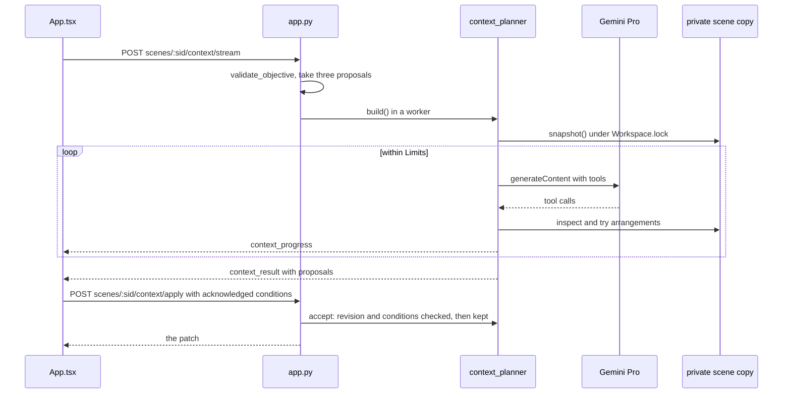

Owned by: [09](09-agent-workflows.md) (the wider search), [07](07-fixes-and-edits.md) (keeping),
[12](12-web-app.md) (the Plan tab's review).

## Chat with a tool that proposes fixes

The Chat tab (`ChatPanel`) posts `/api/chat` with the message and what is open. The route takes one chat message from
the cap, binds this request's proposal and second-try caps into closures, and streams through `_RequestEvents`. The
worker runs `Chat.turn`: up to `chat.MAX_STEPS` (8) Gemini Pro calls with function declarations (`GeminiModel.chat`). When
the model calls `propose_fixes`, `Chat._run` charges one proposal, emits `ui select_clash` and runs `Workspace.propose`,
wrapping each agent event as `{"type": "agent", "event": …}`; the result goes to the page as `proposal` and back to the model
as a short summary. `onChatEvent` sends `agent` events to a `trackAgent` handler (the same pilot and activity table as
a direct proposal) and `proposal` to the options panel.

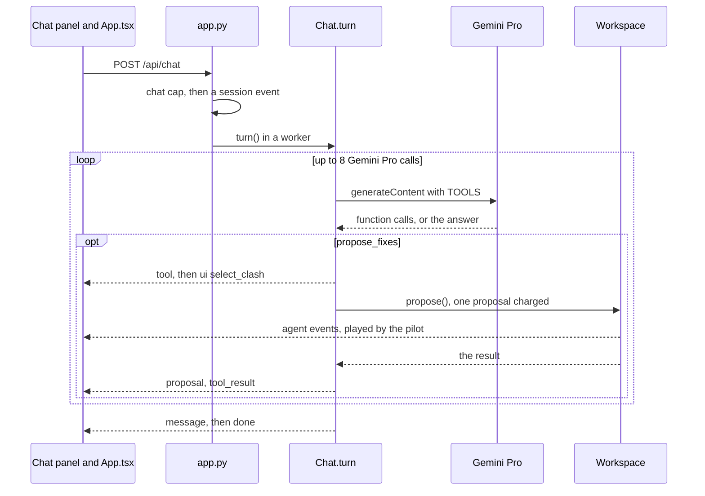

Owned by: [09](09-agent-workflows.md) (the chat's tool loop), [12](12-web-app.md) (`onChatEvent`),
[16](16-security-caps-and-cost.md) (chat and proposal caps).

## Talk to Iris: live voice, and the upload fallback

**Hold to talk** starts `LiveVoice` (`voice.ts`): an AudioWorklet resamples the microphone to 16 kHz PCM over a
WebSocket to `/api/voice/live`. The handler closes a socket from another site before accepting it
(`voice_live.same_origin`, 1008), reads the first frame (`{mode, report_id}`), takes one voice message from the cap and
runs `voice_live.relay` on the event loop: it buffers the audio and transcribes whole clips on the fast model
(`model_client.transcribe`, `GEMINI_FAST_MODEL`) with the server's credentials (why the browser cannot call it itself)
and the vocabulary (`_voice_words`). Hold transcribes the clip once at the end; hands-free cuts segments by RMS
loudness (`voice_live.Segmenter`: `IRIS_VOICE_VAD_RMS`, 500, starts speech; `IRIS_VOICE_SILENCE_MS`, 700, of quiet ends
it) and transcribes each as it ends, so there are no partial words mid-speech. Events: `ready`, `final`, `speech`,
`limit`, `error`. The final transcript is sent as a chat
message. If the socket cannot open in hold mode, `VoiceRecorder` makes a 16 kHz WAV and posts it to `/api/transcribe`.

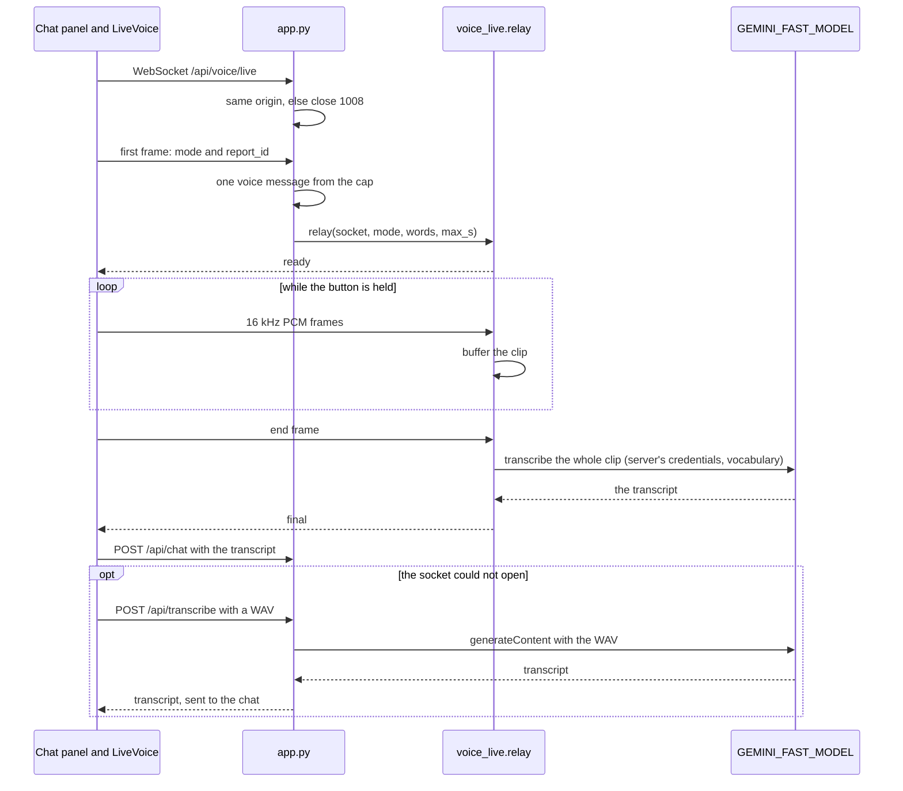

Owned by: [docs/voice.md](../voice.md) (design), [08](08-ai-models-prompts-and-spend.md) (Gemini Flash for voice),
[12](12-web-app.md) (`voice.ts`, `Chat.tsx`), [16](16-security-caps-and-cost.md) (the voice cap, the origin check).

## Escalate to the escalation model

NoFix's second-try button, **Look for a better fix** under verified options, and a failed plan item's second-try
button (`escalateItem`) call `runProposal(true)`: the same `propose/stream` with `escalate: true`. Before any charge,
`_refuse_escalation` answers 409 when nothing may be edited; `escalation_refused` answers 403 when escalation is off and
429 when `spend.claim` finds the day's escalation budget (`IRIS_ESCALATION_MAX_USD_DAY`) spent or `take_all` refuses one escalation plus one proposal.
`Workspace.escalate` turns the claim into a hold (`spend.held`), reads the first try (`last_try`, valid only while the
scene revision and requirements are unchanged), sends `escalating`, writes `escalation.brief` under the lock, and runs
`agent.resolve` on the escalation model (`GEMINI_ESCALATION_MODEL`) for two rounds with every kind, combined fixes included. In `auto` mode
`Workspace.propose` does this itself when a first try finds nothing.

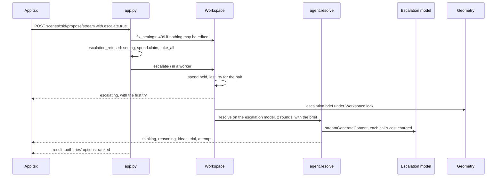

Owned by: [docs/escalation.md](../escalation.md) (design), [09](09-agent-workflows.md) (the second try),
[08](08-ai-models-prompts-and-spend.md) (the escalation model, `spend`), [16](16-security-caps-and-cost.md) (budget and caps).

## Show it built

With built views on (`settings.built_views()`, reported by `GET /api/models`), **Show it built** (`showBuilt`) has
`Viewer.captureBuilt` render one camera three ways (look, ids, normals; a cutaway chosen with class costs from
`classes`) and posts them to `built/stream`. The route refuses a trim or oversized passes (422), answers a cached
picture free, shares one being made (`built.running`), else claims the day's budget (`spend.claim`) and one use of the
built-views cap. `built.make` draws two restyles at once on the Gemini image model (`built.restyle`), runs the pixel `gate`, then has
two escalation-model judges (three fast-model judges at low thinking, `built.main_judge_model`, when the budget can cover only `LIGHTER_ESTIMATE_USD`) read each passing picture; a second
round is told what they found. A kept picture is cached (`/api/built/<key>.jpg`); accepting a fix draws its picture in
the background for the report (`buildAccepted`).

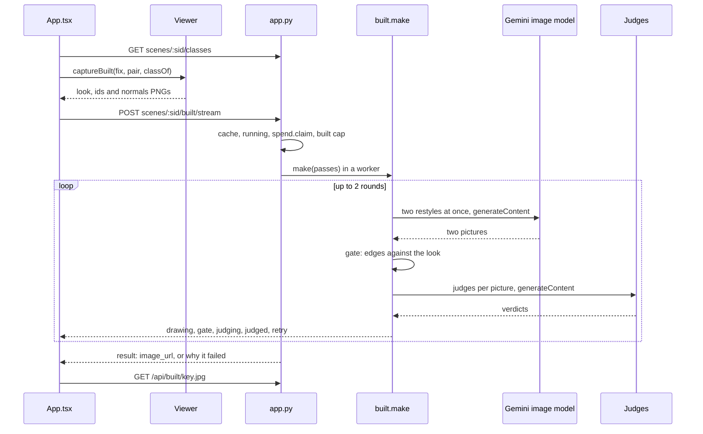

Owned by: [docs/show-it-built.md](../show-it-built.md) (design), [09](09-agent-workflows.md) (`built.make`),
[13](13-3d-viewer.md) (`captureBuilt`), [16](16-security-caps-and-cost.md) (budget and cap).

## Build the PDF report and BCF

**Report** opens `ReportDialog` (`ReportDoc.tsx`), which asks the server to guess each model's team
(`document.guess_teams`) as a starting name the person can retype. On build the page finishes the built pictures first (`prepareReport`,
at most 10), then streams `document/stream` with the scope, teams, evidence, reviews, marks and the triage verdicts it
shows. Triage is optional: without verdicts, a clash with a fix, a kept edit or a decision still gets its page and the
rest are listed by clash test as not triaged. The route charges one proposal; `document.generate` explains each page with Gemini Pro (6 at a time), writes one summary, renders a PDF per
group with WeasyPrint and the BCF 2.1 zip, then sends `ready` with `/api/documents/{doc_id}` (the last 24 are kept in
memory), which the page downloads.

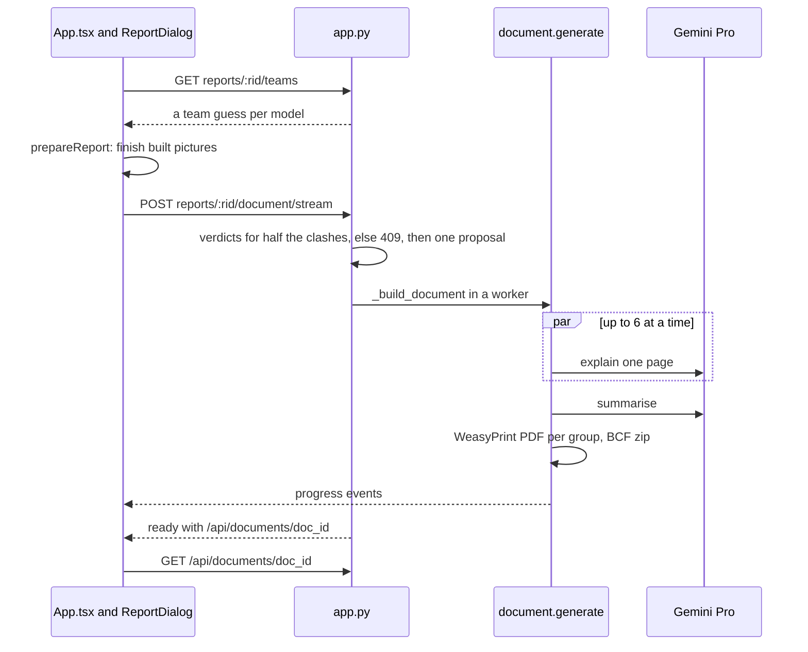

Owned by: [14](14-files-in-and-out.md) (PDF and BCF), [09](09-agent-workflows.md) (the report text),
[12](12-web-app.md) (`ReportDialog`, reviews).

## Export the edited IFC and STEP

**Export IFC** (**Export STEP + IFC** when a model came from STEP) is a plain link to `GET /api/scenes/{sid}/export`. `_tidy_exports` first deletes exports older than an
hour; `Workspace.export` (under the lock) writes only the files with kept edits (`IfcScene.write_edited`:
`<name>.iris.ifc`) and, for a model opened from STEP, writes `<stem>.iris.step` from the original STEP with what changed
(`service.step_changes` → `step.export`: moved parts, rebuilt or cut parts, new pieces). One file comes back as it is,
several as one zip (`<project>-iris.zip`, `app.export_zip_name`), and nothing kept yet is 409. MCP's `export_models` hands an agent this URL
(remote) or writes the files (stdio).

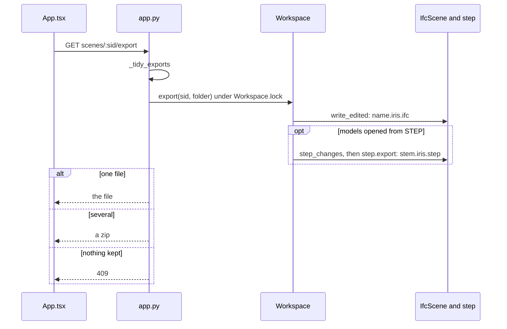

Owned by: [14](14-files-in-and-out.md) (export, STEP write-back), [05](05-domain-model-and-state.md) (what marks a
file edited).

## An MCP agent on a pairing link

**Connect an agent** (`connectAgent`) posts `/api/links`: an `iris_` token (only its sha256 is kept), charged to the
link cap, with an `mcp_url` built from the request's host. The page keeps the link's context current (`PUT .../context`)
and follows its events (`hello`, a `heartbeat` every 15 s; the server ends the stream after 240 s and the page
reconnects). The agent's `POST /mcp` passes `_McpGate` with a live token; every tool call publishes `agent_call` and
`agent_result`. `get_clash_images` on a detected clash without pictures publishes `capture_request` and waits up to
20 s for the page to save its views and answer (`Link.deliver`). `propose_fixes` runs as a job through `Chat._run`, so
the page's pilot plays it; `apply_fix` keeps the option under the lock (`plans.apply`, `Workspace.patch`) and publishes
`ui applied`, which the page's `onAgentEvent` draws with `applyToViewer`.

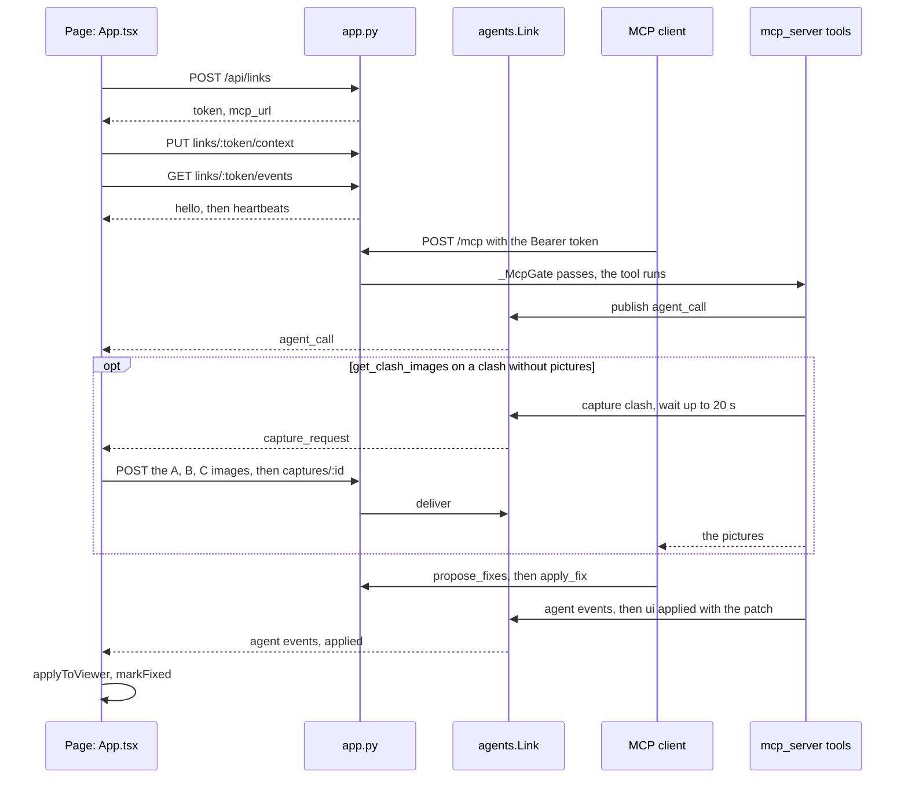

Owned by: [11](11-mcp-and-agent-links.md) (tools, links, jobs), [docs/mcp.md](../mcp.md) (design),
[12](12-web-app.md) (`onAgentEvent`), [16](16-security-caps-and-cost.md) (link and call caps).

## Resume a saved session

As it works, the page saves `{scene_id, report_id, files, fixes, link}` in `localStorage` (`iris.session`). On
arrival it asks `GET /api/scenes/{sid}` (`Workspace.scene_info`: files, STEP names, the last detection, `revision`; 404
once the server no longer holds it, and the saved session is then forgotten), `GET /api/reports/{rid}` and, with a link,
`GET /api/links/{token}` (whose `applied` lists fixes its agent made while no page was open), and shows "Pick up where
you left off". **Resume** (`resumeSession`) calls `open(info.files, existing)`, which skips opening and downloads each
file: `GET .../files/{i}` serves the model as it is now (`Workspace.file` writes an edited one out), so kept fixes come
back. Then `loadReport` (an imported report as it was, else the list of the scene's kept checks the server holds now,
`info.report_id`), the saved and agent-applied fixes, the kept checks and the check the list showed, and the link (its
events stream starts again). **Start fresh** revokes the saved link and forgets the session.

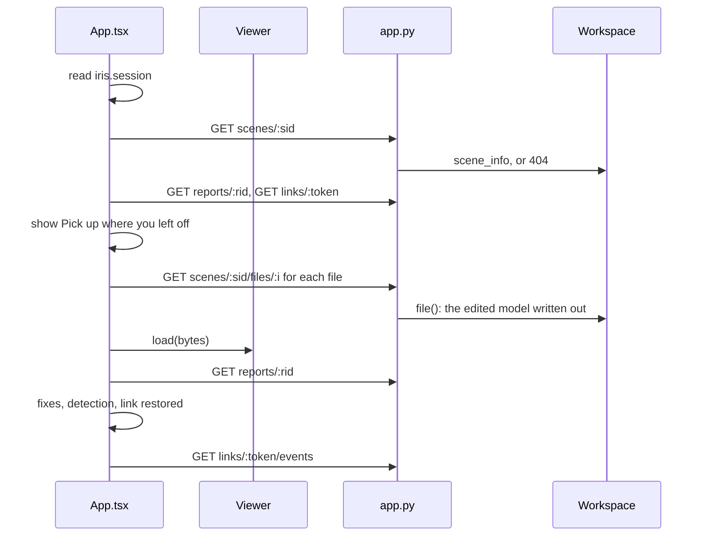

Owned by: [12](12-web-app.md) (the saved session), [05](05-domain-model-and-state.md) (what the server keeps and for
how long), [11](11-mcp-and-agent-links.md) (`Link.applied`).

## Open a saved project

A project ([docs/engineer-workflow.md](../engineer-workflow.md), "Projects") outlives a session: its files are on disk
under `IRIS_PROJECTS_DIR`, one folder per project (`project.json`, `models/` with the original files, `saved/<n>/`,
`reports/`), written atomically under a lock per project. **Save** (`POST /api/projects/{pid}/save` with the scene's
id) writes the scene's models as they are now into `saved/<n>/` (`Workspace.file` for an edited one), then its
`state.json` (the edit log's entries, the decisions, the clashes' ids, numbers and titles), then `project.json`, so a
state is read only once it is whole.

`/projects` lists the projects whose ids this browser keeps (`iris.projects`): `GET /api/projects?ids=…` leaves out
ids the server does not have, and `pruneProjectIds` forgets them. Opening one (`/projects/<pid>/<step>`, then
`openProject`) posts `POST /api/projects/{pid}/open`: 409 when no models are attached or a model file is missing, 400
when the models cannot be read. `projects.open_project` takes the newest saved state of the project's current files
(else the originals in `models/`), copies it into a fresh temporary folder the scene owns (eviction never touches the
project's own files), and opens it as a new scene (`Workspace.open_paths`; a STEP model is converted with the
classifier, as an upload is). Before anything is detected it seeds the scene's clashes (`Workspace.seed_clashes`)
with the ids, `#N` numbers and titles the saved state had, then the reviews' numbers and titles, so a clash found
again keeps them and new ones number on; it puts the saved decisions and earlier entries back in the journal and
records the new `scene_id` on the project. The reply is `{scene_id, project, scene}` (`scene` as
`GET /api/scenes/{sid}` gives it). The page then draws the files as Resume does and runs the check; the decisions come
back with the edit log. A reopened project's undo history starts at the saved state: it is the new baseline. The page
side is [12](12-web-app.md), "Engineer workflow".

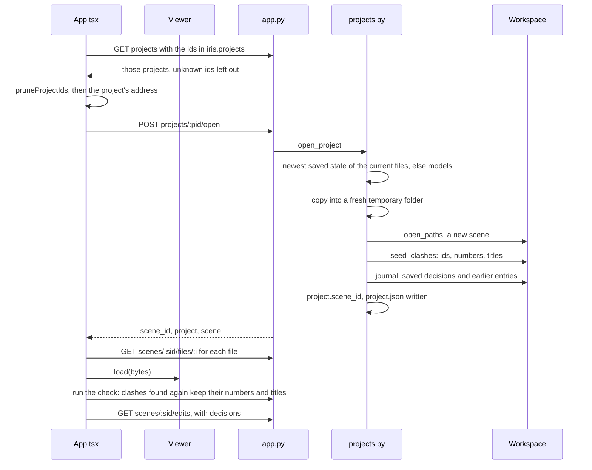

Owned by: [05](05-domain-model-and-state.md) (projects on disk, the journal), [10](10-http-api-and-streams.md) (the
project routes), [12](12-web-app.md) (`projectsApi.ts`, `projectRoute.ts`), [15](15-requirements-settings-and-config.md)
(`IRIS_PROJECTS_DIR`, `IRIS_PROJECTS_MAX`).

## Try the sample drawings

A visitor tries the 2D drawing reader with no PDF of their own and no Gemini spend ([docs/drawings.md](../drawings.md),
"Saved readings"). `GET /api/samples` lists each demo's sample drawings (`demos[].drawings`, from
`samples/drawings/`); when the sample building has some, the first screen shows **Try the sample drawings** beside
**Try the sample building** (`StartScreen`, `onSampleDrawings`). `App.trySampleDrawings` finds this browser's sample
project by name, or makes it (`sampleProject`), goes to its Drawings step (`/projects/<pid>/drawings`), and attaches
the sheets once the sample building's models are open:

- **Its models are the ones open here:** the sheets are attached at once.
- **A project this browser knows, not open:** `openProjectScene(p, attach)` opens it as [Open a saved project](#open-a-saved-project)
  does and attaches the sheets before its clashes are read or checked.
- **A new project:** the sample models are opened (`open`, `POST /api/scenes`), the sheets attached, both kept with
  the project (`keepModels`, `POST /api/projects/{pid}/attach`, which copies the scene's drawings too), then checked
  (`runDetect`).

Attaching is `POST /api/scenes/{scene_id}/drawings/samples` (`app.sample_drawings`). The server takes the demo of the
open files (`demos.drawings_for`), reads its PDFs from `samples/drawings/` and ingests each one the scene does not
hold yet (`drawings.ingest`, by sha256, under a lock), as an upload would, but takes nothing from the upload
allowance. It answers with the scene's sample drawings, each with `saved_reading` (`drawing_reader.saved_info`); 409
when the open models are no demo with sample drawings or the scene has no room. The Drawings step then lists them
(`drawingsTry`). On the step itself, with the sample building open and no drawings, **Add the sample drawings**
(`DrawingsPanel` `onSamples`) calls the same route.

**Read with AI** is the ordinary read (`POST /api/drawings/{drawing_id}/read`). `drawing_reader.read_drawing` finds
each page's saved reading (`saved_reading`: the same PDF by sha256, the prompt as it is now, the same page size) and
replays it: no model call, no budget check, that page's cost 0. The stream says so (`page.saved`, each AI item's
`evidence.saved_reading`, `done.saved`), and the panel shows "Saved AI reading of this sample (…): replayed at no cost,
not read live." Reconciling with the text layer and the comparison with the models run as for any drawing.

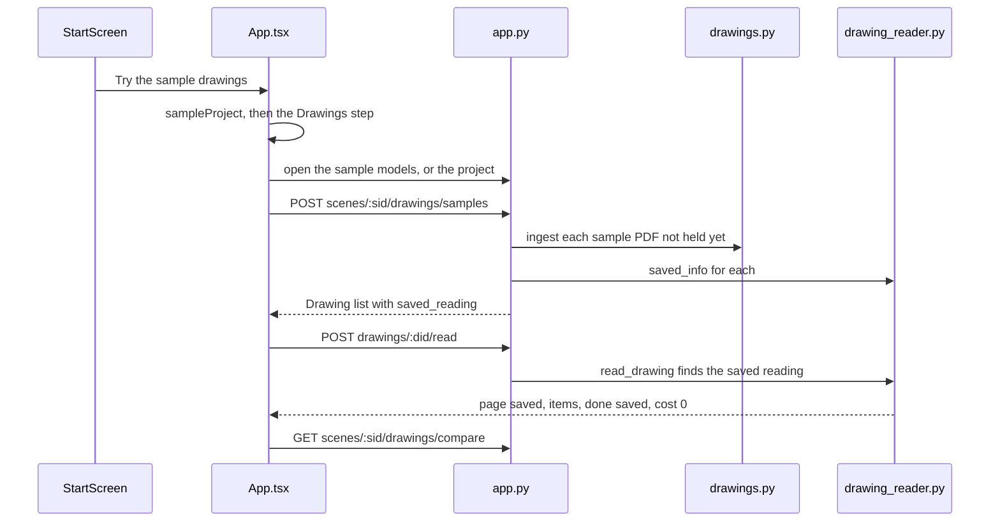

Owned by: [10](10-http-api-and-streams.md) (the samples route, the read stream's fields), [12](12-web-app.md)
(`StartScreen.tsx`, `trySampleDrawings`, `DrawingsPanel.tsx`, `drawingsApi.ts`), [14](14-files-in-and-out.md) (the
sample PDFs and `.reading.json` files), [19](19-demo-data.md) (the sample sheets).

## When the server lets go of the models

A redeploy, a restart, a scale-down after 20 idle minutes (none while the deploy keeps its container warm:
[17](17-deployment-and-operations.md)) or eviction drops
the open scene, its kept edits and the report, while the page still shows them. The page's next call about either
(Show it built, Accept, an element's card, triage…) answers 404 "Model not loaded. Open it again." with
`X-Iris-Gone: scene:<id>`. `api.ts` `send` hands that to App's handler (`setGoneHandler`), which acts only for
the scene or report on screen (a gone report also asks after the scene, so a restart always reads as the models). The
page shows one notice, **The server no longer holds your models**, in place of the
calls' own errors; drops `fixes` and accepted `evidence` (the edits went with the scene); hides Export; and a failed
Show it built offers the reopen instead of Try again. **Open them again** (`reopenGone`) reopens the same sample
models (`open(sceneFiles)`) and then the same clashes: Iris's check on screen run again, or the same sample report.
When only the list of kept checks went (the models are still held), it is made again from them (`GET .../checks`), no
check run. Uploaded models go back to the file picker (**Pick your files again**); an uploaded report is imported again.
Fixes are accepted again from there.

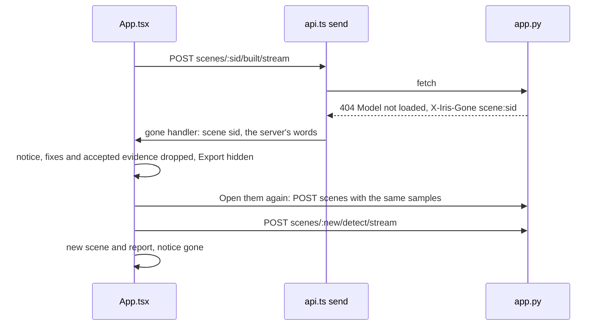

Owned by: [12](12-web-app.md) ("When the server lets go of the models"), [10](10-http-api-and-streams.md) (the
header).

## Upload your own models (big ones too)

**Use your own models** (`ProjectStart.tsx`) or **Models › Upload models** calls `openDemo(files)`. `open()` checks the
files against the server's cap (`uploadRefusal`, `model_upload_max_mb` from `GET /api/models`), and
`api.uploadModelsStream` gzips each file over 1 MB in the browser (`pack`, sent as `<name>.gz`) and sends one form by
XHR, with upload progress. `_receive_models` refuses with 411 or 413 before reading the body, with 400 or 429 once the
form is read, then unpacks each part off the event loop (`_unpack`, counting the unpacked size). A worker runs
`Workspace.open_paths`, streaming STEP conversion events, `opening`, `boxes` and a `tick` every 5 s, then `done`. The
page draws an uploaded IFC from the visitor's own file (`localFile`) and runs the check.

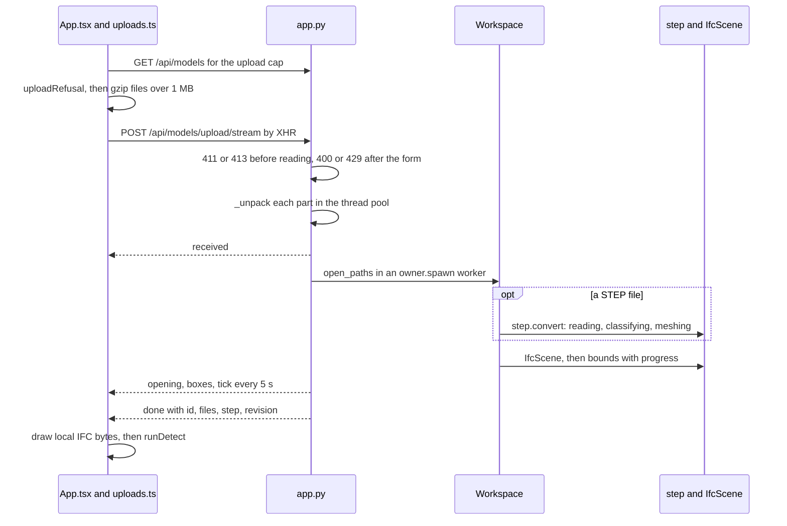

Owned by: [docs/uploads.md](../uploads.md) (design and measurements), [14](14-files-in-and-out.md) (uploads, STEP),
[06](06-geometry-and-detection.md) (boxes), [16](16-security-caps-and-cost.md) (size and upload caps).

## Add a model to the open ones, or take one out

**Add** (Menu › Models › Add to the open models, `App.addModels`): `sceneModels.addRefusal` refuses mixing STEP and
IFC or a name already open before anything is sent, then `api.addModels` (samples) or `api.addModelsStream` (uploads,
the same packing and events as an upload) reaches `Workspace.add_models`, which appends the files and measures only
their boxes. If the reply's `layout` is the next one, the page fetches only the new files (an uploaded IFC from the
visitor's own file), `Viewer.add`s them at the models' origin, adopts the new file list (`adoptFiles`: names, STEP
files, revision, layout, and `infoRev`/`layoutRev` so classes, levels, the filters' index, matches and the check's tests
are read again), then runs every kept check again (`runDetect(null, sid, { all: true })`): new clashes take the next
numbers, readings follow unchanged clashes.

**Remove** (the remove button in Visibility, `App.askRemove` then `removeModel`): the question names what goes (the
list's clashes with that file, `clashesWith`; the log's kept edits in it, `editsIn`). `api.removeModel(sid, index,
name)` reaches `Workspace.remove_model`, which answers the list of what is left; the page `Viewer.remove`s the file,
moves the toolbar's hidden models down (`shiftHidden`), adopts the file list and the list (`adoptRun`), and drops the
pair, selection and stand-ins that pointed into the model.

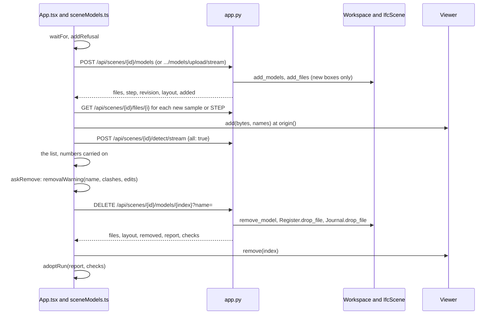

**Another tab or an agent** changed the list: a reply whose `layout` is not the one after this page's (adding,
removing, or any patch through `applyToViewer`) makes the page load every file again from the server
(`reloadModels`: `api.sceneInfo`, `Viewer.load`), as after a restart, and read Iris's list again. A remove by a
position that no longer holds the file answers 409; the page reloads and says so.

Owned by: [docs/add-and-remove-models.md](../add-and-remove-models.md), [12](12-web-app.md) (App),
[13](13-3d-viewer.md) (`Viewer.add`, `remove`), [14](14-files-in-and-out.md) (files in), [05](05-domain-model-and-state.md)
(`layout`).

## Use coordination requirements

**Use them and check again** in the Requirements dialog calls `applyRequirements(doc, true, true)`. An effect registers
the file (`POST /api/requirements`: `requirements.parse`, `register` by its content id `doc_id`, charged only when new)
and `setRequirements` makes `api.ts` send `X-Iris-Requirements` with every call. `_OwnerContext` puts the file in
the request's context (`requirements.enter`), which `owner.spawn` and `owner.submit` carry into workers; then the
pending check runs and `Workspace.detect` compiles its tests from the file (`requirements.compile_tests`). Triage,
proposals (`Workspace.fix_settings`) and plans read it the same way. After a restart the id is unknown: 409
`requirements_unknown`, and `send` registers the file again and retries once.

```mermaid
sequenceDiagram
  participant App as App.tsx and api.ts
  participant MW as _OwnerContext
  participant API as app.py
  participant R as requirements
  participant WS as Workspace
  App->>API: POST /api/requirements with the file
  API->>R: parse, register by doc_id
  API-->>App: id, doc, params, label
  App->>MW: POST scenes/:sid/detect/stream with X-Iris-Requirements
  MW->>R: enter(id)
  MW->>API: the route, with the file in context
  API->>WS: detect: compile_tests from the file
  API-->>App: the report under these requirements
  opt after a restart
    MW-->>App: 409 requirements_unknown
    App->>API: POST /api/requirements again, then the same call
  end
```

Owned by: [15](15-requirements-settings-and-config.md) (requirements), [docs/requirements.md](../requirements.md)
(design), [02](02-system-architecture.md#request-lifecycle) (the middleware).

## When to update this doc

- A user action added, removed or rerouted (a new button that calls a new route, a flow that moves from one route to
  another, a new stream for an existing action).
- A route in one of these flows renamed or its charging changed (which cap, how many, when).
- A new event type that changes what the page does in one of these flows (for example a new agent event the pilot
  plays).
- A change to how accepting a fix reaches the viewer (`_with_patch`, `Workspace.patch`, `applyToViewer`).
- A change to which model a flow calls, or to the endpoint it uses.
- A change to how the page and an MCP agent share a session (link events, captures, `applied`).
- A change to how a decision is recorded (the keep routes' review fields, `POST /api/scenes/{sid}/decisions`,
  `toDecision`), or to what opening or saving a project does (`projects.open_project`, `projects.save`).
