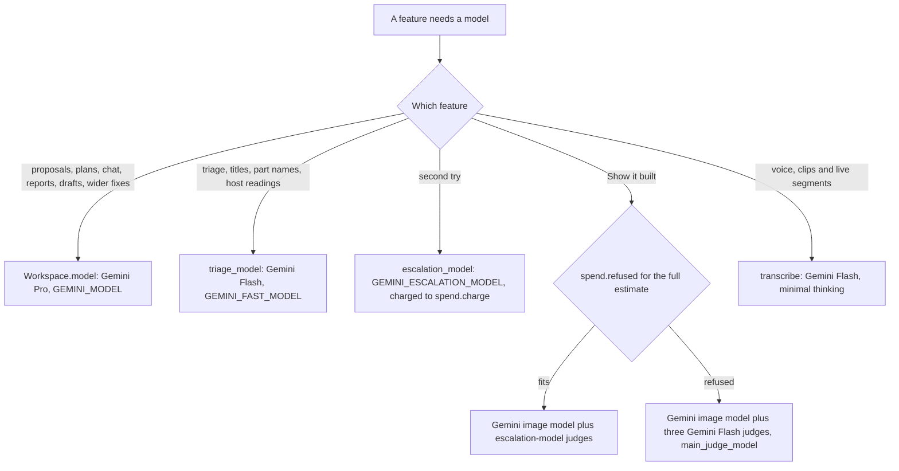
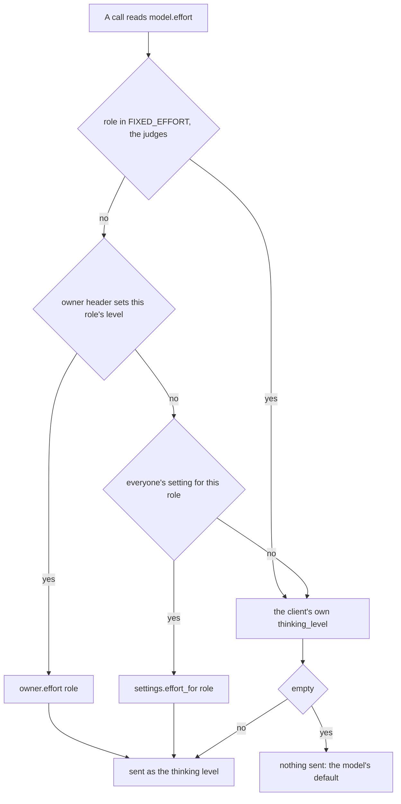
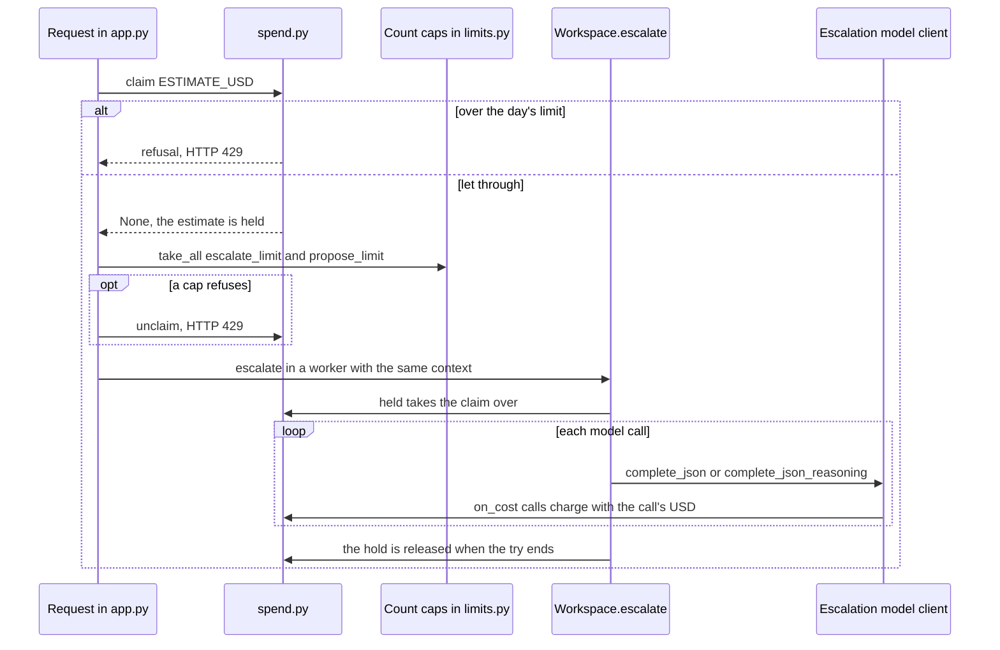

# 08 · AI models, prompts and spend

> **Covers:** `server/iris/model_client.py`, `server/iris/spend.py`, the model parts of `settings.py`,
> `owner.py`, `built.py`, `voice_live.py`, `hosts.py`, `step.py` and `drawing_reader.py`, and every prompt in
> `server/iris/domain_packs/` and `domains.py` · **Checked against code:** re-branded on 2026-11-11; the drawing
> reader's spend and saved readings checked 2026-11-22; the prepared-fixes row: review queue 2026-11-22 ·
> **Deeper design:** [docs/escalation.md](../escalation.md), [docs/show-it-built.md](../show-it-built.md),
> [docs/voice.md](../voice.md)

Iris uses one provider, Gemini on Vertex AI, in four roles: the main model (Gemini Pro) understands clashes and
proposes, plans and chats; the fast model (Gemini Flash) always does the bulk, cheap work (triage, titles, STEP part
names, host readings, voice transcription, and Show it built's lighter judges); an escalation model makes second
tries and judges pictures; and the Gemini image model draws the "Show it built" picture. This doc
is the plumbing under the AI workflows: which feature calls which role, how one client class (`GeminiModel`) makes
every text call, how the thinking level is chosen per request, what every prompt asks for, and how per-token spend
is held to a daily budget. What each workflow does with the replies is in [09 · Agent workflows](09-agent-workflows.md).

## The model roles

| Role | Env var | Used for | Thinking level (env, default) | Charged to the day's budget |
|---|---|---|---|---|
| Main model (Gemini Pro) | `GEMINI_MODEL` | Understanding a clash, proposals, plans, root causes, patterns, chat, wider fixes, requirements drafts, report text | `GEMINI_THINKING_LEVEL`, `low` | No: held by count caps ([16](16-security-caps-and-cost.md)) |
| Fast model (Gemini Flash), always | `GEMINI_FAST_MODEL` | Bulk triage, rule audits, clash titles, STEP part names, host readings, voice transcription (clips and live segments), Show it built's lighter judges | `GEMINI_FAST_THINKING_LEVEL`, empty (the model's default); voice is fixed at `minimal`, the lighter judges at `low` | Only the lighter judges, against `IRIS_ESCALATION_MAX_USD_DAY`; the rest is held by count caps |
| Escalation model | `GEMINI_ESCALATION_MODEL` | Second tries (escalation) and Show it built's full-check judges | `GEMINI_ESCALATION_THINKING_LEVEL`, `high`; the judges fixed at `medium` | Yes, against `IRIS_ESCALATION_MAX_USD_DAY` |
| Gemini image model | `GEMINI_IMAGE_MODEL` | Show it built: the restyled picture of a fix | none | Yes, `IRIS_IMAGE_USD` a picture, against the same daily cap |

`GEMINI_INCLUDE_THOUGHTS` (default `1`; `0` turns thought summaries off) applies to every streamed call. There is
no switch that moves triage, titles or part names off the fast model. Default model ids live in
`model_client.DEFAULT_MODELS` (and `.env.example`); every id can be changed by its env var
([15](15-requirements-settings-and-config.md)). How a level is picked per request is in
[How the thinking level is chosen](#how-the-thinking-level-is-chosen).

### Auth

- **Vertex AI with Application Default Credentials** is the normal path: the client reads `GOOGLE_CLOUD_PROJECT`
  and `GOOGLE_CLOUD_LOCATION`, and the credentials come from the environment (the Cloud Run service account when
  deployed, `gcloud auth application-default login` locally). The endpoint follows from project and location; there
  is no base URL to set.
- **`GEMINI_API_KEY`** is optional, for running against the Gemini API with a key instead of Vertex AI.
- Nothing about credentials reaches the browser. What the page learns is a boolean: whether second tries are
  available (`escalation_info.available`). Deployment and secrets: [17](17-deployment-and-operations.md).

`model_client.model_label` turns an id into the name people read, by prefix (`LABELS`, with `IRIS_MODEL_LABELS` over
them): every option, attempt and stream event of a proposal carries it, and the page shows it as a chip.

## Which feature uses which model

Every AI feature, the role it calls by default, and what changes it. "Thinking" is the thinking level sent with the
call. Env var meanings are in [15](15-requirements-settings-and-config.md); caps and budgets in
[16](16-security-caps-and-cost.md).

| Feature | Code | Role (default) | Changed by | Thinking (client role) | Reply shape |
|---|---|---|---|---|---|
| Proposals (one clash) | `agent.resolve` via `Workspace.propose` | Gemini Pro | `GEMINI_MODEL` | `default`, `GEMINI_THINKING_LEVEL` | JSON, no schema; thoughts streamed when someone watches and `GEMINI_INCLUDE_THOUGHTS` allows |
| Fix together, root-cause fixes | `plans._resolve_items` → `agent.resolve` | Gemini Pro | as above | `default` | JSON, not streamed (plans run without `trials`) |
| Prepared fixes (the review queue) | `prepare.run` → `plans._resolve_items` → `agent.resolve` | Gemini Pro for the pairs prepared live; none for pairs a saved set replays (`prepare.ReplayModel` answers with recorded replies) | as above; a saved set is used only while its key names the configured proposal model and thinking level | `default` | JSON, not streamed; no host reading in saved runs ([09](09-agent-workflows.md), [docs/review-queue.md](../review-queue.md)) |
| Root cause reading | `plans.build_root_cause` | Gemini Pro | as above | `default` | JSON, no schema |
| Pattern verdicts | `plans.triage_patterns` | Gemini Pro | as above | `default` | JSON, no schema |
| Bulk triage | `triage.triage_report` in `triage.Job` (`IRIS_TRIAGE_WORKERS` calls at a time) | Gemini Flash (fast model), always | `GEMINI_FAST_MODEL` | `triage`, `GEMINI_FAST_THINKING_LEVEL` | Strict `triage.SCHEMA`, streamed with thoughts; images always sent |
| Audit of by-design rules | `triage.audit_rules` | the fast model | as triage | `triage` | Strict `triage.AUDIT_SCHEMA` |
| Clash titles | `titles.title_batch` | the fast model | as triage | `triage` | Strict `titles.SCHEMA`, text only |
| STEP part names | `step.classify` (model from `app._classifier`) | the fast model | as triage | `triage` | Strict schema with the `step.CLASSES` enum, text only |
| Host readings for openings | `hosts.read` via `Workspace.hosts_model` | the fast model, 60 s timeout | as triage | `triage` | Strict `hosts.SCHEMA`, text only |
| Requirements draft | `requirements.suggest` | Gemini Pro | as proposals | `default` | Strict `requirements.SUGGEST_SCHEMA` |
| Chat | `chat.Chat.turn` | Gemini Pro | as proposals | `default` | Tool calling (`chat.TOOLS`) |
| Wider fix (context arrangements) | `context_planner.build` | Gemini Pro | as proposals | `default` | Tool calling (`context_planner.TOOLS`) |
| Report pages and summary | `document.explain`, `document.summarise` | Gemini Pro | as proposals | `default` | Strict `EXPLAIN_SCHEMA`, `SUMMARY_SCHEMA` |
| Second try (escalation) | `Workspace.escalate` → `agent.resolve` | Escalation model, a fresh client per try | `GEMINI_ESCALATION_MODEL`, setting `escalation` (`IRIS_ESCALATION`, default `button`) | `escalation`, `GEMINI_ESCALATION_THINKING_LEVEL` | JSON; thoughts streamed when watched; every call charged |
| Show it built: restyle | `built.restyle` | Gemini image model | `GEMINI_IMAGE_MODEL`, setting `built_views` (`IRIS_BUILT_VIEWS`, default off) | none | A PNG |
| Show it built: judges | `built.judge` with `built.judge_model` (`JUDGES`, 2) | Escalation model | as above | `judge`, fixed at `medium` | Strict `built.JUDGE` |
| Show it built: lighter judges | `built.judge` with `built.main_judge_model` (`MAIN_JUDGES`, 3) | Gemini Flash (fast model) | used when the day's budget cannot cover the escalation judges | `judge`, fixed at `low` | Strict `built.JUDGE` |
| Voice clip | `model_client.transcribe` (`POST /api/transcribe`) | Gemini Flash (fast model) | `GEMINI_FAST_MODEL` | fixed at `minimal` | `{transcript, duration_ms}` |
| Drawing reader (2D sheets) | `drawing_reader.read_drawing` with `GeminiReader` (its own request: "Image k:" labels, `media_resolution` HIGH, no temperature; not `GeminiModel.complete_json`) | Gemini Flash (fast model) | `GEMINI_FAST_MODEL` | fixed at `high` (`drawing_reader.THINKING`) | Strict `drawing_reader.schema(n)`; a page's reply cached on disk; each call charged to `IRIS_ESCALATION_MAX_USD_DAY` as it lands, a read refused (`ReadRefused`) when the day cannot cover its estimate; a sample sheet's saved reading (`saved_reading`) is replayed instead, with no call, no charge and no budget check; those were made by `evals/save_drawing_readings.py` at thinking `low` with an output cap, as each file's `settings` say, since `high` did not finish the A1 sample sheet within the deadline ([docs/drawings.md](../drawings.md), [19](19-demo-data.md)) |
| Live voice | `voice_live.relay` (`/api/voice/live`): segments transcribed with `model_client.transcribe` | Gemini Flash (fast model) | `GEMINI_FAST_MODEL`, `IRIS_VOICE_VAD_RMS`, `IRIS_VOICE_SILENCE_MS` | fixed at `minimal` | One `final` per segment (hold: one for the whole clip); no partial words |

`Workspace.model` is one Gemini Pro client for the whole process, built lazily in `service.Workspace.model`; the
chat and the MCP server's tools use the same one. The fast-model client is built per job
(`model_client.triage_model`, called by `app._start_triage`, `app.titles_stream`, `app._classifier` and
`Workspace.hosts_model`), so a change to the fast model's thinking level applies to the next run.

### Which model

`model_client.triage_model_info` names the fast model without building a client and returns
`{model, label, images}` (`images` is always true); `model_client.labels()` names every role (proposal,
escalation, triage, image, voice). `GET /api/models` sends it to the page with `escalation_info()` and
`settings.built_views()`, so the copy on the Triage card, the tour and the landing names the model that will
actually run ([12](12-web-app.md)).

## `model_client.py`: the client

### Configuration and `.env`

- `model_client.load_env()` reads `KEY=value` lines from the repo's `.env` (`ENV_FILE`, two folders above the
  package) into `os.environ` with `setdefault`, so real environment variables win. The package's `__init__.py` calls
  it, so it runs on the first import of any `iris` module, before any setting is read
  ([15](15-requirements-settings-and-config.md)). The factories, `built.restyle`, the judge factories and
  `voice_live` call it again before reading a setting (harmless: a value already set is kept).
- Credentials are resolved when a client is built (Vertex AI ADC, or `GEMINI_API_KEY`). A client that cannot be
  built is turned into "no model" by `Workspace.hosts_model` and `app._classifier`.

### `GeminiModel`

One instance per model. Its fields:

| Field | Meaning |
|---|---|
| `model` | Model id (default from `GEMINI_MODEL`) |
| `thinking_level` | This client's own thinking level: the constructor's, else `GEMINI_THINKING_LEVEL` (`""` means the model's default) |
| `role` | `"default"`, `"triage"`, `"escalation"` or `"judge"`: which owner and everyone settings apply (below) |
| `usage` | A `Usage` counter: calls, input, output and thinking tokens |
| `on_cost` | Called with each priced call's cost in USD (`spend.charge` on escalation and judge clients) |
| `streams_reasoning` | Whether thought summaries are streamed (`GEMINI_INCLUDE_THOUGHTS`, default `1`) |

The ways it calls a model:

| Method | Streams | What it gives back | Falls back to | Used by |
|---|---|---|---|---|
| `complete_json(system, text, images, schema)` | No | One JSON reply (held to `schema` when one is given), fence stripped, `json.loads` | none | Everything that wants one JSON reply |
| `complete_json_streamed(..., on_reasoning)` | Yes | Thoughts to `on_reasoning`, the JSON collected | as `complete_json_reasoning` | Triage (`triage.triage_one` when the Job asks for reasoning) |
| `complete_json_reasoning(..., on_reasoning)` | Yes | Thought summaries to `on_reasoning`, the JSON collected, usage at the end (billed however the stream ended) | `complete_json` when thoughts are off or the stream sent no JSON | `agent.resolve` and `agent._recommend` when `trials` and someone watches |
| `chat(messages, tools, timeout_s=)` | No | The assistant turn (text and/or function calls) | none | `chat.Chat.turn`, `context_planner.build` |

Every text call sends temperature 0.2 and a thinking level only when one is set. Images go inline with the
request. A proposal passes `schema=None`, so proposals always run in plain JSON mode: the prompt's example is the
contract, and the agent reads fields defensively (`reply.get("candidates", [])`).

No fallback is sticky: each call decides afresh. `server/tests/test_model_client.py` and
`server/tests/test_triage.py` pin the client's behaviour.

### Timeouts and retries

The client itself never retries; each caller decides.

| Client or call | Timeout | On failure |
|---|---|---|
| `Workspace.model` (`GeminiModel()`) | 120 s per request | Proposals stream `error`; plan items record the error; chat streams `error` |
| `triage_model()` | 120 s | Triage: 3 attempts per clash with 1, 2, 4 s back-off (`triage_report`), then `verdict: "unknown"` with `error`; titles: the batch is skipped (`batch_error`) |
| Host readings (`service.HOSTS_TIMEOUT_S`) | 60 s | The defaults stand (walls and slabs only) and the agent emits a `note` |
| `escalation_model()` | 240 s | The first try's result stands, with a `note` (automatic mode) or the stream's `error` |
| `built.judge_model` / `main_judge_model` | 240 s (`IRIS_JUDGE_TIMEOUT_S`) | A failed judge counts as unfaithful (`built.judge`) |
| `built.restyle` | 300 s | That picture fails the gate; the other may pass |
| `transcribe` | 60 s (`IRIS_VOICE_TIMEOUT_S`) | `POST /api/transcribe` answers 502; live voice sends one `error` |
| `context_planner.build` | what is left of `Limits.seconds` (120 s) per `chat` call | The search stops and keeps the arrangements already verified |
| Live voice (`voice_live.relay`) | 10 s for the first frame, `END_WAIT_S` (90 s) for the last segments | An `error` frame naming only the error type (`voice_live._failed`), said once |

### How the thinking level is chosen

`GeminiModel.effort` is read on every call, so the same client gives each request the thinking level its context
asks for. The owner's settings ride in the `X-Iris-Settings` header, which `app._OwnerContext` reads only for a
request with a valid owner cookie and puts into context variables (`owner.enter`); `owner.spawn` and `owner.submit`
copy them into stream workers and thread pools. Everyone's settings live in `settings.py`.

| Role | Owner header key | Everyone setting | Client default |
|---|---|---|---|
| `default` (Gemini Pro: proposals, plans, chat, reports, drafts) | `effort` | `effort` | `GEMINI_THINKING_LEVEL` |
| `triage` (the fast model: triage, titles, part names, host readings) | `triage_effort` | `triage_effort` | `GEMINI_FAST_THINKING_LEVEL` (empty: the model's default) |
| `escalation` (second tries) | `escalation_effort` | `escalation_effort` | `GEMINI_ESCALATION_THINKING_LEVEL` (`high`) |
| `judge` (Show it built) | ignored | ignored | fixed (`model_client.FIXED_EFFORT`): `medium` for the escalation judges, `low` for the fast-model lighter judges |
| Voice (`transcribe`, not a `GeminiModel`) | ignored | ignored | fixed at `minimal` |

The `default` role's client default is `GEMINI_THINKING_LEVEL` (`low`). `settings.defaults()` gives the same three
env defaults when nobody has set a level (`model_client.DEFAULT_THINKING`).

Allowed values are `settings.EFFORTS`. The judges keep a fixed level so their verdicts stay comparable from run to
run ([docs/show-it-built.md](../show-it-built.md)). Latency per level is not yet measured on Gemini.

### Factories

- `triage_model(timeout_s=120)` → `(GeminiModel, info)`: always the fast model (`GEMINI_FAST_MODEL`) at
  `GEMINI_FAST_THINKING_LEVEL`, `role = "triage"`.
- `triage_model_info()`: `{model, label, images}` without building a client; `images` is always true.
- `escalation_info()` → `{model, label, mode, available}`: `mode` is `settings.escalation()` (`off`, `button`,
  `auto`); `available` is whether credentials are configured.
- `escalation_model(timeout_s=240)`: a new escalation client each time, `role = "escalation"`,
  `on_cost = spend.charge`. A fresh client per try means its `usage` is that try's alone.
- `built.judge_model()` / `built.main_judge_model()`: the escalation model at `medium` or the fast model at `low`,
  both `role = "judge"` and both charged (`on_cost = spend.charge`). Their names for the page:
  `built.judge_label()` / `built.main_judge_label()`.

### Usage and prices

- `Usage.of(raw)` reads a call's usage metadata (input, output and thinking tokens). `Usage.add` is thread-safe;
  `snapshot` and `as_dict(model_id, since)` give one run's share on a client other runs use.
- `cost(model_id, tokens_in, tokens_out)` prices by id prefix from `PRICES`, with `IRIS_MODEL_PRICES` over them
  (thinking counts as output). Every default model has a price, but only clients with `on_cost` set (second tries
  and both kinds of judge) charge the day's budget; the main and fast models' other calls are held by count caps.
  `GeminiModel._count` adds each call's usage and, when it costs anything, calls `on_cost`.
- `agent.resolve` reports `Result.usage` only for a priced model (`cost(model, 1, 1) > 0`).

### The image model

`built.restyle(look, lines, extra)` sends one request to `GEMINI_IMAGE_MODEL`: `built.PROMPT` (+ `extra` on a
retry) and two input images (Iris's view and its outline), asking for a PNG back. It takes the first image in the
reply, charges `built.IMAGE_USD` (`IRIS_IMAGE_USD`, default 0.04) to `spend.charge`, and raises when none comes
back. How the picture is checked is
in [09](09-agent-workflows.md#show-it-built).

### Voice

- **A clip** (`model_client.transcribe(wav, keywords)`): the WAV goes to the fast model (`model_id("voice")`,
  `GEMINI_FAST_MODEL`) at `minimal` thinking and temperature 0, with `TRANSCRIBE_PROMPT` and the keywords. `app.transcribe_voice` checks the WAV first (mono, 16-bit, 16 or 24 kHz, at most
  `MAX_VOICE_BYTES`), takes one voice cap, and runs it in a thread.
- **Live** (`voice_live.relay`): no model session is opened; Iris buffers the 16 kHz PCM and transcribes whole
  segments with `transcribe` on the fast model, so credentials never reach the browser. Hold to talk transcribes the
  whole clip once, on `end`. Hands-free runs `voice_live.Segmenter`: a frame whose RMS reaches `IRIS_VOICE_VAD_RMS`
  (500) starts speech (with 0.3 s of pre-roll), `IRIS_VOICE_SILENCE_MS` (700) of quiet ends the segment, and a
  segment with under 0.2 s of loud audio is dropped. Each segment is transcribed as soon as silence ends it, in order,
  while the mic stays open: there are no partial words mid-speech (`partial` is never sent). Modes are
  `voice_live.MODES`. The browser-side protocol (`ready`, `final`, `speech`, `limit`, `error`) is in
  [10](10-http-api-and-streams.md); the design in [docs/voice.md](../voice.md).
- **Keywords** (`app._voice_words`): `app.VOICE_WORDS` plus up to 40 element names and clash titles from the open
  report, shortest first, so recognition leans to "supply air duct" rather than "supply adequate".

## Prompts

The prompts are model-independent. Every prompt file lives in `server/iris/domain_packs/` and is read from disk on
each call (the chat's on each turn), so a prompt edit takes effect without a restart. A system prompt is usually a
pack plus lines added at run time: the coordination requirements' `requirements.prompt_text(doc, "triage" | "fixes")`
(which says only what differs from Iris's defaults; see [15](15-requirements-settings-and-config.md)), the second
try's pack, or the recommend-only text.

### How the domain is chosen

Iris has two demos, a building (Northbank, IFC) and a machine cell (the palletising cell, opened from STEP), and the
prompts follow the work. `domains.of(ws, scene_id)` is the one place that decides: the scene's effective requirements
say (`Doc.domain`: the user's file, else a demo's own, `Workspace.requirements_for`); else a scene whose every model
was opened from STEP (`Workspace.sources` has an entry for each of its files) is `machines`; IFC, a mix of IFC and
STEP or no scene is `construction` (`domains.infer`). Callers never test for STEP themselves.

- **The fix pack.** `agent.resolve(..., pack=)` reads `domain_packs/<pack>.md` whole. `Workspace.propose`,
  `Workspace.escalate` and `plans._resolve_items` (Fix together, root-cause partners, the review queue's prepared fixes) pass `pack=domains.of(...)`, so the
  cell gets `machines.md` and Northbank `construction.md`. The two packs share the seven fix kinds and the JSON contract
  (parsing is unchanged; `server/tests/test_domains.py` pins the kinds and the JSON keys); the opening, the rules of
  thumb and the examples differ. No example in either pack, nor in `escalation.md`, is a demo's answer (Northbank
  Rev04's +400 mm duct, the cell's C6 route): the numbers are neutral.
- **The shared prompts.** `chat.md`, `triage.md`, `report.md`, `report_summary.md`, `patterns.md` and `root_cause.md`
  say who Iris is through one `{role}` placeholder, filled by `domains.prompt(name, domain)` from `domains.ROLES`:
  "a senior BIM coordinator" for construction, "a senior mechanical integration engineer on a machine and automation
  cell" for machines. The domain reaches them from the scene: the chat per turn (`Context.scene_id`), triage through
  `app._start_triage` (`triage.Job(domain=)`), reports through `app._build_document` (`document.generate(domain=)`),
  patterns and root causes through their scene id. A triage run started before any scene was open (a Navisworks
  report alone) reads as construction, and the run is shared per report, not per domain.
- `titles.md` names the meeting the titles are read out in (`{meeting}`: "a BIM coordination meeting", "a machine
  cell design review"; `titles.Job(domain=)`, from the `?scene_id=` the page sends), and `triage.AUDIT` takes the
  role (`domains.fill`). `domains.fill` also fills `{teams}`: `triage.md` and `report.md` name the report's teams, and
  an empty list drops the " ({teams})" clause. No team names are fixed in any prompt or schema (below).
- `escalation.md` and `context.md` go through `domains.prompt` too (`{role}` in `context.md`). Neither names a model
  or a property set; "fixed in place" stands where "structure" was a rule. `report.md` says the `{clearance}` the
  requirements set (at least 25 mm without them). `titles.md` shows each domain's own `{examples}`
  (`domains.EXAMPLES`); triage's tolerance is the clash test's own (each clash's text gives it), and no prompt says
  "2.5 m" (the context radius shrinks for small models).
- Written for any industry already: `penetrations.md`, `requirements.md`, `step_classes.md`.
- **Names and prices** come from `model_client.LABELS` / `PRICES`, with `IRIS_MODEL_LABELS` / `IRIS_MODEL_PRICES`
  over them; `GET /api/models` sends each role's name (`model_client.labels`) and the page's words use it
  (`web/src/aiNames.ts`). Whether thoughts are streamed is `GEMINI_INCLUDE_THOUGHTS`.

### The prompt inventory

| Prompt | Loaded by | Model | Asks for | Output | Notable rules |
|---|---|---|---|---|---|
| `domain_packs/construction.md` | `agent.resolve` (`pack="construction"`, for a scene that is not wholly from STEP: `domains.of`), as the system prompt with `guidance` appended | Gemini Pro; the escalation model on a second try | An understanding, up to 5 candidate fixes best first, and advice for the reviewer | JSON object (not schema-held): `{understanding, candidates: [{title, kind, move: "A" or "B", delta_m, or split_m and dz_m, or steps, or split_m and depth_m and keep, rationale, also_needs}], advice}` | Six kinds (move, offset, route, resize, trim, penetration) with when to use each. Structure stays and services move; drainage never rises; smallest move with margin; resize only when moves, offsets and routes fail; never trim structure, a post or guarding to let a service pass; a penetration's `move` names the service; severity from numbers, not pixels; A red, B green, images A/B/C |
| `domain_packs/machines.md` | `agent.resolve` (`pack="machines"`, for a scene opened from STEP: `domains.of`), as the system prompt with `guidance` appended | Gemini Pro; the escalation model on a second try | The same as `construction.md` | The same JSON object as `construction.md` (its fix kinds and output contract are copied word for word) | Persona: a senior mechanical integration engineer coordinating a machine and automation cell (frames, guarding and fencing, conveyors and pallet stations, robot bases, cable chains, pneumatics). Iris checks static geometry only: never claim robot reach or motion is clear. Plant structure, anchored frames and robot bases stay; trays, air lines and conduits move; guarding and safety zones stay intact; keep maintenance access and removal room; conveyors keep line and height; keep a cable chain's envelope clear |
| `domain_packs/escalation.md` | `Workspace._escalate` appends it to the fix guidance (`domains.prompt("escalation", domain)`) | The escalation model | A second, longer try that beats the first | Adds the `combined` kind: `{kind: "combined", steps: [{kind: move, offset or route, move: "A", "B" or a GlobalId, ...}]}` | Never repeat an idea that failed; beat the first try's fixes (a plain fix over a resize or an opening, more clearance, a smaller change); look past the two elements; structure and anything marked "stays" never moves; only services move to make room; one step must change A or B; prefer one element |
| `domain_packs/triage.md` | `triage.triage_one` (`domains.prompt`, `{role}`, `{teams}`: the teams guessed for the report's models, `app._report_teams`), plus `prompt_text(doc, "triage")` | the fast model | One verdict for one clash (or for a group of alike clashes) | Strict `triage.SCHEMA`: `understanding`, `verdict` (`real_clash`, `by_design`, `non_physical`, `modelling_error`), `severity`, `responsible` (one of those teams or none: `triage.schema_for`; free text when none is known), `action`, `fix_hint`, `confidence` | Most raw results are noise; the test name can be wrong, trust classes and names; 0 mm or within the tolerance is a touch; severity from numbers |
| `domain_packs/titles.md` | `titles.title_batch` (`domains.prompt`, `{meeting}`, `{examples}`) | the fast model | A title per clash line, up to 40 lines per call | Strict `titles.SCHEMA`: `{titles: [{number, title}]}` | At most 12 words, sentence case; never an IFC class, a GlobalId or "Clash"; how they meet from the depth (touches at 5 mm or less, clips, runs into, sits inside, is n mm from); "modelled twice" only in a duplicates test; the element that would change first; describe, don't judge |
| `domain_packs/patterns.md` | `plans.triage_patterns` (`domains.prompt`, `{role}`), plus `prompt_text(doc, "triage")` | Gemini Pro | A verdict per pattern (P1, P2, ...) | JSON mode: `{patterns: [{id, verdict, cause, action, rule}]}`; an unknown verdict becomes `real_problem` | `by_design` (a clash rule hides it), `modelling_error` (fix once at the source), `real_problem`; a constant overlap usually means a convention or a systematic error |
| `domain_packs/root_cause.md` | `plans.build_root_cause` (`domains.prompt`, `{role}`), plus `prompt_text(doc, "fixes")` | Gemini Pro | The cause behind one element's clashes and a strategy | JSON mode: `{root_cause, strategy, reason}`; a strategy outside the three becomes `fix_partners` | `move_hub` only for elements that can move; `fix_partners` keeps the hub (a transfer girder) and changes what crosses it; `as_designed` edits nothing; say the cause in design terms; cover clashes the geometry found that the report missed |
| `domain_packs/chat.md` | `chat.Chat.session`, and set again at each `Chat.turn` in the voice of the turn's scene (`domains.prompt`, `{role}`) | Gemini Pro | Short, plain answers using tools | Tool calls from `chat.TOOLS` (26 functions), then text | Each user message starts with a `[context]` line; call a clash "#39 title"; numbers only from tools, saying whose measure; propose_fixes, find_root_causes, find_patterns, check_* and detect_clashes each for its job; show what you talk about (show_clash); kinds of element by class, level, model or property with set_filters (until clear_filters); detect_clashes with a and b for a check of some elements (a user's filter by name from [context], or described); you cannot accept a fix; explore_wider_fix costs three proposals |
| `domain_packs/context.md` | `context_planner.build` (`domains.prompt("context", domain)`, `{role}`) | Gemini Pro | Complete arrangements of up to three edit groups for one clash | Tool calls from `context_planner.TOOLS` (`inspect_element`, `inspect_neighbourhood`, `evaluate_proposal`) | Only discovered GlobalIds; at most 3 edit groups, 6 model calls, 12 trials, 120 s, 3 alternatives; `Pset_IrisConstraints.KeepFixed` forbids edits; offsets split along the run, vertical or lateral; never claim engineering adequacy; an empty search is "inconclusive", never "no solution" |
| `domain_packs/penetrations.md` | `hosts.read` | the fast model | A reading per kind of host a service would pass through | Strict `hosts.SCHEMA`: `{readings: [{kind, verdict, reviewer, fit, limits: {max_depth_ratio, keep_from_ends_depths, keep_from_edges_m, zone}, conditions, reasoning}]}` | Verdicts `allowed`, `with_review`, `not_advised`, `never`, each with examples (a transfer beam or column never); one reviewer; `annular` or `fitted`; limits null when they do not apply; thin facts lean to `with_review` |
| `domain_packs/requirements.md` | `requirements.suggest` | Gemini Pro | A draft of the project's coordination requirements from an inventory of the models | Strict `requirements.SUGGEST_SCHEMA`: `{summary, groups, checks, who_moves, by_design, guidance: {triage, fixes}}` | Any industry, the models' own words; only teams and classes that appear in the files; 2 to 8 groups; one check per pair and per group against itself; at L5 every group is `none`; by-design pairs few and certain |
| `domain_packs/step_classes.md` | `step.classify` | the fast model | An IFC class and type for each STEP part, 200 parts per call | Strict schema: `{parts: [{i, class, type}]}`, `class` limited to `step.CLASSES` | From the name and groups only, never invented; a name that says nothing becomes a proxy with its group's name; conduits are `CONDUITSEGMENT` |
| `domain_packs/report.md` | `document.explain` (`domains.prompt`, `{role}`, `{teams}`: the team names the user typed, `{clearance}`), up to 3 images per page | Gemini Pro | The text of one clash's report page | Strict `document.EXPLAIN_SCHEMA`: `{explanation, recommended_action, review_points: [{team, point}]}` | A draft every named team reviews; a verified fix means "clash gone, 25 mm clear, nothing new hit" and no more (structural approval, cost and access are for the teams) |
| `domain_packs/report_summary.md` | `document.summarise` (`domains.prompt`, `{role}`) | Gemini Pro | The report's opening summary and actions per team | Strict `document.SUMMARY_SCHEMA`: `{summary, team_actions: [{team, actions}]}` | Three to five sentences; numbers, no marketing, no restating every clash |
| `domain_packs/drawing_reader.md` | `drawing_reader.GeminiReader` via `read_drawing` (system prompt; the per-page line `PAGE_TEXT` / `TILE_TEXT` goes after the images, each image after an "Image k:" label) | the fast model, thinking fixed at `high`, `media_resolution` HIGH, no temperature | Every label that names or sizes a building services item on one sheet, and the title block | Strict `drawing_reader.schema(n)`: `{items: [{image, tag, kind, size, box_2d}], title: {sheet, scale, title}}`; `kind` one of `drawing_reader.KINDS`; `box_2d` is Gemini's own [ymin, xmin, ymax, xmax], 0-1000 on image k | Read only what is printed; never guess a hidden or unreadable value (null); copy tags and sizes exactly; one entry per label; prefer the quarter where it reads clearly; room names, dimensions, levels, grids, notes and the title block are not items. The text layer is never sent: it is the check (`drawing_reader.reconcile`). Part of the cache key (`drawing_reader.prompt_hash`) |

### Prompts written in code

| Prompt | Where | Used for |
|---|---|---|
| `triage.AUDIT` with `triage.AUDIT_SCHEMA` (`{answer: consistent, looks_real or unsure, note}`) | `triage.audit_rules`, plus `prompt_text(doc, "triage", rules=False)` | Checking a by-design rule against the deepest clashes it set aside |
| `requirements.RECOMMEND` | appended by `agent.resolve` when nothing may be edited | Asks for recommendations for the designer: nothing will be tried or applied |
| `requirements.prompt_text(doc, role)` | appended to triage, patterns, root cause and fix prompts | The project's level, strictness, clearances, who moves, limits, openings rules and the team's guidance, only where they differ from the defaults |
| `built.PROMPT` (`PROMPT_VERSION`, part of the picture cache key) | `built.restyle` | Restyle Iris's view without adding, removing, moving or resizing anything; keep every outline line |
| `built.JUDGE_SYSTEM` with `built.JUDGE` (`{model_view_objects, differences: [{kind, what, where, size}], verdict}`) | `built.judge` | Compare the restyle with the model view region by region; image 3 (the ids picture) only to read image 1 |

Changing a prompt's version-free text changes behaviour silently: run the eval that covers it
([18](18-testing-and-evals.md)). The triage prompt (construction's voice, `domains.prompt("triage")`) and schema are
shared with `evals/navisworks_triage.py`, so its scores describe the app. Eval scores are not yet measured on Gemini.

## Money

### What costs money

| Spend | Charged when | Amount |
|---|---|---|
| Escalation-model tokens (second tries, full-check judges) | Each call lands: `GeminiModel._count` → `on_cost` → `spend.charge` | `cost()` from `PRICES` / `IRIS_MODEL_PRICES` |
| Fast-model tokens of the lighter judges (`main_judge_model`) | The same way | The same |
| Gemini image model pictures | Each picture returned: `built.restyle` → `spend.charge(IMAGE_USD)` | `built.IMAGE_USD`: `IRIS_IMAGE_USD`, default 0.04 |
| Fast-model tokens of the drawing reader | Each page's call lands: `read_drawing` → `DayBudget.charge` → `spend.charge` (a page read before, or replayed from a saved reading, makes no call and costs nothing) | `model_client.cost` from `PRICES` / `IRIS_MODEL_PRICES` |
| The main model, and the fast model's other work (triage, titles, part names, host readings, voice) | Never | Held by count caps instead ([16](16-security-caps-and-cost.md)) |

No price numbers are kept in these docs: they come from `IRIS_MODEL_PRICES` (over the defaults in `PRICES`) and the
estimates in code.

### `spend.py`: the day's budget

One budget for every per-token and per-picture call, in memory per process, by UTC day:
`IRIS_ESCALATION_MAX_USD_DAY` (0 means no limit; a bad value falls back to the default in `spend.py`). A restart
starts the day's count again.

| Symbol | What it does |
|---|---|
| `_spent`, `_day` | What today's calls cost so far (reset when the UTC date changes) |
| `_held` | Estimates of paid work still running, until it ends |
| `charge(usd)` | Adds a landed call's cost to today |
| `spent()`, `limit()` | Today's total, the limit |
| `refused(estimate, exempt)` | Why paid work may not start (`_spent + _held + estimate > limit`), or None. Checks only |
| `claim(estimate, exempt)` | Checks and holds the estimate in one lock, so two requests on a nearly spent day cannot both pass; remembers the claim in this request's context (`_claims`, a list shared with the threads `owner.spawn` starts) |
| `unclaim(estimate)` | Gives a claim back when a cap refused the work after the budget let it through |
| `held(estimate)` | Context manager around the paid work: takes this request's claim over (or holds now) and releases it when the work ends |
| `reset()` | Tests |

The owner's requests are `exempt`: they skip the limit (and the demo caps) but are still charged, so they count
against everyone else's day. While a try runs, its landed calls are in `_spent` and its whole estimate is still in
`_held`, so the check is conservative.

### Who claims what

| Work | Estimate held | Claimed in | Then |
|---|---|---|---|
| A second try | `escalation.ESTIMATE_USD` | `app.escalation_refused` (button requests, automatic second tries through `_escalation_check`, chat, MCP) | `Workspace.escalate` runs inside `spend.held` |
| Show it built, full check | `built.ESTIMATE_USD` (pictures plus escalation-model judgements) | `app.built_stream` | `built.make` runs inside `spend.held` |
| Show it built, lighter check | `built.LIGHTER_ESTIMATE_USD` (the pictures plus fast-model judgements at `built.LIGHT_JUDGE_USD` each) | `app.built_stream` | three fast-model judges (`built.MAIN_JUDGES`, `built.main_judge_model`), the judge named in the result's `judge` (`built.main_judge_label`) |
| A drawing read | `GeminiReader.estimate_usd` per page to read (`IMAGE_TOKENS` per image, one or five, plus `TEXT_TOKENS` in and `OUTPUT_TOKENS` out); pages cached or with a saved reading count nothing | `drawing_reader.read_drawing` (`DayBudget`: `spend.refused` for the whole read before its first event, again before each page; `budget=` a number adds a run's own cap, `RunBudget`) | each page's call runs inside `spend.held` and is charged as it lands; a replayed page skips the check, the hold and the charge, its `done.cost_usd` share is 0, and the stream says it is a saved reading (`page.saved`, `evidence.saved_reading`, `done.saved`, labelled by `model_name`) |

How Show it built degrades: `built_stream` asks `spend.refused(built.ESTIMATE_USD)`. If the full check fits, it
claims that and the escalation model judges. If not, it claims `built.LIGHTER_ESTIMATE_USD` and three fast-model
judges check the pictures; if even that is refused the request gets 429. A picture already cached costs nothing; one being drawn now
(`built.running`) is shared at no cost; a cached picture that was checked the lighter way is drawn and checked again
by the escalation model once the budget can pay (`built_stream` drops the hit and `built._make` re-checks). Cost per
click is not yet measured on Gemini.

### Budgets and caps

`spend.py` limits dollars per day for the whole server; `limits.ProposeLimit` limits uses per visitor per hour and
for everyone per day. Paid work needs both: a second try is one `escalate_limit` use and one `propose_limit` use
(`ProposeLimit.take_all`, both or neither) plus the budget claim, and is refused outright when the `escalation`
setting is `off` (403); Show it built needs `settings.built_views()`, a `built_limit` use and the claim. Every cap,
its env vars and who is exempt are owned by [16 · Security, caps and cost controls](16-security-caps-and-cost.md).

## When to update this doc

- A new model role, model id default, or env var that picks one (`GEMINI_*`, `GOOGLE_CLOUD_*`).
- A new `GeminiModel` method, fallback, timeout or retry, or a change to `streams_reasoning` (`GEMINI_INCLUDE_THOUGHTS`).
- A new role, a change to `FIXED_EFFORT` or `DEFAULT_THINKING`, or to the owner / everyone / environment
  precedence for the thinking level.
- A new feature that calls a model (add a row to "Which feature uses which model").
- A new, renamed or removed file in `server/iris/domain_packs/`, a change to what a prompt asks for or the schema
  it is held to, or a new prompt written in code (`server/tests/test_docs_map.py` checks the inventory).
- A new domain, a change to how `domains.of` picks one, or a new placeholder in the shared prompts.
- A change to `PRICES` / `IRIS_MODEL_PRICES`, `Usage`, `spend.py`, an estimate (`escalation.ESTIMATE_USD`,
  `built.ESTIMATE_USD`, `built.LIGHTER_ESTIMATE_USD`, `built.IMAGE_USD` / `IRIS_IMAGE_USD`, the drawing reader's
  `IMAGE_TOKENS`, `TEXT_TOKENS`, `OUTPUT_TOKENS`), how Show it built falls back to lighter judges, or when the
  drawing reader replays a saved reading instead of calling the model.
- A change to the voice request shapes or segmenting (`transcribe`, `voice_live`, `IRIS_VOICE_VAD_RMS`,
  `IRIS_VOICE_SILENCE_MS`).
