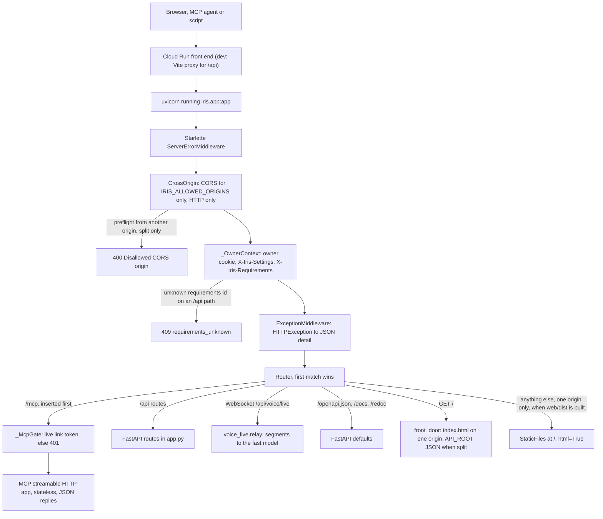
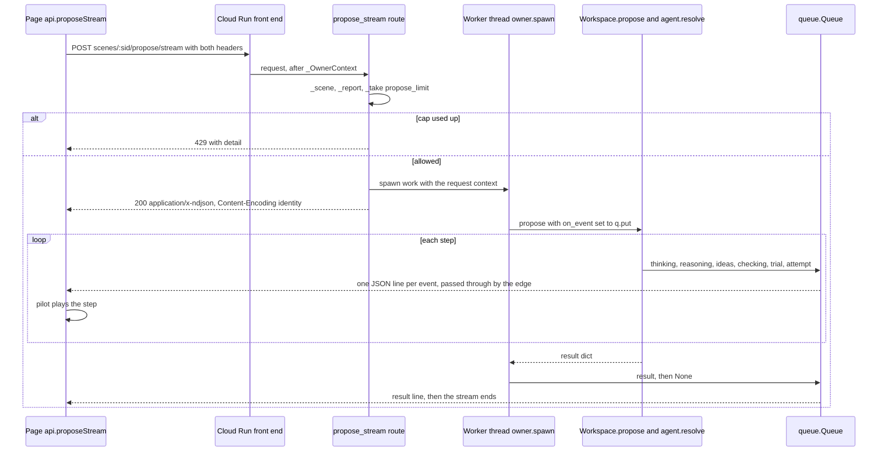

# 10 · HTTP API and streams

> **Covers:** `server/iris/app.py`, `server/iris/voice_live.py`, `server/iris/origins.py`, the request side of
> `server/iris/owner.py` and `server/iris/limits.py`, `web/src/api.ts`, `LiveVoice` in `web/src/voice.ts`,
> `web/src/uploads.ts`, the container entry deployed by `deploy/deploy.sh` · **Checked against code:** 2026-11-22
> (the set-up, `_CrossOrigin`, headers, owner routes, `GET /`, `GET /api/health`, the voice origin check, projects and
> decisions routes, 2D drawing routes with the sample drawings and saved readings, the detect stream's `phase` and
> `done`, the route count, the front door and the errors table; review queue 2026-11-22: the prepare route, its stream
> and the route count; server QA fixes 2026-11-22: `_is_page` serves any browser page address, the patterns reading
> skipped with no model, live prepared pairs with no model; re-branded 2026-11-11) ·
> **Deeper design:** [docs/voice.md](../voice.md), [docs/uploads.md](../uploads.md), [docs/mcp.md](../mcp.md),
> [docs/engineer-workflow.md](../engineer-workflow.md), [docs/drawings.md](../drawings.md),
> [docs/review-queue.md](../review-queue.md)

Iris's server is one FastAPI app, `app` in `server/iris/app.py`, that the page, the MCP server and anything
else talk to. It serves 103 decorated routes under `/api/`, `GET /`, one WebSocket (live voice) and the MCP endpoint
at `/mcp`. On one origin it also serves the built web app. Split, with the web app on another origin (Firebase
Hosting, `IRIS_ALLOWED_ORIGINS` set, `origins.py`), it serves the API only and answers CORS for exactly those
origins. Long work answers as newline-delimited JSON (NDJSON) so the page can
show the agent working. This doc is the inventory of every route, stream event, header and error, and how
`web/src/api.ts` reads them. Other docs link here rather than list routes again. What each route's work does
inside is in [09](09-agent-workflows.md) and [07](07-fixes-and-edits.md); the caps' meaning is in
[16](16-security-caps-and-cost.md); the MCP side of `/mcp` is in [11](11-mcp-and-agent-links.md).

## How the server is put together

- **One app, one process.** `app = FastAPI(title="Iris")`, with one `Workspace` (`ws`) holding scenes, reports and
  jobs in memory ([05](05-domain-model-and-state.md)). The repo's `.env` is loaded by the package's `__init__.py`
  (`model_client.load_env()`), which runs on the first import of any `iris` module and so before `app.py` or
  any module it imports reads a setting: the caps, the owner token and the settings modules read at import time
  (`IRIS_MAX_SCENES`, `IRIS_SCENE_BUDGET_MB` and the others marked "import" in
  [15](15-requirements-settings-and-config.md)) all come from `.env` when the real environment does not set them
  (real environment variables win). Locally: `uv run uvicorn iris.app:app --reload --reload-dir iris` (only the
  package is watched: a package install in `server/.venv` would otherwise restart it and drop every scene). On
  Cloud Run the container serves the same `app` with uvicorn (`deploy/deploy.sh`); concurrency (linked pages each hold
  an events stream) and the request timeout are set there ([17](17-deployment-and-operations.md)).
- **Middleware:** `_OwnerContext` and `_CrossOrigin` (both below). `_CrossOrigin` is added last, so it is the
  outermost. There is no compression middleware. With `IRIS_ALLOWED_ORIGINS` empty (the default) the page, the API and
  `/mcp` share one origin and no CORS header is sent. In development Vite proxies `/api` (with `ws: true`, Host
  kept) to `localhost:8000` (`web/vite.config.ts`); `/mcp` is not proxied there.
- **Start-up check:** `app.py` calls `origins.allowed()` once at import, so a malformed `IRIS_ALLOWED_ORIGINS` (a
  path, a `*`, not `scheme://host[:port]`) raises `ValueError` and stops the server at start.
- **Routing order:** the `/mcp` Starlette `Route` is inserted first (`app.router.routes.insert(0, …)`), then
  FastAPI's own `/openapi.json`, `/docs` and `/redoc` (added when the app is made, left at their defaults), the `/api`
  routes in the order they are declared, `GET /` (`front_door`, declared after them), and last the static mount at
  `/`. No paths overlap, so the order matters only for the static mount, which must come after everything else.
- **Front door and static files:** `GET /` is `front_door`. On one origin (`IRIS_ALLOWED_ORIGINS` empty) and when
  `IRIS_WEB_DIST/index.html` exists (default `web/dist`, the output of `cd web && npm run build`), it returns that
  `index.html`, and `app.mount("/", _WebApp(directory=WEB_DIST, html=True), name="web")` serves the rest,
  declared last so `/api` wins. Split, nothing is mounted and `/` answers `API_ROOT`:
  `{"service": "iris-api", "docs": "/docs", "health": "/api/health"}` (also the answer when there is no build).
  `_WebApp` is `StaticFiles` with one fallback: a browser asking for a page that has no file (`_is_page`: GET or
  HEAD, a first segment not in `NOT_PAGES` (`api`, `mcp`, `docs`, `redoc`, `openapi.json`, `assets`, `wasm`), no file
  extension in the last segment, no `..`, `%` or backslash in the path or the raw path, an `Accept` that takes HTML)
  gets `index.html`, so a reload or a shared link like `/projects/<pid>/drawings` opens the app, and an address the
  app has no page for (`/nope-page`) shows the app's own Page not found page (`web/src/NotFound.tsx`,
  [12](12-web-app.md)) instead of `{"detail":"Not Found"}`. Anything else missing (an `/api` route, a file, a JSON
  request) stays a plain 404. Firebase Hosting's `**` → `/index.html` rewrite (`firebase.json`) does the same on the
  split deploy; this fallback is for one origin and local runs.
- **Lifespan:** `_lifespan` replaces the router's lifespan. On start it builds the MCP transport
  (`_mcp_gate.inner = _mcp_transport()`) and runs `_mcp.session_manager.run()` for the server's life
  ([11](11-mcp-and-agent-links.md)).



### `_OwnerContext`

A plain ASGI middleware (`app.add_middleware(_OwnerContext)`) that runs on every HTTP and WebSocket request:

1. Reads the `iris_owner` cookie (`owner.COOKIE`) and checks it (`owner.cookie_ok`: `v1.<expiry>.<HMAC>`,
   keyed on `IRIS_OWNER_TOKEN`).
2. `owner.enter(is_owner, header)` sets context variables for this request: owner or not, and, only for the owner,
   the settings in `X-Iris-Settings` (thinking levels `effort`, `triage_effort`, `escalation_effort`; `no_caps`,
   `escalation`, `built_views`).
   `owner.leave` resets them when the request ends.
3. A WebSocket stops here: only owner/no-caps matters for live voice.
4. For HTTP, reads `X-Iris-Requirements`. An id the server does not know, on a path under `/api/`, is answered
   at once with **409 `{"detail": "requirements_unknown"}`** (a restart forgot it), so the page registers its file
   again instead of running without it. A known id is entered with `requirements.enter`, so `requirements.current()`
   is that file for the whole request.

Work that leaves the request's thread keeps this context: `owner.spawn` starts each stream's worker thread and
`owner.submit` each pool task with `contextvars.copy_context()`, which carries the owner's settings and the
requirements together. `/mcp` passes through `_OwnerContext` too, but MCP tools take their requirements from the link
(`requirements.using`, [11](11-mcp-and-agent-links.md)) and their caps from who made the link.

### `_CrossOrigin`

A plain ASGI middleware (`app.add_middleware(_CrossOrigin)`, after `_OwnerContext`) for the split deployment: the
web app on Firebase Hosting, built with `VITE_API_BASE` set to this server's URL, calls the API across origins
([12](12-web-app.md), [17](17-deployment-and-operations.md)).

- **None configured** (`origins.allowed()` empty, the default): it passes every request straight on. No CORS
  header is sent, as before.
- **Origins configured** (`IRIS_ALLOWED_ORIGINS`, a comma list of `scheme://host[:port]`, lower-cased, trailing
  slash and duplicates dropped): it wraps Starlette's `CORSMiddleware` with exactly those origins and
  `allow_credentials=True`. Methods `GET`, `POST`, `PUT`, `DELETE`; request headers `Content-Type`,
  `X-Iris-Settings`, `X-Iris-Requirements`; exposed headers `X-Iris-Gone` and `Content-Disposition` (what the page
  reads from an answer: `goneOf`, a download's name); `max_age` 3600. It never answers `*`.
- **An allowed origin** gets `Access-Control-Allow-Origin` set to that origin, `Access-Control-Allow-Credentials:
  true` and `Vary: Origin`, so the page can read the answer and the owner cookie travels.
- **Another origin:** a preflight is refused with 400 (`Disallowed CORS origin`, plain text). A simple request is
  answered, but without `Access-Control-Allow-Origin`, so the browser keeps the reply from that page.
- **Only HTTP.** WebSockets pass straight through: the voice socket checks its own `Origin` (below).
- **Outermost**, so an answer `_OwnerContext` gives itself (409 `requirements_unknown`) carries the headers too.
- **It only adds headers**, so NDJSON streams keep `Content-Encoding: identity` and flow as before.

The origins are read on each request (cached per raw value) and one `CORSMiddleware` is kept per set of origins.

## Headers and cookies

| Name | Direction | Set by | Read by | What it carries |
|---|---|---|---|---|
| `X-Iris-Settings` | request | `api.ts` `settingsHeader()` when the owner has settings (`setOwnerSettings`) | `_OwnerContext` → `owner.settings` | The owner's own settings as JSON. Ignored unless the owner cookie checks out. |
| `X-Iris-Requirements` | request | `api.ts` `settingsHeader()` once `setRequirements(id, doc)` | `_OwnerContext` → `requirements.enter` | The id of a registered requirements file ([15](15-requirements-settings-and-config.md)). |
| `iris_owner` cookie | both | `POST /api/owner/unlock` (`owner.set_cookie`); `POST /api/owner/lock` clears it (`owner.clear_cookie`: the same flags, expired) | `_OwnerContext` | Signed `v1.<expiry>.<sig>`; HttpOnly, Secure, Path=/api, 30 days (`owner.DAYS`). One origin: SameSite=Strict. Split (`IRIS_ALLOWED_ORIGINS` set): SameSite=None; Secure; Partitioned, so it travels on the page's cross-site calls and is kept per top-level site (CHIPS). `owner._cookie` appends `Partitioned` by hand: Starlette writes it only on Python 3.14+. Path=/api: it never reaches `/mcp` or the static files. |
| `Authorization: Bearer <token>` or `?key=<token>` | request | the MCP client | `_McpGate`, `agents.token_from` | An agent link token ([11](11-mcp-and-agent-links.md)). |
| `X-Forwarded-For` | request | a proxy in front | `limits.client_id` | The visitor's address for per-visitor caps only with `IRIS_TRUST_FORWARDED=N`: the N-th entry from the right. Else the socket peer. |
| `X-Forwarded-Host`, `X-Forwarded-Proto` | request | the proxy | `create_link`, `mcp_server.base_url` | The public `mcp_url` and download links. |
| `Content-Length` | request | the browser | `_receive_models` | Required on model uploads (411 without it); checked against the cap before the body is read. |
| `Origin`, `Host` | request | the browser | `voice_live.same_origin`, `_CrossOrigin` | The live-voice socket opens only when they match, when the Origin is in `IRIS_ALLOWED_ORIGINS`, or when no Origin is sent. `_CrossOrigin` answers CORS only for an Origin in that list. |
| `Access-Control-Request-Method`, `Access-Control-Request-Headers` | request | the browser, on a preflight `OPTIONS` | `_CrossOrigin` | Split only: allowed for `GET`, `POST`, `PUT`, `DELETE` and `Content-Type`, `X-Iris-Settings`, `X-Iris-Requirements`; another origin's preflight is a 400. |
| `Access-Control-Allow-Origin`, `Access-Control-Allow-Credentials: true`, `Vary: Origin` | response | `_CrossOrigin` | the browser | Split only, and only for an allowed origin: the origin itself, never `*`. A preflight also gets `Access-Control-Allow-Methods`, `Access-Control-Allow-Headers` and `Access-Control-Max-Age: 3600`. |
| `Access-Control-Expose-Headers: X-Iris-Gone, Content-Disposition` | response | `_CrossOrigin` | the browser | Split only: lets the page on the other origin read those two headers. |
| `Content-Encoding: identity`, `Cache-Control: no-store, no-transform`, `X-Accel-Buffering: no` | response | `_ndjson` (`NDJSON_HEADERS`), and `_McpGate` adds the first | the edge | Keep streams flowing (below). |
| `X-Iris-Gone` | response | `_gone` on the 404 of `_scene` and `_report` | `api.ts` `send` → `goneOf`, App's handler | What the server no longer holds: `scene:<id>` or `report:<id>` (a restart, a redeploy or eviction). Only an id the server could have made (hex) goes back. |
| `Cache-Control: no-store` | response | `GET /api/scenes/{scene_id}/files/{index}` | the browser | The same URL serves the edited model after a kept fix. |
| `Cache-Control: private, max-age=86400` | response | `GET /api/built/{name}` | the browser | A checked picture never changes for its key. |
| `Content-Disposition: attachment` | response | `GET /api/documents/{doc_id}`, `GET /api/projects/{pid}/reports/{doc_id}`, `FileResponse(filename=…)` on export | the browser | The download's file name. |
| `WWW-Authenticate: Bearer realm="iris"` | response | `_McpGate` on 401 | MCP clients | Say a token is needed. |

## Errors and refusals

Every refusal is an `HTTPException`, so the body is FastAPI's `{"detail": "<words>"}`. The words are written for
people; the page shows them as they are. FastAPI's own validation of a request body (a missing field, a wrong type)
is a 422 whose `detail` is a list, not a string.

| Status | When | Examples of `detail` |
|---|---|---|
| 400 | A request the server cannot use | a CORS preflight from an origin not in `IRIS_ALLOWED_ORIGINS`, split only (`Disallowed CORS origin`, plain text from `CORSMiddleware`, not `detail`); an upload that is not IFC/STEP, a file given twice, a truncated `.gz`, a model IfcOpenShell cannot read, a report upload with no XML, a fix with no element, a fix that does not say which clash it is for ("Not a fix Iris can apply: the fix does not say which clash it is for (pair: [A, B])"), or whose changed element is neither side of it, a STEP conversion error, a bad setting value; a drawing that is not a `.pdf` or not a PDF ("plan.pdf is not a PDF."), damaged ("… could not be read as a PDF (it may be damaged)."), password-protected ("… is password-protected: save it without a password and upload it again."), or over `IRIS_DRAWING_MAX_PAGES` ("… has 57 pages; a drawing may have at most 40."); a read of a page the drawing does not have |
| 401 | `/mcp` without a live link token | `{"error": "An Iris agent link token is required: …"}` (the gate's own body, not `detail`) |
| 403 | Not allowed | owner-only settings; listing every project (`GET /api/projects` without `ids`) as a visitor; a wrong owner token (under the unlock cap); second tries switched off; Show it built switched off; a live-voice socket from another origin not in `IRIS_ALLOWED_ORIGINS` (closed before the handshake, which the server answers as HTTP 403) |
| 404 | Gone or never there | "Model not loaded. Open it again." (`_scene`), "Clash report not loaded. Open it again." (`_report`), both with `X-Iris-Gone`; "This agent link has expired or was revoked." (`_link`), "That report has expired. Build it again.", "No such picture.", "No such image.", "No such clash.", "No owner is configured on this server.", "Proposal expired or unknown. Generate a new wider fix.", "No such project." (`projects.NotFound`, also for an id that is not 24 hex characters), "No such report in this project.", "No such drawing. Upload it again." (`_drawing`: no open scene holds it), "No such page.", "Clash 'x' is not in this report." (`prepare/stream`) |
| 409 | The state does not allow it | `requirements_unknown` (middleware); a new project past `IRIS_PROJECTS_MAX` (`projects.Full`); a scene's 31st drawing ("A model set holds at most 30 drawings."), also when the sample drawings would pass it; sample drawings asked for when the open models are not a demo that has them ("The open models have no sample drawings: they go with the sample building."); "No models are attached to this project yet."; "Nothing has been changed yet. Accept a fix first." (export); "Nothing may be edited here (…), so there is no second try to make."; "Only clashes found by Iris take captured views."; a wider fix whose scene changed or whose fresh check failed; a fix that does not pass when tried again before it is kept (`plans.NotVerified`, every keep route): "'Offset up 400' does not pass Iris's check on the model as it is now (collision with IfcSlab (-50 mm)), so nothing was kept. The model or the requirements may have changed since it was proposed: propose again.", or for a plan "Fix 2 of 3, '…', does not pass …" and "… with the other fixes in place (…)" |
| 411 | Model or drawing upload without `Content-Length` | "Send the upload with its length (Content-Length)." |
| 413 | Too big | model upload over `IRIS_MODEL_UPLOAD_MAX_MB` (checked on `Content-Length`, then on the unpacked size); report upload over `IRIS_UPLOAD_MAX_MB` or `IRIS_UPLOAD_MAX_FILES`; a requirements file over 64 KB (`requirements.MAX_BYTES`); a captured view over 4 MB; a capture reply over 6 MB; a voice clip over 3 MB; models too big for a wider fix (`IRIS_WIDER_FIX_MAX_MB`); a drawing over `IRIS_DRAWING_MAX_MB` ("plan.pdf is over 50 MB."), or a drawing upload whose `Content-Length` is over ten of them |
| 415 | A captured view that is not a PNG | "Send a PNG." |
| 422 | Valid JSON, wrong content | "Say which element the offset goes around (other).", "Say which element the trim butts against (other).", "Say what moves (moved) and what it must clear (obstacles): …", "Cannot apply this fix: …" (`edits.Unsupported` while keeping), "Check the tests: …", "Pick the clashes to fix.", "Nothing to prepare." (`prepare/stream`), an empty or over-long project name, a decision whose `state` or `decision` is not one Iris knows, a requirements file that does not parse, a trim sent to Show it built, oversized or malformed built-view passes, a WAV that is not mono 16-bit at 16 or 24 kHz |
| 429 | A cap or budget is used up | the words from `ProposeLimit`: "You've used 20 proposals this hour. Try again later.", "The demo has used today's proposals. …", "That needs 3 proposals; you have 1 left this hour. …", or the escalation model's day budget refusal (`spend.claim`); a drawing read the day's budget cannot cover (`drawing_reader.ReadRefused`, raised before its first event) |
| 501 | Not part of this build | "reader not available" (`POST /api/drawings/{drawing_id}/read` without `drawing_reader.py`), "comparison not available" (without `drawing_compare.py`) |
| 502 | A model call behind the route failed | "Gemini Pro could not draft requirements: …", "Transcription failed: …" |

- **Caps are charged before work starts**, so a 429 is a plain HTTP reply even on a streaming route. A failure
  *after* a stream has started is an `error` event in the stream (`{"type": "error", "detail"}`; the document stream
  uses `message`, the upload stream adds `status`).
- **The owner** (cookie plus `no_caps`, the default) skips every visitor cap (`_take` returns `None` when
  `owner.no_caps()`) and is never refused by the escalation model's day budget, though the owner's spend still counts
  towards it (`spend.claim(exempt=True)`, [16](16-security-caps-and-cost.md)).

### How `web/src/api.ts` handles replies

- **Where the server is:** `API_BASE` is `VITE_API_BASE` at build time, trailing slash dropped; empty means this
  page's own origin (local dev through Vite's proxy, or the web app Cloud Run serves itself). `apiUrl(path)` puts a
  `/api/…` path on the server (data:, blob: and full URLs pass as they are); `wsUrl(path)` makes the `ws:`/`wss:`
  URL for the voice socket; `apiFetch` is `fetch(apiUrl(path))` and adds `credentials: "include"` only when
  `API_BASE` is set, so the owner cookie travels cross-origin. Every call below goes through them
  ([12](12-web-app.md)).
- **`send(url, init)`** wraps `apiFetch`: on a 409 whose `detail` is `requirements_unknown`, it registers the file again
  (`reRegister`: `POST /api/requirements` with the saved document, no requirements header) and retries the request
  once with the new id. On a 404 with `X-Iris-Gone` (`goneOf`) it calls the page's handler (`setGoneHandler`)
  with the kind, the id and the server's words, then returns the reply as usual: App shows one notice that offers to
  open the models again ([12](12-web-app.md), "When the server lets go of the models"). `saveView` goes through `send`
  too.
- **`call<T>(path)`** sends JSON with `jsonHeaders()` (both headers above) and throws `ApiError(detail, status)` on
  any non-2xx; components read `e.status` where it matters (a 404 on any agent-link call drops the link; a 409 or 404
  on a wider-fix accept marks the proposal stale).
- **`ndjson<T>(path, body, onEvent, signal, method)`** POSTs (or GETs) through `send`, throws `ApiError` before the
  stream if the reply is not OK, then reads the body with a `TextDecoder`, splits on `\n`, parses each line and calls
  `onEvent`; a handler that returns `true` ends the read. It always cancels and releases the reader. Each stream
  helper (`detect`, `planStream`, `built`, `chat`, `titles`, `triageStream`, `document`, `contextStream`,
  `linkEvents`) stops on its own final event and turns an `error` event into a thrown error; a stream that ends
  without its final event is an error too ("The server stopped before …").
- **`proposeStream`** reads the same way by hand: it throws on `error`, returns the `result` event as the
  `Proposal`, and passes every other event to the pilot.
- **`apiSend(url, init)`** is `send` with `jsonHeaders()`, for a stream read outside `api.ts`: the review queue's
  `prepareFixes` (`web/src/reviewQueueModel.ts`, [12](12-web-app.md)) posts to `prepare/stream` through it, throws
  `ApiError` on a refusal before the stream, and passes every event (`error` included) to its store, which says
  so when the stream ends before `done`.
- **`uploadModelsStream`** gzips each file over 1 MB (`pack`, `CompressionStream`), posts with `XMLHttpRequest` for
  upload progress (`upload` events made in the browser, after `packing` ones), parses the NDJSON from
  `responseText` as it grows, and retries once on a 409 `requirements_unknown`. Cross-origin it sets
  `withCredentials`. `uploads.uploadRefusal` checks size and count against `GET /api/models` before anything is sent.
- Plain `apiFetch` (no Iris headers) for downloads and small posts that need neither header: model files,
  `uploadReport`, `linkCapture`, re-registering requirements; `navigator.sendBeacon(apiUrl(…))` for `leaveLink`.
  Export, CSV and image URLs are built with `apiUrl`.

## Route inventory

Every route in `app.py`, grouped by area. Paths are exactly as declared. "Caps" names what a call charges; "free"
means no cap. All caps are skipped for the owner unless noted. Body models (`Move`, `Propose`, …) are the pydantic
classes in `app.py`.

### Service

| Method | Path | What it does | Body / params | Reply | Caps / auth |
|---|---|---|---|---|---|
| `GET` | `/` | `front_door`: the web app's `index.html` when this server serves it (one origin, `web/dist` built); split (`IRIS_ALLOWED_ORIGINS` set) or with no build, says this is the API | none | `index.html`, or `API_ROOT` `{"service": "iris-api", "docs": "/docs", "health": "/api/health"}` | free |
| `GET` | `/api/health` | For deploys and uptime checks: no auth, no model call. The deploy's smoke test checks it reports the commit just deployed | none | `{"status": "ok", "version"}`; `version` is `IRIS_VERSION` (set by `deploy/deploy.sh`: the image tag, the commit SHA in CI), else `"dev"` | free |

### Owner and settings

| Method | Path | What it does | Body / params | Reply | Caps / auth |
|---|---|---|---|---|---|
| `GET` | `/api/owner` | Whether an owner is configured and whether this request is the owner's | none | `{available, owner}` | free |
| `POST` | `/api/owner/unlock` | Checks the owner token once (`owner.check_token`, constant time) and sets the signed cookie (`owner.set_cookie`: SameSite=Strict on one origin; SameSite=None, Secure, Partitioned when split) | `{token}` | `{owner: true}` and `Set-Cookie: iris_owner` | 404 with no token configured; wrong token 403, capped by `unlock_limit` (5 per visitor per hour, 50 a day) → 429 |
| `POST` | `/api/owner/lock` | Clears the cookie (`owner.clear_cookie`: the same flags as it was set with, expired, since a browser only replaces a cookie with matching ones) | none | `{owner: false}` | free |
| `GET` | `/api/models` | Which model titles and triage use (`triage_model_info`: always the fast model), the escalation model and mode (`escalation_info`), whether Show it built is on, each role's model name for the words on screen (`model_client.labels`), triage's calls at a time, the upload cap | none | `{triage: {model, label, images}, escalation: {model, label, mode, available}, built_views, labels: {proposal, escalation, triage, image, voice}, triage_workers, model_upload_max_mb, model_upload_max_files}` | free |
| `GET` | `/api/settings` | The settings for everyone (`settings.current`: `effort`, `triage_effort`, `escalation`, `escalation_effort`, `built_views`), their defaults (`settings.defaults`), whether a model is configured (`model_client.configured`) | none | `{everyone, defaults, configured}` | owner only (403) |
| `PUT` | `/api/settings` | Changes settings for everyone (`settings.update`) | partial settings dict | as `GET` | owner only (403); 400 on a bad value |

### Models and scenes

| Method | Path | What it does | Body / params | Reply | Caps / auth |
|---|---|---|---|---|---|
| `GET` | `/api/samples` | Model files in `samples/` (`Workspace.list_samples`) and the demos among them (`demos.listing`), each with the sample PDF drawings of its own that are in `samples/drawings/` (`drawings.sample_names`, `Demo.drawings`) | none | `{files: [name], demos: [{id, name, label, kind, files, context, tour, drawings}]}` (`drawings`: file names, `[]` for a demo with none) | free |
| `POST` | `/api/scenes` | Opens sample models; a STEP sample is converted first (cached by hash) with the triage model naming parts | `Open {samples}` | `{id, files, step, revision, layout}` (`app._files_of`, as every route that opens or changes the file list) | free; 404 unknown name, 400 STEP error |
| `POST` | `/api/models/upload` | Opens the visitor's own IFC/STEP files (`_receive_models`, then `Workspace.open_paths`) | multipart `files` (each may be `<name>.gz`); `Content-Length` required | `{id, files, step, revision, layout}` | `model_upload_limit` (`IRIS_MODEL_UPLOADS_PER_HOUR`/`_DAY`); 411, 413, 400, 429 |
| `POST` | `/api/models/upload/stream` | The same, with the opening streamed (below) | as above | NDJSON | as above; refusals before the files are in are plain HTTP errors |
| `POST` | `/api/scenes/{scene_id}/models` | Adds sample models to an open scene (`Workspace.add_samples`, [docs/add-and-remove-models.md](../add-and-remove-models.md)): appended after its files, everything kept stays; the page then runs every kept check again | `Open {samples}` | `{id, files, step, revision, layout, added: [index]}` | free; 400 "A STEP machine can't join building models yet: open it on its own." (or the reverse), "`<name>` is already open.", past the byte budget, none given; 404 unknown name or scene; 409 the list changed meanwhile |
| `POST` | `/api/scenes/{scene_id}/models/upload/stream` | Adds the visitor's own files to an open scene (`_receive_models`, then `Workspace.add_models`), streamed as the upload stream is (below) | as `/api/models/upload` | NDJSON; `done` adds `added` | one model upload, as `/api/models/upload`; the mixing and "already open" refusals are plain 400s before it is charged (`_receive_models`' `check`); past the byte budget, an `error` event |
| `DELETE` | `/api/scenes/{scene_id}/models/{index}` | Takes one model out (`Workspace.remove_model`): its clashes leave every kept check and the list (nothing is detected again, the checks stay current), edits kept in it stay in the log marked `model_removed`, an uploaded file is deleted | `?name=` (required): the file the page means at `index` | `{id, files, step, revision, layout, removed: {name, clashes, edits}, report (the union's summary, null when no check is kept), checks}` | free; 409 "The models changed: reload them." (`StaleLayout`: `index` no longer holds `name`), 400 "This is the only model: open others instead." |
| `GET` | `/api/scenes/{scene_id}` | A scene the page had open, to resume it (`Workspace.scene_info`) | none | `{id, files, step, revision, layout, report_id, checks}` (the kept checks and the report listing their clashes, as `GET .../checks`) | free; 404 once evicted |
| `GET` | `/api/scenes/{scene_id}/files/{index}` | One model file as it is now: the original, or the edited model written out (`Workspace.file`); tidies exports older than an hour | none | IFC bytes, `no-store` | free; 404 |
| `GET` | `/api/scenes/{scene_id}/elements/{global_id}` | One element's class, name, level, file, and its links by kind with names, systems and assembly (`Workspace.describe`) | none | element dict | free |
| `GET` | `/api/scenes/{scene_id}/elements/{global_id}/properties` | Everything the model says about one object (an element, or a storey, building, site or project from a breadcrumb), for the Properties panel: every attribute, its type, every set (the type's marked), units, materials, classifications, groups, documents, storey, container and path (`Workspace.properties`, `properties.properties`); 404 for an object the scene doesn't have or a file it hasn't | `?file=` (optional): the model's index, when federated files repeat a GlobalId | `{global_id, ifc_class, name, source, file, size_m, attributes: [Prop], type: {global_id, ifc_class, name, attributes} \| null, storey, container: Ref \| null, path: [Ref], materials: [{usage, name, from_type, items, total_m?, sets}], classifications, groups, documents, sets: [{name, kind: pset\|qto, props: [Prop], from_type?}]}`; `Prop = {name, value, unit?, from_type?, kind?, rows?, table?, of?}`, `Ref = {global_id, ifc_class, name, file}` | free |
| `GET` | `/api/scenes/{scene_id}/elements/{global_id}/property-choices` | What an element's properties can be set to from its own model (`property_edits.choices`, [docs/editing-parity.md](../editing-parity.md), Tier 3); 404 for an element the scene doesn't have | none | `{attributes, predefined, types: [{global_id, name, ifc_class}], type, materials: [{id, name}], material, material_fixed, containers: [{global_id, name, ifc_class}], container, classifications: [{id, identification, name, system, on}]}` | free |
| `POST` | `/api/scenes/{scene_id}/elements/{global_id}/properties` | Change one thing the model says about an element, not its shape (`property_edits.edit`): kept through the edit log as the person's (kind `property`), undone like any edit; 422 with why when it would leave the model saying two things, 400 for a change Iris does not make | `{change: {kind: attribute\|property\|type\|material\|classification\|container, ...}}` (a classification: `reference`, with `remove` or `replace` (the reference it had)) | `{entry, properties}` | free |
| `GET` | `/api/scenes/{scene_id}/datums` | Levels (storeys merged across files, world z), grid axes (a sample scene with no grid reads `<prefix>-Grids.ifc` as context) and each element's storey, for the drawing views and the level filter (`Workspace.datums`, `datums.read`) | none | `{levels: [{name, elevation_m, height_m}], grids: [{tag, grid, start, end}], storeys: {GlobalId: name}, sources: {grids}}` | free |
| `GET` | `/api/scenes/{scene_id}/facets` | The filters' index: each facet (file, class, storey, type, material, `attr:`, `pset:`, `qto:`, `classif:`, `group:`) with its values and, per value, the elements that have it; kept on the scene until a kept edit (`Workspace.facets`, `facets.index`, [docs/filters.md](../filters.md)) | none | `{revision, files, elements: [GlobalId], file: [index], facets: [{key, kind: text\|number\|bool, unit?, values, items: [[element index]]}]}` | free; 404 |
| `GET` | `/api/scenes/{scene_id}/classes` | Every physical element's class and name, for a built view's cutaway (`Workspace.classes`) | none | `{GlobalId: [class, name]}` | free |
| `GET` | `/api/scenes/{scene_id}/connections` | What is linked to what, for the connection highlight (`Workspace.connections` → `connections.graph`; contacts from the scene's last check; cached until the scene changes) | none | `{revision, edges: [[a, b, kind, source]], stops, systems, assemblies, names, kinds}` | free |

### Projects

Projects kept on disk across restarts (`projects.py`, [docs/engineer-workflow.md](../engineer-workflow.md)). The
`Project` and `Review` shapes are in [05](05-domain-model-and-state.md); the folder in [14](14-files-in-and-out.md).
A project id is 24 hex characters; anything else is a 404 ("No such project.") before any path is built. A
`ValueError` from `projects.py` comes back as a 400 with its words (`app._project`); a body outside the pydantic
limits (`ProjectNew`, `ProjectReview`, …) is FastAPI's 422.

| Method | Path | What it does | Body / params | Reply | Caps / auth |
|---|---|---|---|---|---|
| `GET` | `/api/projects` | The projects the browser knows, newest first; unknown ids skipped (`projects.list_projects`). Without `ids`, every project, for the owner only | `?ids=a,b` (at most 200, `PROJECT_IDS_MAX`) | `[Project]` | free; 403 without `ids` for a visitor |
| `POST` | `/api/projects` | Makes a project (`projects.create`) | `{name}` | `Project` | free; 409 at `IRIS_PROJECTS_MAX`; 422 an empty or over-long name |
| `GET` | `/api/projects/{pid}` | One project (`projects.get`) | none | `Project` | free; 404 |
| `PATCH` | `/api/projects/{pid}` | Renames it, or keeps the counts the page last saw (`projects.patch`; `counts: null` clears them) | `{name?, counts?}` | `Project` | free; 404; 400 counts that are not whole numbers |
| `POST` | `/api/projects/{pid}/attach` | Copies the scene's original files into `models/` (`projects.attach`, `Workspace.original_paths`: an IFC as opened, a STEP model's original STEP), replacing the project's file list | `{scene_id}` | `Project` | free; 404 unknown project, or unknown scene (with `X-Iris-Gone`, as other scene routes) |
| `POST` | `/api/projects/{pid}/open` | Opens the project as a new scene (`projects.open_project`): the newest saved state whose files match, else the originals; clash ids, numbers and titles seeded; saved decisions and entries back in the journal | none | `{scene_id, project, scene}` (`scene` as `GET /api/scenes/{scene_id}` returns it) | free; 404; 409 when no files are attached or one is missing; 400 a model that cannot be opened (a STEP error, a file IfcOpenShell cannot read) |
| `POST` | `/api/projects/{pid}/save` | Saves the scene as the project's next state (`projects.save`): each model as it is now, the edit log, decisions and clash memory in `saved/<n>/`; sets `scene_id` | `{scene_id}` | `Project` | free; 404 |
| `PUT` | `/api/projects/{pid}/reviews` | Sets one clash's review by its clash key (`projects.set_review`) | `{key, status, note?, by?, number?, title?}`; `status` one of `open`, `by_design`, `author`, `resolved` | `Project` | free; 404; 422 a bad status; 400 past 5,000 reviews |
| `POST` | `/api/projects/{pid}/reports` | Keeps a built report with the project (`projects.add_report`): its bytes copied from the in-memory document store into `reports/` | `{doc_id, name, kind: pdf\|bcf}`; `doc_id` bare or the `/api/documents/<id>` path | `Project` | free; 404 "That report has expired. Build it again." when the document has left memory |
| `GET` | `/api/projects/{pid}/reports/{doc_id}` | A report kept with the project (`projects.report_file`) | none | the stored PDF or BCF zip, as a download (`Content-Disposition: attachment`) | free; 404 "No such report in this project." |

### Drawings

2D PDF drawings held with an open scene (`drawings.py`, [docs/drawings.md](../drawings.md)); the `Drawing`, `Page`
and `Word` shapes are in [05](05-domain-model-and-state.md). Every drawing route first forgets the drawings of scenes
no longer open (`drawings.STORE.prune`). A drawing id is 16 hex; one no open scene holds is a 404 "No such drawing.
Upload it again." The reader (`drawing_reader.py`) and the comparison (`drawing_compare.py`) are looked up when
called (`_optional`): without them their routes answer 501. Every `Drawing` the upload, list and samples routes return
goes through `_drawing_out`: its fields plus `saved_reading`, `{model, label, at}` when every page has a saved reading
that a read would replay (`drawing_reader.saved_info`: a sample sheet's, free), else `null` (also when this build has
no reader).

| Method | Path | What it does | Body / params | Reply | Caps / auth |
|---|---|---|---|---|---|
| `POST` | `/api/scenes/{scene_id}/drawings` | Takes PDF drawings in (`drawings.ingest`): each page rendered to PNG at 150 dpi and its text layer read as words with pixel boxes, the title block as printed; all or none of the upload is kept | multipart `files` (1 to 10 `.pdf`) | `[Drawing]` (each with `saved_reading`) | one model upload (`model_upload_limit`); 411 without a length, 413 a file over `IRIS_DRAWING_MAX_MB` (or a length over ten of them), 400 not a PDF / password-protected / over `IRIS_DRAWING_MAX_PAGES`, 409 past 30 drawings in the scene, 404 the scene |
| `POST` | `/api/scenes/{scene_id}/drawings/samples` | Attaches the sample PDF drawings of the demo whose models are open (`demos.drawings_for`: every open file's name in the demo's set, `Demo.drawings`, read from `samples/drawings/`) as an upload attaches them (`drawings.ingest`), so every drawing route works on them. Under `_samples_lock`, a sheet whose sha256 the scene already holds is not attached again, so calling twice is safe; all or none of the new ones are kept | none | `[Drawing]` (each with `saved_reading`): the scene's sample drawings, held already or added now | free: nothing is sent, so no upload is taken from `model_upload_limit`; 409 when the open models are not a demo with sample drawings, or the scene has no room for them (30 drawings); 404 the scene |
| `GET` | `/api/scenes/{scene_id}/drawings` | The scene's drawings, in upload order | none | `[Drawing]` (each with `saved_reading`) | free; 404 the scene |
| `GET` | `/api/drawings/{drawing_id}/pages/{n}.png` | One page as rendered; `n` is its `Page.index` (0-based) | none | `image/png` (`Cache-Control: private, max-age=3600`) | free; 404 the drawing or the page |
| `POST` | `/api/drawings/{drawing_id}/read` | Reads the pages with the drawing reader (`drawing_reader.read_drawing(drawing, pages, folder=)`, the folder from `drawings.folder_of`: the fast model, checked against the text layer, cached by file hash and page; a page with a saved reading (`drawing_reader.saved_reading`: a sample sheet's) is replayed instead, with no model call and no cost); keeps the items (a read of some pages replaces only theirs) | `{pages?: int[]}` (`Page.index` values; absent or null: every page) | NDJSON (below) | the day's budget (`IRIS_ESCALATION_MAX_USD_DAY`, in the reader): 429 before the stream when it cannot cover the read (replayed and cached pages need none); 400 an empty or unknown page; 404; 501 "reader not available" |
| `GET` | `/api/drawings/{drawing_id}/items` | The last read's items | none | `[Item]` (`[]` before a read) | free; 404 |
| `GET` | `/api/scenes/{scene_id}/drawings/compare` | Every read drawing's items against the model's own data, drawing by drawing with the level its title block names (`drawings.compare_scene`, `drawing_compare.compare`, the model's index built once, under `ws.lock`); an element one drawing leaves out but another sheet shows is not missing, one left out by several is listed once; two drawings with the same sheet number (`drawings.sheet_key`: two issues of one sheet) are each a whole sheet, so one showing an element does not excuse the other leaving it out | none | `{matches: [{item, element, by, …, drawing}], mismatches: [Mismatch + drawing], unmatched: [… + drawing], drawings: [{drawing, name, storey, read, scope}]}` | free; 404 the scene; 501 "comparison not available" |

### Fixes

| Method | Path | What it does | Body / params | Reply | Caps / auth |
|---|---|---|---|---|---|
| `POST` | `/api/scenes/{scene_id}/verify` | Checks a move without keeping it (`Workspace.verify_move`); with `obstacles`, what the moved elements stand on is kept | `Move {moved, delta_m, clearance_m? (none: the pair's, Workspace.clearance), obstacles=[]}` | verdict `{passed, hits, min_clearance_m, checked_against, reason?, placements}` | free |
| `POST` | `/api/scenes/{scene_id}/propose` | Runs the fix agent (`Workspace.propose`), or a second try (`Workspace.escalate`), one JSON reply | `Propose {element_a, element_b, distance_m?, notes, report_id?, clash_id?, escalate=false}` | the proposal (`understanding, options, attempts, advice, recommendation, requirements, clearance_m, model, usage, escalated?`) | one proposal (`propose_limit`); a second try: 409 if nothing may be edited, 403 if switched off, then the escalation day budget and one escalation plus one proposal (`escalation_refused`) |
| `POST` | `/api/scenes/{scene_id}/propose/stream` | The same, streamed (below); `api.proposeStream` | as above | NDJSON | as above |
| `POST` | `/api/scenes/{scene_id}/apply` | Keeps a move through `plans.apply` (tried again first against `obstacles[0]`, the rest as `others`; the requirements' clearance, not the body's `clearance_m`) and returns the patch (`_with_patch`); the page no longer calls it | `Move` (`obstacles` required) | as `fix/apply` | free; 422 without `moved` or `obstacles`, 409 when it does not pass |
| `POST` | `/api/scenes/{scene_id}/context/stream` | The wider-fix search over whole arrangements (`context_planner.build`) | `ContextObjective {element_a, element_b, report_id?, clash_id?}`, extra fields refused | NDJSON | three proposals at once (`take_many(who, 3)`); `context_planner.ContextError` statuses (422, 404, 413) before charging |
| `POST` | `/api/scenes/{scene_id}/context/apply` | Accepts a wider-fix proposal by its server-held id, checked afresh (`context_planner.accept`) | `ContextApply {proposal_id, acknowledged_conditions}` | `{files, pieces, edits, resolved_pairs, checks}` plus the patch | free; 404 expired, 409 scene changed or check failed, 422 conditions |
| `POST` | `/api/scenes/{scene_id}/offset/check` | Checks a local offset without keeping it (`Workspace.check_offset`) | `Offset {element, split_m, dz_m, other, clearance_m}` | `{passed, reason, min_clearance_m, preview}` | free; 422 without `other` |
| `POST` | `/api/scenes/{scene_id}/trim/apply` | Keeps a trim through `plans.apply` (tried again first against `other`; an `end` that is not the joint's is refused); the page no longer calls it | `TrimBody {element, end, by_m, other}` | as `fix/apply` | free; 422 without `other`, 409 when it does not pass |
| `POST` | `/api/scenes/{scene_id}/offset/apply` | Keeps an offset through `plans.apply` (tried again first against `other`); the page no longer calls it | `Offset` (`other` required) | as `fix/apply` | free; 422 without `other`, 409 when it does not pass |
| `POST` | `/api/scenes/{scene_id}/fix/apply` | Keeps one option of any kind through `plans.apply`: `preview` and `before` are dropped, the fix is tried again on the server (`plans.recheck`: its kind's `agent.TRIES` with the clearance and requirements `Workspace.fix_settings` sets for the clash it names) and what that trial makes is kept ([07](07-fixes-and-edits.md)). The edit-log entry records `actor` = `reviewer` and `check = {verified, min_clearance_m, checked_against}`; one `accepted` decision (state `geometry_validated`, check `{verified: true, min_clearance_m, checked_against}`) is appended to the journal | `FixApply {option, clash_id?, reviewer?, reason?, clash_key?, number?}`; the option names its clash in `pair` (`[A, B]`, plus `others` for a plan's merged item; a penetration and a combined fix name theirs in `edit`); `clash_key` and `number` are used when the server cannot derive the key itself | `{files, pieces (first run), groups (first fix), changed, not_cut, verified, cut?, blocked_by?, decisions}` plus the patch | free; 400 no element (an empty `moved` is a drain tilted with nothing at its free end only when `edit.tilts` names it), no `pair` or not a fix, 409 `NotVerified`, 422 `Unsupported` while keeping |
| `POST` | `/api/scenes/{scene_id}/edit/face` | The face of an element under a pick (`faces.resolve`): kind, name in words, size, what it allows, and what the Edit tool's choices would do there (`manual.choices_for`) | `FacePick {element, point, normal}` (IFC axes, metres) | the face plus the element's `label` and `choices: {type: {name, others, kind} \| null, joined}` | free; 404 unknown element |
| `GET` | `/api/scenes/{scene_id}/elements/{global_id}/faces` | Every face of an element there is to edit, named (`faces.faces`): what Gemini and a person can point at | | `{element, faces}` | free; 404 unknown element |
| `POST` | `/api/scenes/{scene_id}/edit/check` | Tries a hand edit in a trial (`manual.check`): what it clears, what it would hit new or worse, the nearest gap, its warnings and preview meshes; a refusal (the requirements, the geometry) comes back as `blocked` | `EditBody {op}` | `{op, key, summary, face, passed, blocked, clashes, close, new, worse, cleared, min_clearance_m, warnings, preview, before, targets, revision, also}`; `also`: every other element it changes or makes, `{element, name, why}` (`manual.also`) | free |
| `POST` | `/api/scenes/{scene_id}/edit/apply` | Keeps a hand edit (`manual.apply`): checked again first, then kept through the edit log, tied to the clash and any fix it follows, the clash measured again; returns the patch | `EditBody {op, key?, accept_clashes=0, accept_joints=0, clash_id?, pair?}` | `{entry, files, changed, created, removed, pieces, check}` plus the patch | free; 409 refused by the requirements, changed since its check (`key`), more clashes than accepted, or more joints left open than accepted; 422 cannot be made; 400 not an edit |
| `GET` | `/api/scenes/{scene_id}/edits` | The scene's edit log (`journal.Journal.summary`): every kept edit, oldest first, with `can_undo`, `can_redo` and which entry each would take, and the reviewers' decisions; `?format=csv` as a spreadsheet (`Workspace.edits_csv`) | `format=json\|csv` | `{entries, can_undo, can_redo, undo, redo, decisions}` | free |
| `POST` | `/api/scenes/{scene_id}/edits/undo` | Undoes the newest kept edit (`Workspace.undo_edit`): its transactions rolled back on each file, boxes and edited files put back, the revision moved forward; returns the patch (what it made in `removed`) and each of the entry's clashes measured again (`clash_states`: the page opens or marks fixed from that, whoever kept the entry) | `EditStep {entry?}` | `{entry, files, changed, removed, clash_states, can_undo, can_redo, undo, redo}` plus the patch | free; 409 when another edit came after it outside the log, a wider fix replaced the models (or models were added or removed since a wider fix), `entry` changed a model since removed (`model_removed`: undo passes over it), or `entry` is not the newest |
| `POST` | `/api/scenes/{scene_id}/edits/redo` | Redoes the last undone edit (`Workspace.redo_edit`) | `EditStep {entry?}` | as undo | free; 409 when the model changed since it was undone, or `entry` changed a model since removed |
| `POST` | `/api/scenes/{scene_id}/edits/{entry_id}/picture` | A picture of a kept edit, taken by the page right after it (`Journal.attach_picture`): the report's "After the edits" | `EditPicture {png}` (a `data:image/` URL, at most 400 kB) | `{ok}` | free; 404 unknown entry, 400 not a picture or too big |
| `POST` | `/api/scenes/{scene_id}/decisions` | Records a reviewer's decision about a proposal (`Journal.add_decision`, [05](05-domain-model-and-state.md)): kept in memory with the scene, saved only with a project | a Decision `{clash_id, clash_key, number?, option: {title, kind, moved, delta_m?, rationale?}, state, decision, reason?, reviewer?, check?}`; `state` one of `ai_proposed`, `geometry_validated`, `failed_validation`, `unverified`; `decision` one of `accepted`, `rejected`, `modified`, `requested_another` | `{decision, decisions}` | free; 404 unknown scene, 422 a bad field |

"The patch" is `Workspace.patch`: `{scene_id, revision_before, revision, layout, meshes, history}`, which lets the
page update its model in place (`applyToViewer`, [07](07-fixes-and-edits.md), [13](13-3d-viewer.md)). `history`'s file
indexes hold only within one `layout`: a page whose layout differs (a model was added or removed elsewhere) reloads
the files instead of patching by index. `_with_patch` holds
`Workspace.lock` from reading `revision_before` to building the patch, so another tab's edit cannot fall between.

### Export

| Method | Path | What it does | Body / params | Reply | Caps / auth |
|---|---|---|---|---|---|
| `GET` | `/api/scenes/{scene_id}/export` | Writes the edited files (`Workspace.export`: IFC, plus `<name>.iris.step` for STEP models); one file as is, several as a zip | none | the file, or `<project>-iris.zip` (`iris-export.zip` when the files share no name) | free; 409 when nothing was kept |

### Reports

| Method | Path | What it does | Body / params | Reply | Caps / auth |
|---|---|---|---|---|---|
| `GET` | `/api/reports/samples` | Sample report folders in `samples/reports/` | none | `[name]` | free |
| `POST` | `/api/reports` | Opens a sample Navisworks report (`Workspace.open_report_sample`) | `OpenReport {sample}` | the report (`id, title, sources, clashes, origin, requirements_id`; the last is a detected run's requirements id, else null) | free; 404 |
| `POST` | `/api/reports/upload` | Opens uploaded Navisworks XML with its pictures; folder paths kept (`_safe_relpath`), only `.xml`, `.png`, `.jpg`, `.jpeg` written | multipart `files` | the report | free; 413 over `IRIS_UPLOAD_MAX_FILES` (5000) or `IRIS_UPLOAD_MAX_MB` (200), 400 no XML or unreadable |
| `GET` | `/api/reports/{report_id}` | The report as the page reads it (`Workspace.report_summary`) | none | the report | free; 404 |
| `GET` | `/api/reports/{report_id}/clashes/{clash_id}/images/{index}` | One of a clash's pictures (Navisworks or captured) | none | the image | free; 404 |
| `POST` | `/api/reports/{report_id}/clashes/{clash_id}/images` | Saves a view A, B or C the page captured of a detected clash (`Workspace.save_capture`), for the agent, triage and the PDF | multipart `label`, `image` (PNG, at most 4 MB) | `{images: [labels]}` | free; 413, 415, 404, 409 (not a detected report), 422 (label) |
| `GET` | `/api/reports/{report_id}/match/{scene_id}` | Each clash's two sides matched to model elements (`Workspace.match`) | none | `{clash_id: {a, b, how, show}}` | free |
| `GET` | `/api/reports/{report_id}/clashes/{clash_id}/measure/{scene_id}` | Iris's own measure of one clash (`Workspace.measure`) | none | `{matched, physical, distance_m}` | free; 404 |

### Detection

| Method | Path | What it does | Body / params | Reply | Caps / auth |
|---|---|---|---|---|---|
| `GET` | `/api/scenes/{scene_id}/detect/tests` | The tests a run would use (defaults and presets, or what the requirements compile to) (`Workspace.detect_tests`) | none | `{tests, teams, elements, file_elements, rules, requirements, check: {tolerance_m, clearance_m, rules, min_size_m, everything}}` (`check`: a check on filters' defaults, `Workspace.check_defaults`; `everything`: the selection its Everything takes, a site model left out) | free |
| `POST` | `/api/scenes/{scene_id}/detect/stream` | Runs one check (`Workspace.detect` → `detect.run`), keeps its result with the scene's other checks and opens every kept check's clashes as one report ([docs/detection.md](../detection.md), "Kept checks"); with `all`, every kept check again, one after another (`Workspace.detect_all`) | `DetectRequest {tests: [...] or null, check: key or null, all: false}`; a test with no id and a side with a `filter` is a check on filters ([docs/filters.md](../filters.md)); `check` runs a kept check again with the tests it ran with; `done` carries `check` (its key; null for all), `ran`, `checks` (summaries), `saved` (one check: measured by the samples' saved check) and `tests` (as run, or null) | NDJSON | `detect_limit` (`IRIS_DETECT_PER_HOUR`/`_DAY`), once for Run all again too; the one run after a hand edit kept with clashes (`after_edit`) on `edit_rerun_limit` instead; 422 bad tests; 404 a `check` no longer kept |
| `GET` | `/api/scenes/{scene_id}/checks` | The scene's kept checks and the report listing their clashes, made again with a new id if the server let it go (`Workspace.checks_info`, `union_report`); no detection run | none | `{report_id (null: none kept), checks: [{key, name, title, tests, requirements, revision, stale, ran_at, seconds, elements, coverage, diff, clashes}]}` | free; 404 scene |
| `DELETE` | `/api/scenes/{scene_id}/checks/{key}` | Drops a check on filters (`Workspace.remove_check`): its clashes leave the list unless another check found them; their numbers stay theirs | none | `{report (null when none is left), checks}` | free; 404 no such check, 409 `models` (run again, never removed) |

### Requirements

| Method | Path | What it does | Body / params | Reply | Caps / auth |
|---|---|---|---|---|---|
| `GET` | `/api/requirements/scale` | The design levels and strictness steps (`requirements.scale`) | none | `{levels, strictness, format, roles, checks, edits}` | free |
| `POST` | `/api/requirements` | Registers a requirements file (content-addressed id) | the file as the raw JSON body | `{id, doc, params, label, model_key}` | `requirements_limit` (`IRIS_REQUIREMENTS_PER_HOUR`, default 120, `_PER_DAY`) for ids not yet known only; 413, 422 |
| `GET` | `/api/scenes/{scene_id}/requirements/default` | An L3 Coordinated, balanced starting file from the open models, and what they contain (`requirements.default_doc`, `inventory`); does not wait for `Workspace.lock` | none | registered fields plus `inventory` | free |
| `POST` | `/api/scenes/{scene_id}/requirements/suggest` | Gemini Pro drafts a file for the open models (`requirements.suggest`) | `RequirementsDraft {level=3, strictness="balanced", name}` | registered fields plus `summary`, `inventory` | one proposal; 502 when the draft fails |
| `POST` | `/api/scenes/{scene_id}/requirements/preview` | How many clashes the file finds, and the defaults find, without opening a report (`detect.run` under `Workspace.lock`, cached in `_previews`, 64 entries) | the file as the raw JSON body | `{clashes, seconds, tests, baseline, params}` | `preview_limit` (`IRIS_PREVIEW_PER_HOUR`, default 60, `_PER_DAY`) unless both counts are cached |

### Insights

| Method | Path | What it does | Body / params | Reply | Caps / auth |
|---|---|---|---|---|---|
| `GET` | `/api/reports/{report_id}/root_causes/{scene_id}` | Elements in several real clashes, plus geometry hits missing from the report (`plans.root_causes`) | `?fixed=` comma-separated clash ids | `[RootCause]` | free |
| `GET` | `/api/reports/{report_id}/patterns/{scene_id}` | The same kind of clash many times over (`plans.patterns`), no model call | `?fixed=` | `[Pattern]` | free |
| `POST` | `/api/reports/{report_id}/patterns/{scene_id}/triage` | One main-model call judging every pattern (`plans.read_patterns` → `triage_patterns`), kept on the Workspace by report, scene, pattern ids and the requirements' `model_key`, and shared with chat and MCP `find_patterns`. With no model that can be called (`model_client.can_call(ws.model)` false: no credentials), the reading is skipped: `{}`, no call, nothing charged, so the page's automatic reading gets no 500 | `PatternTriage {fixed}` | `{pattern_id: {verdict, cause, action, rule}}`, or `{}` | one proposal, only when not cached and a model can be called |

### Triage and titles

| Method | Path | What it does | Body / params | Reply | Caps / auth |
|---|---|---|---|---|---|
| `GET` | `/api/reports/{report_id}/triage` | The report's triage so far (`triage.Job.state`), with facts the open model settles (`_triage_facts`). Under requirements that only change rules since a finished run, starts a run from its readings at no charge; under a different prompt, returns the last run with `stale: true`. A list of Iris's checks gets at once, free, the readings that still hold for its clashes (same pair, depth within 1 mm, same prompt: `checks.Register.carried`), each marked `carried` | `?scene_id=` | `{results, done, stopped, can_stop (this visitor may stop the run under way), total, seconds, error, summary, audit, model, label, images, requirements?, …}`, plus `stale` for an older run, or `{results: {}, done: false, started: false}`; for Iris's checks also `unread` (clashes no reading holds for) and `scope` | free |
| `POST` | `/api/reports/{report_id}/triage/stream` | Starts or follows the report's shared triage run (`_start_triage`, `triage.Job.follow`); for Iris's checks one run per scene, asking only about unread clashes; after a run that stopped or failed some reads, a new run that keeps its readings and asks only the rest | `?rerun=true` to run a finished one again, `?scene_id=`, `?scope=` (a kept check's key: only its clashes); empty body | NDJSON | one proposal to start a run that asks the model anything; following one, carrying readings over (to new rules, or to a new list of checks), or a scope with nothing unread is free |
| `POST` | `/api/reports/{report_id}/triage/stop` | Stops the report's triage under way (`triage_stop` → `triage.Job.stop`), and a run it waits behind that this visitor also started: no new model call, calls under way dropped, what landed kept. Shared, so only whoever started it (`Job.may_stop`: same `client_id`, or the link's creator for a run an agent started) or the owner may stop it: 403 for anyone else; the stream ends with `done` and `stopped: true`. The next `triage/stream` asks only about what is left (an imported report's run is seeded from the stopped one) | empty body | `{stopped}` (false when nothing was running) | free |
| `GET` | `/api/reports/{report_id}/titles` | Titles so far (from the shared run, `_with_titles`) | none | `{titles: {id: title}, running}` | free |
| `POST` | `/api/reports/{report_id}/titles/stream` | Starts or follows the report's shared titling run (`titles.Job`; for Iris's checks one per scene: a new list follows the run under way, and takes the titles the scene keeps); a finished run with untitled clashes starts again for those | empty body; `?scene_id=` (the open models: their domain names the meeting in `titles.md`) | NDJSON | `title_limit` (`IRIS_TITLES_PER_HOUR`/`_DAY`) to start; following is free |

Shared runs are keyed by `_triage_key`: a sample report by `sample:<root>` (every visitor's copy has the same ids),
an uploaded or detected one by its id, and under requirements also by `model_key|rules_key`. The server keeps 16
triage jobs (`_triage_jobs`) and 32 titling jobs (`_title_jobs`).

### Plans

| Method | Path | What it does | Body / params | Reply | Caps / auth |
|---|---|---|---|---|---|
| `POST` | `/api/scenes/{scene_id}/plan/stream` | Fix together (`plans.build_batch`) or the root cause around one element (`plans.build_root_cause`) | `PlanRequest {report_id, clash_ids=[], hub?, fixed=[]}` | NDJSON | Fix together: one proposal per distinct pair (at most `plans.MAX_ITEMS`, 8), all or nothing (`take_many`); a root cause: one, then its fixes only if it needs edits; 422 with no clashes |
| `POST` | `/api/scenes/{scene_id}/plan/apply` | Keeps a plan's chosen options, all or none (`plans.apply`: each tried again alone, then all together with `verify_together`, then kept in one transaction). The entry records `actor` = `reviewer` and `check = {verified, min_clearance_m, checked_against}`; one `accepted`, `geometry_validated` decision per kept fix is appended to the journal | `PlanApply {options, clash_ids?, reviewer?, reason?, clash_keys?, numbers?}`, each option with its `pair` and `others`; `clash_ids`, `clash_keys` and `numbers` are lists, one per option (keys and numbers used when the server cannot derive them itself) | `{files, pieces, groups, changed, not_cut, verified, decisions}` plus the patch | free; 400, 409 `NotVerified` (which fix and why), 422 |

### Review queue

Prepared fixes for the review queue (`prepare.py`, [docs/review-queue.md](../review-queue.md), [09](09-agent-workflows.md)).
The route keeps nothing: the reviewer's Accept goes through `POST /api/scenes/{scene_id}/fix/apply` (`plans.apply`,
tried again first), and Reject and Request another through `decisions` and `propose/stream`, as everywhere else.

| Method | Path | What it does | Body / params | Reply | Caps / auth |
|---|---|---|---|---|---|
| `POST` | `/api/scenes/{scene_id}/prepare/stream` | Runs Fix together's loop (`plans._resolve_items` → `agent.resolve`) on each distinct physical pair the clashes stand for, one card each and never merged (`prepare.pairs`, `plans.pairs_for(..., merge=False)`), at most `plans.MAX_ITEMS` (8) (`prepare.run`). Pairs the scene's saved set holds (`prepare.load_saved`) are replayed first from the model's recorded replies, each option checked again by geometry; the rest are asked live | `PrepareRequest {report_id, clash_ids=[], pick="ids", fixed=[]}`: `pick` `"ids"` prepares `clash_ids` less `fixed`; `"deepest"` lets the server pick the deepest open hard clashes not in `fixed` (`prepare.deepest`) | NDJSON (below) | one proposal per pair prepared live (`prepare.live_count`), all or none (`propose_limit.take_many`), charged before the stream; a pair replayed from a saved set is free (it needs no model and no credentials); with no model that can be called (`model_client.can_call` false) the live pairs are not charged and each fails with `prepare.NO_MODEL`, with no call; the owner has no caps. Before the stream: 404 scene, report, or a clash id the report does not hold; 422 "Nothing to prepare."; 429 the proposal cap |

### Chat and voice

| Method | Path | What it does | Body / params | Reply | Caps / auth |
|---|---|---|---|---|---|
| `POST` | `/api/chat` | One chat message, answered by Gemini Pro with tools (`chat.Chat.turn`); the message is cut to 4,000 characters | `ChatTurn {message, session_id?, scene_id?, report_id?, clash_id?, fixed=[], filters=[], filter_view, check?}` (`check`: the kept check the list shows) (`filters`: the user's own, `PageFilter {id, name, when, invert, on, origin, action, by}`, at most 100, for `detect_clashes` by name; `filter_view`: `FilterView {hide_rest, colours}`, how they show together, for its `{"shown": true}` side) | NDJSON | `chat_limit` (`IRIS_CHAT_PER_HOUR`/`_DAY`) per message; the tools charge proposals and second tries as the page's own buttons do; 422 on an empty message |
| `POST` | `/api/transcribe` | A recorded clip to text with the fast model (`model_client.transcribe`, `GEMINI_FAST_MODEL`), biased to coordination words, the domain's (`domains.VOICE`), the open models' levels and systems and the open report's element names and titles (`_voice_words`) | multipart `audio` (WAV, mono 16-bit, 16 or 24 kHz, at most 3 MB), optional `report_id`, `scene_id` | `{transcript, duration_ms}` | `voice_limit` (`IRIS_VOICE_PER_HOUR`/`_DAY`); 413, 422, 502 |
| `WEBSOCKET` | `/api/voice/live` | Live voice: the microphone buffered on the server, each segment transcribed on the fast model and the words sent back (below) | JSON first frame (`mode`, `report_id`, `scene_id`), then PCM | JSON frames | one `voice_limit` use per session; same origin, or an origin in `IRIS_ALLOWED_ORIGINS` |

### Documents

| Method | Path | What it does | Body / params | Reply | Caps / auth |
|---|---|---|---|---|---|
| `GET` | `/api/reports/{report_id}/teams` | Each model with a first guess at its team (`document.guess_teams`; the user types the real names) | `?scene_id=` | `{teams (the distinct guesses, as suggestions), models: [{file, guess, elements}]}` | free |
| `POST` | `/api/reports/{report_id}/document/stream` | Builds the coordination report: PDF(s) combined, per team or per model, plus BCF (`document.generate` via `_build_document`); with `check`, only that kept check's clashes, titled as its run (`_narrowed`) | `DocumentRequest {scene_id?, scope, teams, bcf, evidence, reviews, marks, triage, check?, project_id?}`: `project_id` puts the project's name on the cover and, with no live edit log for the scene, reads the decisions of its newest saved state (`projects.saved_decisions`) | NDJSON | one proposal; 422 bad scope; 404 a `check` the report does not hold; 404 "No such project." for an unknown `project_id`. Triage is optional: the verdicts are the page's `triage`, else the server's finished run, else none; a clash with none and no fix, kept edit, decision or mark is listed as not triaged |
| `GET` | `/api/documents/{doc_id}` | Downloads a built report (kept in memory, 24 at most) | none | PDF or zip, as an attachment | free; 404 once dropped |

### Agent links

| Method | Path | What it does | Body / params | Reply | Caps / auth |
|---|---|---|---|---|---|
| `POST` | `/api/links` | Makes an agent link for what this visitor has open (`agents.Links.create`); the token is shown once | `LinkContext {scene_id?, report_id?, clash_id?, fixed=[], filters=[], filter_view}` (`filters` and `filter_view` as `ChatTurn`'s) | `{token, mcp_url, id, expires_at, max_expires_at, server_time, calls, last_call, browser, context, applied}` | `link_limit` (`IRIS_LINKS_PER_HOUR`/`_DAY`) |
| `GET` | `/api/links/{token}` | The link's state (`Link.public`); does **not** renew it | none | as above, without `token` and `mcp_url` | 404 expired or revoked |
| `PUT` | `/api/links/{token}/context` | The page keeps the link's view current (what is open, selected, fixed, the kept check its list shows, and its requirements id); renews the link | `LinkContext` (with `check`) | `Link.public()` | 404 |
| `GET` | `/api/links/{token}/events` | What the agent does, for the page to follow (below); renews the link | none | NDJSON | 404 |
| `POST` | `/api/links/{token}/captures/{capture_id}` | The page's answer to a capture request: a PNG, or an empty body (a clash's views went to the report); renews the link | raw PNG body, at most 6 MB | `{ok: true}` | 404 when nobody waits any more; 413 |
| `POST` | `/api/links/{token}/leave/{stream_id}` | The page is closing (a `pagehide` beacon): that stream stops counting as a browser at once | none | `{left: bool}` | 404 |
| `DELETE` | `/api/links/{token}` | Revokes the link (`Links.revoke`) | none | `{revoked: bool}` | free |

### Built views

| Method | Path | What it does | Body / params | Reply | Caps / auth |
|---|---|---|---|---|---|
| `POST` | `/api/scenes/{scene_id}/built/stream` | Show it built: the Gemini image model restyles the page's view of a fix and the picture is checked against the model (`built.make`); a cached or in-progress picture for the same passes costs nothing | `BuiltBody {look, ids, normals, fix_kind, title}` (PNG data URLs, each at most 12,000,000 characters) | NDJSON | 403 when switched off; 422 for a trim or refused passes; the escalation day budget (`spend.claim`, else Gemini Pro's lighter check while the pictures fit) and `built_limit` (`IRIS_BUILT_PER_HOUR`/`_DAY`) |
| `GET` | `/api/built/{name}` | A checked picture `<key>.jpg` or its outline `<key>-lines.png` (`built.path_of`, a strict name pattern) | none | JPEG or PNG | free; 404 |

### Not declared with a decorator

| Method | Path | What it is |
|---|---|---|
| `GET`, `POST`, `DELETE` | `/mcp` | The MCP endpoint: a Starlette `Route` inserted first, `_McpGate` in front of the streamable HTTP app. 401 without a live link token. See [11](11-mcp-and-agent-links.md). |
| `GET` | every other path | `StaticFiles(directory=WEB_DIST, html=True)`: the built web app, when `web/dist/index.html` exists and `IRIS_ALLOWED_ORIGINS` is empty (one origin). Split, nothing is mounted. |
| `GET` | `/openapi.json`, `/docs`, `/redoc` | FastAPI's defaults, not switched off. |

## NDJSON streams

### Why `_ndjson` sends `Content-Encoding: identity`

Every stream goes out through `_ndjson(events)`: a `StreamingResponse` with media type `application/x-ndjson` and
`NDJSON_HEADERS` (`Cache-Control: no-store, no-transform`, `X-Accel-Buffering: no`, `Content-Encoding: identity`).
An edge in front of the server may compress responses for browsers that accept it and hold a stream back until a
buffer fills, so the first events arrive only with the result. Such an edge can ignore `no-transform`; an explicit
`Content-Encoding: identity` makes it pass the stream through. `_McpGate` adds the same header to `/mcp` replies.
`_CrossOrigin` only adds CORS headers, so a stream to the page on another origin keeps it too. Test a stream with
`Accept-Encoding: gzip, deflate, br, zstd`, as browsers send.

### How a stream is fed

| Pattern | Routes | How it works | When the reader goes away |
|---|---|---|---|
| Queue and worker thread | `propose/stream`, `detect/stream`, `plan/stream`, `prepare/stream`, `document/stream`, both `models/upload/stream` routes, `drawings/{drawing_id}/read` | The route charges, makes a `queue.Queue`, starts `work` with `owner.spawn` and returns a sync generator that yields `json.dumps(event) + "\n"` until the `None` sentinel (Starlette iterates it in its thread pool). The upload stream yields `{"type": "tick"}` after 5 s with no event. `prepare/stream`'s `work` runs `prepare.run` with `events.put` as its emitter; an exception becomes `{"type": "error", "detail": "<kind>: <words>"}` before the sentinel. | The work runs to the end; the queue is unbounded. |
| `_RequestEvents` | `chat`, `context/stream`, `built/stream` | A bounded queue (64) that never blocks a worker, even under `Workspace.lock`. When full it drops or evicts progress events (`thinking`, `tool`, `tool_result`, `trial`, `reasoning`, `ideas`, `checking`, `attempt`, `context_progress`, `item`, `checking_plan`, and wrapped ones) to keep results, errors and the end; if results alone fill it, the request ends with `error` "Request cancelled: too many unread result events. Please retry." The async reader polls every 50 ms and checks `request.is_disconnected()`. | Sets `cancel`: the chat turn and the wider search stop at their next check; a built view's work carries on. |
| Shared job, replayed | `triage/stream`, `titles/stream` | One `triage.Job` / `titles.Job` per report key (triage over Iris's checks: one per scene, `scene:<id>`); `Job.follow()` yields every event so far, then new ones, and `{"type": "ping"}` after 15 s of quiet. A late follower of triage skips reasoning sent before it joined. | Other followers and the job carry on. |
| Link channel | `links/{token}/events` | An async generator polling the subscriber's queue every 0.1 s; `heartbeat` after 15 s idle; ends after about 240 s (under the service's request timeout), when the page leaves, or when the link is gone. | The subscriber is removed. |

One stream from worker to page, for a proposal:



### Events per stream

Fields are the main ones; `api.ts` has the full TypeScript types (`AgentEvent`, `DetectEvent`, …).

**`POST /api/scenes/{scene_id}/propose/stream`** (emitters: `agent.resolve`, `agent._recommend`,
`Workspace.propose`, `Workspace._escalate`). Every event from `agent.resolve` carries `model`, the label of the
model that ran it (Gemini Pro's label, or the escalation model's).

| Type | Fields | When |
|---|---|---|
| `thinking` | `round` | A model call starts |
| `reasoning` | `round`, `text` | A thought summary as the model thinks (only when someone watches and `GEMINI_INCLUDE_THOUGHTS` allows it) |
| `ideas` | `round`, `seconds`, `understanding`, `count`, `candidates` (`[{title, kind}]`) | The model's candidates are in |
| `checking` | `index`, `title`, `kind` | One candidate is about to be tried |
| `trial` | `index`, `kind`, `moved`, `delta_m`, `pieces`, `summary?` | The candidate in place before its check (a move's delta, or new pieces as triangles) |
| `attempt` | `index`, `title`, `delta_m`, `passed`, `reason`, `kind`, `split_m`, `trim`, `hit_ids`, `edit`, `where`, `model`, `seconds?`, `checked?` | Its verdict |
| `note` | `text` | A host could not be read; no second try, and why; a second try failed and the first stands |
| `escalating` | `model`, `first`, `first_try {understanding, advice, attempts, options}` | A second try starts (button or automatic) |
| `result` | the whole proposal | Last |
| `error` | `detail` | The model or the check failed |

**`POST /api/scenes/{scene_id}/detect/stream`** (`detect.run`, `Workspace.detect`):

| Type | Fields |
|---|---|
| `phase` | `text` ("Reading the models", "Building geometry for n elements"; for the unchanged sample models, "Unchanged sample models: taking the saved geometry of n elements": a saved check, [06](06-geometry-and-detection.md)) |
| `start` | `elements`, `tests [{id, name, kind}]` |
| `test` | `index`, `id`, `name`, `candidates` |
| `test_done` | `index`, `coverage` (test, name, kind, elements, candidate pairs, clashes, touching, excluded, partial, seconds) |
| `check` | Run all again only, before each check's own events: `key`, `name`, `index`, `of` |
| `done` | `report` (the union of every kept check, with `scene_id`, `serial`, `checks`), `check` (the key run, null for all), `ran [keys]`, `checks [summaries]`, `coverage`, `diff {new, resolved, no_longer_checked, first}` against that check's own last run (null for all), `elements`, `seconds`, `offset`, `saved` (one check: true when its measurement came from the samples' saved check; not sent for all), `requirements`, `tests` |
| `error` | `detail` |

**`POST /api/reports/{report_id}/triage/stream`** (`triage.Job`, `triage.triage_report`):

| Type | Fields |
|---|---|
| `start` | `total`, the model info (`model`, `label`, `images`, `requirements` when a requirements file is in force), `can_stop` (per follower: whoever started the run, or the owner); for Iris's checks `asking` (how many the model is asked about) and `scope`, `queued` (waits for the run under way) or `following` (the id of the earlier list whose run this follows: only unchanged clashes are passed on) |
| `asking` | A queued run starts: `asking` (how many it asks about, worked out now) |
| `clash` | `id`, the verdict (`verdict`, `severity`, `responsible`, `action`, `understanding`, `fix_hint`, `confidence`, `source` rule or model, `seconds`, `basis`, `rule`, `model_reading`, `reasoning`, `alike`, `alike_of`, `audit`, `audit_note`, `carried` (a reading kept from an earlier list of Iris's checks), `error`) |
| `reasoning` | `id`, `text` (what the triage model wrote since the last one) |
| `audit` | `rules` (Gemini's check of each by-design rule) |
| `done` | `summary`, `seconds`, `error?`, `stopped?` (stopped part way: `triage/stop`) |
| `ping` | keep-alive |

A correction from the open model (`Job.learn`) re-sends a `clash` event; on a finished run it goes in before the
`done`, which is sent again with the new summary.

**`POST /api/reports/{report_id}/titles/stream`** (`titles.Job`, `titles.title_report`): `start {total, missing, report_id (the list the run titles),
model…}`, `titles {items: {id: title}}` per batch, `batch_error {detail}`, `done {titled, seconds, error?}`, `ping`.

**`POST /api/scenes/{scene_id}/plan/stream`** (`plans.build_batch`, `plans.build_root_cause`, `plans._resolve_items`,
`plans._settle`):

| Type | Fields |
|---|---|
| `thinking` | `what` ("root cause") |
| `root_cause` | `root_cause`, `strategy` (move_hub, fix_partners, as_designed), `reason` |
| `plan_items` | `items`, `skipped` |
| `item` | `key`, `status` (thinking, checking, done), `attempt?`, `passed?`, `seconds?`, `checked?`, `reason?`, `ok?`, `title?` |
| `checking_plan` | `retry?` (the items given their next-best option) |
| `plan` | the whole plan (`kind, title, root_cause, strategy, hub, items, check, seconds, advice`) |
| `error` | `detail` |

**`POST /api/scenes/{scene_id}/prepare/stream`** (`prepare.run`, `plans._resolve_items`). In this order:
`prepare_start`; then each pair's `item` events, the pairs a saved set holds first and the live ones after, a pair's
last `item` (`status` done) followed at once by its `prepared` (one lock, so no other event falls between); then
`done`. Pairs run `plans.PLAN_WORKERS` (4) at a time, so their `item` events interleave.

| Type | Fields |
|---|---|
| `prepare_start` | `total`, `items` (`[{key, clash_ids, element_a, element_b, label, distance_m, saved}]`, `saved` true for a pair the saved set holds), `skipped` (why some clashes cannot be prepared, as words), `saved` (`Saved.info()`: `{label, model, made, title}` of the saved set in use, or null when none is used) |
| `item` | as `plan/stream`'s: `key`, `status` thinking, checking (`attempt`, `passed`, `seconds?`, `checked?`, `reason?`) or done (`ok`, `title`: the best option's title, or why not; a replay miss without its exception's name) |
| `prepared` | `key`, `clash_ids`, `element_a`, `element_b`, `label`, `distance_m`, `status` (`ready`: at least one option passed the check in this run; `failed`), `source` (`live` or `saved`), `options` (every option that passed, best first, each an `agent.Option` as a dict), `understanding`, `tried` (attempts), `model` (who proposed: the live model's label, or the saved set's `model_label`), `recommended` (the requirements allow no edit), `why` (failed only: `plans.failure_summary`, the recommendation, `prepare.MISS`, or `prepare.NO_MODEL` for a live pair with no model that can be called), `done` (how many have finished, this one included), `total` |
| `done` | `ready`, `failed`, `total`, `seconds` |
| `error` | `detail` (`<kind>: <words>`; the run failed, and no `done` follows) |

**`POST /api/reports/{report_id}/document/stream`** (`document.generate`): `progress {step, done?, total?}` with
step `explaining`, `summarising`, `rendering` or `bcf`; `ready {url, name, bytes}` (the url is
`/api/documents/<id>`); `error {message}`. (`api.ts`'s `DocEvent` also lists a `drawing` step, which the server
never sends.)

**`POST /api/scenes/{scene_id}/built/stream`** (`built.make`):

| Type | Fields |
|---|---|
| `drawing` | `round`, `pictures`, `shared?` (waiting for the same picture another request is making) |
| `gate` | `round`, `picture`, `f`, `tile`, `passed`, `error?` (the pixel check) |
| `judging` | `round`, `picture` |
| `judged` | `round`, `picture`, `verdicts` |
| `retry` | `why` |
| `result` | `status` done or failed, `key`, `image_url`, `lines_url`, `gate`, `verdicts`, `tried`, `seconds`, `judge`, `cached?`, `why?` |
| `error` | `detail` |

**`POST /api/scenes/{scene_id}/context/stream`** (`context_planner.build`): `context_progress {phase, message}`
(phase inspecting, thinking, checking, blocked), then `context_result {proposals, message, seconds, trials,
model_calls, blockers}`, or `error {detail}`.

**`POST /api/chat`** (`chat.Chat.turn`, `chat.Chat._run`):

| Type | Fields |
|---|---|
| `session` | `id` (first, so the page keeps the conversation) |
| `thinking` | a model call starts |
| `tool` | `name`, `args` |
| `tool_result` | `name`, `summary` |
| `ui` | `action`: `select_clash {clash_id}`, `set_view {mode?, section_box?}`, `filters {mode: replace\|clear, filters?: [Rule], grey_rest?, hide_rest?}` ([docs/filters.md](../filters.md)), `open_report {report_id, detection}`, `show_it_built {clash_id}`, `edit_preview {check}` (a hand edit Gemini or an agent checked: the Edit tool previews it with Keep), `edit_kept {kept}` (a hand edit kept on the person's word or by an agent, with the patch), `edit_stepped {step}` (an undo or redo, with the patch) ([docs/manual-edits.md](../manual-edits.md)) |
| `detect_event` | `event` (a detection event, above) |
| `agent` | `event` (a proposal event, above, `escalating` included) |
| `proposal` | `clash_id`, `element_a`, `element_b`, the whole proposal |
| `context_event` | `event` (a wider-fix event, above) |
| `plan_started` | `kind` (batch, root_cause) |
| `plan_event` | `event` (a plan event, above) |
| `plan` | the whole plan |
| `message` | `text`, the answer |
| `error` | `detail` |
| `done` | last |

**`POST /api/models/upload/stream`** (`app.upload_models_stream`, `Workspace.open_paths`, `step.convert`) and
**`POST /api/scenes/{scene_id}/models/upload/stream`** (`app.add_uploaded_models_stream`, `Workspace.add_models`), both
through `app._ticking`:

| Type | Fields |
|---|---|
| `received` | `bytes` (unpacked, all files) |
| `reading`, `classifying`, `classify_failed`, `meshing`, `converted` | the STEP conversion: `file`, `parts`, `seconds`, `cached`, `detail` |
| `opening` | `files` (the files coming in) |
| `boxes` | `done`, `total` (elements measured: `IfcScene.bounds` on opening, only the new files' on adding) |
| `tick` | every 5 s with nothing else |
| `done` | `id`, `files`, `step`, `revision`, `layout`; adding: `added` (the new files' indexes) |
| `error` | `status` (400; adding: 409 the list changed meanwhile, 404 the scene is gone), `detail` |

`packing` and `upload` are made in the browser by `api.uploadModelsStream`, not sent by the server.

**`POST /api/drawings/{drawing_id}/read`** (`app.read_drawing_stream`, `drawing_reader.read_drawing`), through
`app._ticking`; the route runs the reader to its first event before answering, so a budget refusal is a plain 429.
Each event is the reader's own, its dataclasses as plain JSON (`drawings.plain`):

| Type | Fields |
|---|---|
| `page` | `index` (the `Page.index` about to be read), `total` (pages in this read), `cached` (read before, or a saved reading: free), `saved` (the page replays a saved reading) |
| `item` | `item`: `{id, page, tag, kind, size, size_mm, box, source, status, evidence}`; an AI item's `evidence` includes `model`, `page_cost_usd` (what the page's reply cost when it was made), `cached`, and on a replayed page `saved_reading` `{model, label, at}` (`label` from `drawing_reader.model_name`, like "Gemini 3.8 Flash") |
| `done` | `items` (every item of this read), `cost_usd` (this read's spend: 0 for replayed and cached pages), `titles` (the model's reading of each title block), `errors`, `saved` (`{model, label, at, pages}` when any page was replayed, `pages` their indexes; else `null`) |
| `tick` | every 5 s with nothing else |
| `error` | `status` (429 the budget ran out mid-read, else 500), `detail` |

**`GET /api/links/{token}/events`** (`Link.publish` from `agents.py` and `mcp_server.py`):

| Type | Fields |
|---|---|
| `hello` | `stream` (this subscriber's id, for `leave`), and `Link.public()`: `id`, `expires_at`, `max_expires_at`, `server_time`, `calls`, `last_call`, `browser`, `context`, `applied` |
| `heartbeat` | after 15 s idle |
| `agent_call` | `tool`, `args` (long lists cut), `expires_at` |
| `agent_result` | `tool`, `summary` |
| `capture_request` | `id`, `what` (view or clash), `report_id?`, `clash_id?`, `a?`, `b?` |
| `ui` | `open_models {names}`, `applied {files, pieces, pairs, titles, clash_ids, scene_id, revision_before, revision, meshes, history}`, `follow_triage` |
| `revoked` | published by `Links.revoke`; the stream usually closes first (it stops as soon as the link is gone), so the page mostly learns from the 404 when it reconnects |
| the chat's events | `ui select_clash`, `ui set_view`, `ui filters`, `ui open_report`, `detect_event`, `agent`, `proposal`, `plan_started`, `plan_event`, `plan`: the same tools, run by the agent |

An internal `bye` (from `Link.leave`) ends the stream and is never sent. What the page does with each is in
[11](11-mcp-and-agent-links.md).

## Live voice WebSocket

`WEBSOCKET /api/voice/live` (`voice_live_socket` in `app.py`, `voice_live.relay`). The browser never talks to the
model itself: the server holds the Google credentials (Vertex AI, or `GEMINI_API_KEY`) and the vocabulary. It
buffers the audio, finds speech segments, and sends each finished segment as a WAV clip to the fast model
(`model_client.transcribe` on `GEMINI_FAST_MODEL`), then passes the words back in Iris's own small protocol. There
are no partial words mid-speech: a segment's words arrive once it has ended. Design: [docs/voice.md](../voice.md).

```mermaid
sequenceDiagram
    participant mic as LiveVoice in voice.ts
    participant sock as voice_live_socket
    participant relay as voice_live.relay
    participant gem as Fast model, model_client.transcribe
    mic->>sock: WebSocket handshake with Origin
    alt Origin host differs from Host and is not an allowed origin
        sock-->>mic: closed with 1008 before accept, HTTP 403
    else same origin, an allowed origin, or no Origin
        sock-->>mic: accepted
        mic->>sock: first frame mode, report_id, scene_id, within 10 s
        sock->>sock: _take voice_limit, one use per session
        sock->>relay: relay with mode, words, max seconds
        relay-->>mic: ready with max_s
        loop while talking
            mic->>relay: binary PCM frames, 80 ms each
            relay->>relay: hold buffers the clip; hands-free Segmenter checks loudness
            relay-->>mic: speech on or off, hands-free
            relay->>gem: hands-free: each segment once silence ends it
            gem-->>relay: the segment's words
            relay-->>mic: final with text and turn
        end
        mic->>relay: end frame, the user let go
        relay->>gem: hold: the whole clip; hands-free: the segment in progress
        gem-->>relay: last words, within 90 s
        relay-->>mic: final, then close 1000
    end
```

| Direction | Frame | Meaning |
|---|---|---|
| Browser → Iris | `{mode: "hold" or "hands_free", report_id, scene_id}` (text, first) | Hold to talk or hands-free (each segment ended by the speaker's pause); `report_id` and `scene_id` bias the words to the open report's and models' names (`_voice_words`). Missing within 10 s: closed with 1008. |
| Browser → Iris | binary | 16 kHz mono 16-bit little-endian PCM (the browser sends 80 ms, 2,560 bytes). A frame over 32,768 bytes (`MAX_FRAME`) or of odd length is refused: `error` "That isn't 16 kHz microphone audio." and the session ends. |
| Browser → Iris | `{"type": "end"}` | The user let go (hold): Iris transcribes what is left and waits up to 90 s (`END_WAIT_S`) for it. |
| Iris → browser | `ready {max_s}` | The session is open: 60 s for hold (`VOICE_HOLD_MAX_S`), `IRIS_VOICE_LIVE_MAX_S` (default 120 s) for hands-free. |
| Iris → browser | `partial {text}` | Part of the protocol, but not sent by this transcriber. |
| Iris → browser | `final {text, turn?}` | Hold: once, at the end, no `turn`. Hands-free: each segment when its transcription returns, in order, `turn` counted from 0. |
| Iris → browser | `speech {on}` | Hands-free: a segment started or ended. |
| Iris → browser | `limit` | The time ran out (audio sent reached `max_s`, or nothing arrived by `max_s + 5` s). |
| Iris → browser | `error {detail}` | A refused cap, no model configured, a bad frame, or a failed transcription (said once per session, naming only the kind of error, never its details). |

- **Origin check** (`voice_live.same_origin`): an `Origin` whose host differs from `Host` is closed before accepting,
  so another site cannot spend the model budget. An Origin in `IRIS_ALLOWED_ORIGINS` (`origins.allows`) is let in:
  the web app on Firebase Hosting opens the socket on Cloud Run (`wsUrl`). A client that sends no Origin (not a
  browser) is let through and held to the same caps. `_CrossOrigin` does not touch the socket.
- **Caps:** one session is one `voice_limit` use, hands-free included; a refusal is an `error` frame then close 1000.
  The owner has no cap (the cookie reaches the socket through `_OwnerContext`).
- **Segments** (`voice_live.Segmenter`, hands-free only): a frame whose loudness (`rms` of the 16-bit samples) is at
  least `IRIS_VOICE_VAD_RMS` (500) starts speech, with 0.3 s of audio from before it (`PRE_ROLL_S`); `IRIS_VOICE_SILENCE_MS`
  (700) of quiet ends it. A segment with under 0.2 s of loud audio (`MIN_SPEECH_S`) is a cough or a click and is not
  sent. Each segment is transcribed while the mic stays open; its `final` waits for the one before.
- **Model:** `model_client.transcribe` on `GEMINI_FAST_MODEL` with the keywords; the endpoint comes from
  `GOOGLE_CLOUD_PROJECT` and `GOOGLE_CLOUD_LOCATION` (Vertex AI with Application Default Credentials), or
  `GEMINI_API_KEY`. With neither, the session says so in an `error` and closes.
- **Fallback:** when the socket fails before `ready` (or takes over 8 s) with no refusal, hold to talk records a
  clip instead (`VoiceRecorder`) and sends it to `POST /api/transcribe` (`LiveVoiceError` kind "fallback", handled
  in `Chat.tsx`); hands-free says live voice is unavailable.

## When to update this doc

- A route added, removed, renamed or with a new method in `server/iris/app.py` (the docs-map test checks every
  decorated route against the tables above), or a route added another way (`app.router.routes`, `app.mount`).
- A new body field, reply field, status code or refusal message on a route; a new cap charged by a route, or a change
  to what is free (a pair replayed from a saved set costs nothing on `prepare/stream`: `prepare.live_count`).
- A new NDJSON stream, a new event `type` or field from `agent.resolve`, `detect.run`, `triage.Job`, `titles.Job`,
  `plans`, `prepare.run`, `document.generate`, `built.make`, `context_planner.build`, `chat.Chat`, `step.convert`,
  `Workspace.open_paths`, `Workspace.add_models`, or `Link.publish`.
- A change to `_ndjson`, `NDJSON_HEADERS`, `_RequestEvents` (size, what counts as progress), keep-alives, or how
  long the link events stream lives.
- A new header or cookie, or a change to `_OwnerContext`, `_McpGate`, the lifespan, `front_door` or the static mount.
- A change to `_CrossOrigin` (methods, request or exposed headers), to how `origins.py` reads
  `IRIS_ALLOWED_ORIGINS`, or to the owner cookie's flags (`owner._cookie`).
- A change to the live-voice protocol, its limits or its origin check in `voice_live.py`.
- A change to how `web/src/api.ts` reads replies or streams (`send`, `call`, `ndjson`, `proposeStream`,
  `uploadModelsStream`).
