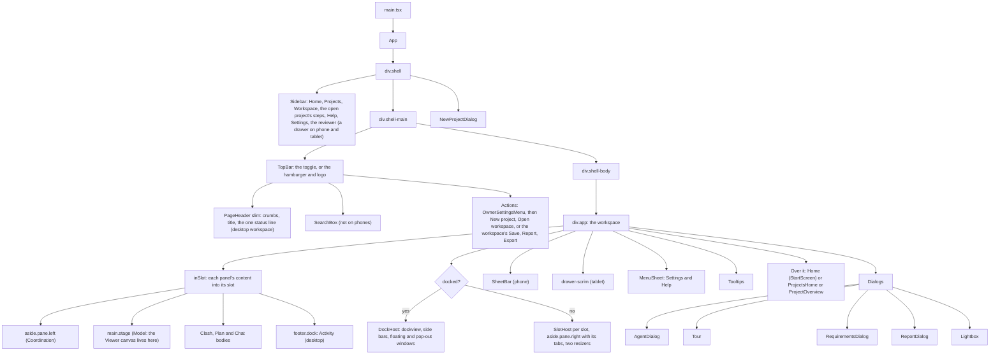
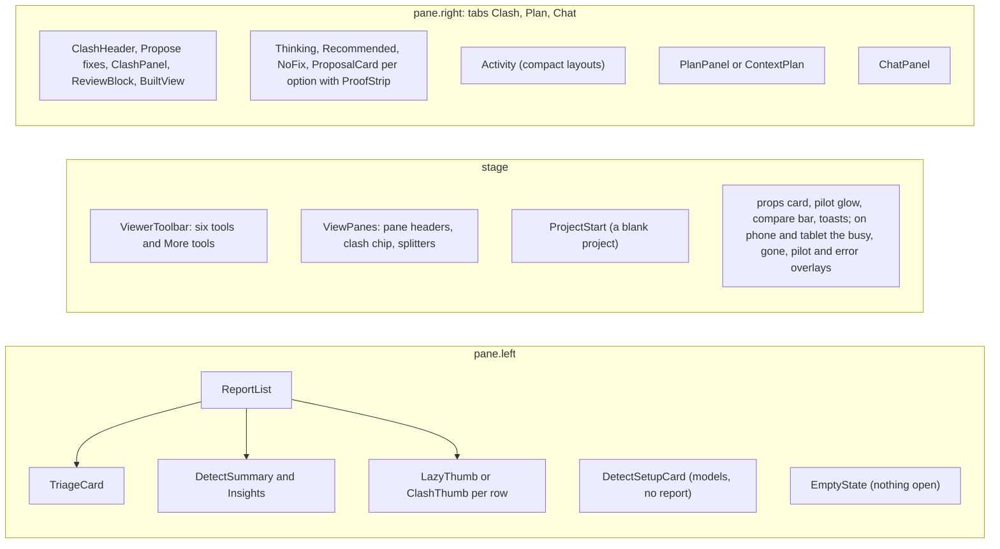
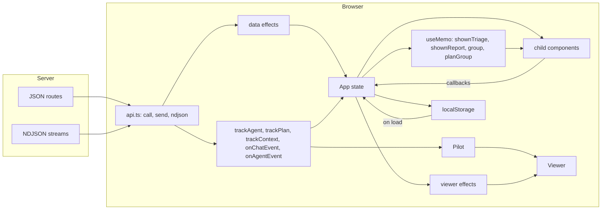
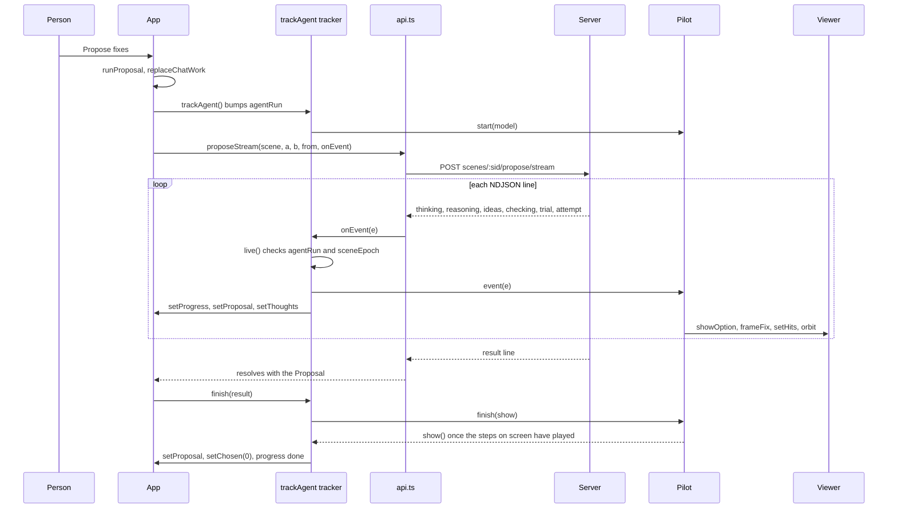

# 12 · Web app: structure and state

> **Covers:** `web/src/` (all but `viewer/`, which is [13](13-3d-viewer.md)), `web/index.html`, `web/vite.config.ts`,
> `web/tsconfig.json`, `web/package.json`, `web/scripts/`, `web/public/`, `assets/brand/iris/` · **Checked against code:**
> re-branded on 2026-11-11; the server's address (`api.ts`, `voice.ts`, `clashImage.ts`, the server's URLs at render
> time), the engineer-workflow files (projects, import rows, model summary, coordination overview, clash header,
> proposal card) and the sample drawings (`StartScreen.tsx`, `sampleDrawings.ts`, `DrawingsPanel.tsx`,
> `drawingsApi.ts`, `trySampleDrawings`) on 2026-11-22; the app shell and theme files (`App.tsx`'s shell, `AppShell.tsx`,
> `shellNav.ts`, `PageHeader.tsx`, `Holo.tsx`, `StartScreen.tsx`, the projects pages, the decluttered workspace, `dock.tsx`,
> `dockLayout.ts` and the stylesheets) on 2026-11-22; the sidebar's footer (`BuiltBy`), the white + pink theme and
> Home's How Iris works (`HowIrisWorks.tsx`) on 2026-11-22; the Page not found page (`NotFound.tsx`, `isAppPath`) on
> 2026-11-22 · **Deeper design:** [docs/mobile.md](../mobile.md),
> [docs/views.md](../views.md), [docs/panels.md](../panels.md), [docs/brand-assets.md](../brand-assets.md),
> [docs/engineer-workflow.md](../engineer-workflow.md), [docs/drawings.md](../drawings.md)

The web app is a single-page React 19 app built with Vite and TypeScript. One component, `App` in `App.tsx`, owns
almost all of the page's state and every call that changes it; the other components draw what `App` hands them and
report back through callbacks. A handful of plain modules hold logic that the tests exercise on their own (layout,
fix wording, requirements files, uploads, review sign-offs, the chat's turn ownership). The page talks to the server
only through `api.ts`, mostly as NDJSON streams, and draws the models through the `Viewer` class
([13](13-3d-viewer.md)). There is no router, no state library and no CSS framework: `useState`/`useRef`/`useMemo`/
`useEffect` and one global stylesheet with the tokens (the shell, Home, the pages and the workspace each import a small
one of their own built on them; the landing has its own, `landing/landing.css`). Everything sits in an app shell: a
left sidebar, a top bar, and the page in the body (below, "The app shell"). Pages with an address read it from the
path with small pure modules: `/home`, `/workspace` and the projects, `/projects` and `/projects/<pid>/<step>`
(`projectRoute.ts`, below, "Engineer workflow"), and `/about` (`aboutRoute.ts`). Any other path (`isAppPath` false:
a mistyped or old link) shows the app's own Page not found page (`NotFound.tsx`) in the shell, with a Home button.

## Every file in `web/src/`

| File | What it is | Main exports | Used by |
|---|---|---|---|
| `main.tsx` | Entry: mounts `<App />` in `StrictMode` on `#root`, imports `index.css`, then `frame.css` | (none) | `web/index.html` |
| `App.tsx` | The whole page: state, handlers, effects, and the app shell it renders (below, "The app shell"): `Sidebar` and `TopBar` (`AppShell.tsx`), then the shell's body: the workspace (`div.app`: panes, sheet, dialogs; always mounted) with Home or a project's page over it. On the desktop workspace the top bar's middle is a slim `PageHeader` carrying the one status line (`headerStatus`); Settings and Help are two `MenuSheet`s the sidebar opens; the New project dialog sits at the shell's root. No notch, corner or compact header any more. Also small local components `ProofStrip`, `Recommended`, `NoFix`, `Thinking` and helpers `keepPlaces`, `movedPairs`, `clampPane` | `App` | `main.tsx` |
| `index.css` | The app's stylesheet: the lifemed tokens on `:root`, in white and pink (below, "Theme and motion"), layout grid, every feature's styles (buttons, segmented controls, dockview's light theme), then the "Responsive" block. The landing's are in `landing/landing.css`; the shell's, Home's, the pages' and the workspace's in their own files (below) | (CSS) | `main.tsx` |
| `frame.css` | How the workspace and the pages sit in the shell: `.shell`, `.shell-main`, `.shell-body` (`--shell-top-h`), the workspace (`.app`) filling the body, a page over it (`.proj-shell`, absolute in the body) with its `.proj-shell-alert`, the top bar's `.work-actions` (Export's kept-fix count `.export-n`), the one status line (`.status-line`: `status-error`, `-gone`, `-pilot`, `-work`, `-idle`), Help's steps (`.help-flow`), `kbd`; at its end the owner's white + pink theme for every screen, loaded last so it wins over the component sheets: primary buttons on `--holo-cta` with a pink glow on hover and an ink focus ring, secondary buttons pink on hover, the selected clash row a pink tint with a pink left edge, chips and count badges on white or pink, form controls `accent-color` pink, every `.spinner` filled with `--holo`, white dock tabs underlined in pink, Settings' section titles and `.proj-eyebrow` in `--accent-ink` (below, "Theme and motion") | (CSS) | `main.tsx` (after `index.css`) |
| `AppShell.tsx` | The app shell's parts (below, "The app shell"): `Sidebar` (the logo: the Aperture mark and "Iris"; Home, Projects, Workspace for a session outside a project, the open project's group with its seven steps and counts, Help, Settings, then `BuiltBy`; its `reviewer` and `onReviewer` props are optional and unused; expanded, the 64 px rail, or a drawer on phones and tablets that Escape, the scrim, ✕ or an item closes, focus kept inside and given back), `TopBar` (the collapse toggle, or the hamburger and logo; the middle; the search; the actions), `SearchBox` (a combobox whose popover groups the hits by kind; arrows and Enter, Escape, "/" or Ctrl/⌘+K to focus it; an icon that opens the field on narrow screens), `SideLink` (a link whose plain click goes to `onNav`, a button without an address; `aria-current="page"` when active), `BuiltBy` (the sidebar's quiet footer: the small Aperture mark and "Built by Techjays"; on the rail the mark alone with that tip; a `role="note"`), `LogoTile`. No person in the sidebar and no log out: there is no login. Props only | `Sidebar`, `TopBar`, `SearchBox`, `SideLink`, `BuiltBy`, `LogoTile`, `SidebarProps`, `TopBarProps`, `SearchBoxProps`, `SideLinkProps`, `NavId`, `SearchHit` | `App` |
| `shellNav.ts` | The shell's pure parts, no React: the sidebar's item ids (`NavId`: home, projects, workspace, a project step), the rail state in `iris.sidebar` (`readRail`, `writeRail`: `{"pages": bool, "workspace": bool}`, true meaning the rail; `RAIL_DEFAULT` expanded on pages and the rail on the 3D workspace; a missing or throwing storage gives the defaults and never throws), the initial and the saved name (`initials`; `cleanName`, at most `NAME_MAX`, 120; both kept and tested, no longer used by the sidebar), the search key (`isSearchKey`: "/" outside a field, `inField`, or Ctrl/⌘+K) the hits grouped by kind (`groupHits`, the first `MAX_HITS`, 8) and the sidebar's sheets at their own addresses (`SheetId`: `/settings`, `/help`; `sheetOfPath` reads one, `showSheetPath` pushes it over the page it was opened from and, closing, puts that page's address back) | `NavId`, `SheetId`, `sheetOfPath`, `showSheetPath`, `RailWhere`, `SIDEBAR_KEY`, `RAIL_DEFAULT`, `readRail`, `writeRail`, `browserStorage`, `StorageLike`, `initials`, `NAME_MAX`, `cleanName`, `SearchHit`, `HIT_KIND_LABEL`, `MAX_HITS`, `HitGroup`, `groupHits`, `inField`, `isSearchKey` | `App`, `AppShell.tsx` |
| `appShell.css` | The sidebar (`nav.sidebar`, 264 px; `.sidebar-rail`, 64 px, the width animated; `.side-drawer.open` / `.closed` over a light `.side-scrim` on phones and tablets), its rows (20 px outline icons; the active one a white pill with a hairline, a soft shadow and a 2 px holo left edge; counts as small pills, open clashes red-tinted), the logo tile, the footer (`.side-built`: the mark and "Built by Techjays", small and muted, centred on the rail), the top bar (`header.topbar`, `.compact`, `.has-middle`) and the search (`.search*`); prefixes `side-`, `topbar-`, `search-`; light only | (CSS) | `AppShell.tsx` |
| `PageHeader.tsx` | A page's header in the shell: the breadcrumb (`Crumb`: a link whose plain click the page handles, or the page itself), the title, a grey line under it, then the status and the actions at the right; `slim` is the workspace's one row in the top bar (crumbs and title side by side, the status line in the middle, no line under the title). Props only | `PageHeader`, `Crumb` | `App` (the workspace's slim header), `ProjectsHome.tsx`, `ProjectOverview.tsx` |
| `page.css` | PageHeader's styles (`.page-head`, `.page-crumbs`, `.page-title` 30 px at weight 500, `.page-sub`, `.page-status`, `.page-actions`, a hairline under it; `.slim`, one row with a 15 px title) | (CSS) | `PageHeader.tsx` |
| `Holo.tsx` | Iris's motion (below, "Theme and motion"): `MarkBadge` (the Aperture's blades in the holo colours in a soft pink circle, a CSS mask of `/brand/iris-spinner.svg`: the art of empty states, the loading card and Home's quiet lines; the striped holographic ribbon was removed at the owner's request), `TextReveal` (words from a lavender blur to ink, once), `CountUp` (a number counting up with a lavender blur), `EmptyState` (the badge, a title, one line, one action; `compact`; `glass` puts one of the 3D glass stills, `glassStill` from `glassModel.ts`, in place of the badge, at most one per view: Projects' "Start your first project" the aperture, Reports' "No reports yet" the pill, a missing project's page the ring; the loading card has its own ring), `useReducedMotion`, `prefersReducedMotion`; everything still under `prefers-reduced-motion` and where there is no window | `MarkBadge`, `TextReveal`, `CountUp`, `EmptyState`, `useReducedMotion`, `prefersReducedMotion` | `App`, `StartScreen.tsx`, `ProjectsHome.tsx`, `ProjectOverview.tsx` |
| `holo.css` | The mark badge (`.mark-badge`, its size `--mb`), `.text-reveal*`, `.count-up`, `.ai-shimmer` (a soft holo band moving across a status line or card while an AI model works), `.holo-edge` (a 1 px `--holo` border on AI-made things), `.empty-state*` (`.empty-state-glass`, the still), `.load-glass` (the loading card's glass ring, turning in 9 s); every animation off under `prefers-reduced-motion` | (CSS) | `Holo.tsx` |
| `CursorGlow.tsx` | The pink glow that follows the cursor over the pages (Home, the projects, a project's pages; App mounts it once at the shell's root with `on={onPage}`, so never over the 3D workspace): a pink-to-lavender glow easing toward the pointer (`LEAD_EASE`) and a smaller periwinkle one trailing it (`TRAIL_EASE`), breathing when the mouse rests; moved by transform from a `requestAnimationFrame` loop that runs only while catching up, paused in a hidden tab, no React render per frame. `glowMode`: it follows a fine pointer, a coarse pointer or less motion gets a still wash, else off. It also sets `--mx`/`--my` on the card under the cursor (`SPOTLIGHT`: `.home-tile`, `.hiw-card`) | `CursorGlow`, `glowMode`, `ease`, `LEAD_EASE`, `TRAIL_EASE`, `SPOTLIGHT`, `GlowMode` | `App` |
| `cursorGlow.css` | The glow's layer (fixed, `pointer-events: none`, `mix-blend-mode: multiply`, z-index 60), its two radial glows and their breath, the still wash, and the cards' spotlight (a pink radial highlight at `--mx`/`--my` with a 2 px lift, fine pointers only); still under reduced motion | (CSS) | `CursorGlow.tsx` |
| `api.ts` | Every server call, the NDJSON reader, the wire types, the two request headers, the server's address (`VITE_API_BASE`) | `api`, `ApiError`, `apiUrl`, `wsUrl`, `apiSend` (a JSON request with the same headers, for `reviewQueueModel.prepareFixes`), `setOwnerSettings`, `setRequirements`, `requirementsInUse`, ~100 types | everything |
| `aiNames.ts` | The name of the AI model behind each role (proposal, escalation, triage, image, voice) as the server reports it (`GET /api/models` labels), for every panel's words; App sets them, the defaults until then | `aiName`, `setAiNames`, `DEFAULT_AI_NAMES`, `AiRole`, `AiNames` | `App`, `Activity.tsx`, `pilot.ts`, `PlanPanel.tsx`, `BuiltView.tsx`, `Triage.tsx`, `Insights.tsx`, `ReportDoc.tsx`, `ClashPanel.tsx`, `ReportList.tsx`, `Requirements.tsx`, `Owner.tsx`, `Workings.tsx`, `workingsGraph.ts` |
| `names.ts` | Model files' names as people read them: no extension, and no prefix the set shares, whatever the project is called | `shortNames`, `sharedPrefix` | `App` |
| `About.tsx` | The landing in the empty viewer, a page of its own (`landing/`): its header (the wordmark, section links that follow the scroll), the hero with the live replay (`landing/Hero.tsx`) and the resume card, the strip of formats Iris reads and writes by their logos (`Formats`), the problem (`Collide`), the loop as tabs beside one frame playing each step's recorded run (`Loop`), the check to try by hand (`landing/Sandbox.tsx`), the kinds of fix (`landing/FixArt.tsx`), the AI's rule and the five models, everything around the fix (`landing/Bento.tsx`), the two demo cards playing a recorded fix (`DemoCard`, `Clip`), who it is for, what is proven and what is not, words and colours, the close with the "Go deeper" card that opens About Iris, the footer. Its numbers are the measured ones; the one industry figure, rework's cost, links its source `GIRI_STRATEGY` | `About`, `Resume`, `projectName`, `GIRI_STRATEGY` | `StartScreen.tsx` (`Resume`, `projectName`), `App` (`projectName`); App mounts the page itself no more (Home is the first screen) |
| `AboutIris.tsx` | About Iris: a full page over the app in six tabs (Overview, How it works, The fixes, The AI, Under the hood, Proof and limits), with animated SVG pictures (the Iris loop, the girder clash before and after, each fix kind, the propose-check loop), count-up numbers and sections that fade up as they scroll in; reduced motion shows it all still. Its numbers are the landing's measured ones | `AboutIris` | none at HEAD: App keeps `aboutTab` from the address but mounts no page for it ("no longer offered", docs/ui-design.md §10) |
| `stepClips.ts` | The landing's step clips: an animated WebP's length read from its frames (`webpDuration`), and each clip fetched once (`loadClip`) so the loop (`Loop` in `landing/Story.tsx`) can play it from a fresh object URL, from its first frame, and move on when it ends | `webpDuration`, `loadClip`, `LoadedClip` | `landing/Story.tsx` |
| `StartScreen.tsx` | Home (`/home`, and `/` on load), the first page inside the shell, light and calm (docs/ui-design.md §10.1): the greeting (`greetingFor`: Good morning, afternoon or evening, then the reviewer's name or "there") revealed word by word (`TextReveal`) beside the holographic ribbon, the tagline "AI proposes. Geometry proves. The engineer decides.", what Iris does, the last session to resume (Resume, Start fresh), three start tiles (**New project**, dashed; **Try the sample building**, `data-start="sample"`, the Northbank sample as a project of this browser's opened on its Clash review; **Try the sample drawings**, `data-start="sample-drawings"`, the same project on its Drawings step with the sample PDF sheets attached, shown only when the server lists sample drawings; `sampleBusy` or `sampleDrawingsBusy` spin the one opening while both wait), then **How Iris works** (`HowIrisWorks`: each card opens its step on the sample building through `onSampleStep`, which `App` wires to `trySample(step)`; static cards without it), then **Recent projects** (up to `RECENT_MAX`, 4: name, models, the open clashes when the last check is known, else "Not checked", when updated; light placeholders while listing; "Create one" with none). No demo clips ("See it work" is gone). No 3D and no brand header of its own: the shell has them. Props only | `StartScreen`, `greetingFor`, `RECENT_MAX` | `App` |
| `NotFound.tsx` | Page not found: a light page in the shell for an address the app has no page for (`isAppPath` false), `EmptyState` with "This page doesn't exist", one line and a **Home** button (`onHome`: `App`'s `goHome`). `App` shows it (`lostPage`) when no project's page, Home or About is asked for, in place of Home. The server sends `index.html` for such a browser address (`app._is_page`), as Firebase Hosting's `**` rewrite does, so the app draws this page, never raw JSON. Props only | `NotFound` | `App` |
| `home.css` | Home's styles (`.home*`): the hero (the greeting at weight 400, the tagline, the ribbon at the right, clipped so nothing scrolls sideways), the resume card on glass, the start tiles (New project dashed), the recent projects (How Iris works has its own, `howIrisWorks.css`); Home is a size container, so its layout follows the panel's width beside the sidebar, not the window's | (CSS) | `StartScreen.tsx` |
| `StartScreen.tsx` | Home (`/home`, and `/` on load), the first page inside the shell, light and calm (docs/ui-design.md §10.1): the hero: at the left the greeting (`greetingFor`: Good morning, afternoon or evening, then the reviewer's name or "there"), the tagline in two lines of large regular type (`TAGLINE`: "AI proposes. Geometry proves." / "The engineer decides.", `h1.home-tagline`), both revealed word by word (`TextReveal`), and what Iris does, set at the top of the hero (no blank band above the greeting); at the right our logo as a 3D glass aperture floating over a white pedestal (`HeroGlass`, loaded with `React.lazy` so three.js is not in the first paint; `HERO_POSTER`, its still, shows until it loads); a square "↓" cue (`.home-cue`) scrolls down to the body; then the last session to resume (Resume, Start fresh), three start tiles styled alike (white, a hairline; the lift and the holo edge only on hover; **New project**; **Try the sample building**, `data-start="sample"`, the Northbank sample as a project of this browser's opened on its Clash review; **Try the sample drawings**, `data-start="sample-drawings"`, the same project on its Drawings step with the sample PDF sheets attached, shown only when the server lists sample drawings; `sampleBusy` or `sampleDrawingsBusy` spin the one opening while both wait), then **How Iris works** (`HowIrisWorks`: each card opens its step on the sample building through `onSampleStep`, which `App` wires to `trySample(step)`; static cards without it), then **Recent projects** (up to `RECENT_MAX`, 4: name, models, the open clashes when the last check is known, else "Not checked", when updated; light placeholders while listing; "Create one" with none, beside the small Aperture mark: the hero already has the glass). No demo clips ("See it work" is gone). No brand header of its own: the shell has it. Props only | `StartScreen`, `greetingFor`, `RECENT_MAX`, `TAGLINE` | `App` |
| `home.css` | Home's styles (`.home*`): the hero (two columns: the words at the top left, the tagline at 60 px / 400, the aperture's box at the right; on a phone the aperture above the words, centred; the square cue under them; clipped so nothing scrolls sideways), the resume card on glass, the start tiles (all three alike, white with a hairline; a lift, a soft shadow and the holo edge on hover only), the recent projects (How Iris works has its own, `howIrisWorks.css`); Home is a size container, so its layout follows the panel's width beside the sidebar, not the window's | (CSS) | `StartScreen.tsx` |
| `HowIrisWorks.tsx` | Home's **How Iris works** (`section.hiw`, labelled by its title): a kicker with the small Aperture mark, the title "From tangled models to verified fixes" and one line ("Eight steps, from the models you bring to the report you share."), then `HiwCards`: `PROJECT_FLOW`'s eight steps as cards (`ol.hiw-grid`) in four phases (`HIW_PHASES`: **Bring in**, **Find**, **Fix**, **Share**, each label above the first card of its phase), each card an icon tile (`HIW_CARDS`: Upload, Layers, Radar, Crosshair, Sparkles, ShieldCheck, UserCheck, FileText), a step pill (01 to 08), the step's name, `PROJECT_FLOW`'s line unchanged and a measured proof chip (IFC · STEP; 4 models · 1,732 elements; 464 clashes in 11 s; #1 · −300 mm; Gemini 3.8 Flash; Clash gone · 50 mm clear · nothing new hit; 8 of 8 fixes ready to review; PDF + BCF). Propose wears the AI's holo edge (`.holo-edge`) and an "AI" badge, Validate a green "✓ Geometry" badge, and "AI proposes → geometry proves" (`HIW_BRIDGE`) sits between them, above Validate. With `onStep` each card is a button ("Open <step> on the sample building") that opens its `HIW_CARDS` step: Models for Import and Understand, Coordination for Detect, Clash review for Investigate to Review, Reports for Report; without it the cards are static. The cards fade up one after another as the section scrolls into view (an `IntersectionObserver`, armed before paint); still under reduced motion (`useReducedMotion`) and with no window, so a static render shows everything. `glass`: an optional decorative image, nothing drawn without it | `HowIrisWorks`, `HiwCards`, `HIW_PHASES`, `HIW_CARDS`, `HIW_BRIDGE` | `StartScreen.tsx` (Home, after the start tiles) |
| `howIrisWorks.css` | How Iris works' styles (`.hiw*`), light, on `index.css`'s tokens: a size container (`hiw`) with four columns, two at 880 px or narrower and one at 560 px or narrower (there, phase labels only where a phase starts); white cards with a hairline, a 16 px radius and a soft shadow that lift 2 px with a pink-lavender glow on hover; 48 px icon tiles in a lavender-to-pink tint (Propose's holo-tinted, Validate's green); the step pill on white; proof chips and the bridge in `--accent-soft` with `--accent-ink` text; the AI badge on `--holo-cta`; a thin dashed line joining the cards (down between them in one column); a soft pink-lavender haze behind the heading; the reveal (`.hiw-armed`, `.hiw-shown`, 80 ms apart), none under reduced motion | (CSS) | `HowIrisWorks.tsx` |
| `HeroGlass.tsx` | Home's hero object, live: our Aperture logo as 3D glass (a `GlassStage` from `glass.ts` with `hero`) on a canvas that fills its container. It floats over a white pedestal, turns a sixth of a turn per `LOOP_S` (24 s) and breathes open and closed like an eye's iris (`BREATH_S`, 8 s, eased); it leans toward the pointer (up to `MAX_TILT`, about 12°, eased with `follow` in the render loop; `pointermove` on the window, no React state per frame) and opens a little more while the pointer is over `track` (Home's hero). The pointer counts only with a fine pointer and motion allowed (`pointerFollows`), never on touch. It renders only while on screen (IntersectionObserver) and the tab is showing (`visibilitychange`), at most 2x pixels (`capPixelRatio`); one still frame under `prefers-reduced-motion` (`useReducedMotion`) or `paused`, resuming from the same pose; its still (`HERO_POSTER`) under the canvas until the first frame, and alone with no WebGL or a lost context (`data-mode`: poster, live, still); everything freed on unmount. Decorative (aria-hidden). Default export for `React.lazy` | `HeroGlass` (default too), `aperturePose`, `pointerAim`, `shouldAnimate`, `capPixelRatio`, `LOOP_S` | `StartScreen.tsx` (lazy) |
| `heroGlass.css` | The aperture's box (`.hero-glass`, filling its container), the canvas fading in over the still (`.hero-glass-canvas`, `.hero-glass-still`, `object-fit: contain`), no fade under reduced motion | (CSS) | `HeroGlass.tsx` |
| `glass.ts` | Iris's 3D glass with three.js, our own (no stock or third-party assets): `glassMaterial` (`MeshPhysicalMaterial`: transmission, thickness, a light violet attenuation, dispersion, iridescence with `iridescenceIOR` and `iridescenceThicknessRange`, clearcoat, roughness 0.06), a generated studio environment (white in front, the holo colours round the sides and back, white strips for the clear coat's streaks, pre-filtered with `PMREMGenerator`), a backdrop of soft holo colour fields that only the transmission pass sees (the page stays white while the glass bends colour), and `createGlassStage(canvas, { shape, hero })`: the Aperture (the mark's six blades extruded thick with a rounded bevel, each in a pin group that slides out and turns a little as it opens, round an ink hexagonal pupil that grows with the opening), the ring and the pill; with `hero`, a white pedestal (its own hemisphere light) with a contact shadow that tightens as the aperture comes down. ACES tone mapping, sRGB output, antialiasing, a camera that fits `GLASS_EXTENT` like `object-fit: contain`; `render(t, aim)`, `resize`, `snapshot`, `dispose`. Throws without WebGL | `createGlassStage`, `GlassStage`, `glassMaterial` | `HeroGlass.tsx`, `glassStill.ts` |
| `glassModel.ts` | The glass's pure parts (no three, no DOM; Node tests load it): `pathOutlines` (an SVG path's outlines for M, L, circular A and Z), `apertureParts` (the mark's six `Blade`s from Brand.tsx's paths, centred, y up, radius 1: outline, pin, tip, way out, turn sign; the pupil and its clean `hexagon`), `bladeMove` (`BLADE_SLIDE`, `BLADE_TURN`), `turnAbout`, `pupilScale`, `aperturePose(t)` (spin, lean, float and `open`; periodic in `LOOP_S`), `pointerAim`, `follow`, `pointerFollows`, `shouldAnimate`, `capPixelRatio` (`MAX_DPR` 2), `sweepMesh` (a superellipse cross-section swept round a closed loop with half-turns of twist, the seam stitched so the mesh is closed with smooth `vertexNormals`) and `ringMesh`, `GLASS_SHAPES` (aperture, ring, pill), `GLASS_EXTENT`, the stills' paths (`HERO_POSTER` `/hero/aperture.webp`, `glassStill(shape)` `/glass/<shape>.webp`) | `GlassMesh`, `GlassShape`, `GLASS_SHAPES`, `GLASS_EXTENT`, `HERO_POSTER`, `glassStill`, `LOOP_S`, `BREATH_S`, `MAX_DPR`, `MAX_TILT`, `Blade`, `BLADE_SLIDE`, `BLADE_TURN`, `bladeMove`, `pathOutlines`, `apertureParts`, `turnAbout`, `pupilScale`, `aperturePose`, `pointerAim`, `follow`, `pointerFollows`, `sweepMesh`, `vertexNormals`, `ringMesh`, `shouldAnimate`, `capPixelRatio` | `glass.ts`, `HeroGlass.tsx`, `StartScreen.tsx` (`HERO_POSTER`, `glassStill`), `glassStill.ts` |
| `glassStill.ts` | The page `web/scripts/render-glass.mjs` renders the stills from (`web/scripts/render-glass.html`, on a Vite dev server only; not in the app's build): one shape by the same `createGlassStage` at `?shape=&hero=&w=&h=&t=`, drawn on white; with `transparent=1` white is taken out to transparency (colour to alpha, exact over white). Sets `window.glassStill.snapshot(type, quality)` | (none) | `web/scripts/render-glass.html` |
| `landing/Hero.tsx` | The landing's first screen: the hook and the ways in (with `data-tour` `golden` and `blank`), and the live 3D replay of Iris fixing Northbank's three girder clashes: labels hung on the scene each frame, the log (each line tagged with its step: Observe, Resolve, Check, Apply), chapter buttons and pause. It frames the scene in the HUD's empty window wherever the layout puts it, pauses off screen and in a hidden tab, gives a still frame (and still chapters) for less motion, a recorded still of the app without WebGL, and a fresh canvas each mount | `Hero`, `HeroActions` | `About.tsx` |
| `landing/heroScene.ts` | The hero's three.js scene, apart from the viewer ([13](13-3d-viewer.md)): the girder, the services, their fixes and the context from `landing/northbank.ts`, materials in the viewer's colours with a scan band, a fade beyond the crossings and an idea's lift from its run in their shaders, a camera that eases to the clash being told and fits the window, fog by distance; draws one frame of `landing/timeline.ts` and gives its WebGL context back on dispose | `HeroScene`, `webglAvailable`, `Anchor` | `landing/Hero.tsx` |
| `landing/timeline.ts` | The replay as a pure function of time (36 s): the check's sweep, the three pins, each run's idea, check, keep and old self, the tray's recorded round (the whole lift failing on the spigots and a core wall, then its offset), the log's lines from Iris's records (the opening as Gemini Pro is told it, the recorded numbers), chapters, the still frame | `heroAt`, `logAt`, `LOG`, `CHAPTERS`, `T`, `LOOP`, `STILL`, `chapterStill`, `ramp`, `HeroFrame` | `landing/Hero.tsx`, `landing/heroScene.ts` |
| `landing/northbank.ts` | Northbank's answer key as the landing draws it, from the models' own geometry (read with IfcOpenShell, [19](19-demo-data.md)): the girder with its web openings, the three runs and their recorded fixes, the context; a run's centreline with raised stretches (`offsetPath`, `cutPath`) and a mitred sweep of any section along it (`sweep`) | `GIRDER`, `RUNS`, `CONTEXT_BOXES`, `CONTEXT_RUNS`, `SPIGOT`, `SPIGOT_X`, `offsetPath`, `cutPath`, `sweep`, `rect`, `channel`, `circle` | `landing/heroScene.ts`, `landing/check.ts`, `landing/Hero.tsx`, `landing/Sandbox.tsx` |
| `landing/check.ts` | "Try the check yourself": the check cut to the plane that decides #1, seen along the duct (the web cut into solids round its openings, the flanges, the slab, the ceiling, the services beside it): raise the duct and it says clash gone, anything new hit, the room left, verified or not; +400 mm gives the recorded 50 mm | `checkRaise`, `passingBands`, `mm`, `SOLIDS`, `DUCT_AT`, `PLANE` | `landing/Sandbox.tsx`, `landing/Hero.tsx` |
| `landing/Sandbox.tsx` | The check to try: the girder face on, drawn from the models, the duct dragged (or the slider, or **Show Iris's fix**), the room left dimensioned, three checks and the verdict, 25 mm or 50 mm needed | `Sandbox` | `About.tsx` |
| `landing/Story.tsx` | The three teams' models as sheets coming together until their clashes light (`Collide`, by scroll), and the loop as tabs beside one frame that plays each step's recorded run and moves on as each ends (`Loop`) | `Collide`, `Loop`, `LoopStep` | `About.tsx` |
| `landing/FixArt.tsx` | A picture of each kind of fix, before and after, in the viewer's colours | `ArtMove`, `ArtOffset`, `ArtRoute`, `ArtTrim`, `ArtSeat`, `ArtResize`, `ArtOpening`, `ArtCombined` | `About.tsx` |
| `landing/Bento.tsx` | The tiles of "Everything around the fix" and their small moving pictures (triage, the root cause, Workings' lanes, chat and voice, requirements, drawing views, editing by hand, Show it built, an MCP client's settings, the hand-off with each format's logo, phones, a Navisworks report coming in with its pictures, each clash given its #N and a verdict), a logo (`Logo`) and the strip of formats under the hero (`Formats`) | `Tile`, `TriageArt`, `RootArt`, `LanesArt`, `ChatArt`, `ReqArt`, `ViewsArt`, `EditArt`, `BuiltArt`, `McpArt`, `FilesArt`, `PhoneArt`, `NavisArt`, `Logo`, `Formats` | `About.tsx` |
| `landing/logos.ts` | The logos of the formats and tools Iris works with (files in `web/public/logos/`: IFC, BCF, Navisworks and MCP are their owners', STEP and PDF drawn for Iris; [docs/brand-assets.md](../brand-assets.md)) and the strip's lines, which way each goes | `LOGO`, `LogoKey`, `FORMATS` | `landing/Bento.tsx` |
| `landing/motion.ts` | The landing's motion hooks: less motion asked for, seen once, sections fading up as they scroll in (late ones too), the section in view for the header, scroll progress, counting up | `useReducedMotion`, `useSeen`, `useReveal`, `useSpy`, `useScrollProgress`, `useCountUp` | `About.tsx`, `landing/Story.tsx` |
| `landing/landing.css` | The landing's styles: its tokens, the hero and its HUD, each section, the narrower pages by container query, less motion; and how the app's own chrome looks over it (the notch steps aside, the corner and the compact bar take the night) | (CSS) | `About.tsx` |
| `aboutRoute.ts` | The About page's tabs and address: the path `/about` and `/about/<tab>` (`showAboutPath`: pushed when it opens, so Back closes it, replaced on a tab change, and on close the address it was opened from), and the first, hash form `#about` and `#about/<tab>`, still read | `ABOUT_TABS`, `AboutTab`, `aboutTabFromHash`, `aboutHash`, `nextTab`, `currentHash`, `showAboutHash`, `aboutPath`, `aboutTabNow`, `showAboutPath` | `App`, `AboutIris.tsx` |
| `Activity.tsx` | The Activity panel: the one-line status, then Steps (the table of ideas tried, why each failed) or Workings, with the switch between them, Workings' off button and, when it is off, Turn it on; and `ActivityLine`, the one calm line the collapsed Activity strip shows (a spinner while a proposal runs, then where it is; nothing before the first run), which App hands the dock as the Activity tab's content | `Activity`, `ActivityLine`, `ActivityView`, `statusLine`, `Progress` (re-exports `editText`, `KIND_LABEL`) | `App` |
| `Workings.tsx` | Workings ([docs/workings.md](../workings.md)): the picked run drawn on a canvas that pans, zooms, follows the newest step, marks the step the pilot shows, and replays a finished run (the timeline strip, speeds); a check pointed at or pinned goes to `onPeek`, so its trial shows in the 3D viewer; timers and sizes come from the window the panel is in, so it works floated or in a pop-out window | `Workings`, `curve` | `Activity.tsx` |
| `workingsGraph.ts` | A run's events as a graph to draw (lanes, columns, steps, edges, timeline bars), one builder per kind of run, as it stood at any moment | `graphOf`, `sec`, `Graph`, `Step`, `Edge`, `Lane`, `Part`, `Peek` | `Workings.tsx`, `App` (`Peek`) |
| `runlog.ts` | The runs the page watched, for Workings: each run's events (meshes dropped, but a trial's pieces kept for the newest three proposals) with when they arrived, its origin (you, the chat, an agent over MCP, a tour replay); kinds: propose, plan, triage, built, detect, chat (a Chat panel turn); 12 kept, never letting a live one go | `runs`, `RunLog`, `lean`, `Run`, `RunHandle`, `RunKind`, `Origin`, `RUNS_KEPT`, `TRIALS_KEPT` | `App`, `Workings.tsx` |
| `Agent.tsx` | "Connect an agent" dialog: token and server fields, client set-up snippets, time left, the agent's log | `AgentDialog`, `timeLeft`, `secondsLeft`, `AgentLogEntry` | `App` |
| `AppMenu.tsx` | `MenuSheet`: a titled panel from the right with every action by name; Escape or the scrim closes it. App opens two from the sidebar (below, "The app shell"): **Settings** at `/settings` (your name for review decisions, This session, Panels and layout, Owner settings when the server has an owner, and a Help link; the workspace's own actions, sample models, your own files, checks and a Navisworks report, moved to the workspace: App's `workMore`, a closed line under the Models step's import and at the top of the workspace's left panel, `data-work-actions`) and **Help** at `/help` (the principle and the eight steps, the samples, good to know) | `MenuSheet` | `App` |
| `Brand.tsx` | Iris's identity in the page: the **Aperture** mark (six holographic blades around an ink hexagonal pupil, drawn inline: `ApertureMark`, its paths `APERTURE_PUPIL` and `APERTURE_BLADES`; `working` opens and closes the blades, the workspace status line's "Iris is working" sign, still under reduced motion; `mono` in one colour), the lockup with "Iris" in live text (`Lockup`; `Wordmark` now draws it), the app icon (`AppIcon`: the mark on a white tile), the loading card while the first models open (`LoadCard`, with the glass ring still (`glassStill("ring")`, turning slowly) at its head, fed by `LoadProgress`; `serverLine` says the server may be waking after `WAKE_AFTER_MS`, `loadShare` is the bar's share) and the kept-fix toast (the mark beside the words). The older split-O (`IrisMark`) and `Notch` are still exported but App renders neither; `NotchStatus` is what the workspace's status line says while Iris works | `ApertureMark`, `APERTURE_PUPIL`, `APERTURE_BLADES`, `Lockup`, `Wordmark`, `IrisMark`, `AppIcon`, `Notch`, `NotchStatus`, `LoadCard`, `LoadProgress`, `serverLine`, `loadShare`, `WAKE_AFTER_MS`, `KeptToast` | `App`, `AppShell.tsx` (`ApertureMark`), `About.tsx` (`Wordmark`) |
| `BuiltView.tsx` | Show it built's picture over Iris's view, the wipe dragged on the picture (its handle, each side named, the keys), "Lines from the model", the "Checked against the model" chip | `BuiltView`, `builtStep`, `cutText`, `wipeAt`, `BuiltRun` | `App`, `PlanPanel.tsx` |
| `Chat.tsx` | "Chat with Iris": turns, tool steps, suggestions, the mic (hold to talk, hands-free, upload fallback); tells the page what was asked (`asked`) before each request, so Workings draws the turn | `ChatPanel`, `Turn`, `Step` | `App` |
| `ClashPanel.tsx` | What the clash header does not show (the header holds the number, title, status, the report's distance and A and B, once): the A/B/C pictures in one row of small squares, the distance Iris measures now, whether the open model has each element, the "one element" note and the triage reading folded to one line (open at once when its rule is disputed or the reading failed); the image dialog, thumbnails. A fixed clash (a fix kept, `fix`, or `resolved` by the re-run check) shows a calm **Fixed ✓** card: what was kept, **Undo** when `onUndo` is given (App passes it only when `coordination.undoableFix` finds the newest kept edit is this clash's fix) and **Propose a different fix** as a secondary (`onProposeAgain`); App then leaves out Propose fixes, Explore wider fix and Go to the clash, and shows only Next clash after it | `ClashPanel`, `Lightbox`, `ClashThumb` | `App`, `ReportList.tsx` |
| `ContextPlan.tsx` | The "wider fix" (context proposal) review in the Plan tab: alternatives, checks, review conditions to acknowledge | `ContextPlan`, `contextStep`, `ContextRun` | `App` |
| `dock.tsx` | The desktop's panels on dockview: a slot per panel that `App` draws into (`inSlot`), `SlotHost` (where a slot sits, in the dock or the classic grid), `DockHost` (the dock, its tabs, buttons, right-click menu, saving; Activity starts collapsed to its strip, whose tab carries `strip` and App's `ActivityLine`) and `DockHandle` (show, reset, gather, and `fitBar`, which grows the bottom bar for Workings and gives it back only from that height). Imports `workspace.css` | `DockHost`, `SlotHost`, `inSlot`, `usePanelSlots`, `DockHandle`, `Slots` | `App` |
| `dockLayout.ts` | The panels and their homes, which saved layouts load (`validLayout`), pop-outs back home on save (`withoutPopouts`), storage (`LAYOUT_KEY` `iris.dock.v2`, `LAYOUT_VERSION` 2: a layout kept under `iris.dock.v1` is not read), the bars the default layout starts collapsed (`DEFAULT_COLLAPSED`: Activity's), what showing a panel takes (`showSteps`), the tab names that follow the project step (`stepTitles`: the left panel is "Models" on the Models step, "Clashes" on Clash review; `DockHost`'s `titles`) | `stepTitles`, `PANELS`, `PANEL_IDS`, `homeOf`, `isPanel`, `validLayout`, `withoutPopouts`, `readLayout`, `writeLayout`, `showSteps`, `LAYOUT_KEY`, `LAYOUT_VERSION`, `DEFAULT_COLLAPSED`, `CLASSIC_KEY` | `App`, `dock.tsx` |
| `workspace.css` | The workspace decluttered: the 3D toolbar's light glass column and its white menus (More tools in two columns), the clash list (status tabs with counts, number / title / distance-badge rows, row actions on hover or focus and a ⋮ that is always there on touch, the selection bar), the clash header and panel (one measure line, A and B side by side, the calm Fixed state, the A/B/C squares, the folded triage note), and the Activity strip with its `ActivityLine`. `index.css` comes later in the cascade, so each rule here is more specific than the one it overrides; never a bare `.rail` | (CSS) | `dock.tsx` |
| `Detect.tsx` | Iris's check: the set-up card (tests to run), the run summary (coverage, new/resolved, Detect again; with no check of the open models kept, "Only <check>" and Check the open models), and the check picker over the list (All checks or one kept check, Run again, Remove a check on filters, Run all again, which checks ran before a fix; [docs/detection.md](../detection.md), "Kept checks") | `DetectSetupCard`, `DetectSummary`, `CheckPicker`, `DetectProgress` | `App` |
| `Insights.tsx` | Root causes and patterns, with their fix, filter, tick, mark and Add to requirements buttons | `Insights` | `App` (into `ReportList`'s `insights` slot) |
| `Owner.tsx` | The owner's gear: unlock, "For me" and "For everyone" settings; marked while the owner's own settings are on, what is set in its tip (`note`) | `OwnerSettingsMenu` | `App` |
| `PlanPanel.tsx` | A Fix-together or root-cause plan: its items, their status, the joint check, Accept | `PlanPanel`, `PlanRun` | `App` |
| `Properties.tsx` | The selected object's properties under its card: the element (class, every attribute, GlobalId, storey, file, size), its type, materials, classification, groups, documents, then each property and quantity set (Type badges, every kind of value, lengths in mm); each row's facet key for the filters; a filter, click to copy; a pencil on the element's own editable rows (`RowEdit`: an attribute, a value in its own set, its type, storey, material, a classification swapped or taken off) that edits in place, **Add a classification**, a select from `property-choices` or typed, kept through `PropEditor` | `PropertySets` (row tools: copy, filter by, colour by, isolate all with, change; collapse all; links open an object), `RowActions`, `RowEdit`, `PropEditor`, `EDITABLE_ATTRIBUTES`, `changeFor`, `editOptions`, `sections`, `filtered`, `shown`, `words`, `classWords` | `ElementCard.tsx` |
| `ElementCard.tsx` | The selected element's card ([docs/panels.md](../panels.md), "Properties"): header, breadcrumbs that open a parent's own properties (with a back arrow; a storey's isolate, hide, filter), the icon bar (A, B, zoom, hide, isolate, section box, links, More for the class), what it is linked to (`Links`), then `PropertySets` (folded under All properties on the card over the model; its editor, `CardActions.editor`, only for the element itself: `api.editProperty`, then the new properties, the drawn revision moved on and the log read again) | `ElementCard`, `CardActions`, `Links` | `App` (`elementCard`, `cardActions`) |
| `FiltersPanel.tsx` | The Filters panel ([docs/filters.md](../filters.md)): the list of filters (on, colour or action, name, count, up, down, zoom to them, delete; Show colours, The rest: Show · Grey · Hide, Colour by…), and the editor (models, classes and floors with counts, property conditions, Colour / By value / Hide / Isolate, swatches, Invert, the Value / Items / Colour table, the live count); with `check`, each row's What do these hit? and the Check clashes block under the list ([docs/filters.md](../filters.md), "Checks") | `FiltersPanel`, `blankRule`, `FiltersPanelProps` | `App` (the dock's Filters panel, or a sheet without the dock) |
| `ProjectStart.tsx` | The blank project's drop zone (IFC/STEP models, or a Navisworks report or folder) | `ProjectStart` | `App` |
| `projectRoute.ts` | A project's address as a path, pure (as `aboutRoute.ts`; below, "Engineer workflow", "Addresses and steps"): the seven steps in order with their labels, `/projects`, `/projects/<pid>` (Overview), `/projects/<pid>/<step>` (`clashes` for Clash review) and `/projects/<pid>/clashes/<n>` read and written (an unknown step opens on Overview; an id is 1–64 word characters or dashes, never a slash); the first, hash addresses (`#projects`, `#project/<pid>/<step>`) still read, and `legacyPath` turning an old hash (`#about`, `#owner` too) into its path; the step beside one (`stepBeside`, wrapping; nothing calls it since the step bar went); `showPath` / `showProjectRoute` (pushed, so Back returns, or replaced; the same address again is not a new entry); `isAppPath` (an address the app has a page for: `/`, `/index.html`, `/home`, `/workspace`, `/settings`, `/about` and its tabs, a path `parseProjectPath` reads; "" where there is no location; anything else is Page not found, `NotFound.tsx`); `ownClick` (a plain click a link's page handles, not one for a new tab) | `PROJECT_STEPS`, `ProjectStep`, `Step`, `ProjectRoute`, `isProjectStep`, `isProjectId`, `parseProjectPath`, `formatProjectPath`, `projectPath`, `PROJECTS_PATH`, `parseProjectHash`, `formatProjectHash`, `projectHash`, `PROJECTS_HASH`, `legacyPath`, `stepBeside`, `stepLabel`, `currentHash`, `currentPath`, `currentProjectRoute`, `showPath`, `showProjectRoute`, `ownClick`, `isAppPath` | `App`, `ProjectOverview.tsx`, `ProjectsHome.tsx`, `projectsApi.ts` (type) |
| `projectRoute.ts` | A project's address as a path, pure (as `aboutRoute.ts`; below, "Engineer workflow", "Addresses and steps"): the seven steps in order with their labels, `/projects`, `/projects/<pid>` (Overview), `/projects/<pid>/<step>` (`clashes` for Clash review) and `/projects/<pid>/clashes/<n>` read and written (an unknown step opens on Overview; an id is 1–64 word characters or dashes, never a slash); the first, hash addresses (`#projects`, `#project/<pid>/<step>`) still read, and `legacyPath` turning an old hash (`#about`, `#owner` too) into its path; the step beside one (`stepBeside`, wrapping; nothing calls it since the step bar went); `showPath` / `showProjectRoute` (pushed, so Back returns, or replaced; the same address again is not a new entry); `ownClick` (a plain click a link's page handles, not one for a new tab); `isWorkStep` (Models, Coordination, Clash review: the workspace) and `projectView` (what a project's address shows: the workspace or the page once the project is known, the not-found page for any step of one the server does not have, `/projects/<id>/clashes/5` too, else loading; only a known project opens the workspace or its models) | `isWorkStep`, `projectView`, `ProjectView`, `PROJECT_STEPS`, `ProjectStep`, `Step`, `ProjectRoute`, `isProjectStep`, `isProjectId`, `parseProjectPath`, `formatProjectPath`, `projectPath`, `PROJECTS_PATH`, `parseProjectHash`, `formatProjectHash`, `projectHash`, `PROJECTS_HASH`, `legacyPath`, `stepBeside`, `stepLabel`, `currentHash`, `currentPath`, `currentProjectRoute`, `showPath`, `showProjectRoute`, `ownClick` | `App`, `ProjectOverview.tsx`, `ProjectsHome.tsx`, `projectsApi.ts` (type) |
| `projectsApi.ts` | Projects on the server ([docs/engineer-workflow.md](../engineer-workflow.md), "Server contract"): the `Project` wire types and a typed call per `/api/projects*` route through its own small JSON `request` (a failure is `api.ts`'s `ApiError` with FastAPI's `detail`); listing asks only for the ids this browser keeps (`iris.projects`, most recent first), in batches of `LIST_IDS_MAX` (200), and `pruneProjectIds` forgets the ids the server no longer has; the stable clash key reviews are stored under; and the plain facts the project pages show: relative and full times (server seconds or page milliseconds, `toMs`), sizes, the model mix, the latest saved state, review tallies, which counts to show (`knownCounts`: the open page's live ones, else the project's last known) and the next step (`nextAction`: no models → import; models, no counts → run coordination; open clashes → review; else report); `closedText` words the share closed without a false round number (1 of 464 is "<1% closed", 463 of 464 ">99% closed") | `listProjects`, `createProject`, `getProject`, `patchProject`, `renameProject`, `attachScene`, `openProject`, `saveProject`, `setReview`, `addReport`, `projectReportUrl`, `projectsApi`, `clashKey`, `myProjectIds`, `rememberProject`, `forgetProject`, `pruneProjectIds`, `PROJECTS_KEY`, `LIST_IDS_MAX`, `toMs`, `whenText`, `fullTime`, `sizeText`, `plural`, `closedText`, `modelMix`, `lastSaved`, `REVIEW_LABEL`, `reviewTally`, `knownCounts`, `nextAction`, `Project`, `CoordCounts`, `Review`, `ActivityItem`, `NextAction`, … | `ProjectsHome.tsx`, `ProjectOverview.tsx` |
| `ProjectsHome.tsx` | Projects (`/projects`) in the shell: a `PageHeader` ("Projects", how many in this browser; **Open the sample building** at the right when there are projects), tabs with counts (All · Needs review · Clear · Not checked), a table card (Name · Models · Clashes · Open · Status · Last saved · ⋮) whose status pill comes from the counts and reviews only (`projectStatus`: No models, Not checked, Open issues, All clear, Resolved, In review), each row's ⋮ menu (Open, Rename in place, Remove from this browser with an inline confirm), stacked cards on a narrow panel, and with no projects an `EmptyState` with **New project** and Try the sample building. No inline create form: `NewProjectDialog` (a light modal: one name up to 120 characters, Enter creates, Escape or Cancel closes but not while `busy`, `error` the server's words) is App's, opened from Home's tile, the top bar and this empty state. `PROJECT_FLOW`: the eight steps a project follows (Import → Report, in words true of Iris as built). Props only: `projects`, `loading`, `error`, `onNew`, `onOpen`, `onRename`, `onRemove`, `onDemo`, `hrefOf` | `ProjectsHome`, `ProjectRow`, `NewProjectDialog`, `projectStatus`, `ProjectStatus`, `ProjectStatusKey`, `PROJECT_FLOW` | `App`, `StartScreen.tsx` (`PROJECT_FLOW`) |
| `ProjectOverview.tsx` | A project's page (`/projects/<pid>/<step>` for Overview, Drawings, Reports and Activity): a `PageHeader` (crumbs Projects › name › step; the title the name, or the step's label; under it created, updated and the last save; **Save** its only action), then the step's body: Overview (four stat cards that count up, `CountUp`: Models, Clashes, Open, Resolved, "—" when unknown; the models table and the coordination tally with `closedText`; the next step from `nextAction` under a thin holo line; recent activity; recent reports), Reports and Activity (the activity, the saved states and, given `decisions`, the Decisions card: fixed column widths, one line in the short columns, the date short, `shortWhen`: "Nov 22, 14:05", the full time in its tip; the table scrolls sideways inside its card on a phone), with `EmptyState` where there is nothing yet (it still holds bodies for Models, Coordination and Clash review, steps App shows as the workspace instead). App's own cards for the step follow as `children` (Drawings' `DrawingsPanel`, building a report, the decisions, the edit log). The page is a size container, so it follows its panel's width. No step bar: the sidebar carries the steps. Props only: `project`, `step`, `onStep`, `counts`, `reports`, `activity`, `decisions` (App's open session's, `null` when its models are not open), `onImport`, `onOpenWorkspace`, `onSave`, `saving`, `onProjects`, `stepHref`, `projectsHref`, `children`. `SaveButton`, the project's Save (this header and the workspace's top bar): "Saving…" while it runs, "Saved ✓" for `SAVED_MS` (2 s) after, "Not saved" (`btn danger`, the reason in its tip, for 5 s) when `onSave` resolves `false` or throws | `ProjectOverview`, `SaveButton`, `SAVED_MS`, `shortWhen` | `App` |
| `projects.css` | Projects' and a project's pages (`.proj-*`): white cards with a hairline and a 12 px radius (a soft shadow on hover only where clickable), tables with a soft grey header band, numbers in IBM Plex Mono, status pills (a dot and a label), segmented tabs with counts, the row menu, rename in place, the New project modal on a pale veil, the overview's stat cards and next-step card; container queries follow the page's panel; light only, on `index.css`'s tokens | (CSS) | `ProjectsHome.tsx`, `ProjectOverview.tsx` |
| `importRows.ts` | Per-file import rows, pure ([docs/engineer-workflow.md](../engineer-workflow.md), step 2): one row per chosen file (`IFC`, `STEP`, else refused at once with why: a PDF, `PDF_REFUSAL` ("A PDF drawing is not a model: add it on the Drawings step, where Iris reads it against the models"; `App` sends the PDFs among chosen files to the Drawings step first, `splitDrawings`), a DWG or DXF drawing "aren't supported yet", Navisworks `.nwd`/`.nwc`/`.nwf`, `.ifczip`), moved through the existing upload stream's events (`applyEvent`: packing, upload bytes split over the files in the order sent, a STEP file's own conversion stages, then opening and measuring, which are the whole batch's and marked `shared`, never a file's own number); `failAll` fails every model row (the server opens the batch all or none) and names the culprit when the reason names one file; `applyDraw` marks files ready as the viewer draws them; `summary` says ready / in progress / failed / not supported and whether **Retry** applies | `importKind`, `extension`, `sendableFiles`, `initRows`, `applyEvent`, `applyDraw`, `drawnUpTo`, `failAll`, `removeRow`, `summary`, `PACK_MIN`, `PDF_REFUSAL`, `ImportRow`, `ImportKind`, `ImportStage`, `ImportSummary` | `ImportPanel.tsx` |
| `ImportPanel.tsx` | The import as a file table: each row's type, size, stage, progress (indeterminate where nothing is measured; a shared batch figure said so), its error, **Remove**; one batch error said once; **Retry import** (every model file again: the server opens them together, all or none), **Choose files** and an optional drop zone; the formats line (`FORMATS`: IFC, STEP, "2D PDF drawings: not yet supported"). Props only: `rows`, `onRetry`, `onRemove`, `onPick`, `onDrop`, `onClose`, `busy`; the page keeps the rows and the files | `ImportPanel`, `FORMATS`, `fileSize` | `App` |
| `import.css` | The import table's styles (`.imp-*`), on `index.css`'s tokens | (CSS) | `ImportPanel.tsx` |
| `modelSummary.ts` | Model understanding, pure (step 3): every element of the filters' index (`api.facets`) counted once under a discipline by its IFC class, with its classes, systems (IFC4 distribution systems and circuits, IFC2X3 systems, building systems; an element in two counts in both) and model files, and each file's mix. Two kinds of grouping, labelled on the page: **existing** (Structure from `domains._FRAME`, Architecture and Site from the report's team classes; walls, slabs, members and plates follow their model's team, `modelTeams`, as `document.guess_team` votes) and **ifc-class**, the HVAC / Plumbing & piping / Electrical split, a new mapping from IFC4 class that the models do not state; IFC2X3's generic flow classes go to "MEP by system" ("MEP (unspecified)" when in no system) | `summarize`, `disciplineOf`, `modelTeams`, `ruleClasses`, `fileMix`, `disciplineLabel`, `disciplineShort`, `mappingOf`, `isSharedFrame`, `RULES`, `ORDER`, `FRAME`, `SHARED_FRAME`, `SYSTEM_KEYS`, `NO_SYSTEM`, `MEP_UNSPECIFIED`, `ModelSummary`, `Discipline`, `DisciplineId`, `Mapping`, … | `ModelSummaryPanel.tsx` |
| `ModelSummaryPanel.tsx` | "Model understanding": the discipline table (count and share, a "by class" tag on the new mapping, each row opening to its classes, systems and models), the models table (`fileMix`), "How this is grouped" (each rule's classes, existing or new IFC-class mapping); a click on any row isolates what it counts, again shows all. Props: `index` (App's `facetIndex`), `onIsolate(ids, label)`, `onClear`, `isolated`; `SummaryView` is the stateless table for the tests | `ModelSummary`, `SummaryView`, `shareText`, `ModelSummaryProps`, `SummaryViewProps` | `App` |
| `model-summary.css` | The model summary's styles (`.msum-*`), on `index.css`'s tokens | (CSS) | `ModelSummaryPanel.tsx` |
| `coordination.ts` | The coordination overview's rules, pure (step 4; the contract's "Classification", "Severity", "Status"): a clash's class from fields the page already holds (`classify`: settled facts, then the triage verdict, then the test and its signed distance; a duplicate test is a modelling error), triage severity (`severityOf`, AI-assessed; high / medium / low / none, no "critical" tier), status (`statusOf`: resolved by the re-run check's `diff.resolved`, else a kept fix awaiting re-check, else reviewed by design or sent to author, else open), the counts with the detector's touching and meant-to-meet pairs as counts only (`overview`), the list filter (`passes`), the clash key (Iris's `kind|gidA|gidB`, an imported one `nw|<report title>|<clash name>`), and distance, limit and location in words; `undoableFix`: the edit log's newest kept entry when it is this clash's fix (by id or pair, as `Journal.for_clash`), for the clash panel's Undo | `classify`, `severityOf`, `statusOf`, `resolvedIdsOf`, `undoableFix`, `overview`, `passes`, `clashKey`, `testKind`, `distanceText`, `limitText`, `locationText`, `CLASSES`, `SEVERITIES`, `STATUSES`, `CLASS_INFO`, `SEVERITY_LABEL`, `STATUS_INFO`, `ClashClass`, `Severity`, `ClashStatus`, `CoordinationFilter`, `CoordinationSummary`, `StatusInputs` | `CoordinationOverview.tsx`, `ClashHeader.tsx`, `App` |
| `CoordinationOverview.tsx` | The coordination overview card: how many kept checks it counts (or "Imported report: no checks run by Iris"), totals (clashes, open, actual, triaged), the clashes by class, by severity (badged "AI-assessed (triage)", with **Triage all** or "Triage the n not read") and by status, each number a filter on the list (`onFilter`); touching and meant-to-meet pairs as counts with no rows; **Run checks again** (or **Run checks**). Props only: `summary` (`coordination.overview`), `onFilter`, `onRunChecks`, `onTriage`, `triaged` | `CoordinationOverview` | `App` |
| `ClashHeader.tsx` | The investigation header for one clash (step 5), compact and the only place its details show, so the panel's Propose fixes stays on screen under it: #N, its id (stable across runs for Iris's own) and Navisworks ref, previous and next, focus in 3D, the title, the class, severity ("AI-assessed", or "by rule" when a rule settled it) and status chips, the signed distance (overlap, gap, touching) against the test's limit with the level and grid on one line, A and B side by side as the report gives them (class, GlobalId to copy, name, file, level, system); a field the clash does not hold is left out. Props: `clash`, `triage`, `status` (`statusOf`), `onFocus`, `onPrev`, `onNext` | `ClashHeader` | `App` |
| `coordination.css` | The overview's and the clash header's styles (`.coord-*`, `.clash-head-*`), on `index.css`'s tokens, `.chip`, `.btn`, `.ibtn` and `.sw` | (CSS) | `CoordinationOverview.tsx`, `ClashHeader.tsx` |
| `proposalState.ts` | A proposal's state and words, pure (steps 6, 7 and 9; below, "Proposal states"): `stateOf` decides AI-proposed / Geometry-validated / Failed validation / Unverified from the item's shape alone, never from anything the model wrote; `safeState` lets a caller lower a validated state, never raise one; `describe` gives the card's rows (element and joined parts, direction and distance in mm on east / north / up, the edit, the reason labelled AI-drafted, constraints considered, expected outcome and evidence only from geometry numbers, a failed check's reason and hits); `toDecision` builds the journal's `Decision` and throws on accepting anything not geometry-validated; `decisionWords` says who, when and why | `stateOf`, `safeState`, `describe`, `toDecision`, `decisionWords`, `moveParts`, `directionWords`, `STATE_LABEL`, `STATE_MEANING`, `EXPECTED_NONE`, `ProposalState`, `DecisionKind`, `Decision`, `ProposalItem`, `Described`, `ClashRef`, … | `ProposalCard.tsx`, `api.ts` (the `Decision` type) |
| `ProposalCard.tsx` | One proposal for the engineer: the state chip and what it means, kind and model, element to move, direction, distance, edit, reason (AI-drafted), constraints considered, expected outcome, evidence or the failed check. An AI-proposed or Unverified card wears the holo edge and a soft yellow notice "AI-proposed: check before accepting"; a geometry-validated one a green check in its chip. **Accept** (ink; enabled only when geometry-validated; the server checks again on keep), **Reject** (outline; a reason is required), **Modify** (the edit tool, this fix as the start), **Request another** (text), **Before / after**; once decided, "Accepted by … · time · Why". Props only: `item`, `state`, `names`, `requiredClearanceMm`, `onAccept`, `onReject(reason)`, `onModify`, `onAnother`, `onShowBeforeAfter`, `busy`, `decided`, `acceptTour` | `ProposalCard`, `ProposalCardProps` | `App` |
| `proposal.css` | The proposal card's styles (`.pcard-*`): a rule down the left in the state's colour (dashed for Unverified), the holo edge on AI-only cards (with `holo.css`'s `.holo-edge`), the soft yellow notice, on `index.css`'s tokens | (CSS) | `ProposalCard.tsx` |
| `reviewQueueModel.ts` | The review queue's logic, no React ([review-queue.md](../review-queue.md)): `pickForReview` (the ticked open clashes, else triage's real clashes by severity then depth, else `pick: "deepest"` for the server; at most 8, with the source in words), `prepareFixes` (POST `/api/scenes/{scene_id}/prepare/stream`, NDJSON; a refusal throws `ApiError` with the server's words), `prepareStore` (per `sceneId|reportId`: items in the server's order, waiting / preparing / ready / failed, each decision, the saved set, running, error; it outlives the queue being closed), `reducePrepare`, `prepareText`, `reviewText`, `savedLabel`, `nextIndex` (auto-advance), `keyAction` (A, R, ←, →, Escape; never while typing) | `pickForReview`, `prepareFixes`, `prepareStore`, `createPrepareStore`, `reducePrepare`, `prepareText`, `reviewText`, `savedLabel`, `nextIndex`, `keyAction`, `PrepState`, `PrepItem`, … | `ReviewQueue.tsx` |
| `ReviewQueue.tsx` | `ReviewFixesEntry`, the one entry point on Clash review, now in the workspace header's actions ("Prepare fixes (n)" → "Preparing fixes: 3 of 8" → "Review fixes (n ready)"), and `ReviewQueue`, the two-pane review over the workspace: progress and a status pill per clash, ← / →, Close; the clash with its distance, the verified fix (AI-proposed, Geometry-validated ✓, what moves, how far, the evidence, the AI-drafted reason, the model), the reviewer's name, **Accept** (`api.accept`: the server checks it again; 409 shows why), **Reject** (a reason is required, `api.decide`), **Request another** (`api.decide`, then `api.proposeStream` with the set-aside fixes as notes); the 3D view mounted in the right pane (`viewer.mountIn`) with Before / After / Both, previews only | `ReviewFixesEntry`, `ReviewQueue`, `ReviewViewer`, `ReviewQueueProps`, `ReviewFixesEntryProps` | `App` |
| `review-queue.css` | The review queue's styles (`.rq-*`): a white full-viewport overlay, holo edge on AI-proposed, green check, red distance badge, sliding segmented control; stacks at phone width; static under reduced motion | (CSS) | `ReviewQueue.tsx` |
| `drawingsApi.ts` | The 2D drawing reader's calls and facts, pure ([docs/drawings.md](../drawings.md)): upload PDFs to the open scene (with progress), attach the sample drawings that go with the open sample models (`addSampleDrawings`, `POST /api/scenes/{scene_id}/drawings/samples`), list them, a page's picture, read one with AI (NDJSON events, its cost), its items, the comparison with the models; a saved reading (`SavedReading` `{model, label, at}`: a sample sheet's reply, made once with Gemini and replayed at no cost) as `Drawing.saved_reading`, a `page` event's `saved`, `done.saved` and `ReadResult.saved`, read tolerantly by `savedReadingOf` (and from an item's `evidence.saved_reading` by `savedOfItems`); the status and mismatch words and styles, kinds, sizes, cost (`costText`: "$0 (saved reading)" for a replay, "$0 (already read, cached)" for a cached page), text-layer label, page numbers, the viewer's zoom maths | `uploadDrawings`, `addSampleDrawings`, `listDrawings`, `pageUrl`, `readDrawing`, `drawingItems`, `compareDrawings`, `drawingsApi`, `Drawing`, `SavedReading`, `Item`, `Comparison`, `Mismatch`, `ReadEvent`, `ReadResult`, `savedReadingOf`, `savedOfItems`, `savedText`, `savedModel`, `costText`, `STATUS_STYLE`, `MISMATCH_STYLE`, `fitWidth`, `zoomAt`, `centreOn`, … | `App`, `DrawingsPanel.tsx` |
| `sampleDrawings.ts` | "Try the sample drawings" as steps, pure ([docs/drawings.md](../drawings.md)): `openSampleDrawings(names, page)` runs the page's own calls (`SampleDrawingsPage`: `sampleProject`, `show`, `sceneId`, `open`, `openProject`, `attach`, `keep`, `check`, `listed`, `busy`, `fail`) in order, the sheets first: a new sample project's models opened, the sheets attached and listed, both kept with the project, then the check; a project found again and not open here opened with the sheets attached before its check; one open here given them at once. A refused attach says "Could not open the sample drawings: …" and runs no check (a check clears the error line). `demoOfFiles`: the demo the open files are (server `demos.find`), for the Drawings step's offer; the busy words `SAMPLE_DRAWINGS_BUSY` and `ADDING_SAMPLE_DRAWINGS` | `openSampleDrawings`, `SampleDrawingsPage`, `demoOfFiles`, `SAMPLE_DRAWINGS_BUSY`, `ADDING_SAMPLE_DRAWINGS` | `App` |
| `DrawingsPanel.tsx` | The Drawings step: the sheets of the open models' scene, a page viewer (zoom, fit, pan) with each item read boxed by status (confirmed by the text layer, AI only, text only), the items and the mismatches with the models (missing in the model or the drawing, size or type differs), **Read with AI** (live progress and cost), upload (drop or choose; non-PDFs listed and skipped), an element shown in 3D. "AI reads, data checks, the engineer decides." With no drawings and `onSamples` given (the open models are the sample building), "No drawings to hand?" and **Add the sample drawings** ("Adding the sample drawings…" while it runs; a failure shown with Retry). A sheet with a saved reading (`Drawing.saved_reading`, the sample sheets) carries a **Saved reading** badge, its read button says it replays the saved reading at no cost, and its reading says so in words, never as a live one: `SavedNote`, "Saved AI reading of this sample (Gemini 3.8 Flash): replayed at no cost, not read live." (the label from the server), "Replaying the saved reading of page n of N" while it runs, "Saved AI reading (…)" and "$0 (saved reading)" when done, and "(saved reading, replayed)" in an item's evidence. A sample sheet opens already read: fetched with no items, it replays its saved reading by itself (`autoReplays`, once; its card says "Opening the saved reading…", its button **Replay the reading**); the user's own PDFs wait for **Read with AI**. The viewer opens fitted to its width, its zoom said against that fit ("Fit", 125 %, …), with the zoom and the key in one row under the sheet; on a phone the stage takes the sheet's shape. Props only: `sceneId`, `drawings`, `items`, `compare`, `busy`, `names`, `error`, `onRetry`, `onUpload`, `onRead`, `onFocusElement`, `onSelectItem`, `onSamples` | `DrawingsPanel`, `DrawingsPanelProps`, `ReadState`, `SavedNote`, `ReadLine`, `autoReplays`, … | `App` |
| `drawings.css` | The Drawings step's styles (`.dwg-*`), light, on `index.css`'s tokens: white, the selected readings tab in the pink accent, a mismatch red when it differs from the model and amber when missing ([docs/drawings.md](../drawings.md)) | (CSS) | `DrawingsPanel.tsx` |
| `ReportDoc.tsx` | The coordination report dialog (scope, all kept checks or only the one the list shows, a typed team name per model, build PDF and BCF; for a project, `projectId` and `projectName` put its name on the cover and `onBuilt` hands the built report on to be kept with it) and the per-clash review block. Triage is optional: **Build the report** needs only the teams table; `reportCounts` gives the pages (a fix, or a real clash nobody marked) and the clashes not triaged (no verdict, fix or mark), shown as "n not triaged (listed by clash test)" with **Triage all** as a secondary to sort them | `ReportDialog`, `ReviewBlock`, `reviewersOf`, `reportCounts` | `App` |
| `ReportList.tsx` | The left pane over a report: Clashes / Insights tabs, impact bar, the report's line (tests, in the model, a "Naming n…" pill while titles land; the line wraps under a narrow panel, never clipped), the check picker (`picker`, from App), then the status tabs with their counts (All · Open · Fixed · Reviewed, `statusCounts`: a fixed clash counts as fixed even when also reviewed; Fixed and Reviewed off while empty), the search on its own row and the filters under it (with `coord`, the coordination overview's filter, a class, severity or status applied by the page, as a chip that shows every clash again), each only when it would change the list (In the model when some clashes are not in the open models; "n shown"), the list with lazy thumbnails, drawing only the rows on screen (below, "The clash list draws what is on screen"; `rowWindow`, `reveal` scrolls to a clash not drawn yet). A row shows its mark, `#N` (mono), the title and the distance badge (`badgeMm`: a true minus, red for an overlap, amber for a gap), and a pill only when there is something to say (Fixed, By design or For author, a triage verdict, Proposing… while a proposal runs, then "N fixes ready" or "No fix found", with View when it is not on screen: `proposing`, `ready`, `panel`, `onViewProposal`). A click anywhere on the row but its own controls opens the clash. The heading says what a detection run checked (`listTitle`: "3 models checked · Site is context", so it never reads as a mismatch with the 4 open models). Its quick actions (`RowActions`) are a compact group of 24 px icons at the row's right end (two to a column, never over the title, a press never also opening the clash), shown on hover or keyboard focus, or from a ⋮ menu that is always there on a touch screen: Isolate the clashing elements, pressed on the clash isolated now (`isolating`, `onIsolate`); Propose fixes when both elements are in the model and it may need one; Not a clash; and its same-element clashes with their count, narrowing the list to the clashes sharing either element (`sameElements`, through `onFocus`) | `ReportList`, `listTitle`, `sameElements`, `clashLabel`, `mm`, `badgeMm`, `statusCounts`, `StatusTab`, `linkState`, `Review`, `rowWindow`, `FIRST_ROWS`, `OVERSCAN` | `App`, `ClashPanel.tsx`, `ContextPlan.tsx`, `PlanPanel.tsx`, `ReportDoc.tsx`, `coordination.ts` (types) |
| `Requirements.tsx` | The requirements dialog: level cards, strictness, the check matrix, who moves, the kind of project (building or machine) and what is fixed in place, rules and Gemini's audit, openings | `RequirementsDialog` | `App` |
| `Sheet.tsx` | The phone's bottom sheet bar: handle, drag and flick, snap heights | `SheetBar` | `App` |
| `Tour.tsx` | Both guided tours (steps, spotlight, "Show me", recorded-run offer) | `Tour`, `TourState`, `TourActions`, `TOUR`, `CELL`, `TOUR_QUESTION`, `BUILDING_STEPS`, `CELL_STEPS` | `App` |
| `Triage.tsx` | The Triage card (a head with the Step 1 pill and a full-width Triage all button before a run; two stages; verdict bar and rows; a Stop button while it runs, only for whoever started it or the owner (`can_stop`; others see "Shared with whoever started it"), and "Stopped: n of m sorted" after; "Triage N unread" when readings carried from other checks leave some to read, a failed read counted among them, and "Continue · N left" after a stop, for every report; a run queued behind the one under way, or following an earlier list's, says so; compact mode, folded to the head and the button or bar) | `TriageCard`, `TRIAGE`, `TriageRun` | `App`, `ClashPanel.tsx`, `ReportList.tsx` |
| `ViewerToolbar.tsx` | The viewer's icon rail: six core tools (Home view, Go to the clash, Section box, Measure, Visibility, Save a screenshot), then **More tools** (an ellipsis), a two-column menu with the rest by name (modes, styles, the outline pair, connections, Edit the model, camera views, orthographic, back and forward, set and clear Home, saved views, the view layouts). With several panes the main rail keeps Go to the clash, Measure, Visibility, Screenshot and More tools (Edit, the layouts), and the 3D pane's rail Home, Section and **More 3D tools**. On a phone, one Tools menu | `ViewerToolbar`, `ToolbarState`, `ViewsControls`, `Rail3d`, `RemoveModel`, `STYLES` | `App` |
| `MeasurePanel.tsx` | The Measure panel beside the rail while measuring: snap toggle, what to click next, the measurements (copy or delete each, Copy all, Clear all); its header drags it and folds it ([docs/measure.md](../measure.md)) | `MeasurePanel` | `App` |
| `EditTool.tsx` | The Edit tool's panel beside the rail (P): the animated palette (push/pull, align, move, void, cut by shape, split, remove a section, clip, offset, join, disconnect, delete), an offset's two points along the run then Up, Down or a compass side (`offsetWays`) and how far, a join's two segments, a disconnect's joint, points snapped only to the element picked (`SNAP_ON_PICK_M`), forms that leave numbers to the server (`noValidate`), the face picked and its name (sent by its pick when only a pick places it: `faceRef`), drag or typed distance, align's target (a face, or a snapped corner, edge midpoint or edge point) with its preview at once, gap and stretch-or-move, a move's vector or two snapped points, **Take joined parts along** for push/pull, align and move (off by default, `carry` in the op, kept for the visit in `sessionStorage`), **Apply to the type** for push/pull and align (`scope: "type"`, off by default and again for each element), each shown only where the picked face's `choices` say it does something (the type named with how many others: `typeChoice`), the check's summary as the edit then a line per thing it brings along (`effects`), **Also changes N other elements** by why with **Show them** (`alsoGroups`, `frameEverywhere`), the server's check (Checking…, clear and nearest gap, the clashes it makes, the joints it leaves open, its warnings), its offer (Clip it flush, Move it on its own), Keep or Keep with N clashes · N open joints (`keepLabel`); a face the tool cannot take offers the tools it does take (`carry` keeps the face); the log folded in when the panels are not docked. App routes clicks, hovers, keys and Esc to it (`EditToolHandle`) | `EditTool`, `EditToolHandle`, `READY`, `checkStatus` | `App` |
| `EditPanel.tsx` | The Edits panel: the scene's edit log newest first (who kept each edit, its clash, the fix a hand edit follows, its check, its warnings; Undone in an undone entry's header), Undo, Redo and the CSV at its head, Redo and Undo to here at the foot of the rows they belong to; a row frames its elements ([docs/manual-edits.md](../manual-edits.md)) | `EditPanel`, `checkLine`, `timeOf` | `App` |
| `editIcons.tsx` | The edit tools' animated icons, with a lucide icon's props: each acts out its tool once on hover or focus and loops while its tool is on; still under reduced motion (index.css, "Edit tool icons") | `EditIcon`, `PushPullIcon`, `AlignIcon`, `MoveIcon`, `VoidIcon`, `CutByIcon`, `SplitIcon`, `RemoveSectionIcon`, `ClipIcon`, `OffsetIcon`, `JoinIcon`, `DisconnectIcon`, `DeleteIcon`, `UndoIcon`, `RedoIcon`, `KeepIcon`, `CheckingIcon`, `LogIcon` | `EditPanel.tsx`, `dock.tsx`, `App` |
| `ViewPanes.tsx` | Each pane's header over the viewer (view picker, view range or depth and crop, pin, go to the clash, fit, maximise), the clash chip, and the lines between panes to drag | `ViewPanes` | `App` |
| `filters.ts` | Filters, pure ([docs/filters.md](../filters.md)): the index's types, conditions and rules, `matching` (as the server's `facets.matching`), `found`, `evaluate` (what every rule that is on hides, isolates and colours: a `RuleView`), counts, facet names, the palette clear of every reserved colour, `migrate` for kept and saved states, `shareable` (the filters as chat and the agent link see them) | `evaluate`, `found`, `matching`, `prepare`, `count`, `valueCounts`, `describe`, `sets`, `nameFor`, `nextColour`, `migrate`, `shareable`, `PALETTE`, `RESERVED`, `Rule`, `FilterState`, `RuleView`, `FacetIndex` | `App`, `FiltersPanel.tsx`, `api.ts` (type), `viewer/Viewer.ts` (type) |
| `checks.ts` | Checks on filters, pure ([docs/filters.md](../filters.md), "Checks"): a filter as a detection test's side (its complete conditions; colouring by value, what it colours), what the filters show together as a side (`viewOf`, counted from `evaluate`), the check's name as the user knows it, the test with the server's defaults and no id (Everything: the server's `check.everything`), what a side takes counted as the filter list counts it, with the rooms among it a check cannot test and the line that says so, whether a run was a check; and the kept checks' list as one check shows it, which fix marks a run leaves, a check's picker line ([docs/detection.md](../detection.md), "Kept checks") | `sideFilter`, `sideOf`, `viewOf`, `sideName`, `checkName`, `checkTest`, `sideCounts`, `shownCounts`, `roomsLine`, `checkOf`, `narrow`, `pruneFixes`, `checkLabel`, `sameClash`, `Side`, `CheckKind` | `FiltersPanel.tsx`, `Detect.tsx`, `App` |
| `chatRequest.ts` | Who owns the chat's current turn, so a newer action can cut off an older stream | `ChatRequestOwner`, `ChatRequest` | `App`, `Chat.tsx` |
| `clashImage.ts` | Reads a Navisworks clash picture by colour (red A, green B, where they meet); asks for it with CORS when it comes from another origin | `readClashImage`, `focusSquare`, `drawOverlay`, `ClashRead`, `Box` | `ClashPanel.tsx` |
| `fixKinds.ts` | Every fix kind in words: label, edit text, clearance, framing, reviewer, host rows; rejected options as the next proposal's notes | `KIND_LABEL`, `kindLabel`, `editText`, `changeText`, `clearanceText`, `needsText`, `framePieces`, `hostRows`, `moveWords`, `reviewText`, `recEditText`, `optionKey`, `rejectionNotes`, `Rejection` | `App`, `Activity.tsx`, `PlanPanel.tsx` |
| `links.ts` | The connection highlight's logic: index the graph, an element's direct links by kind, its run (Shift), the groups and colours to light, the hover label's counts | `indexGraph`, `linksOf`, `runOf`, `highlightGroups`, `countsText`, `LINK_COLOURS`, `LINK_WORDS`, `LINK_ORDER`, `Graph`, `LinkIndex`, `LinkKind` | `App`, `api.ts` (the `Graph` type) |
| `layout.ts` | Desktop / tablet / phone by width, touch detection, sheet snapping, `follow()` | `useLayout`, `layoutFor`, `useCoarse`, `isCoarse`, `follow`, `nearestSnap`, `nextSnap`, `SNAPS`, `PHONE_MAX`, `TABLET_MAX` | `App`, `Sheet.tsx`, `About.tsx` |
| `noClash.ts` | Why a reported clash needs no fix (same element, not physical, a touch, no overlap, by design), and triage as shown (`shownVerdicts`: what is settled in this browser over the model's verdict; a fixed clash keeps its own) | `noClash`, `shownVerdicts`, `oneElement`, `sameWhy`, `NoClash` | `App`, `ReportList.tsx`, `ClashPanel.tsx` |
| `pilot.ts` | Lets the fix agent drive the viewer while it works; its status names the idea on screen (`step`), for Workings | `Pilot`, `PilotStatus` | `App` |
| `reqFile.ts` | Requirements files in the browser: load/save, upload/download, cell edits, add rules, the domain and the classes fixed in place (`setDomain`, `setStays`) | `load`, `save`, `shortLabel`, `addByDesign`, `addPenetration`, `hasByDesign`, `hasPenetration`, `setCell`, `setMover`, … | `App`, `Requirements.tsx` |
| `signoffs.ts` | Where review sign-offs are kept in the browser (a detected clash by its id, an imported report by its title and files), and moving the old title-keyed ones over | `signoffScope`, `loadSignoffs`, `saveSignoffs`, `migrateTitleKeyed`, `Signoffs` | `App` |
| `ui.tsx` | Shared UI bits: `IconButton`, `Popover` (a `note` of what is set now goes on the trigger's name and tip and marks it `set`; kept inside its window, or the dock panel that clips it (`roomFor`): it moves left or up, and scrolls inside when taller, so it never makes the page scroll or gets cut off; Esc closes only the menu; it listens on its own document, so it works in a pop-out window; on a phone its sheet renders into the body, above the bottom sheet), and the tooltip layer (`Tooltips`, one per document: the page and each pop-out window) | `IconButton`, `Popover`, `Tooltips` | `App`, `Owner.tsx`, `ViewerToolbar.tsx` |
| `uploads.ts` | The size check before an upload and the words for each upload stage | `uploadRefusal`, `uploadStatus`, `localFile` | `App` |
| `sceneModels.ts` | Adding models to the open scene and taking one out ([docs/add-and-remove-models.md](../add-and-remove-models.md)): what may be added, the refusals in words, what to wait for, the warning before a model goes, the toolbar's hidden models moved down | `addableSamples`, `addRefusal`, `isMachine`, `waitFor`, `removalWarning`, `clashesWith`, `editsIn`, `shiftHidden` | `App` |
| `voice.ts` | Live voice over a socket, and the record-then-upload fallback | `LiveVoice`, `VoiceRecorder`, `LiveVoiceError`, `MAX_SECONDS`, `VoiceMode` | `Chat.tsx` |
| `viewer/Viewer.ts`, `viewer/ifcLoader.ts`, `viewer/patch.ts`, `viewer/views.ts`, `viewer/cube.ts`, `viewer/drawing.ts`, `viewer/annotate.ts` | The viewer: 3D, the view cube and the drawing views | see [13](13-3d-viewer.md) | `App`, `pilot.ts`, `ViewPanes.tsx`, `ViewerToolbar.tsx`, `api.ts` (types) |

## The component tree

`App` renders the app shell (below, "The app shell"): `div.shell` (`shell-rail` while the sidebar is collapsed to its
rail on a desktop; `shell-compact shell-phone` or `shell-tablet` on phones and tablets) holds the `Sidebar` and
`div.shell-main`, which is the `TopBar` over `div.shell-body`. The body holds the workspace, one `div.app` absolutely
filling it, whose classes carry the layout (`notched` on a desktop, a name left from the notch that `frame.css` places
the floating cards by; `docked`, `landing`, `starting`, `phone`/`tablet`, `snap-*`, `list-open`, `resizing`) and whose
CSS variables `--left-w` / `--right-w` carry the dragged pane widths. The workspace is always mounted, so the 3D view
and its panels stay drawn under any page. The page over it, Home (`div.proj-shell.home-shell`) or the projects and a
project's page (`div.proj-shell`), is drawn among the last children of `div.app` and placed over it with
`position: absolute` (`frame.css`), inside the body, not fixed over the window. `NewProjectDialog` is rendered at the
shell's root.

Each panel's content (the left pane, the stage, the Clash, Plan and Chat bodies, Activity) is drawn into a slot of its
own (`dock.tsx`, [docs/panels.md](../panels.md)), and the slots are placed in one of two ways:

- **The dock** (`docked`: a desktop, not the landing, Classic layout off): `DockHost` (dockview) with the model in the
  middle and side bars that collapse, float and pop out.
- **The classic layout** (phones, tablets, the landing, Classic layout on): the old grid, the slots placed with
  `SlotHost` as `display: contents`, so the five regions are grid items as before and CSS re-places them (phone: the
  panes become the sheet's body). Its resizers measure from the workspace's own edges, since the sidebar is to its left.

Nothing remounts when a panel moves, the layout changes or a page opens over the workspace: only the slot elements
move.

- In the dock every panel draws its content whatever `tab` says (Clash and Chat can both be on screen); in the classic
  layout the Clash, Plan and Chat bodies are hidden by `tab` as before.
- The Clash tab is `ClashHeader`, then its actions (Propose fixes, Explore wider fix, Go to the clash) right under it,
  so Propose fixes shows without scrolling, then `ClashPanel`. A fixed clash (`fixedHere`: a kept fix, or resolved by
  the re-run check) leaves the actions out: `ClashPanel` shows its calm Fixed ✓ card, and after it only **Next clash**.
  "Your name, recorded with each decision" shows above the verified options whenever there are options or a
  recommendation (`iris.reviewer`; also in Settings).
- `ChatPanel` is always mounted (hidden when another tab is open) with `key={sceneId:chatReport}`, so it keeps its
  history across tabs and restarts only when the scene changes or the user opens another report. A report the chat
  opened itself (`adoptChatReport`) does not change `chatReport`, so the turn that opened it keeps answering.
- The Plan tab holds either `PlanPanel` (a batch or root-cause plan) or `ContextPlan` (a wider fix), switched by
  `planKind`; a segmented control appears when both exist.
- `landing` (`!stats && !report && !blankish`) still names the workspace with nothing open, but App mounts neither the
  landing (`About`) nor About Iris (`AboutIris`) at HEAD: Home is the first screen, and an `/about` address only sets
  `aboutTab` ("no longer offered", docs/ui-design.md §10).

## The app shell

Iris is an app with a left sidebar, not a website (the owner's brief, Nov 22). `AppShell.tsx` draws the shell's parts
from props; `App` owns the route, the rail state and what each item does; `frame.css` places
the workspace and the pages in it.

- **Layout.** The sidebar on the left (264 px; on a desktop it collapses to a 64 px icon rail, the width animated),
  then the main column: the top bar (56 px) over the body. The body holds the workspace (`div.app`), always mounted,
  and over it the page shown. On phones and tablets the sidebar is a drawer over a light scrim, opened from the slim
  top bar's hamburger ("`layout.ts`, `Sheet.tsx`, `AppMenu.tsx`", below).
- **Pages.** Home (`StartScreen`) shows when no project page is asked for and either Home was asked for (`homeAsked`:
  the sidebar's Home, `/home`, or `/` on load; a session open stays open behind it) or nothing is open (no models,
  report, blank project, busy line or loading). `/projects` is `ProjectsHome`; a project's Overview, Drawings, Reports
  and Activity are `ProjectOverview`; its Models, Coordination and Clash review are the workspace itself (`workStep`),
  as is `/workspace`, a session open outside a project. An error on a page over the workspace shows as one line at its
  top (`pageAlert`, `.proj-shell-alert`; a click dismisses it).
- **Sidebar items.** The logo (the Aperture mark and "Iris": a click goes Home), **Home** (`/home`), **Projects** (`/projects`), and
  **Workspace** only for a session open outside a project (labelled with the open models' name, "Clash report" or
  "Workspace"). Then the open project's group (`project`: the last project loaded): a small grey "Project" over its
  full name, folding, with its seven steps, each a link: Overview, Models, Drawings, Coordination, Clash review,
  Reports, Activity. Counts show only where known (`navProject`): models (the project's files), drawings (while its
  models are open), Clash review's open clashes (the open page's live counts when its models are open, else the
  project's last known; a red-tinted pill while above 0) and reports. At the foot: **Help**, **Settings**, then
  `BuiltBy`: the small Aperture mark and "Built by Techjays" (on the rail the mark alone, with that tip). The sidebar
  shows no person and no log out (there is no login): the reviewer's name (`iris.reviewer`) is asked where decisions are
  made, above a clash's verified options (always), in the review queue ("Reviewing as …") and in Settings; Home's
  greeting uses it. The page shown is marked (`navActive`: home, projects, the route's step or workspace) as a
  white pill with a hairline, a soft shadow and a 2 px holo left edge, `aria-current="page"`. Every item is a real
  link (`hrefOf`): a plain click goes through `nav`, a new tab gets the address.
- **The rail.** Icons only, each with its name as an `aria-label` and a tip on the right (with its count). The state
  is kept apart for pages and for the 3D workspace in `iris.sidebar` (`shellNav.readRail` / `writeRail`): pages
  expanded and the workspace collapsed by default (`RAIL_DEFAULT`). The top bar's toggle flips the one for where the
  page is.
- **Top bar.** The collapse toggle (desktop) or the hamburger and the logo (the mark and "Iris"; phone, tablet); on the desktop workspace, the
  slim `PageHeader` in the middle (crumbs Projects › project, the step's label or the open models' name as the title,
  and the one status line); the search box (`SearchBox`, not on phones); then the actions. The owner's settings
  (`OwnerSettingsMenu`) are mounted on every page and show only to the owner. The primary action is the page's: **New
  project** on Home and Projects (`data-shell="new-project"`), **Open workspace** on a project's page (it opens the
  project's models and goes to Clash review; **Import models** when it has none; `data-shell="open-workspace"`), and on
  the workspace `div.work-actions`: the requirements pill, the agent pill, the tablet's **Clashes**, the project's busy
  line, **Save** (`SaveButton`, in a project) and **Report** (with a report), neither on a phone, **Review fixes**
  (`ReviewFixesEntry`) as the primary action when `reviewLeads` (Clash review or a session outside a project, on every
  layout: on phones and tablets a smaller button in the compact top bar, the logo's name stepping aside;
  [docs/review-queue.md](../review-queue.md)), and **Export** with the kept-fix count, primary
  where Review fixes does not lead (`export-n`; an icon and the count where the window is 1200 px or narrower). There is no ☰ Menu button: its contents are in Settings.
- **Search** (`searchHits`, given to `SearchBox`): projects by name (up to 4), the open clash list by number (`#42` or
  `42`), title or element names (up to 10 hits in all), the open models' elements by name or GlobalId (2 characters or
  more, up to 5), and the pages Home and Projects. The popover groups them by kind and lists the first 8. "/" (outside
  a field) or Ctrl/⌘+K focuses it, unless a dialog is open.
- **The one status line** (`headerStatus`, the desktop workspace's header only), the first that applies: an error
  (`status-error`, with dismiss); the server let go of the models (`status-gone`, with the reopen button); the agent
  driving the view (`status-pilot`, Take the view or Let Iris drive); what Iris is doing (`status-work`, from
  `notchStatus`: opening, busy, checking, fixing #N with the proposal's line, a plan, a wider fix, triage; with the AI
  shimmer while an AI model works: a proposal, a plan, a wider fix, triage); else a quiet summary (N clashes · N fixed).
  It replaces the notch over the model and the floating status cards. Phones and tablets keep the in-view overlays
  instead (error, gone, pilot, busy).
- **Settings** (the sidebar's): `MenuSheet title="Settings"`: first **Your name for review decisions** (the reviewer's
  name, `iris.reviewer`), then what the old menu held: Models (open the samples, add,
  upload), Coordinate (check, run all, back to Iris's checks, the Navisworks XML import), This session (Requirements,
  Report, Export, Connect an agent; not on the landing), Panels and layout (desktop, not the landing).
- **Help** (the sidebar's): `MenuSheet title="Help"`: the principle and the eight steps (`PROJECT_FLOW`), Try the
  sample building and Try the sample drawings (when the server has them), and good to know: projects are private to
  this browser by an unguessable id, your name (in Settings, or above the proposals) is recorded with each decision, "/" to
  search, Esc to leave a clash.
- **New project.** `NewProjectDialog` (from `ProjectsHome.tsx`) at the shell's root, opened from Home's tile, the top
  bar and the Projects empty state; `busy` while `createProject` runs (`creating`), with its own error line
  (`createError`); then the new project's Overview. Rename and Remove from this browser are in the projects table's
  row menu (`renameProjectNow`, `removeProjectHere`).
- **Removed** with the shell: the notch over the model (`Notch` is no longer rendered), the corner (Export, the menu
  button, the pills), the ☰ Menu button, the project step bar over the workspace (`ProjectSteps`, `.app.projected`), the
  compact `header.bar` and its step picker, and the tablet's "Watch Iris fix a clash" (`startGolden`).

## Theme and motion

- **Tokens** (`index.css` `:root`, from lifemed's palette, white and pink since the owner's call on Nov 22): white
  surfaces (`--bg`, `--surface`, `--raised` #ffffff; `--panel` #f5f4f8 only for tracks and header bands; `--hover`
  #fdf2fb), lavender-grey hairlines (`--line` #ebe8f0, `--line-soft` #f2f0f5, `--line-strong` #d9d4e2), ink for text (`--ink` #1a1a1a, `--ink-2`, `--ink-hover`,
  `--muted` #6a6a6a; `--navy` kept as an alias of the ink for older rules), the accent (`--accent` #b07af2
  lavender, `--pink` #ff5cd6, `--accent-ink` #b0269a, a pink-magenta legible as text for links and kickers,
  `--accent-soft` #fdf2fb, `--accent-line` #f6c9ea, `--on-accent`), `--holo-cta` (the primary buttons' fill, 120°:
  #d3249c, #9a46dd, #5f62e0, each stop 4.5:1 or more with white text), the holographic gradient
  `--holo` (120°: #8f9bff, #b07af2, #ff5cd6, #7dd3fc) for AI-made things, glass (`--glass-bg`, `--glass-border`,
  `--glass-blur`), a light `--scrim`, and the engineering meanings kept: `--red` #e0473f, `--green` #2fb153, `--amber`
  #f5a623 and `--ok` / `--fail` / `--warn` with their `-soft` tints; shadows `--shadow-soft`, `--shadow`,
  `--shadow-lift`, `--shadow-pill`; `--viewer-bg` #f3f1f8, near-white with a faint lavender, which is also the 3D
  scene's background (`viewer/Viewer.ts`). `web/index.html`'s theme colour is #ffffff.
- **Light only.** No dark mode and no dark fills: tooltips, toasts and labels over the 3D view are white with a
  hairline, scrims are a light veil with a blur, dockview is light (white panels and white tab strips, a 2 px pink
  underline on the active tab, as on the panes' tabs). Buttons: `.btn` white with a hairline at weight 500, pink on hover
  (`--accent-soft`, `--accent-line`, `--accent-ink` text); `.btn.primary` (and the review queue's primary and the
  proposal card's Accept) on `--holo-cta` with white text, a pink glow on hover and a 2 px ink focus ring; `.btn.ghost`
  accent-ink text with a pink tint on hover; other focus rings lavender. The selected clash row is a pink tint with a
  2 px pink left edge; chips are white with a hairline, `.chip.accent` and count badges (`.badge-n`) pink; checkboxes,
  radios, ranges and progress bars pink (`accent-color`); every `.spinner` is the Aperture mask filled with `--holo`;
  Settings' section titles and `.proj-eyebrow` in `--accent-ink`. These rules close `frame.css`, loaded last. Green
  verified, red clash and the A/B colours stay. Segmented controls (`.seg`, `.fseg`) are a `--panel` track with a white
  pill segment. Big titles are weight 400–500, numbers IBM Plex Mono; only clickable cards lift on hover.
- **The glass aperture** (`HeroGlass`, `glass.ts`): Home's hero, our Aperture logo as thick iridescent 3D glass rendered live with three.js on white, floating over a white pedestal, turning slowly, breathing open and closed (8 s) and leaning toward the mouse; lazy-loaded, drawn only while visible; its still `web/public/hero/aperture.webp` before it loads, with no WebGL, and under reduced motion as the first frame. Small transparent stills of the glass family (`web/public/glass/aperture.webp`, `ring.webp`, `pill.webp`) for the main empty states (`EmptyState`'s `glass`, at most one per view) and the loading / waking card's ring; Home's no-projects line keeps the small mark, since the hero already has the glass. Our own geometry, material and environment in the holo palette (no stock or other sites' assets).
- **Text reveal** (`TextReveal`): Home's greeting and its two tagline lines, word by word from a lavender blur to ink, once per page
  load.
- **Count-up** (`CountUp`): the project overview's stat cards, from 0 with a slight lavender blur the first time.
- **AI shimmer** (`.ai-shimmer`): a soft holo band across the workspace's status line while an AI model works, and the
  Drawings step's opening line.
- **Holo edge** (`.holo-edge`): a 1 px `--holo` border on what the AI made and geometry has not proved (AI-proposed and
  Unverified proposal cards), on Home's Try the sample drawings tile and on the Propose card in How Iris works (with an "AI"
  badge). What the geometry proved wears the green check instead (Validate's "✓ Geometry" badge there).
- **Reduced motion:** under `prefers-reduced-motion` (or with no window) the ribbon, the reveal, the count-up and the
  shimmer are still (`useReducedMotion`, `holo.css`).

## `App.tsx`: state by concern

`App` holds about 100 `useState` and 50 `useRef` values. The table groups the main ones. State that drives rendering
is `useState`; refs hold what callbacks must read without re-rendering (counters, queues, the viewer, the pilot).

| Concern | State | Refs | Derived |
|---|---|---|---|
| Scene and files | `sceneId`, `stats`, `modelNames`, `sceneFiles`, `stepFiles`, `samples`, `demos`, `picked`, `uploadMax`, `blank`, `labels`, `triageWorkers`; adding and removing: `adding` (samples ticked to add), `removing` (the model asked about), `layoutRev` (re-reads what depends on the file list) | `viewer`, `host`, `sceneRevision`, `sceneLayout` (the server's layout this page drew), `modelInput`, `pickFor` (open or add: what the file input's files are for) | `landing`, `starting`, `startLabel`, `cellSample`, `cellOpen`, `addable`, `addWait`, `modelsWait()` |
| Edits by hand and the log ([docs/manual-edits.md](../manual-edits.md)) | `tool.edit` (the Edit tool, P), `journal` (the scene's edit log, read after every keep, undo or redo: `refreshJournal`), `incomingEdit` (a check Gemini or an agent made, for the Edit tool to preview) | `editTool` (`EditToolHandle`: clicks, hovers, keys, Esc), `editPick` (the element and face chosen, for chat's context), `journalAsk` | `keptEdit` (patch, picture, fixed when resolved, the kept checks run again after a keep with clashes, uncharged once: `after_edit`), `stepEdit` / `afterStep` (undo, redo; a fix undone opens its clash again), `undoTo` |
| Report | `report`, `reportSamples`, `matches`, `clash`, `measure`, `remeasure`, `titles`, `naming`, `views`, `capturing`, `lightbox` | `reportRef`, `captures`, `folderInput`, `filesInput` | `shown()`, `shownReport`, `shownClash` |
| Detection | `detectSetup`, `detecting`, `checks` (the scene's kept checks), `viewCheck` (the one the list shows, null for all), `ranCheck` (the last run) | `lastTests`, `pendingDetect`, `unionSerial` (the list on screen: a later one is higher), `reportNow`, `clashRef` | `listReport` (`checks.narrow` of the list by `viewCheck`), `shownCheck` (whose run the summary shows), `listTriage`, `unread` |
| Selection and the view's tools | `a`, `b`, `standIns`, `selected`, `tool` (`ToolbarState`: mode, style, ortho, grey, edges, section, measure, links, hidden models), `measurePts`, `measured`, `toast` | `down`, `longPress`, `flashTimer`, `sides` | `group` |
| Measuring ([docs/measure.md](../measure.md)) | `snapping`, `measureAt` (the viewer keeps the measurements; `viewsTick` redraws the panel) | `measureFrame` (one snap per animation frame) | `rail3d()` (where the 3D view's tools go) |
| Filters ([docs/filters.md](../filters.md)) | `facetIndex` (`api.facets`, read with the classes and storeys: `[sceneId, infoRev]`), `filterState` (kept per set of models in `iris.filters.<project>`), `filterDraft` (the filter being edited, shown live), `filtersOpen` (the sheet where there is no dock) | `lastFilters`, `restoredFilters` (what the filters were, and a state read back from a project or a saved view: applying zooms, restoring does not) | `prepared`, `ruleView` (`filters.evaluate`, to `Viewer.setRules`; then the filters just applied, `filters.applied`, are framed in every view, `zoomTarget`, `Viewer.frameEverywhere`), `rulesOn` (the tab's badge), `sharedFilters` (`filters.shareable`, into the chat context, `createLink` and the link-context effect) and `filterView` (`{hide_rest, colours}`, alongside them as `filter_view`), `filterCheck` (both panels' `check`: the check defaults from `detectSetup.check`, busy, and `runDetect([test])`) |
| Views and navigation ([docs/views.md](../views.md)) | `fly`, `filters`, `temporary`, `isolating` and `isolatedFor` (a clash row's Isolate: only the clash's elements drawn, each clash opened after isolated in turn and flown to, until Show all), `savedViews`, `viewsTick` (the viewer's `onChange`: history, Home, panes or hides changed; at most one tick a frame), `viewLayout`, `drawingsShow` (what drawing views show: filtered, follow or whole), `infoRev` (bumped after a kept fix, so classes and storeys are read again for its new elements) | `sectionTo`, `viewsQueued` | `shownLayout` (phone Single, tablet at most Two), `viewsControls`, `counts`, `clashBusy` |
| Proposal and options | `proposal`, `chosen`, `rejected` (the pair's options set aside, by `optionKey`, with why; never chosen; sent as the next proposal's notes; cleared with the clash), `peek` (a trial from Workings, over the option), `progress`, `thoughts`, `compare`, `tab`, `fixAnyway`, `pilotStatus`, `escalation`, `manual`, `manualDz`, `manualPreview`, `running` (the clash a proposal is being made for, one at a time: its row says Proposing…, the notch "Fixing #N"), `doneProposals` (each clash's last finished proposal for the session: its row says how many fixes are ready, and opening it again shows them with no new request) | `pilot`, `agentRun`, `previewRequest`, `directAgent`, `golden`, `peeked`, `runState` and `runningNow` (the running proposal's own progress, proposal and thoughts: `trackAgent` writes the panel only while its clash is on screen, so another clash opened meanwhile shows its own work), `optionsHead` and `landed` (a result that lands scrolls the Clash panel to Verified options once: `scrollInPane`, the panel's own scroll box, never the page) | `option`, `proposing`, `notAClash`, `hideFix`, `canEscalate`, the escalation-model flag, `nextClash`, `readyCounts` |
| Kept work | `edits` (element → pieces a fix added), `fixes` (clash id → fix title), `reviewed`, `evidence`, `checked` | | `resolved`, `resolvedSet`, `fixedCount` |
| Plan and `viewPlan` | `plan`, `planRun`, `planError`, `viewPlan`, `planKind` | `planRequest`, `planRevision`, `directPlan`, `chatPlan`, `planThisTurn` | `planGroup`, `planOptions`, `planStale`, `planning` |
| Wider fix (context) | `context`, `contextChosen`, `contextNames`, `acknowledged`, `viewContext` | `contextRequest`, `directContext`, `chatContext` | `contextProposal`, `contextWorking`, `activeContext`, `contextGroup` |
| Chat and `chatReport` | `chatReport`, `chatAsk` | `chatOwner` (`ChatRequestOwner`), `chatAgent`, `chatEscalating` | |
| Triage and `shownTriage` | `triage`, `triageRun`, `triageLive`, `triageFilter`, `triageAudit`, `triageStale`, `triageModel` | | `shownTriage`, `triageDone` |
| Insights and `keepPlaces` | `rootCauses`, `patterns`, `verdicts`, `explaining`, `leftView`, `listFocus` | `resolvedNow`, `explained` | `insightsOpen` |
| Requirements | `reqSaved` (`{ doc, enabled }`), `reqId`, `reqOpen` | | `reqLabel` |
| Coordination report | `modelTeams`, `signoffs`, `docOpen`, `docReady` | | `signoffKey` |
| Show it built | `builtOn`, `builtRuns` | `sceneClasses`, `builtFixes`, `builtDone`, `builtPending`, `latest` | `buildable`, `canBuild`, `builtKey` |
| Projects and drawings ([docs/engineer-workflow.md](../engineer-workflow.md), [docs/drawings.md](../drawings.md)) | `route`, `projects`, `project`, `projectBusy` (what a project action is doing, in words; Home spins the sample tile it belongs to: "Opening the sample drawings…" is the drawings one), `reviewer` (`iris.reviewer`; asked above the verified options whenever there are any, and in Settings), `importRows`; the Drawings step's `drawings`, `drawingItemsBy`, `drawingCompare`, `drawingsError`, `drawingsTry` (bumped to read them again after an upload, a reading or the sample drawings attached) | `autoOpened` (the project whose models this page opened itself, once a visit), `importBatch` | `projectHere`, `projectOpen`, `sampleSet`, `sampleDrawings` (the sample building lists sample drawings: Home and Help offer them), `sceneSampleDrawings` (the open models are a demo's set with sample drawings, `demoOfFiles` in `sampleDrawings.ts`: the Drawings step offers them) |
| Owner | `ownerSettings`, `modelsAsked` | | |
| Agent link and session | `agentLink`, `agentOpen`, `agentLog`, `agentBusy`, `agentError`, `resumable` | `agentStream`, `agentHandler` | |
| Models the server let go of | `goneIds` (`{ scene, report }`: the ids the server said are gone) | `holding` (the ids on screen, for the handler), `sceneUploaded`, `sampleReports` (report id → sample), `goneWords` (the server's words for it, never shown as an error line) | `goneScene`, `goneReport`, `gone` (only while those ids are on screen), `reopenable()`, `reopenLabel`, `builtReopen` |
| Tour | `touring`, `tourWhich`, `replaying`, `about` | | `tourState`, `tourActions` |
| Layout and sheet | `widths`, `resizing`, `listOpen`, `snap`, `menuOpen` (the Settings sheet) | `followed` | `layout`, `compact`, `coarse`, `peekLine` |
| The app shell (below, "The app shell") | `homeAsked` (Home asked for: `/home`, `/` on load, the sidebar's Home), `rails` (`{pages, workspace}` from `iris.sidebar`), `drawerOpen` (phones and tablets), `helpOpen`, `newOpen`, `creating` and `createError` (the New project dialog) | | `homePage` (`showHome`), `projectPage`, `onPage`, `navActive`, `navProject` (its counts), `navWorkspace`, `rail`, `searchHits`, `headerStatus` (from `notchStatus`), `workHeader`, `topActions` (`workActions` on the workspace), `pageAlert` |
| Panels (docs/panels.md) | `tab` (set through `setTab`, which also shows the panel in the dock), `classic`, `popouts` (pop-out windows open now) | `dock` (`DockHandle`), `dockedNow`; `slots` (`usePanelSlots`) | `docked`, `dockTabs`, `showPanel`, `layoutMenu` |
| Selected element | `selected` (GlobalId and `api.element`'s card data), `elementProps` (`api.properties`, read on each selection) | | `elementCard` (`ElementCard` with `cardActions`: the card, its breadcrumbs, icon bar, links and sets; folded on the card over the model), `idsWith` (a facet value's elements, for isolate all with / this level); the card shows over the model in the classic layout (sets under All properties) and in the dock's Properties panel |
| Thumbnails queue | `thumbs` | `thumbQueue`, `thumbPaused`, `thumbTimer`, `thumbSource` | |
| Status | `busy`, `error`, `now` | `sceneEpoch`, `workspaceEpoch` | `working`, `fixing` |

Notes on the less obvious ones:

- **`viewPlan`** says what the viewer shows: the selected clash, or the plan. It follows the latest activity, not
  the open tab: a plan started from chat takes the view while the chat stays open; picking a clash, proposing or the
  Clash tab gives it back (`selectClash`, `trackAgent`, `showClashTab`); the Plan tab takes it again (`showPlanTab`).
  `viewContext` / `activeContext` do the same for a wider fix.
- **`shownTriage`** is triage as shown: a model verdict of real or model error gives way to what this browser already
  settled (marked not a clash, or `noClash` geometry), with the model's reading kept as `model_reading`.
- **`keepPlaces(prev, next)`** keeps root causes in the order already on screen; a hub that drops out stays as a done
  row, new ones go after, so the Insights list never jumps.
- **`listFocus`** and **`triageFilter`** are one filter at a time: `setListFocus` clears the triage filter and
  `setTriageFilter` clears the focus. Both and `leftView` reset when the report changes.
- **`sceneRevision`** is the server's revision of the scene this page's model shows (from the open, upload or
  scene-info reply). A kept fix is patched in place only from that revision (`applyToViewer`, [13](13-3d-viewer.md)).
  `planRevision` records the revision a plan was checked at; `planStale` blocks Accept when they differ.
- **`standIns`** are elements drawn in place of a side the model cannot draw (a port's pipe or valve); a pipe that
  stands in for both sides is `"ab"` (purple). `group` adds the pieces accepted offsets added to A or B.
- **The clash and the camera are independent.** `goToClash(c, m, force)` marks the clash and, with `fly` on (or
  `force`, from F or a click on the clash), takes every unpinned view to it (`Viewer.focusClash(…, fly)`).
  `leaveClash()` clears the pair, stand-ins, marker and previews and leaves the camera, style and visibility as they
  are; Esc reaches it last (`views.escStep`) and the ✕ on the clash chip calls it, but not while Iris works on the clash
  (`clashBusy`), nor in a clash plan or a wider fix (`viewPlan`, `activeContext`), where the chip is hidden too. `focusNow` (F) frames the selected element first.
- **Saved views and Home** are per project (`viewsKey`, from `About.projectName` of the open files): `saveView` keeps
  the pose, projection, style, mode, filters and section box; `applyView` puts them back. The element card adds Zoom
  to it, Hide, Isolate, Section box round it (`sectionRound`) and Hide all / Isolate all of its class (temporary hides,
  shown by a cyan frame and a "N hidden · Reset" chip).
- **`evidence`** (clash id → `Evidence`) is what the PDF shows per clash: proposed (captured 1.4 s after an option is
  picked), accepted, or recommended, with before/after pictures and the built picture.
- **When the server lets go of the models.** A restart or redeploy (or eviction) drops the open scene and report; the
  next call about either answers 404 with `X-Iris-Gone` ([10](10-http-api-and-streams.md)). `api.ts` hands it to
  the handler App registers with `setGoneHandler`, which records the id in `goneIds` only for the scene or report on
  screen (`holding`); a gone report also asks after the scene (`api.sceneInfo`), since a restart drops both. `gone` is
  derived while rendering (the recorded ids still on screen), so new models or a new report end it in the same
  render, with no effect to clear it. Then: one notice over the viewer ("The server no longer holds your models … The
  fixes you kept went with them."), hidden while `busy` or `detecting` (a reopen's check may still ask after the old
  report); the server's words never show as an error line (`goneWords`); `fixes` and accepted `evidence` are dropped
  (the edits went with the scene, so the list and the PDF stop claiming them); Export is hidden; a failed Show it built
  offers the reopen instead of Try again (`BuiltView`'s `reopen`).

## The main handlers

All are functions inside `App`. Names confirmed at HEAD.

| Handler | What it does |
|---|---|
| `open(source, existing?)` | Opens samples (`api.open`), uploads (`uploadRefusal`, `api.uploadModelsStream`) or a held scene (`existing`, for resume). Bumps the epochs, retires running work; an upload of IFCs starts parsing the visitor's own files at once (`viewer.stage`, in the viewer's worker, beside the upload) and hands that to `viewer.load` when the server kept the files as sent (`localFile`), else drops it; otherwise reads each file's bytes (`localFile` for an uploaded IFC, else `api.file`) and `viewer.load`s them; sets `sceneRevision` and resets per-scene state. Returns the scene id. |
| `openDemo(source?)` | `open`, then `runDetect(null, id)`: the golden path's first half. |
| `addModels(source)` | Adds samples or the visitor's files to the open scene ([docs/add-and-remove-models.md](../add-and-remove-models.md)): `modelsWait` and `addRefusal` first, then `api.addModels` / `api.addModelsStream`; on the next layout fetches only the new files (`localFile` for an uploaded IFC), `viewer.add`s them and `adoptFiles`; on any other, `reloadModels`. Then `runDetect(null, sid, { all: true })`. Never through `open()`: nothing is dropped. |
| `askRemove(i)`, `removeModel()` | The Visibility menu's remove button: the question (`removalWarning` with `clashesWith` the list and `editsIn` the log), then `api.removeModel`, `viewer.remove`, `shiftHidden` on the toolbar's hidden models, `adoptFiles`, `adoptRun` with the answer's list (an imported report stays and is matched again), and A, B, the selection and stand-ins dropped when they were in the model. A 409 (the list changed) reloads the files. |
| `adoptFiles(scene, drawn)`, `reloadModels(sid, live)` | The file list as the server has it after an add or remove (names, STEP files, revision, `sceneLayout`, stats; `infoRev` and `layoutRev` bumped; the filters on screen carried to the new set). `reloadModels` draws every file again from `api.sceneInfo`, as after a restart: a layout this page doesn't know. `applyToViewer` calls it for a patch on another layout. |
| `goHome()`, `goWorkspace()`, `goRoute(next)`, `goStep(s)`, `goProjects()`, `nav(id)`, `toggleRail()` | The shell's moves: `goHome` pushes `/home` and sets `homeAsked` (a session stays open behind Home); `goWorkspace` goes to `/workspace` (or `/home` with nothing open); `goRoute` shows a project address and clears `homeAsked`; `popstate` reads both from the path. `nav` is the sidebar's click (it closes the drawer); `toggleRail` flips the rail for where the page is (`pages` or `workspace`) and keeps it with `writeRail` |
| `newProject(name)`, `renameProjectNow(id, name)`, `removeProjectHere(id)` | The New project dialog's create (`createProject`, `creating` while it runs, `createError` on failure; then the new project's Overview), the row menu's Rename (`patchProject` `name`) and Remove from this browser (`forgetProject`: the server keeps the project, and its address still opens it) |
| `trySample(step?)`, `trySampleDrawings()`, `sampleProject()`, `openProjectScene(p, opened?)` | Home's (and Help's) sample ways in. `sampleProject` finds this browser's sample project by name (`SAMPLE_PROJECT`, one holding models) or makes it and keeps its id. `trySample` opens it on Clash review, or on the step given (How Iris works' cards, `onSampleStep`) (a new one gets the sample models, `samplesInto`). `trySampleDrawings` runs `openSampleDrawings` (`sampleDrawings.ts`) with the page's own calls: it opens it on its Drawings step (`/projects/<pid>/drawings`) with the sample PDFs attached (`addSampleDrawings`, then `drawingsTry`): straight away when the project's models are the ones open; else through `openProjectScene(p, attach)`, which attaches them once the project's kept list is read and before any check; for a new project, the sample models opened (`open`), the sheets attached, both kept with the project (`keepModels`), then the check (`runDetect`, which sets `detecting`, not `busy`, so the sheets can be read meanwhile). `projectBusy` says "Opening the sample drawings…", then "Adding the sample drawings…"; a failure says "Could not open the sample drawings: …" and runs no check after it (a check clears the error line). Reading the sheets then replays their saved readings: no model call. |
| `loadReport(get, what)` | Replaces the report (refused while `busy`), resets report state, sets `chatReport`. |
| `upload(list)` | Navisworks XML and images → `loadReport(api.uploadReport)`. |
| `isolateClash(c)`, `endIsolation()` | A row's Isolate: turns `isolating` on and opens the clash (on the clash already isolated, shows everything again); an effect isolates the clash on screen's pair (as `goToClash` draws it, with a kept fix's pieces from `edits` and what the kept edits for the clash changed or made, `keptFor`: from the edit log, the clash's by its id or, kept without one, its pair; an undone entry leaves it) and flies to it once per clash, also with Fly to clash off (the parts changing after a Keep or an undo leaves the camera where it is). `endIsolation` (the chip's Show all, the toolbar's Reset) shows everything again; the element card's hide and isolate replace it. |
| `viewProposal(c)` | A row's View: the clash on screen (its proposal restored by `selectClash`), the Clash panel in front (`setTab`), scrolled to Verified options. |
| `proposeFromList(c)` | A row's Propose fixes: selects the clash and, once its own pair is picked (`proposeNext`), proposes as the panel's button does; on a clash already proposed for, it only shows that proposal. A row's Mark as not a clash is `review([id], "by_design", note)`, its same elements `setListFocus`. |
| `runDetect(tests, sid, again)` | `api.detect` with `onDetectEvent` (progress into `detecting`), then `adoptRun` with the done event's list; from an import (or nothing) it keeps `reviewed` marks whose ids survive and re-selects the selected clash. `again`: `{check}` runs a kept check again by its key (Run again, Detect again), `{all: true}` every kept check (Run all again). A check on filters is `runDetect([test])`; Check the open models is `runDetect(null)`. `lastTests` keeps what ran, for reopening after a restart. |
| `adoptRun(report, checks, ran, ranKeys)` | Iris's kept checks after a run or a removal ([docs/detection.md](../detection.md), "Kept checks"): from an import or nothing, `loadReport`; otherwise the light path keeps the selected clash, plans, views and the chat, prunes `reviewed` and `checked` to ids still listed and `fixes` by `checks.pruneFixes` (a mark goes when a check that ran still finds the clash, or nothing lists it). A list older than the one on screen (`serial`) is ignored. The list then shows what ran (`viewCheck`). |
| `adoptChatReport(id, checks, check)` | The chat or an agent ran a check: `adoptRun` on its list without restarting the chat (from an import, the list opens without ending the chat's turn); `lastTests` becomes the tests it ran. |
| `removeCheck(key)`, `backToChecks()` | Drop a check on filters (`api.removeCheck`), or go from an imported report back to the scene's list (`api.checks`, made again if the server let it go), both through `adoptRun`. |
| `selectClash(c, keepPlan)` | Select a report clash and fly to it (`goToClash`); with `keepPlan` only select it while a plan keeps the view. |
| `goToClash(c, m, force)` | `Viewer.focusClash` on the matched (or shown) elements and the report's point; it moves the views only with Fly to clash on or `force`. |
| `leaveClash()` | Leave the clash (Esc's last step, the chip's ✕): clears the pair, stand-ins, marker and previews; the camera stays. |
| `onClick`, `pickSide`, `pressStart` / `pressMove` / `pressEnd` | Mouse and touch picking (see [13](13-3d-viewer.md), "Keyboard, mouse and touch"). |
| `propose()`, `escalate()`, `escalateItem(it)`, `runProposal(second, pick?)` | Start a proposal (or a second try on the escalation model) through `api.proposeStream`; for a detected clash without views, `captureViews` first (waits up to 4 s). |
| `trackAgent(first?)` | Returns `{ onEvent, finish, live, retire }` for one proposal run (below). |
| `accept(o)` | Captures before/after (`captureFix`) and Show it built's passes, `api.accept` with the clash pair, then `applyToViewer`, `edits`, `markFixed`, `evidence`, `buildAccepted`. A penetration returned `cut: false` is recorded as requested, not fixed; a fix the server's re-check refuses (409) shows its reason and changes nothing. |
| `runPlan(body)`, `trackPlan(kind)`, `acceptPlan()` | Fix together (`clash_ids`) or root cause (`hub`) through `api.planStream`; accept keeps every passing item through `api.applyPlan`. |
| `exploreContext(objective?)`, `trackContext`, `acceptContext()`, `staleContext()` | The wider-fix search (`api.contextStream`) and its accept (`api.applyContext`, all review conditions acknowledged). |
| `applyToViewer(sid, kept, pieces, live)` | Patch the kept fix into the viewer in place, or reload the changed and missed files ([13](13-3d-viewer.md)). |
| `markFixed(pairs, titles)`, `clashIdsOf(pairs)`, `review(ids, kind, note)` | Map element pairs to every report clash of that pair (one pair can be in several tests); mark fixed or reviewed. |
| `checkManual()` | "Try a move yourself": `api.verify` of a vertical move of A against B. |
| `replayPropose(which)`, `replayPlan(which)` | Play a recorded run from `web/public/tour/` through the same trackers at its recorded pace. |
| `runTriage(rerun)` | `api.triageStream` into `triage`, `triageRun`, `triageLive`, `triageAudit`. |
| `stopTriage()` | `api.triageStop`; the stream's `done` (with `stopped`) ends the run on the page. |
| `explainPatterns(quiet)` | `api.triagePatterns`; run automatically once per report and models. |
| `applyRequirements`, `addRule`, `addPenRule` | Keep a requirements file (and optionally check again); add a by-design or opening rule, starting a file from `api.requirementsDefault` when there is none. |
| `onChatEvent(e)` | Turns chat events into page state (below). |
| `connectAgent`, `disconnectAgent`, `onAgentEvent(e)` | The MCP agent link ([11](11-mcp-and-agent-links.md)). |
| `resumeSession()`, `startFresh()` | Reopen the saved session (an imported report as it was, else the list of the scene's kept checks as the server holds it now, on the check it showed), or forget it and revoke its link. |
| `reopenGone()` | The notice's button: reopen the same sample models (`open(sceneFiles)`; the visitor's own files go back to the file picker), then the same clashes: with the models still held, the list of their kept checks made again (`api.checks`, no run); else the check on screen run again (its tests, or the open models'); or the same sample report (`sampleReports`), or a line asking to import an uploaded report again. A Navisworks report the server still holds is kept. |
| `drawBuilt`, `builtPasses`, `showBuilt`, `buildAccepted`, `redrawKept`, `builtFromChat`, `prepareReport` | Show it built ([docs/show-it-built.md](../show-it-built.md)): one request per key (`builtKey`), shared while drawing. |
| `captureViews(report, clash, a, b)` | A/B/C pictures of a detected clash (`Viewer.captureClash`), saved with `api.saveView`; once per clash. |
| `needThumb(c)`, `pumpThumbs()` | The list-thumbnail queue (below): one every 60 ms, newest first, waiting while the camera moves (`Viewer.moving`); `thumbPaused` while models load or a check runs, not while Iris works on a clash, so the rows fill during a proposal ([13](13-3d-viewer.md), "Performance notes"). |
| `retireDirectWork()`, `replaceChatWork()`, `resetWork()`, `clearManual()` | End work that newer work replaces. |

### Effects that load data

| Runs when | Calls | Sets |
|---|---|---|
| Mount | `new Viewer`, `new Pilot`, `api.samples`, `api.reportSamples` | `samples`, `demos` (server: `demos.py`), `picked` (the first demo's own files, else the first sample), `reportSamples`; the start label, the cell's sample and `cellOpen` come from `demos`, never a file-name pattern, and so does whether Home offers the sample drawings (`Demo.drawings`, `api.ts`: the sheets the server lists for a demo) |
| `ownerSettings`, `modelsAsked` change | `api.models` | `triageModel`, `uploadMax`, `escalation`, `builtOn` |
| `report`, `sceneId` | `api.match` | `matches` |
| `report`, `sceneId`, `matches` | `api.patterns` (and clears root causes) | `patterns` |
| the same plus `resolved` | `api.rootCauses` | `rootCauses` via `keepPlaces` |
| `reqSaved` | `reqFile.save`, `api.registerRequirements`, `setRequirements` | `reqId` |
| `report`, `reqId` | `api.triage`; a run still going is followed with `runTriage()` | triage state |
| `triageDone` with matches | `api.triage` again (the server settles one-element pairs from the open model) | `triage` |
| `report`, `sceneId` | `api.teams` | `modelTeams` |
| `signoffKey` (`signoffScope`: a run's files, or an import's title and files), and the report | `migrateTitleKeyed`, then `loadSignoffs` for the report's clash ids | `signoffs`; a new `signoffKey` also clears `evidence` |
| `report.id` | `api.titles` (stream) | `titles`, `naming` |
| `sceneId`, `reqId` | `api.detectTests` | `detectSetup` |
| `clash`, `matches`, `remeasure` | `api.measure` | `a`, `b`, `standIns`, `measure` |
| a detected clash selected, no views, idle | after 1.5 s, `captureViews` | `views` |
| patterns found, nothing running | `explainPatterns(true)` | `verdicts` |
| `builtOn`, `sceneId` | `api.classes` | `sceneClasses` |
| `agentLink` and page context | `api.linkContext` (250 ms debounce), `api.linkEvents` (reconnects with back-off), `api.linkState` every 60 s | link state |
| mount; then `sceneId`, report, files, fixes, link | `api.sceneInfo` / `api.report` / `api.linkState`; `localStorage` | `resumable`; the saved session |

Other effects drive the viewer from state: `setFocus` (A/B, `group`, `planGroup`, `contextGroup`), `setMode`,
`setEdges`, `setSection`, `setMeasuring` and `setSnap`, and the preview (`showOption` for the chosen option, `showOptions` for a plan
or wider fix, `preview` for a manual move), plus framing (`frameFix`, `frameMeshes`).

## How a stream event becomes UI

Every long piece of work (proposal, plan, wider fix, triage, titles, detection, chat, built picture, report document,
agent link) is an NDJSON stream read by `api.ts`, which calls a handler per line. For the three kinds of fix work,
`App` makes a **tracker** first (`trackAgent`, `trackPlan`, `trackContext`): an object `{ onEvent, finish, live,
retire }` that closes over the counters current when it was made. Every event and the final result go through
`live()` first, so a run that newer work replaced (another clash, another scene, a replay) can no longer change the
page. The same trackers serve direct work, chat (`chatAgent`, `chatPlan`, `chatContext`) and replays.

Other streams are simpler: `runTriage` and the titles effect set state straight from each event, `onDetectEvent`
folds detection events into `detecting`, `uploadStatus` turns upload events into the `busy` line, `builtStep` turns
built-picture events into `builtRuns[key].step`. Event types are listed in [10](10-http-api-and-streams.md).

- **Chat:** `ChatPanel` calls `api.chat` and passes every event to `App.onChatEvent`, but only while the scene and
  workspace epochs are the ones it rendered with. `onChatEvent` opens trackers when a tool starts
  (`agent` events start `trackAgent` on round 1, `plan_started` starts `trackPlan`, `explore_wider_fix` or a
  `context_event` starts `trackContext`), feeds them (`agent`, `plan_event`, `context_event`) and finishes them
  (`proposal`, `plan`). It also carries out `ui` actions: `select_clash` (keeping a plan on screen if this turn built
  one: `planThisTurn`), `set_view`, `filters` (chat's or an agent's filters replace their own; the user's that were on pause, `Rule.paused`, and come back on clear), `open_report` (`adoptChatReport`), `show_it_built`, and detection progress.
- **Agent link:** `api.linkEvents` (a GET stream that the server ends every few minutes; the effect reconnects with
  back-off up to 15 s) calls `agentHandler.current`, which is always the latest `onAgentEvent`. It handles `hello`,
  `revoked`, `agent_call` / `agent_result` (the log), `capture_request` (a view PNG or a clash's A/B/C views, posted
  back with `api.linkCapture`), `ui` `open_models`, `follow_triage` and `applied` (through `applyToViewer`, as an
  accept does), and passes anything else to `onChatEvent`.
- **Ownership counters:** `sceneEpoch` (bumped by `open`, `loadReport`, unmount), `workspaceEpoch` (`open`,
  `loadReport`), `agentRun` (each proposal; plans and wider fixes bump it to stop a proposal), `planRequest`,
  `contextRequest`, `previewRequest` (the manual move and the option's evidence capture), and `chatOwner`, whose
  `invalidate()` aborts the chat's stream when the person starts direct work (`replaceChatWork`). `ChatRequestOwner`
  is in `chatRequest.ts` so the tests can drive it.

## Client modules

### `api.ts`

- **The server's address.** `API_BASE` is the build-time `VITE_API_BASE`, trailing slash dropped. Empty (the
  default) means the server is on this page's origin: local dev through Vite's proxy, and the page Cloud Run serves
  itself. Set, it is the API's origin: `deploy.yml` builds the page for Firebase Hosting with the Cloud Run
  `iris-api` URL ([17](17-deployment-and-operations.md)).
  - `apiUrl(path)` puts `API_BASE` before a path starting with `/`. `data:`, `blob:` and full URLs pass through.
  - `wsUrl(path)` gives the WebSocket URL: `ws:`/`wss:` on the API's origin, or on this page's host when unset.
  - `apiFetch` (internal) is `fetch(apiUrl(path))`. It adds `credentials: "include"` only when `API_BASE` is set, so
    the owner cookie travels cross-origin; on one origin the request is as it always was.
  - Every server call goes through them: `send`, `call`, `ndjson`, `reRegister`, `streamUpload` (its XHR sets
    `withCredentials` cross-origin), the `leaveLink` beacon, `linkCapture`, `file`, `uploadReport`, and the URLs
    `exportUrl`, `journalCsvUrl` and `imageUrl` return.
  - URLs the server sends back (`/api/built/<key>.jpg`, its `-lines.png`, `/api/documents/<id>`) are wrapped with
    `apiUrl` only when shown (`BuiltView.tsx`, `workingsGraph.ts`, `ReportDoc.tsx`). Stored values stay relative:
    `document.py` recognises the `/api/built/` prefix.
  - Static files (tour JSON, demo clips, logos, wasm) still come from the page's own host.
- **Transport.** `call<T>(path, init)` sends JSON to `/api{path}` and throws `ApiError(detail, status)` on a non-2xx
  reply. `ndjson<T>(path, body, onEvent, signal, method)` POSTs (or GETs) and reads the body line by line; it stops
  when `onEvent` returns `true` or the signal aborts, and cancels the reader in `finally`. `proposeStream` has its own
  reader (it resolves on `result`, throws on `error`, and throws if the stream ends first). `uploadModelsStream` uses
  `XMLHttpRequest` for upload progress and parses `responseText` as it grows. `file`, `uploadReport` and `linkCapture` use
  `apiFetch` directly (`saveView` goes through `send`); `leaveLink` uses `navigator.sendBeacon` so it still goes while the page unloads.
- **Headers.** `settingsHeader()` adds `X-Iris-Settings` (the owner's own settings as JSON, set by
  `OwnerSettingsMenu` through `setOwnerSettings` only once the owner is unlocked) and `X-Iris-Requirements`
  (the registered requirements id, set by `App` through `setRequirements`). Every `call`, `ndjson`, `proposeStream`,
  `uploadModels`, `uploadModelsStream` and `transcribe` sends them.
- **Gateway failures.** `callAgain` (for `triagePatterns`, a reading the server makes once and keeps) asks again after a
  502, 503, 504 or no answer, after 1.5 s and then 4 s (`GATEWAY_WAITS`); a refusal or a server error stands. Those come
  from the edge in front of the server, not from it, and asking again never charges twice: the server keeps the
  reading, and a caller who comes while it is being made waits for it.
- **Re-register.** `send(url, init)` retries once when the server answers 409 with detail `requirements_unknown` (it
  forgot the id, e.g. after a restart): `reRegister()` posts the kept document to `/api/requirements` and the request
  goes again with the new id. `uploadModelsStream` does the same by hand.
- **Gone.** On a 404 with `X-Iris-Gone`, `send` calls the handler set by `setGoneHandler` with `goneOf(reply)`
  (`{ kind: "scene" | "report", id }`) and the reply's `detail`; the caller still gets its `ApiError`. App turns it
  into one notice ("When the server lets go of the models", above).
- **Packing.** `pack(file)` gzips files over 1 MiB with `CompressionStream` before an upload (sent as `name.gz`).

| Group | Functions | Notes |
|---|---|---|
| Models and scenes | `samples`, `open`, `uploadModelsStream`, `uploadModels`, `addModels`, `addModelsStream`, `removeModel`, `file`, `sceneInfo`, `element`, `exportUrl`, `classes` | `uploadModels` (no progress) is not called by the app at HEAD; both upload streams go through `streamUpload` (packing, XHR progress, the requirements retry). `OpenedScene`, `Patch` and `SceneInfo` carry `layout` |
| Fixes | `proposeStream`, `propose`, `verify`, `accept` | `accept(id, o, pair)` sends every kind to `/fix/apply` with `preview`/`before` dropped and the option's `pair` (else the clash on screen: recorded tour runs carry none); a 409 is the server's re-check refusing it, shown with its reason. `propose` (not streamed) is unused at HEAD |
| Plans | `planStream`, `applyPlan` | resolves with the `plan` event |
| Wider fix | `contextStream`, `applyContext` | throws if the stream ends without `context_result` or `error` |
| Detection | `detectTests`, `detect` (with `{check}` or `{all}`), `checks`, `removeCheck` | `detect` resolves with the `done` event |
| Reports | `report`, `reportSamples`, `openReport`, `uploadReport`, `match`, `measure`, `imageUrl`, `saveView`, `titles` | |
| Triage and Insights | `triage`, `triageStream`, `patterns`, `triagePatterns`, `rootCauses` | |
| Coordination report | `teams`, `document` | `document` stops at the first event that is not `progress` |
| Show it built | `built` | resolves with the `result` event |
| Chat and voice | `chat`, `transcribe` | live voice is a WebSocket in `voice.ts`, not here |
| Requirements | `requirementsScale`, `registerRequirements`, `requirementsDefault`, `suggestRequirements`, `previewRequirements` | |
| Owner and settings | `owner`, `unlock`, `lock`, `settings`, `saveSettings`, `models` | |
| Agent links | `createLink`, `linkState`, `linkContext`, `linkEvents`, `linkCapture`, `leaveLink`, `revokeLink` | |

Routes, bodies and events: [10](10-http-api-and-streams.md). The wire types in `api.ts` are hand-written mirrors of
the server's replies; `ElementMesh` is imported from `viewer/patch.ts`.

### `pilot.ts`

`Pilot` lets the fix agent drive the viewer ([13](13-3d-viewer.md) has the Viewer calls). `App` makes one on mount
with a getter for the viewer, a framing function (`frameFix` on the trial's pieces) and `setPilotStatus`.

- `start(model)` takes the view and orbits while the model thinks; `model(name, offset)` switches to a second try's
  model, numbering its ideas after the first try's.
- `event(e)` queues each `trial` and pairs it with its `attempt`. `play()` shows each candidate in amber
  (`#f5a623`), frames it, waits for its attempt and at least 1.1 s (0.5 s when two or more are queued), then shows it
  teal (`#12b5cb`, passed) or lights what it hit in magenta (`Viewer.setHits`), and holds 1.4 s (0.6 s).
- `takeOver()` (the viewer's `onUserCamera`: any drag, wheel or click) stops driving and clears what it drew; the
  agent keeps working and the activity table still fills. `resume()` ("Let Iris drive") drives again from the next
  step. `finish(then)` shows the result once the steps on screen have played; `cancel()` drops everything (a
  `generation` counter makes late waits harmless).

### `layout.ts`, `Sheet.tsx`, `AppMenu.tsx`

- `layoutFor(width)`: `phone` at or below `PHONE_MAX` (760 px), `tablet` at or below `TABLET_MAX` (1100 px), else
  `desktop`; `useLayout()` follows window resizes. `useCoarse()` follows `(pointer: coarse)`, independent of width.
  The CSS uses the same numbers.
- `follow(what, snap)` says what the sheet does when something happens: `report` and `models` open the list,
  `select` and `result` show the right pane, `work` drops to `peek`; each raises `peek` to `half` but leaves a sheet
  the visitor raised further alone. `App`'s one effect (next to `viewPlan`) compares `followed` with now, collects the
  happenings and applies them only on phone and tablet; with a result it also scrolls the right pane to the first
  option card, no-fix card or recommendation.
- `SheetBar` (phone only) is the sheet's bar: the handle (tap steps `nextSnap`: peek, half, full, peek; arrow keys
  step too), the peek line and the Clashes · Fix · Plan · Chat tabs (rendered by `App`). While the peek line offers
  Propose fixes (`data-tour="propose"`), the Fix tab's own copy is hidden (`review-queue.css`), so a phone shows it once,
  on screen at every height of the sheet. Dragging sets
  `--sheet-drag`; release settles with `nearestSnap` (a flick over 0.5 px/ms goes one step its way). Heights: peek is
  the bar's own height (published as `--peek-h`), half is 55% of the window, full is up to the shell's top bar
  (`--shell-top-h`, `frame.css`). The panes under it are `App`'s own left and right panes, placed by CSS.
- **Phones and tablets** (`compact`) have no header of their own: the shell's slim, light top bar (52 px;
  `--shell-top-h` adds the safe area) shows a hamburger ("Open the menu") and the logo, then the actions. The
  hamburger opens the sidebar as a drawer (`drawerOpen`; Escape, the scrim, its ✕ or an item close it; focus stays
  inside while it is open and goes back after). There is no step picker: the drawer lists the project's steps. Tablets keep the search box, phones do not.
  The workspace's actions sit in the top bar on both: the tablet's **Clashes** button, then Save and Report (not on a
  phone) and Export. Errors, the server letting go of the models, the agent driving the view and the busy line stay
  as overlays in the view.
- `MenuSheet` is a panel from the right on every layout, and App opens two from the sidebar: **Settings** (the
  Models, Coordinate, This session and Panels and layout sections; `modelsMenu`, `coordinateMenu` and `layoutMenu`
  render them) and **Help** (below, "The app shell"). Escape or the scrim closes either.
- The tablet keeps the right pane and shows the list as a drawer (`listOpen`, the top bar's **Clashes**,
  `drawer-scrim`); in the shell the drawer starts under the top bar.

### `dock.tsx`, `dockLayout.ts`

The desktop's panels ([docs/panels.md](../panels.md)). `usePanelSlots` makes a slot per panel once; `App` draws each
panel's content into its slot with `inSlot` (a portal), and `SlotHost` puts a slot into whatever element hosts it: a
dock panel, or the classic grid (where slot and host are `display: contents`). `DockHost` wraps dockview's
`DockviewReact` with Iris's theme (`dockview-theme-iris` in `index.css`):

- **Default layout** (`build`): the model locked in the middle (no tab, no drops into it); side bars (edge groups)
  left (Coordination), right (Clash, Plan, Chat) and bottom (Activity), sized from `iris.left-w` / `right-w`. The
  bars in `DEFAULT_COLLAPSED` (Activity's) start collapsed to their strip, also after Reset layout: a slim bar along
  the bottom whose tab (class `strip`) carries App's `ActivityLine`, one calm line of what the last run is doing. A run
  never opens it (`traceStart` ignores `grow`); choosing Workings, or turning it on, still grows it (`fitBar`).
- **Tabs** (`Tab`): icon, title and `App`'s `dockTabs` (a count, a spinner), `data-tour` for the tour. A click is the
  user choosing the panel (`onTab`, which `App` maps to its classic tab handlers); in a side bar it opens the bar and
  never closes it.
- **Buttons** (`Actions`, at the end of a group's tabs): collapse the side bar (`collapseEdge`: the tabs go down the
  outer edge first, so the strip is narrow), float (`floatPanel`, each one a step down and left of the last), open in a
  window (`popOut`: a bar's only panel floats first, dockview won't pop it out of the bar, and `returnToBars` puts it back
  when the window closes), put it back (`moveHome`), and for Properties outside the right bar, dock it on the right. The
  right-click menu has Float, Open in New Window, Put it back and Close.
- **Properties' place** (`propsHome`, `iris.dock.properties`, read by `dockLayout.readPropsHome`): floating or the
  right side bar, as last put there (its button, Float, or a drag, seen in `onDidMovePanel`); `addHome`, `moveHome` and
  `atHome` use it. In a bar with more than three tabs, `Tab` shows the tabs behind the front one as icons with a tooltip.
- **Empty side bars** (`fitEdges`): a bar with no panel is hidden (dockview's `setEdgeGroupVisible`) and the model takes
  its room; it shows again, at its width, when a panel docks there. Fitted after every panel added, removed or moved,
  a layout change, a loaded layout and a pop-out window opening or closing.
- **Saving:** `toJSON` into `iris.dock.v2` (`{ v: 2, layout }`) a moment after a layout change or a collapse
  (`writeLayout`, which puts pop-out panels back in their bars first); on load `readLayout` and `fromJSON`, else the
  default. A layout kept under `iris.dock.v1` (Activity open) is not read, so the new default shows once.
- **`DockHandle`** for `App`: `show(id, { dock })` (`showSteps`: reopen at home, open the bar, focus the window or bring
  it home), `reset()`, `gather()` (the tour: closed panels reopened, every panel back in this window, every bar open),
  `isOpen(id)`, `closeFloating(id)` (Properties, when the Edit tool opens: a floating one closes, a docked one stays). `DockHost` reports `onReady(handle)`, `onGone(handle)` on a real unmount (App lets go only if it is still
  the handle it holds), `onShown(id)` when Clash, Plan or Chat comes to the front however it got there (`tab` follows),
  `onTab(id)` for a tab click, and `onWindows` (the pop-out windows; none on unmount). The side widths are one constant,
  `dockLayout.PANE`, shared with the classic resizers.
- Side panels use dockview's `renderer: "always"`, so a panel behind another tab stays in the page, hidden: the tour
  finds its targets and `reveal` shows their panel.
- Pop-out windows load `web/public/popout.html`; `App` adds its keys to each window and mounts a `Tooltips` there
  (`onWindows`).
- **Stacking:** `.dock-area` is a layer of its own (`isolation: isolate`): dockview's floating panels (z-index 999 and
  up) stay under the page's tooltips and dialogs. A `.rail` or `.pane-head` holding an open `Popover` rises to 5000, over
  the floating panels, while it is open.

### `Tour.tsx`

- **No control starts a tour at HEAD** ("no longer offered", docs/ui-design.md §10): nothing in the page sets
  `touring`, and the tour's hooks stay.
- **Two tours:** `BUILDING_STEPS` (30 steps in 10 acts: design coordination, triage, one fix live, a joint, the root
  cause, not everything needs a fix, your standard, people decide, hand-off, and a closing act named Iris) and
  `CELL_STEPS` (12 steps in 6 acts). `Tour` takes `which`; `App` keys it by `tourWhich`.
- **A step** has a `target` (a CSS selector, often a `data-tour` attribute, or a function of `TourState`), `done`
  (when the app reaches the state, the tour moves on after 1.1 s), `show` ("Show me": runs an action or clicks the
  target), `enter` (set the page up), `reveal` (open the target's `
`) and `fallback` (offer a recorded run).
- **`TourState`** is built by `App` each render (`tourState`): what is open, triage counts, the tab, the proposal's
  progress and seconds and its options' kinds (`optionKinds`, best first, so copy can name the option on screen), the
  plan's, reviews and sign-offs, the report dialog, requirements, and the tour's clashes
  found by element pair (`clashOfPair(TOUR.duct)`, `TOUR.joint`) or, for the cell, by part names
  (`clashOfNames(CELL.…)`). **`TourActions`** (`tourActions`) are what "Show me" can do beyond a click: filter real
  clashes, select a tour clash, open the cell, fix the pipe, compare, replay, ask the tour question in chat, add a
  sign-off, and `reveal`.
- **Recordings:** a live model step offers "Watch a recorded run" after 45 s (a plan after 75 s), on an error, or when
  the proposal ended with no option (`liveMissed`: a failed run also ends "done"); a plan-starting step counts a plan
  error as done, so the tour moves to the step that offers the plan's recording. The
  runs are `web/public/tour/c0053.json` (duct), `c0051.json` (joint), `girder-plan.json`, `cell-ladder.json` and
  `cell-pipe-plan.json`: `{ events: [{ t, event }] }`, replayed by `replayPropose` / `replayPlan` through the same
  trackers at their recorded times. `replayPlan` re-points the recording's clash ids at this report's clashes of the
  same element pairs. Accepting a replayed fix edits the model for real.
- **Finding the control:** `find()` runs every 250 ms, takes the visible copy of the target (a phone has some
  twice), scrolls it into view for 1.5 s after it appears, and spotlights it (`tour-hole`). When no copy is visible
  it calls `actions.reveal(selector, el)` once: `App` switches the left pane's tab (`[data-left-view]`), opens
  Settings for Report, Export or Requirements (on a desktop and a phone), and on phone and tablet opens the drawer or
  the sheet's tab that hides it. A clash row (`[data-clash="…"]`) may
  not be drawn at all (the list draws the rows on screen): `App` hands its id to the list (`listReveal`, `reveal`),
  which scrolls to it, and it is drawn there.
- **Card:** beside the target, else below or above; on a phone it spans the width at the top or bottom. On a touch
  screen its copy says tap instead of click. Escape ends the tour unless a dialog (`.about-dialog`) or About Iris (`.iris-about`) is open.

### The clash list draws what is on screen (`ReportList.tsx`)

- **Why** (Nov 2): Iris's check found 2,471 clashes on Snowdon Towers' architecture, and every row was drawn. Each
  title batch, each list thumbnail landing (one every 60 ms) and each click re-rendered them all (0.3–0.6 s each in
  the dev build), and each row's `LazyThumb` kept an intersection check that Chromium ran every frame: clicking a clash
  took 1–6 s to answer, an element's Properties 2.5 s, and orbiting fell to 5 fps while thumbnails were drawn.
- **How:** each group keeps its full height (`paddingTop` and `paddingBottom` of the rows not drawn, in rows of one
  measured height: every row is one line) and draws the rows between the top and bottom of the visible part of the
  list, and `OVERSCAN` (12) either side (`rowWindow`). The window is measured after every scroll (caught in the
  capture phase, so a phone's sheet scrolling counts too), resize, group opened or closed (`toggle`) and change to the
  list, in the list's own document and window (a pop-out). Before it is measured (and in tests) a group draws its
  first `FIRST_ROWS` (60), as does a closed group or a hidden list.
- **Scrolling to a clash:** the selected clash (and `reveal`, the tour's row) scrolls into view as before when its row
  is drawn; when it is not, the list scrolls whatever holds it to where the row sits in its group (opening the group),
  and the row is drawn there.

### Smaller modules

- **`noClash.ts`:** `noClash(clash, match, measure, triage)` returns why a clash needs no fix, or null: one element on
  both sides (`oneElement`), a non-physical side (`IfcSpace`, ports, openings, virtual elements, zones) or Iris
  measuring it non-physical, a touch (Navisworks at most 1 mm and no Iris overlap), no overlap in the open model, or
  triage `by_design` / `non_physical`. Used for the clash panel's "Mark as not a clash", list tags and `shownTriage`.
  `shownVerdicts(clashes, triage, reviewed, matches, selected, measure, fixes)` is `shownTriage`: a mark or that
  reading over a model verdict of real or model error, the live measure only for the selected clash, and a clash with
  a kept fix keeping its verdict (so selecting it never drops it from a list filtered by verdict). The list keeps the
  selected row under a verdict filter for the same reason.
- **`clashImage.ts`:** `readClashImage(url)` reads a Navisworks picture on a 512 grid by colour (red A, green B, their
  blend or seam where they meet), cached per URL; `focusSquare` crops thumbnails to the meeting zone, `drawOverlay`
  draws outlines in the image dialog. A picture from another origin gets `crossOrigin = "anonymous"`: it is drawn to a
  canvas and read, and without CORS the canvas is tainted. The API's CORS answer allows it.
- **`fixKinds.ts`:** the client half of the fix-kind registry ([07](07-fixes-and-edits.md)). `framePieces` says what
  to frame (a split run's middle pieces, a penetration's provision for void, every piece of a combined fix; none for a
  move, trim or seat, which frame where they meet the other side); `clearanceText` says "butt joint" for a trim and
  "bears on it" for a seat. A new fix kind needs a line here.
- **`reqFile.ts`:** the requirements file (`iris-requirements/1`) in the browser: `load`/`save` (key
  `iris.requirements`, `{ doc, enabled }`), `serialise`, `parseUpload`, `download`, cell, mover and penetration
  edits, `addByDesign` / `addPenetration` and their `has…` checks. Pure functions, shared by `App` and the dialog.
- **`signoffs.ts`:** where a report's sign-offs (clash id → reviews) are kept. A detection run's, per clash under its
  id (`iris.signoffs:clash:<id>`): the id hashes the test and the GlobalId pair, so a rerun, a requirements change
  or a different set of open models finds the same clash's reviews, and another project never does. An imported
  report's, under its title and sorted files (`iris.signoffs:import:…`): a Navisworks id is the clash's place in
  its file, and opening the same report again finds them. `signoffScope(report)` says which (and when the page moved
  to other models, which clears `evidence`); `loadSignoffs(scope, ids)` reads the report's own clashes;
  `saveSignoffs` writes inside `try` (a clash with no review left is dropped). `migrateTitleKeyed(report)` moves the
  pre-Oct 30 `iris.signoffs.<report title>` entries over for the clashes this report has, never over newer ones,
  and leaves the rest for their own reports. Every detection run was titled "Coordination · N models", so those were
  shared between projects and runs, and the PDF's DRAFT depends on them.
- **`sceneModels.ts`:** adding and removing models (pure, no React): `addableSamples` (not open, of the open models'
  kind), `addRefusal` (the server's words for mixing and "already open", checked first so nothing is uploaded or
  charged), `waitFor` (a proposal, plan, triage, check or busy line, in words), `removalWarning`, `clashesWith`,
  `editsIn`, `shiftHidden`.
- **`uploads.ts`:** `uploadRefusal` (at most 8 files, `.ifc`/`.step`/`.stp`, the server's cap from `api.models`
  counted before packing), `uploadStatus` (the busy line per upload event), `localFile` (an uploaded IFC is drawn from
  the visitor's own file, a STEP comes back converted). Design: [docs/uploads.md](../uploads.md).
- **`voice.ts`:** `LiveVoice` streams 16 kHz PCM from an AudioWorklet over `/api/voice/live`, opened with
  `new WebSocket(wsUrl("/api/voice/live"))` so it reaches the API's origin (hold to talk, or hands-free); `VoiceRecorder` records a clip and converts it to 16 kHz mono WAV for `api.transcribe` when the socket
  can't open. Design: [docs/voice.md](../voice.md).
- **`chatRequest.ts`:** `ChatRequestOwner.begin()` gives a turn its `AbortSignal` and an `isCurrent()` check;
  `invalidate()` closes the boundary and aborts; `capture()` lets voice callbacks check they are still current.
- **`ui.tsx`:** `IconButton` (its tooltip is its accessible name), `Popover` (closes on outside `pointerdown` or
  Escape; a sheet from the bottom on a phone), and `Tooltips`: one fixed layer for every `data-tip` (side from
  `data-tip-side`), flipped and clamped to the window. On touch, press and hold any control with a tip to read it
  (500 ms, not on the canvas), and a tap on a `data-tip-tap` element shows its tip for 3.5 s.

### `index.css` and the other stylesheets

One global stylesheet, no CSS modules. It opens with the lifemed tokens on `:root` (below, "Theme and motion"; `--red`
/ `--green` still mark sides A and B, `--wonder`, `--spark` and `--image` the model families, `--viewer-bg` the 3D
view's empty background, IBM Plex Sans and Mono) and base rules, then the layout grid (`.app`: three columns from
`--left-w` / `--right-w`, rows for header, body and dock), then one commented section per feature roughly in the app's
order (dockview's light theme `dockview-theme-iris`, buttons, segmented controls, tooltips, popovers, rail, list, tabs,
clash, option cards, plan, activity, chat, lightbox, Insights, Triage, pilot, the shared prose and dialog frame, NoFix,
escalation, Show it built, landing, reasoning, clash pictures, voice, reviews, tour, owner, wider fix, detection, agent
dialog, requirements). `.app.landing` drops the panes, dock and resizers. The **Responsive** block at the end (after
its long comment) holds the toast and pop-sheet base, touch targets (`@media (pointer: coarse)`: 44 px, 36 for small
buttons), the menu panel, `.app.tablet` (drawer), `.app.phone` (the sheet: `--sheet-h` per `snap-*`, `--peek-h`,
`--sheet-drag`, `.list-open` choosing which pane shows), what floats over the model, popovers as sheets, full-screen
dialogs, the requirements matrix as a list, the left pane's tabs, and the blank project. The rules of the old header,
notch and corner (`.bar`, `.notch*`, `.corner`) are still there, though App no longer renders them.

The shell brought six stylesheets, each imported by the file it styles: `frame.css` by `main.tsx` (after
`index.css`), `appShell.css` by `AppShell.tsx`, `page.css` by `PageHeader.tsx`, `home.css` by `StartScreen.tsx`,
`holo.css` by `Holo.tsx` and `workspace.css` by `dock.tsx`. App's imports load before `main.tsx` loads `index.css`, so
`index.css` comes later in the cascade: `workspace.css` writes every rule more specific than the `index.css` rule it
overrides. The engineer-workflow components import theirs (`projects.css`, `import.css`, `model-summary.css`,
`coordination.css`, `proposal.css`), and `HowIrisWorks.tsx` `howIrisWorks.css`. `frame.css` ends with the white + pink
theme (above, "Theme and motion"), so it wins over the component sheets. Each is built on the tokens above (most with
the brief's value as a fallback), so a theme that redefines them restyles those pages too.

## Engineer workflow

Iris Engineering's project workflow, **Import → Understand → Detect → Investigate → Propose → Validate → Review →
Report**, organised around a saved **project** ("AI proposes. Geometry proves. The engineer decides."). The contract
the slices build to, server and web, is [docs/engineer-workflow.md](../engineer-workflow.md); the journey is in
[01](01-product-and-journeys.md), "An MEP engineer runs a coordination round in a project", and the flows in [03](03-end-to-end-flows.md).
Iris VisionBench (the Track 2 benchmark) is a separate pipeline and never appears here.

**Where it stands at HEAD:** wired into `App`, inside the app shell (Nov 22; above, "The app shell"). The first
screen is Home (`StartScreen`, `/home`); its **Try the sample building** and **Try the sample drawings** open the same
sample project, on Clash review or on Drawings with the sample sheets attached (`trySample`, `trySampleDrawings`,
above); `/projects` is `ProjectsHome`, with **New project** a dialog (`NewProjectDialog`). A project's Overview,
Drawings, Reports and Activity are `ProjectOverview` pages over the workspace inside the shell's body (`.proj-shell`,
absolute; the workspace and its 3D view stay mounted beneath), and Models, Coordination and Clash review are the
workspace itself. The sidebar's project group carries the steps, with counts, on every layout (the drawer on a phone
or tablet); there is no step bar and no step picker. Opening a project (`openProject`) adopts its scene as a resumed
session is, then runs the checks when it holds no list; importing into a project is the upload (or the sample) and
then `attachScene`; **Save** is `saveProject`, in the overview's header and in the workspace's top bar (`SaveButton`:
"Saving…", then "Saved ✓" or "Not saved" with the reason in its tip); the coordination numbers go to the project
(`patchProject` `counts`, a second after they change). The Models step's left pane is `ImportPanel` (every upload, with Retry: the same files again), the models open
(show, hide, remove) and `ModelSummary` (click to isolate); Coordination puts `CoordinationOverview` at the head of the
Clashes tab (elsewhere at the head of Insights), its numbers filtering the list (`ReportList` `coord`, through
`coordination.passes`); the Clash panel has `ClashHeader` over `ClashPanel`, a `ProposalCard` per option (Show in 3D
over each; Accept on the chosen one carries the tour's `data-tour="accept"`), the attempts geometry refused under
"What was tried", the idea being checked as AI-proposed, and a recommendation as Unverified. Who decides is a name kept
in this browser (`iris.reviewer`: "Your name, recorded with each decision" above the options, always, and Settings'
"Your name for review decisions"), sent with every keep and decision; **Accept** sends
it with the keep and reads the `accepted` decision from the reply (never posting one of its own), **Reject** (with
its reason), **Modify** (the Edit tool; the hand edit kept for that clash records `modified`) and **Request another**
(a second, longer look when there is one, else a new try) post theirs. Server times are seconds (`toMs`). A report
built while the project is open carries `project_id` and is kept with it (`addReport`). The tests:
`web/tests/engineer-workflow.test.mjs` (routes, New project, the sidebar's project steps each on its real panel,
opening a project, accept and reject decisions).

### Addresses and steps

`projectRoute.ts` reads and writes the path with the History API (`pushState`, `popstate`): no router, no App
state. Every address is a real link (`<a href>`: a new tab opens it; a plain click is handled in the page). The server
serves the app for any page path it has no file for (`app._WebApp`), and Firebase rewrites every path to it, so a
reload or a shared link opens the same page. An old hash address is replaced by its path on load (`legacyPath`).

| Path | Shows |
|---|---|
| `/` , `/home` | Home, the dashboard (`StartScreen`; `/` is replaced by `/home`); a session open stays open behind it |
| `/workspace` | The open session without a project (the address the page takes once models or a report open outside one) |
| `/projects` | `ProjectsHome`: the projects this browser knows (ids in `iris.projects`) as a table with status tabs and a row menu, the sample building; New project opens the dialog (no inline form) |
| `/projects/<pid>` | That project's Overview (`ProjectOverview`: stat cards, models, coordination, next step, activity, reports) |
| `/projects/<pid>/<step>` | `models`, `drawings`, `coordination`, `clashes` (Clash review), `reports`, `activity`; an unknown step opens Overview |
| `/projects/<pid>/clashes/<n>` | Clash review with clash #n open: written as clashes are picked, opened from the address once the list has it |
| `/about`, `/about/<tab>` | About Iris (`AboutIris.tsx`) |
| `/settings`, `/help` | Settings or Help (`MenuSheet`) over the page it was opened from (over Home when the address is opened as it is); closing puts that page's address back. Owner settings sit in Settings (`Owner.tsx`, as `#owner` was) |
| `/projects/<unknown>/…` | Any step of a project the server does not have (`/projects/doesnotexist/clashes/5` too): "No project with this address", the way back to All projects; never the workspace's import, nothing opened |

Each step is a page of the project's own facts, and a way to the workspace panel that already does that work (the
workspace keeps its viewer, dock panels and clash panel as they are; the sidebar's project group links every step):

| Step (`ProjectStep`) | The project page shows (`ProjectOverview`) | The workspace panel that does the work |
|---|---|---|
| `overview` · Overview | Four stat cards (Models, Clashes, Open, Resolved, counting up), the next step (`nextAction`), then the Models, Coordination, Reports (newest five) and Recent activity (newest six) cards | — |
| `models` · Models | Each file's type, size and SHA-256; **Import models** | The import table (`ImportPanel` over `importRows`: per-file rows, Retry) and the model summary (`ModelSummary`: disciplines and systems from the facet index, click to isolate) |
| `drawings` · Drawings | `DrawingsPanel` over the open models (PDF sheets uploaded here or from the import; read with AI, checked against each PDF's text layer, compared with the models; a mismatch's element shown in 3D on Models). With the sample building open and no drawings, **Add the sample drawings** (`onSamples`); a sample sheet's reading is its saved one, replayed and said so. With the models not open, "Open the project's models", or the line of what is opening while `busy` or `projectBusy` | — |
| `coordination` · Coordination | Unresolved against resolved and reviewed, live from the open page or the project's last known (`knownCounts`), and the review decisions recorded | The clash list with `CoordinationOverview` over it (`coordination.overview`; each number filters the list), the Detect and Triage cards |
| `clash` · Clash review | The same tally and **Open workspace** | The Clash panel: `ClashHeader`, then Propose fixes, Explore wider fix and Go to the clash, then `ClashPanel` (a fixed clash: its calm Fixed ✓ card and Next clash), a `ProposalCard` per proposal, Before / After in 3D |
| `reports` · Reports | Every report kept with the project, a download each (`projectReportUrl`) | The report dialog (`ReportDialog`: PDF and BCF) |
| `activity` · Activity | The activity lines the page keeps (imports, checks, decisions, saves: `ActivityItem`) and the saved states | The Edits panel (`EditPanel`: the edit log) and the Activity panel |

**Save** (the overview's header, and the workspace's top bar in a project, not on a phone) keeps the open scene's
edited models, edit log and decisions as the project's next saved state (`saveProject`); `SaveButton` says how it
went. Opening the project again starts from the newest one (`openProject`).

### Proposal states

Every proposal shown or recorded is in exactly one of four states, decided by `proposalState.stateOf` from the item's
shape:

| State | Chip | When | Accept |
|---|---|---|---|
| `ai_proposed` | AI-proposed | An idea the model put forward that geometry has not checked yet (an `ideas` candidate, a `checking` event, a trial in place) | Off |
| `geometry_validated` | Geometry-validated ✓ | An option from a proposal's `options` (it carries `moved` and `min_clearance_m`: nothing reaches that list without passing `verify.check`), an attempt the check passed, or a plan item whose option is one | On; the server tries it again before it keeps it (`plans.apply`, 409 with why when it no longer passes) |
| `failed_validation` | Failed validation ✕ | An attempt the check refused, or anything whose `check.passed` is false; the card shows the reason and what it hit | Off; kept for the record |
| `unverified` | Unverified | Never tried on the model: a plan item "as designed" (`check.geometry === false`), a recommendation for the designer (`blocked_by`), or nothing recognisable | Off |

- **`geometry_validated` is never derived from model text.** Only the geometry gate's own fields decide it; the title,
  rationale, advice and anything else the model wrote are never read. The reason is shown labelled "AI-drafted", and
  the expected outcome and evidence come only from the check's numbers (clash gone, minimum clearance against the
  required one, how many elements it was checked against).
- **A caller cannot raise a state.** `safeState` lets the page lower a validated one (say, the model changed under
  it), never raise one or hide a failed check; `toDecision` records no more than that and throws on accepting
  anything not geometry-validated. The card's Accept is disabled to match, and the server stamps an `accepted`
  decision `geometry_validated` only for a fix that has just passed its re-check on keep.
- **Decisions are recorded on the server** with the reviewer and the reason: **Accept** goes through the keep routes
  (`fix/apply`, `plan/apply` with `reviewer`, `reason`, `clash_key`, `number`), which append the `accepted` decision
  themselves; **Reject** (a reason required), **Modify** and **Request another** post `toDecision(…)` to
  `POST /api/scenes/{sid}/decisions`. The journal returns them in `GET /api/scenes/{sid}/edits` (`decisions`), a
  project save keeps them, and the PDF lists them. Sequences: [03](03-end-to-end-flows.md), "Accept or reject a
  proposal, with the decision recorded".

### What the other pieces decide

- **Import (`importRows.ts`):** what is measured, and so what a row may claim. Upload bytes are split over the files
  in the order sent; a STEP file's conversion is its own; opening and measuring are the whole batch's and say so. The
  server opens the batch all or none, so one failure fails every model row and **Retry import** sends them all again.
  A PDF goes to the Drawings step (`App.splitDrawings`, then `addDrawings`), never to the models; a DWG or DXF
  drawing is refused at once with "not supported yet", never simulated.
- **Understand (`modelSummary.ts`):** Structure, Architecture and Site are Iris's existing class lists; the HVAC /
  Plumbing & piping / Electrical split is a new IFC-class mapping, tagged "by class" on the page and explained under
  "How this is grouped".
- **Detect (`coordination.ts`):** classes, severity and status are read from fields the page already holds (the
  contract's "Classification"); nothing is measured or asked anew. Severity is triage's, labelled AI-assessed; there
  is no "critical" tier. The detector's touching and meant-to-meet pairs are counts only, with no rows.
- **Investigate (`ClashHeader.tsx`):** every value is one the clash or its triage holds; a missing one is left out.

## Browser storage

Everything but one key (below the table) is `localStorage`, read and written inside `try` (a private window just loses it). Keys keep the old
`iris.` prefix on purpose. What they mean as state: [05](05-domain-model-and-state.md).

| Key | Written by | Holds |
|---|---|---|
| `iris.session` | `App` (`SESSION_KEY`) | `SavedSession`: scene id, report id, files, fixes, agent link, time, the check the list showed; read on load for Home's resume card |
| `iris.left-w`, `iris.right-w` | `App` (`stored`, `remember`) | Dragged pane widths in the classic layout (clamped by `PANE`); the dock's default side bar widths |
| `iris.dock.v2` | `dockLayout.ts` (`writeLayout`, `LAYOUT_KEY`), for `DockHost` | `{ v: 2, layout }`: the dock's layout (dockview's `toJSON`), pop-out panels put back in their bars. The old `iris.dock.v1` (Activity open) is not read: the default, with Activity collapsed, shows once |
| `iris.sidebar` | `shellNav.ts` (`writeRail`, `SIDEBAR_KEY`; read by `readRail`), for `App` | `{"pages": bool, "workspace": bool}`: whether the sidebar is collapsed to its rail on ordinary pages and on the 3D workspace; missing, pages expanded and the workspace the rail (`RAIL_DEFAULT`) |
| `iris.dock.properties` | `dock.tsx` (`setPropsHome`; read by `dockLayout.readPropsHome`) | `float` or `right`: where Properties opens |
| `iris.dock.classic` | `App` | `"1"`: the Classic layout switch is on (fixed panes on the desktop) |
| `iris.signoffs:clash:<clash id>` (a detection run) / `iris.signoffs:import:<title>:<files>` (an imported report) | `signoffs.ts`, for `App` (`signoffKey`, `changeSignoffs`) | Team reviews per detected clash, or per imported report. The old `iris.signoffs.<report title>` keys move over as their reports open (`migrateTitleKeyed`) |
| `iris.reviewer` | `App` (`setReviewer`: the Clash tab's "Your name" above the verified options, Settings' "Your name for review decisions", the review queue's "Reviewing as … · change"), `ReportDoc.tsx` | The reviewer's name: Home's greeting, every decision and keep, the report, the tour's sign-off (the sidebar no longer shows it) |
| `iris.requirements` | `reqFile.ts` | The requirements file and whether it is in use |
| `iris.owner` | `Owner.tsx` | The owner's own settings (the token is never stored: the server sets an HttpOnly cookie) |
| `iris.triage.compact` | `Triage.tsx` | Whether the Triage card is folded |
| `iris.voice.handsfree` | `Chat.tsx` | Hands-free voice on or off |
| `iris.agent.setup` | `Agent.tsx` | Whether this browser has made a link (folds "First time? Set up your agent") |
| `iris.views.fly` | `App` | Fly to clash: whether picking a clash takes every view to it (default on) |
| `iris.views.layout` | `App` | The view layout: `single`, `two` or `quad` |
| `iris.views.<project>` | `App` (`viewsKey`, `saveViews`) | `ViewsStore`: Home pose and saved views for this set of models (a saved view keeps the filters too) |
| `iris.filters.<project>` | `App` (`filtersKey`) | `FilterState`: the filters for this set of models (`filters.migrate` reads it back) |
| `iris.measure.snap` | `App` | Snapping while measuring, on or off (default on) |
| `iris.measure.at` | `App` | Where the Measure panel was dragged to (`{x, y}` in the stage) |
| `iris.projects` | `projectsApi.ts` (`rememberProject`, `forgetProject`, `pruneProjectIds`; `PROJECTS_KEY`) | The ids of the projects this browser created or opened, most recent first: projects are private by unguessable id, not by login, and `#projects` lists only these |

`sessionStorage` holds one key, `iris.edit.carry` (`EditTool.tsx`): **Take joined parts along**, kept for the visit. No
IndexedDB is used.

## Build, assets and tests

- **Brand assets:** [`assets/brand/iris/`](../../assets/brand/iris/) holds the direction-05 library (vector
  masters, exports, icons, motion). The app does not import it: `Brand.tsx` carries the wordmark and symbol paths, and
  `web/public/brand/` holds copies of the icons it serves (favicon `.ico`, Apple touch, Android and maskable icons,
  `site.webmanifest`, the Safari pinned tab, `og.png` from `social/og-light.png`, and `iris-spinner.svg`, the optical
  micro symbol that `.spinner` uses as a mask). `web/public/favicon.svg` is the kit's adaptive favicon. Motion follows
  the kit's semantics: Orbit only while work runs, Settle only after the server kept a fix (`markFixed`), Reveal once
  in the boot splash; reduced motion stills all three. Design and commands: [docs/brand-assets.md](../brand-assets.md).

- **`package.json` scripts:** `dev` (Vite dev server), `build` (`tsc --noEmit && vite build` into `web/dist/`),
  `test` (`node --test tests/*.test.mjs`), `preview`, `copy-wasm`, and `postinstall` (runs `copy-wasm`).
  Dependencies are pinned: `react` / `react-dom` 19.3.1, `three` 0.186.1, `web-ifc` 0.0.77, `lucide-react` 1.48.0,
  `dockview-react` 8.5.1 (with `overrides` holding `dockview` and `dockview-core` at 8.5.1; the free MIT core only,
  [docs/panels.md](../panels.md)), and `three-mesh-bvh` 0.9.16, which nothing in `web/src` imports at HEAD.
- **`vite.config.ts`:** the React plugin, and a dev proxy sending `/api` (WebSockets included, for live voice) to
  `http://localhost:8000`, keeping the Host header so the server's same-origin check passes.
- **`VITE_API_BASE`:** read at build time by `api.ts` (above). Unset for local dev and the image Cloud Run serves;
  set to the Cloud Run `iris-api` URL when `deploy.yml` builds the page for Firebase Hosting, which checks the bundle
  contains it.
- **`tsconfig.json`:** strict, `noUnusedLocals`/`noUnusedParameters`, includes `src` and `vite.config.ts` only, so
  `web/spikes/` (the Show it built spike, `built.ts` / `built.html`) is outside the build.
- **`web/scripts/copy-wasm.mjs`:** copies `web-ifc.wasm` (and `web-ifc-mt.wasm` when present) from
  `node_modules/web-ifc` to `web/public/wasm/` (gitignored), where `ifcLoader.ts` loads it from `/wasm/`.
- **`web/scripts/render-glass.mjs`** (with **`render-glass.html`**): renders the glass stills with the same three.js code
  as the live hero (`glassStill.ts` on a Vite dev server it starts) in headless Chromium on the graphics card
  (`--use-angle=metal`; SwiftShader if that fails): `web/public/hero/aperture.webp` (the hero's poster and no-WebGL
  picture: the aperture closed on its pedestal, 1056 × 1200 on white, under 200 KB) and `web/public/glass/<shape>.webp`
  (aperture, ring, pill; transparent, 2x, under 120 KB each), lowering the WebP quality until each fits. `--only
  ring,pill` (or `hero`) for some, `--t <s>` another moment, `--preview <dir>` also writes PNGs; Playwright from
  `PLAYWRIGHT_FROM` (a package.json beside a `playwright` install) or this package. Rerun after changing `glass.ts` or
  `glassModel.ts`.
- **`web/scripts/capture-demos.cjs`:** Playwright opens each demo against a running server (default
  `http://localhost:8765`), waits for the check, picks a view, saves the viewer's screenshot and writes
  `web/public/demos/northbank.webp` and `cell.webp` (cropped to 16:10 with Pillow). Recapture after visual changes;
  the README's "Two demos" table and About Iris use these pictures.
- **`web/scripts/capture-proposals.cjs`** (with **`timelapse.py`**): records live proposal runs in the app (a clash,
  Propose fixes, the verified options, Before / After, then the run's Workings replayed in Activity's own window) from
  the browser's screencast and writes animated WebP time-lapses to `docs/media/proposals/`. The clips made there from
  the pre-Iris UI were removed; they are to be recaptured on Gemini (none are in the repo, and the README does not
  link them). Needs Gemini credentials on the server (Vertex AI Application Default Credentials, or `GEMINI_API_KEY`): every capture is a real proposal. Not served by the app.
  `--landing` records the landing's clips instead, into `web/public/demos/` (served): `fix-northbank.webp` and
  `fix-cell.webp` on the demo cards (the 3D view alone: the left and bottom bars collapsed, the rail cropped off), and
  one per step of "What Iris does": `check.webp` (the list and the 3D view beside it, while the check runs),
  `understand.webp` (the Clash panel: the pictures, then Gemini Pro's reasoning), `workings.webp` (the Workings graph
  alone) and `keep.webp` (the 3D view as the fix is kept), each with a `-still.webp` of its last frame. The window is
  small (1110 × 435; the check 1110 × 680, Workings 720 × 540) at twice the pixels, so the words still read at a
  card's width (about 500 px); frames are the whole window, and each clip crops its part, so Northbank's run gives
  the card and steps 2-4. `--keep` keeps the frames and times, `--from <folder>` encodes them again without a
  new proposal, and `--gpu` draws with the graphics card instead of SwiftShader.
- **`web/scripts/capture-drawings.cjs`** (with **`timelapse.py`**): records the first screen's "2D drawing reader"
  clip in the app as a visitor tries it: **Try the sample drawings**, the sample building opening, the two sample
  sheets read (each replays its saved Gemini reading: no model call, $0), the mismatch sheet's Mismatches tab and one
  mismatch shown on the sheet. Writes `web/public/demos/drawings.webp` and `drawings-still.webp` (1000 px, 16:10) and
  a full-size MP4 for the hackathon video (`~/Downloads/Iris-demo/iris-drawings.mp4`, `--out-mp4` elsewhere);
  `--clash` records the 3D clash check instead (`iris-3d-clash.mp4`). Run against one origin (the server serving
  `web/dist`); it needs no Gemini credentials. Launches SwiftShader through ANGLE
  (`--use-angle=swiftshader --enable-unsafe-swiftshader`), `--gpu` for the graphics card; `--keep` / `--from`
  as `capture-proposals.cjs`. Not served by the app.
- **`web/scripts/video-cards.cjs`** and **`web/scripts/record-demo.cjs`:** helper scripts that draw title cards and
  record screen takes of the app with Playwright (`web/tests/record-demo.test.mjs` covers the recorder). Not served by
  the app.
- **`web/public/`:** `favicon.svg`, `brand/` (above), `popout.html` (the page a panel's own window opens: dockview moves the panel in
  and copies the styles), `demos/*.webp` (the stills, the landing's clips with their stills, and `check.webp` and `drawings.webp` with their `-still.webp`, no longer on Home: kept for the submission video), `tour/*.json` (the five recordings), and the generated `wasm/`.
- **`web/index.html`:** the shell (`#root`, `viewport-fit=cover`, the IBM Plex fonts from Google Fonts, title "Iris ·
  AI design coordination", theme colour white `#ffffff`, the icon and manifest links, the Open Graph image). `#root`
  starts with the boot splash: the wordmark's letters arrive once (inline CSS) until React mounts and replaces it.
- **Serving:** on one origin the server mounts `web/dist` at `/` when `index.html` exists (`app.WEB_DIST`, env
  `IRIS_WEB_DIST`). Split, Firebase Hosting serves `web/dist` and the server is the API only; see
  [17](17-deployment-and-operations.md).
- **Tests:** `web/tests/` runs on Node's test runner without a browser. `app-host.mjs` compiles a source file with the
  TypeScript transpiler into a data URL, replacing named imports, and `appHost()` runs the real `App` render and its
  effects with React hooks, the API and the viewer replaced. **A new import in `App.tsx` must be added to both stub
  lists, in `web/tests/app-host.mjs` and in `web/tests/app-replacement.test.mjs`**, or `npm test` cannot resolve it;
  `fixKinds`, `chatRequest`, `uploads`, `signoffs`, `aboutRoute`, `dockLayout` and `ContextPlan` are compiled for real,
  the rest are stubbed (`./dock`'s `inSlot` returns what it is given, so the tests see each panel's content in place).
  The host's `find` walks children and the app shell's element slots too (a top bar's `actions` and `search`, a page
  header's `status`), and `menu()` opens Settings through the `Sidebar`'s `onSettings` and returns that `MenuSheet`.
  The transform cannot read `for (const [a, b] of …)` in `App`: iterate keys. Other tests cover `dockLayout.ts`, `layout.ts`,
  `uploads.ts`, `signoffs.ts`, `reqFile.ts`, `fixKinds.ts`, and `Viewer.load` / `viewer/patch.ts` with real three.js
  batches. `built-view.test.mjs` and `workings.test.mjs` map `./api` to the compiled `api.ts` (for `apiUrl`). The
  engineer-workflow modules have their own: `project-route.test.mjs`, `projects-api.test.mjs`,
  `import-rows.test.mjs`, `model-summary.test.mjs` (which also keeps `FRAME` equal to the server's `domains._FRAME`),
  `coordination.test.mjs` and `proposal-state.test.mjs`; the Drawings step `drawings.test.mjs` and
  `drawings-samples.test.mjs` (saved readings, the sample offer), Home `start-screen.test.mjs` (the greeting, the
  tiles, recent projects, Home's order with How Iris works stubbed, `onSampleStep`, its ways in in the real `App`) and
  `how-iris-works.test.mjs` (the eight cards, the phases, the proof chips, Propose and Validate, the buttons, the
  stylesheet). The app shell has `sidebar.test.mjs` (links, the active item, the project group, the rail, the footer
  "Built by Techjays", the drawer, the rail kept in storage) and `shell.test.mjs` (the shell in the real `App`: the
  sidebar's pages and addresses, the collapse per page kind, the project group, Settings and Help), the 3D toolbar `viewer-toolbar.test.mjs` (six core tools, the rest under More tools, several panes, the
  phone's Tools sheet), the fixed clash `clash-fixed.test.mjs`, the report dialog without triage
  `report-dialog.test.mjs`, and the workspace's top-bar actions `corner.test.mjs` (Export's kept-fix count, the owner's tip, Settings' sections). More in [18](18-testing-and-evals.md).

## When to update this doc

- A new, renamed or removed file in `web/src/` (the docs-map test checks every file is named here or in 13).
- A new import in `App.tsx` (also update both stub lists, above).
- A new state group, handler or data effect in `App`, or a change to how `viewPlan`, `shownTriage`, `listFocus`,
  `keepPlaces` or `sceneRevision` behave.
- A new stream consumer, tracker, chat `ui` action or agent-link event handled by the page.
- A new `api.ts` function group, request header, retry rule or transport, or a server call or server URL that does
  not go through `apiUrl` / `wsUrl` / `apiFetch`.
- A new `localStorage` key.
- A project step, a project address (`projectRoute.ts`), a proposal state or what decides it (`proposalState.ts`), a
  coordination class, severity or status rule (`coordination.ts`), a discipline rule (`modelSummary.ts`), or `App`
  starting to mount the engineer-workflow components ("Engineer workflow"; also
  [docs/engineer-workflow.md](../engineer-workflow.md)).
- A change to the breakpoints, `follow()`, the sheet's snaps, or the Responsive CSS's structure.
- The app shell: a sidebar item or count, what the rail remembers (`iris.sidebar`), a top bar action, what the search
  finds, what the one status line says, what Settings or Help holds ("The app shell"); a token, or where the ribbon,
  reveal, count-up, shimmer or holo edge are used ("Theme and motion").
- A new or renamed panel, a change to the default layout, the side bars' buttons, what is saved, or how `setTab` and
  the dock follow each other (also [docs/panels.md](../panels.md)).
- A new tour, act, `TourState` field, `TourActions` action or recording in `web/public/tour/`.
- A change to the build: scripts, dependencies, the Vite proxy, `copy-wasm.mjs`, `capture-demos.cjs`, `capture-proposals.cjs`, `capture-drawings.cjs`, `record-demo.cjs`, `video-cards.cjs`, `web/public/`.
- The identity or motion library in `assets/brand/iris/`, or its adoption by the app.
