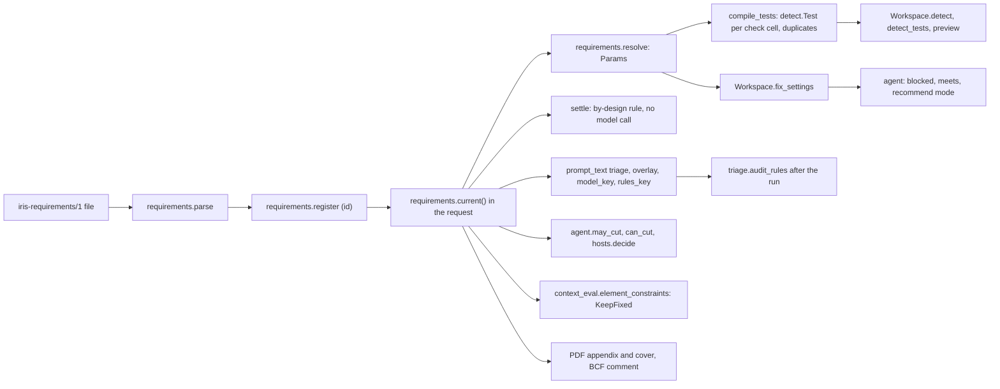
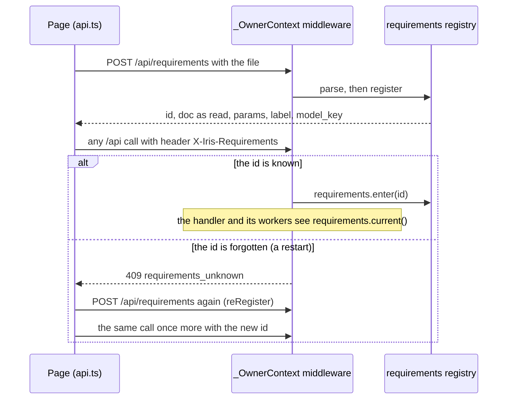
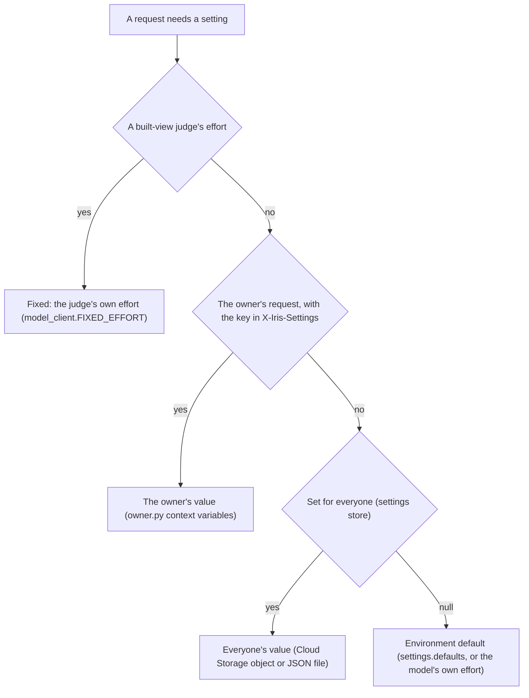

# 15 · Requirements, settings and configuration

> **Covers:** `server/iris/requirements.py`, `server/iris/settings.py`, the settings side of
> `server/iris/owner.py`, `model_client.load_env` and `server/iris/__init__.py`, `limits.env_int` /
> `env_float`, every environment variable the server, deploy and evals read, `server/iris/origins.py`,
> `.env.example`, `web/src/reqFile.ts`, `web/src/Requirements.tsx`, the header plumbing and `VITE_API_BASE` in
> `web/src/api.ts` · **Checked against code:** re-branded on 2026-11-11; the deploy variables and the web build
> variable on 2026-11-22 · **Deeper design:** [docs/requirements.md](../requirements.md)
> `env_float`, every environment variable the server, deploy and evals read,
> `.env.example`, `web/src/reqFile.ts`, `web/src/Requirements.tsx`, the header plumbing in `web/src/api.ts` ·
> **Checked against code:** 2026-11-22 (the projects and drawing variables; `IRIS_PREPARED_DIR`: review queue
> 2026-11-22; re-branded on 2026-11-11) · **Deeper design:** [docs/requirements.md](../requirements.md),
> [docs/review-queue.md](../review-queue.md)

Three layers decide how Iris behaves for a request. **Coordination requirements** are a project's own standard
(what is checked, how strictly, who may move), sent by the page as a file id. **Settings** are the owner's switches
(thinking levels, second tries, Show it built), for themselves or for everyone.
**Environment variables** are the deployment's configuration: keys, models, caps, sizes and paths. This doc covers
all three, and ends with the reference table of every environment variable. Caps and budgets are explained in
[16](16-security-caps-and-cost.md); the routes named here are listed in [10](10-http-api-and-streams.md).

## Coordination requirements

Optional. Without a file, Iris behaves exactly as before: the L3 Balanced default compiles to the same tests and
the same clashes (464 = 464 on Northbank, 107 = 107 on the cell, measured Oct 29,
[docs/requirements.md](../requirements.md)). With one, the numbers are fixed by the file and declared cases are
settled without a model call.

### The file: `iris-requirements/1`

JSON, at most `requirements.MAX_BYTES` (64 KB). `requirements.parse` validates and normalises it: unknown fields
are dropped, numbers clamped, and anything that names a group that does not exist is dropped. A `format` other than
`iris-requirements/1` is refused (422 from `POST /api/requirements`).

| Field | What it holds | Parse rules |
|---|---|---|
| `format` | `"iris-requirements/1"` | Missing is accepted; any other value refused |
| `name`, `version`, `notes` | Shown in the dialog, the PDF and BCF | Name 80 chars; version 1–10,000 (the page bumps it on every edit, `reqFile.bump`); notes 2,000 chars |
| `level` | Design level 1–5 (`LEVELS`: Concept, Developed, Coordinated, Production, As-built) | Clamped to 1–5, default 3 |
| `strictness` | `lenient`, `relaxed`, `balanced`, `strict`, `exacting` (`STRICTNESS`) | Anything else is `balanced` |
| `groups[]` | `id`, `name`, `role` (`ROLES`: structure, services, architecture, equipment, site, other), and a selection by `teams`, `classes`, `exclude_classes`, `systems`, `files` (top level or under `select`), `source` | Id slugged (40 chars, made unique); classes must look like `Ifc…`; a group that selects nothing is dropped; at most 24 groups |
| `checks[]` | `a`, `b` (null: the group against itself), `check` (`hard`, `clearance`, `off`), `clearance_mm`, `tolerance_mm`, `reason`, `source` | Both groups must exist; one cell per pair; clearance 0–500 mm; tolerance 0.5–200 mm |
| `duplicates` | Whether to run the duplicates test | Default true |
| `rules` | The four never-a-clash rules: `same_element`, `connected`, `assembly`, `host` (`RULE_KEYS`) | Each default true |
| `who_moves[]` | In order, the group that stays put most first: `group`, `edits` (`any`, `move`, `none`), `max_move_mm`, `trims` | Group must exist, once each; largest move 0–5,000 mm (0 is none) |
| `by_design[]` | `a_classes` with `b_classes`, `reason`, `source` (user, iris, triage) | Both sides need a class; at most 20 classes a side and 40 rules |
| `penetrations[]` | Per group (and optionally one `kind` of host, a `hosts.profile` key, with `kind_name`): `rule` (`allowed`, `review`, `never`), `max_mm`, `reviewer` (structure, architecture, fire, safety, services), `reason`, `source` | Default rule `review`; size 10–5,000 mm; left out of the file when empty, so a file without it keeps its id |
| `guidance` | `triage` and `fixes`, text for the model | 1,000 chars each (`MAX_GUIDANCE`) |
| `domain` | `construction` (a building) or `machines`: Iris's voice, its fix pack, how teams are guessed and the default classes fixed in place | Anything else is unset; unset means as the models were opened (all from STEP: a machine). Left out when unset, so older files keep their ids |
| `stays` | IFC classes fixed in place: a fix never moves them to make room, nor a run that holds them (a trim between two that stay is still allowed). A `who_moves` group with `edits: none` stays too | Classes like `Ifc…`, at most 60; unset means the domain's (`domains.STAYS`); left out when unset |

- **Selectors** name teams, classes, systems or files, never GlobalIds, so a file can be reused on another project.
  `requirements.Matcher` puts each element in the first group that selects it (a file's team is guessed from its
  content by `document.guess_team`, cached on the scene).
- **A model's draft is held to the models:** `requirements.suggest` parses its reply with `classes=` and `teams=` from
  the open models' inventory, so it cannot invent a class or team; an empty reply keeps the default groups.
- **The starting point** (`requirements.default_doc`, `GET /api/scenes/{sid}/requirements/default`): one group per
  team present (or, with one team, one per kind of thing: frame and structure, services, equipment and other, site),
  hard checks between every pair and within each with Site off, and who moves from structure (stays most) to
  services (moves first), naming the models' domain. It compiles to what Iris checks with no file. A demo's scene
  starts from its own checked-in file instead (`demos.requirements_for`, [19](19-demo-data.md)).
- **What decides a scene's domain and what stays** (`Workspace.requirements_for`): the user's file when switched on,
  else the demo's own when the scene is a demo set, else none (the models decide: `domains.infer`, `domains.STAYS`).
  Only these two come from a demo's file when requirements are off; clearance, edit limits and the prompt guidance
  come only from a file the user switched on (`Workspace.fix_settings`). `requirements.stays_rule` is the one
  predicate every fix path asks (`IfcScene.stays`).
- **Clearance** (`requirements.DEFAULT_CLEARANCE_MM`, 25 mm without a file): every check takes the pair's
  (`Workspace.clearance`): a proposal, a keep, a check by hand, by chat or over MCP, an opening's search and the wider
  fix (`context_planner.validate_objective` puts it on the objective).

### Level and strictness become numbers

`requirements.resolve(doc)` turns the level and strictness into a `Params` record through the `LEVELS` and
`STRICTNESS` tables; every number they set comes from there (other code reads them only for names and prompt
words). The tables
(tolerance, smallest element, services-to-structure clearance, fix clearance, largest move, trims, the triage lean
and the "dispute below" confidence) are reproduced in [docs/requirements.md](../requirements.md), which matches the
code at this commit. Rules worth knowing:
- the resolved tolerance is kept between 1 and 200 mm (`MIN_TOLERANCE_MM`, `MAX_TOLERANCE_MM`); a check cell's own
  `tolerance_mm` is used as given (0.5–200 mm);
- `policy` takes the stricter of the level's ceiling (`edits`: L1 whole moves, L5 none) and the group's mover row;
  the largest move is the smaller of the strictness's and the row's;
- `GET /api/requirements/scale` returns both tables for the dialog (`requirements.scale`).

### What one file turns into

| Where | What it uses | Effect |
|---|---|---|
| **Detection** | `compile_tests(doc, scene)` | One `detect.Test` per check cell that is not off, ids `req:a\|b` (`req:a` within a group), with the cell's tolerance or the resolved one, the clearance from `_cell_clearance` (a clearance cell's mm, 25 when unset, times the strictness's `clearance_x`; a hard services-to-structure cell gets the level's clearance at L4 and L5), `min_size_m` and the four rules; plus `req:duplicates` over the groups that are checked. `Workspace.detect` and `detect_tests` use it when no tests are given; a rerun is compared with the last run only under the same requirements id ([06](06-geometry-and-detection.md)). |
| **Triage** | `settle`, `prompt_text(doc, "triage")`, `overlay`, `model_key`, `rules_key`, `triage.audit_rules` | A by-design pair is settled with `basis: requirement` and no call. The prompt gains only what differs from the defaults (level not L3, the strictness's lean, a tolerance other than 1 mm, clearance cells, by-design rules, guidance). Under Strict / Exacting a model "by design" below 0.6 / 0.8 confidence becomes real (`basis: strictness`). Jobs are keyed by report + `model_key` + `rules_key`, so a rule change reuses the last readings for free ([09](09-agent-workflows.md)). |
| **Fixes** | `Workspace.fix_settings` → `fix_clearance`, `policy`, `prompt_text(doc, "fixes")`, `recommend` | The clearance a fix keeps (the strictness's, or the pair's clearance cell when larger), a `Policy` per element (`edits`, `max_move_m`, `trims`), the prompt lines, and recommend mode when neither side may be edited. `agent.resolve` refuses forbidden candidates with `requirements.blocked` (the model hears why), lists what each option `meets`, and in recommend mode asks once with `requirements.RECOMMEND` ([09](09-agent-workflows.md)). Plans and root causes add the same prompt lines (`plans.py`). |
| **Penetrations** | `penetration_rule`, `can_cut` | A group's rule (or one kind of host's) wins over the model's reading of a host (`hosts.decide`); the opening is cut only when the host's group may be edited in any way (`agent.may_cut`, `Workspace.apply_penetration`), else only the provision for void is written ([07](07-fixes-and-edits.md)). |
| **Wider fixes** | `context_eval.element_constraints` | An element whose group may not be edited is `KeepFixed`. |
| **Hand edits** | `manual.gate` → `policy`, `blocked`, `can_cut` | A move as a fix's move (largest move applies); push/pull and align by stretching as a resize ("may only be moved whole" refuses it, the largest move applies to the push); a clip as a trim (`trims`); a void or a cut by shape only where the group may be edited in any way (`can_cut`); a split, a removed section and a delete only with `edits == "any"`. Iris's own hard rules (`hosts.hard_rule`, structure) only warn on a hand edit ([docs/manual-edits.md](../manual-edits.md)). |
| **Reports** | `requirements_html`, `Workspace.requirements_info` | The PDF's cover says what it was checked against, the clearance sentence uses the required clearance, an appendix lists the file; BCF topics get a "Checked against" comment ([14](14-files-in-and-out.md)). |

### Registration and the header

- **Content-addressed.** `requirements.doc_id` is the first 16 hex characters of a sha256 of the canonical JSON
  (`canonical`: `to_dict`, sorted keys). The same file always gets the same id. The registry keeps the 500 most
  recently used (`REGISTRY_MAX`) in memory. Registering a file the server already knows is free; a new one takes one
  use of `IRIS_REQUIREMENTS_PER_HOUR` / `_PER_DAY`.
- **The header.** `api.ts` sends `X-Iris-Requirements: <id>` with every call (`settingsHeader`). The
  `_OwnerContext` middleware puts the file in a context variable (`requirements.enter` / `leave`). `owner.spawn` and
  `owner.submit` copy the context into stream workers and model-call pools, so a triage worker sees the same file.
- **A forgotten id** on any `/api/` path answers 409 `{"detail": "requirements_unknown"}` before the handler runs.
  `api.ts` `send` registers the file again and retries once; the upload stream does the same (`reRegister`).
- **Agent links** store the page's id (`Link.requirements`, set at create and on every context PUT); MCP tool calls
  run under it with `requirements.using` ([11](11-mcp-and-agent-links.md)).
- **Routes:** `POST /api/requirements`; `GET /api/requirements/scale`; `GET /api/scenes/{sid}/requirements/default`
  (the start plus `requirements.inventory`: files and their teams, classes, systems, storeys, STEP groups);
  `POST /api/scenes/{sid}/requirements/suggest` (one main-model call, `domain_packs/requirements.md`, costs one
  proposal); `POST /api/scenes/{sid}/requirements/preview` (runs detection with the file and with the defaults,
  without keeping either; 64 results cached; a preview not fully cached takes one use of
  `IRIS_PREVIEW_PER_HOUR` / `_PER_DAY`).

### In the browser

- `web/src/reqFile.ts`: the file as the page keeps it (`localStorage` key `iris.requirements`, the file and
  whether it is in use), `serialise` / `download` (`<name>.iris-requirements.json`) / `parseUpload`, and pure edits
  that bump the version: `setCell`, `setMover`, `shiftMover`, `addByDesign` (Insights' **Add to requirements**),
  `removeByDesign`, `setPenetration`, `addPenetration` (an opening option's host reading, for that kind of host only).
- `web/src/Requirements.tsx` (`RequirementsDialog`): level cards, the strictness slider with the numbers it sets
  and the expected count (from preview), the check grid, who moves, by-design rules with the model's audit (Keep rule /
  Remove rule), openings for services, guidance, Suggest with the main model's name, Download, Upload, Start from the models,
  "Use these requirements" and "Use them and check again" ([12](12-web-app.md)).

## Settings

`server/iris/settings.py` holds settings for everyone; `owner.py` carries the owner's own settings on their
requests. Only the owner can read or change either (`GET` / `PUT /api/settings`, 403 otherwise; the owner menu in
`web/src/Owner.tsx`, "For me" and "For everyone").

| Key | Values | Default when unset (environment) | What it decides |
|---|---|---|---|
| `effort` | minimal, low, medium, high, null | `GEMINI_THINKING_LEVEL` (low) | The main model's thinking level: proposals, chat, plans, reports |
| `triage_effort` | same | `GEMINI_FAST_THINKING_LEVEL` (empty: the model's default) | The fast model's thinking level: triage, titles, STEP part names |
| `escalation` | off, button, auto, null | `IRIS_ESCALATION` (button) | Whether a second try on the escalation model is offered, or made at once after a failed proposal |
| `escalation_effort` | minimal, low, medium, high, null | `GEMINI_ESCALATION_THINKING_LEVEL` (high) | The escalation model's thinking level for second tries |
| `built_views` | true, false, null | `IRIS_BUILT_VIEWS == "1"` (off) | Whether Show it built is offered and drawn for kept fixes |

- **The store.** Always the JSON file `IRIS_SETTINGS_FILE` (default `server/.iris-settings.json`, gitignored). On
  Cloud Run, point it at the Cloud Storage mount so it survives restarts and redeploys
  ([17](17-deployment-and-operations.md)). Read once and cached in memory (`settings.current`); a store that
  cannot be read or written is logged and the in-memory value is used, so a setting never fails a request. `PUT`
  takes any subset; null puts a key back to its default; an unknown key or value is a 400.
- **The owner's header.** The page sends `X-Iris-Settings` (JSON) with every call once the owner has unlocked
  (`setOwnerSettings` in `api.ts`, kept in `localStorage` `iris.owner`). The server reads it only when the
  owner cookie checks out (`owner.enter`). Keys: `effort`, `triage_effort`, `escalation_effort` (an effort),
  `escalation` (off, button, auto), `built_views` (a boolean), and `no_caps` (true unless sent as
  false: the owner skips the demo caps by default, [16](16-security-caps-and-cost.md)). Unknown keys and values are
  dropped.
- **What a request gets.** `GET /api/models` tells the page which triage model this request would use, whether
  second tries and Show it built are on for it, and the upload limits, so its copy matches.

### Precedence

`settings.escalation` and `settings.built_views` apply this order directly; thinking level is applied by
`GeminiModel.effort` (`owner.effort(role)`, then `settings.effort_for(role)`, then the effort the model was built
with). Details of the model side: [08](08-ai-models-prompts-and-spend.md).

## Environment variables

### How they are loaded

- **`.env` at the repo root** (gitignored; start from the checked-in `.env.example`). `model_client.load_env` reads
  `KEY=value` lines, skips comments and lines without `=`, strips whitespace (not quotes: write values without
  quotes) and sets each with `os.environ.setdefault`, so **a real environment variable always wins**.
- **Loaded before any setting is read.** The package's `__init__.py` calls `load_env()`, so it runs on the first
  import of any `iris` module, before that module's own code: the web server (`iris.app`), the stdio MCP
  server, tests, evals and spikes all see `.env`, and **every variable below can be set there**, including those
  read at import. `GeminiModel`, `transcribe`, `voice_live` and `built` call it again before reading settings
  (harmless: a value already set is kept).
- **Read once.** Variables marked "import" below, and what `app.py` reads at module level (the caps, the upload
  sizes, `IRIS_VOICE_LIVE_MAX_S`, `IRIS_WEB_DIST`, and `IRIS_ALLOWED_ORIGINS` for whether the web app is mounted),
  are read once, when their module is imported: a change
  to them needs a server restart. The rest are read each time they are used.
- **Empty values.** Numbers are read with `limits.env_int` / `env_float`: unset or empty (`NAME=`) is the default,
  so an empty cap is no limit, or its own default for requirements files (120 an hour) and previews (60 an hour).
  A value that is not a number raises where it is read: the server stops at start, or, for
  `IRIS_TRIAGE_WORKERS` and `IRIS_CONTEXT_*`, the triage or wider-fix run fails.
  `spend.limit` reads an empty or unreadable `IRIS_ESCALATION_MAX_USD_DAY` as 25, and an empty
  `IRIS_BUILT_CACHE` is its default. Elsewhere an empty string is a value: `IRIS_SAMPLE_EXCLUDE=` keeps
  every class, `GEMINI_THINKING_LEVEL=` sends no thinking level, `IRIS_OWNER_TOKEN=` means no owner.
- **Cloud Run** gets the deploy's values from `deploy/deploy.sh` (the caps in `deploy/env.yaml`, plus the Gemini
  and Google Cloud settings, `IRIS_PUBLIC_URL`, `IRIS_VERSION` and, when set, `IRIS_ALLOWED_ORIGINS`) and the owner
  token and any key from Secret Manager (the CI deploy sets no key) ([17](17-deployment-and-operations.md)). Locally, Vertex AI uses Application Default Credentials.
- **Never** print or commit a value. The browser never sees a key ([16](16-security-caps-and-cost.md)).

### Reference

"Cloud Run" is the value `deploy/deploy.sh` sets (from `deploy/env.yaml`), where it sets one. Caps count per visitor per rolling hour and for
everyone per rolling day; 0 means no limit, and unset or empty is the default column
([16](16-security-caps-and-cost.md)).

**Models and keys**

| Variable | Default | Read in | What it does |
|---|---|---|---|
| `GOOGLE_CLOUD_PROJECT` | none | `model_client.make_client` (every Gemini call), `model_client.configured` | The Google Cloud project whose Vertex AI endpoint serves every Gemini call (with Application Default Credentials) |
| `GOOGLE_CLOUD_LOCATION` | `global` | `model_client.make_client` | The Vertex AI location (region) of that endpoint |
| `GEMINI_API_KEY` | none (secret, optional) | `model_client.make_client`, `configured` | Gemini API key, used only when `GOOGLE_CLOUD_PROJECT` is empty (local development); normally unset |
| `GEMINI_MODEL` | `model_client.DEFAULT_MODELS` (`proposal`) | `model_client.model_id("proposal")`: `GeminiModel` | The main model: proposals, chat, plans, patterns, report text |
| `GEMINI_THINKING_LEVEL` | `low` | `model_client.thinking_level`, `settings.defaults` | The main model's thinking level; empty sends none |
| `GEMINI_FAST_MODEL` | `model_client.DEFAULT_MODELS` (`fast`, `voice`) | `model_client.triage_model_info`, `triage_model`, `transcribe`; `built.main_judge_model`, `main_judge_label` | The fast model: triage, titles, STEP part names, voice transcription (hold to talk and live) and the lighter Show it built judges |
| `GEMINI_FAST_THINKING_LEVEL` | empty (the model's default) | `model_client.thinking_level("fast")` (`triage_model`), `settings.defaults` | The fast model's thinking level for triage, titles and part names |
| `GEMINI_ESCALATION_MODEL` | `model_client.DEFAULT_MODELS` (`escalation`) | `model_client.escalation_info`, `escalation_model`, `built.judge_model` | Second tries and the full Show it built judges |
| `GEMINI_ESCALATION_THINKING_LEVEL` | `high` | `model_client.escalation_model`, `settings.defaults` | The escalation model's thinking level for second tries |
| `GEMINI_IMAGE_MODEL` | `model_client.DEFAULT_MODELS` (`image`) | `model_client.generate_image` (`built.restyle`) | Show it built's image model |
| `IRIS_MODEL_LABELS` | empty | `model_client.model_label` (each call) | JSON object, model-id prefix → the name people read (`{"acme-coder": "Acme Coder"}`), over the built-in Gemini names (`model_client.LABELS`); the longest prefix wins. The page gets each role's name from `GET /api/models` (`labels`) |
| `IRIS_MODEL_PRICES` | empty | `model_client.prices`, `cost` (each call) | JSON object, model-id prefix → [USD per million input tokens, per million output tokens], over the built-in `model_client.PRICES`. Spend and the day's budget count what it prices |
| `GEMINI_INCLUDE_THOUGHTS` | `1` | `GeminiModel` (each client) | `0` stops asking Gemini to stream thought summaries (plain calls then) |
| `IRIS_MODEL_TIMEOUT_S` | 120 | `GeminiModel` (each client) | How long one model call may take (proposals, chat, triage, titles, plans) |
| `IRIS_ESCALATION_TIMEOUT_S` | 240 | `model_client.escalation_model` | A second try's model calls |
| `IRIS_JUDGE_TIMEOUT_S` | 240 | `built.judge_model`, `main_judge_model` | Show it built's judges |
| `IRIS_IMAGE_USD` | 0.04 | `built.IMAGE_USD` (import) | The estimated cost of one Show it built picture, charged to the day's budget (`spend.charge`) per picture returned |
| `IRIS_VOICE_TIMEOUT_S` | 60 | `model_client.transcribe` | One recorded voice clip's transcription |
| `IRIS_HOSTS_TIMEOUT_S` | 60 | `service.HOSTS_TIMEOUT_S` (import) | A host reading for openings; slower leaves the defaults |

**Caps and budgets**

| Variable | Default | Cloud Run | Read in | What it caps |
|---|---|---|---|---|
| `IRIS_PROPOSE_PER_HOUR` / `IRIS_PROPOSE_PER_DAY` | 0 / 0 | 20 / 300 | `limits.ProposeLimit.from_env` → `app.propose_limit` | Proposals and everything charged as one |
| `IRIS_ESCALATE_PER_HOUR` / `IRIS_ESCALATE_PER_DAY` | 0 / 0 | 3 / 30 | `ProposeLimit.escalate_from_env` | Second tries on the escalation model |
| `IRIS_CHAT_PER_HOUR` / `IRIS_CHAT_PER_DAY` | 0 / 0 | 40 / 1500 | `ProposeLimit.chat_from_env` | Chat messages |
| `IRIS_BUILT_PER_HOUR` / `IRIS_BUILT_PER_DAY` | 0 / 0 | 6 / 60 | `app.built_limit` | Show it built requests |
| `IRIS_TITLES_PER_HOUR` / `IRIS_TITLES_PER_DAY` | 0 / 0 | not set | `app.title_limit` | Titling runs |
| `IRIS_DETECT_PER_HOUR` / `IRIS_DETECT_PER_DAY` | 0 / 0 | not set | `app.detect_limit` | Detection runs |
| `IRIS_VOICE_PER_HOUR` / `IRIS_VOICE_PER_DAY` | 0 / 0 | 60 / 2000 | `app.voice_limit` | Voice clips and live sessions |
| `IRIS_MODEL_UPLOADS_PER_HOUR` / `IRIS_MODEL_UPLOADS_PER_DAY` | 0 / 0 | 10 / 200 | `app.model_upload_limit` | Model uploads |
| `IRIS_REQUIREMENTS_PER_HOUR` / `IRIS_REQUIREMENTS_PER_DAY` | **120** / 0 | not set | `app.requirements_limit` | New requirements files registered |
| `IRIS_PREVIEW_PER_HOUR` / `IRIS_PREVIEW_PER_DAY` | **60** / 0 | not set | `app.preview_limit` | Requirement previews not in the cache |
| `IRIS_LINKS_PER_HOUR` / `IRIS_LINKS_PER_DAY` | 0 / 0 | 10 / 500 | `app.link_limit` | Agent links made |
| `IRIS_AGENT_CALLS_PER_HOUR` | 0 | 600 | `app.agent_call_limit` | MCP tool calls per link per hour |
| `IRIS_ESCALATION_MAX_USD_DAY` | 25 | 25 | `spend.limit` (each check) | Spend per UTC day, all visitors, on second tries, Show it built pictures and its judges; 0 is no limit |

**Sizes, memory and search bounds**

| Variable | Default | Cloud Run | Read in | What it does |
|---|---|---|---|---|
| `IRIS_UPLOAD_MAX_MB` | 200 | 150 | `app.UPLOAD_MAX_MB` | Navisworks report uploads, all files; also the default for model uploads |
| `IRIS_UPLOAD_MAX_FILES` | 5000 | not set | `app.UPLOAD_MAX_FILES` | Files in one report upload |
| `IRIS_MODEL_UPLOAD_MAX_MB` | `IRIS_UPLOAD_MAX_MB` | 150 | `app.MODEL_UPLOAD_MAX_MB` | Model uploads, all files together, unpacked; the page reads it from `GET /api/models` |
| `IRIS_DRAWING_MAX_MB` | 50 | not set | `drawings.max_mb` (each ingest; the upload route's length check) | One PDF drawing's size; over it is a 413 ([docs/drawings.md](../drawings.md)) |
| `IRIS_DRAWING_MAX_PAGES` | 40 | not set | `drawings.max_pages` (each ingest) | Pages one PDF drawing may have; more is a 400, nothing kept; 0 is no limit |
| `IRIS_MAX_SCENES` | 0 (no limit) | 8 | `service.MAX_SCENES` (import) | Open model sets held in memory |
| `IRIS_SCENE_BUDGET_MB` | 0 (count only) | 300 | `service.SCENE_BUDGET_MB` (import) | IFC bytes of the open scenes held; also the most one scene may grow to by adding models |
| `IRIS_MAX_REPORTS` | 0 (no limit) | 8 | `service.MAX_REPORTS` (import) | Open clash reports held (each scene's current list of kept checks is evicted last, and made again from its checks if it goes) |
| `IRIS_PROJECTS_MAX` | 50 | 50 | `projects.max_projects` (each create) | Projects kept on disk; one more is refused (409); 0 is no limit ([docs/engineer-workflow.md](../engineer-workflow.md)) |
| `IRIS_MAX_CHECKS` | 12 | not set | `checks.MAX_CHECKS` (import) | Checks kept per open scene (the open models and each check on filters); past it the oldest check on filters goes, never the open models ([docs/detection.md](../detection.md), "Kept checks") |
| `IRIS_BIG_MODEL_MB` | 50 | not set | `scene.BIG_MODEL_BYTES` (import) | From this federation size every element's box is measured through CGAL |
| `IRIS_WIDER_FIX_MAX_MB` | 100 | not set | `context_planner.WIDER_MAX_MB` (import) | Largest models a wider fix is offered for (it copies them) |
| `IRIS_STEP_MAX_PARTS` | 20000 | not set | `step.MAX_PARTS` (import) | Parts in one STEP file |
| `IRIS_STEP_MAX_TRIANGLES` | 5000000 | not set | `step.MAX_TRIANGLES` (import) | Triangles in one STEP conversion |
| `IRIS_VOICE_LIVE_MAX_S` | 120 | not set | `app.VOICE_HANDS_FREE_MAX_S` | How long a hands-free voice session may run (hold to talk is 60 s) |
| `IRIS_VOICE_VAD_RMS` | 500 | not set | `voice_live` segmenter (each session) | The loudness (RMS of 16-bit samples) that counts as speech in live voice |
| `IRIS_VOICE_SILENCE_MS` | 700 | not set | `voice_live` segmenter (each session) | How long a pause ends a live-voice segment, which is then transcribed on the fast model |
| `IRIS_TRIAGE_WORKERS` | 24 (`triage.WORKERS`) | not set | `app._start_triage`, `GET /api/models` (`triage_workers`, the card's "n at a time") | Triage model calls at a time |
| `IRIS_TITLE_BATCH` | 40 | not set | `titles.BATCH` (import) | Clashes per titling call |
| `IRIS_TITLE_WORKERS` | `IRIS_TRIAGE_WORKERS`, else 8 | not set | `titles.WORKERS` (import) | Titling calls at a time (the same host as triage) |
| `IRIS_AGENT_ROUNDS` / `IRIS_AGENT_OPTIONS` | 3 / 3 | not set | `agent.ROUNDS`, `agent.OPTIONS` (import) | A proposal's model rounds, and the verified options it stops at |
| `IRIS_PLAN_MAX_ITEMS` | 8 | not set | `plans.MAX_ITEMS` (import) | Clashes one Fix together or root-cause plan takes on |
| `IRIS_PLAN_WORKERS` / `IRIS_PLAN_ROUNDS` | 4 / 2 | not set | `plans.PLAN_WORKERS`, `plans.PLAN_ROUNDS` (import) | A plan's items proposed at a time, and model rounds per item |
| `IRIS_ESCALATION_ROUNDS` | 2 | not set | `escalation.ROUNDS` (import) | Model rounds of a second try |
| `IRIS_ESCALATION_NEAR_M` / `IRIS_ESCALATION_NEAR_MAX` | 5 / 80 | not set | `escalation.NEAR_M`, `NEAR_MAX` (import) | The wider neighbourhood a second try is told about: how far, and how many elements |
| `IRIS_ESCALATION_ESTIMATE_USD` | 1.0 | not set | `escalation.ESTIMATE_USD` (import) | What a second try holds against the day's budget while it runs |
| `IRIS_CHAT_MAX_STEPS` / `IRIS_CHAT_SESSIONS` / `IRIS_CHAT_HISTORY` | 8 / 200 / 40 | not set | `chat.MAX_STEPS`, `MAX_SESSIONS`, `MAX_HISTORY` (import) | Model calls per chat message, chats held, messages kept per chat |
| `IRIS_AGENT_LINK_TTL_H` / `IRIS_AGENT_LINK_MAX_AGE_H` | 12 / 24 | not set | `agents.TTL`, `MAX_AGE` (import) | An agent link's life after its last use, and at most |
| `IRIS_AGENT_LINKS` / `IRIS_AGENT_LINK_JOBS` | 200 / 16 | not set | `agents.MAX_LINKS`, `JOBS_PER_LINK` (import) | Agent links held, and jobs per link |
| `IRIS_DETECT_CAP` | 5000 | not set | `detect.CAP` (import) | Clashes kept per test (a test that reaches it is partial) |
| `IRIS_MODEL_UPLOAD_MAX_FILES` | 8 | not set | `app.MODEL_UPLOAD_MAX_FILES` (import) | Model files in one upload; the page reads it from `GET /api/models` |
| `IRIS_EXPORTS_KEEP_S` | 3600 | not set | `app.EXPORTS_KEEP_S` (import) | How long written models and exports are kept |
| `IRIS_VOICE_HOLD_MAX_S` | 60 | not set | `app.VOICE_HOLD_MAX_S` (import) | How long hold-to-talk may run |
| `IRIS_CONTEXT_MODEL_CALLS` | 6 | not set | `context_planner.Limits.from_env` (each run) | Model calls in one wider-fix search |
| `IRIS_CONTEXT_TRIALS` | 12 | not set | same | Arrangements a wider fix may evaluate |
| `IRIS_CONTEXT_SECONDS` | 120 | not set | same | Time a wider-fix search may take |
| `IRIS_CONTEXT_ALTERNATIVES` | 3 | not set | same | Verified wider fixes kept |
| `IRIS_CONTEXT_RADIUS_M` | 2.5 | not set | same | First neighbourhood radius, metres |

The five `IRIS_CONTEXT_*` values are ceilings: `Limits.__post_init__` refuses anything not above 0 or above
its default, so a bad value fails the wider-fix run with a `ValueError` rather than widening it.

**Features and behaviour**

| Variable | Default | Cloud Run | Read in | What it does |
|---|---|---|---|---|
| `IRIS_OWNER_TOKEN` | empty (no owner) | secret | `owner._token` (each request) | The owner token, at least 24 characters ([16](16-security-caps-and-cost.md)) |
| `IRIS_ESCALATION` | `button` | not set | `settings.defaults` | Default for `escalation` (off, button, auto) |
| `IRIS_BUILT_VIEWS` | `0` | `0` | `settings.defaults` | Default for `built_views` |
| `IRIS_OFFSET_CORNERS` | `bends` | not set | `edits.default_corners` | A value starting `sq` makes offsets turn with square corners instead of bend fittings |
| `IRIS_CONNECTED_MOVES` | `carry` | not set | `connections.mode` (each call) | How a move treats joints: `carry` the fittings beyond the run and stretch the segments it runs along, `refuse` one that would pull a joint apart, or `off` (moves as before joints were known) ([docs/connections.md](../connections.md)) |
| `IRIS_CARRY_MAX` | 12 | not set | `connections.CARRY_MAX` (import) | Most parts a move may take along before it is refused |
| `IRIS_GEOM_THREADS` | up to 8 | not set | `verify.geometry_threads` (each check) | Threads that triangulate a clash check's neighbourhood when it has more than 50 elements ([06](06-geometry-and-detection.md)) |
| `IRIS_MOVE_REFIT` | on | not set | `connections.refit_moves` (each call) | Whether the model's moves re-fit a straight segment square to them (a pair of bends at its joined end) instead of taking it along; `off` plans them as before. Hand moves with joined parts always re-fit ([docs/editing-parity.md](../editing-parity.md)) |
| `IRIS_SAMPLE_EXCLUDE` | `IfcGeographicElement,IfcSpace,IfcBuildingElementProxy` | not set | `service.SAMPLE_EXCLUDE` (import) | Classes whose clash tests sample reports leave out; empty keeps everything |

**Paths**

| Variable | Default | Read in | What it does |
|---|---|---|---|
| `IRIS_SETTINGS_FILE` | `server/.iris-settings.json` | `settings._file` | The settings file for everyone; on Cloud Run, a path on the Cloud Storage mount |
| `IRIS_BUILT_CACHE` | `$TMP/iris-built` | `built.CACHE` (import) | Built-view pictures |
| `IRIS_PROJECTS_DIR` | `server/.iris-projects` (gitignored; empty is the default) | `projects.projects_dir` (each call) | Where projects are kept, one folder each ([14](14-files-in-and-out.md)); on Cloud Run `deploy/deploy.sh` sets `/mnt/iris/projects` when `BUCKET` is set |
| `IRIS_WEB_DIST` | `web/dist` | `app.WEB_DIST` | The built web app served at `/` when its `index.html` exists |
| `IRIS_PREPARED_DIR` | `samples/prepared` (the samples folder's `prepared/`; empty is the default) | `prepare.saved_dir` (each prepare request, through `load_saved`; `prepare.generate`) | Where the review queue's saved AI proposal sets (`*.json`) are read from; the first whose key equals the scene's is replayed ([docs/review-queue.md](../review-queue.md), [19](19-demo-data.md)). `prepare.generate` with no `out` writes `saved.json` there; `evals/prepare_saved.py` writes `samples/prepared/Northbank.json` unless given `--out` |
| `DEMO_MODELS` | `../demo-models` beside the repo | `evals/step_cell.py`, `detection_cell.py`, `detection_navisworks.py`, `escalation.py` | A clone of the team's private demo-models repo, for the evals ([18](18-testing-and-evals.md)) |

**Deploy**

| Variable | Default | Cloud Run | Read in | What it does |
|---|---|---|---|---|
| `IRIS_PUBLIC_URL` | unset | the web app's URL: the service's own, or with the CI deploy the Firebase Hosting URL (or `WEB_URL`) | `mcp_server.build` (import) | The address MCP clients show as Iris's website; unset, none is sent |
| `IRIS_TRUST_FORWARDED` | unset | `1` | `limits.client_id` | N proxies in front that each append to `X-Forwarded-For`: visitors are keyed by the N-th entry from the right instead of the peer. 1 on Cloud Run, whose front end appends the visitor's address |
| `IRIS_ALLOWED_ORIGINS` | empty (one origin) | the plain deploy: not set; the CI deploy: `https://SITE.web.app`, `https://SITE.firebaseapp.com`, plus `WEB_URL` and `EXTRA_ORIGINS` when set | `origins.allowed` (each request: `app._CrossOrigin`, `app.front_door`, `owner._cookie`, `voice_live.same_origin`); at import for the web app's mount | The web app's other origins, comma-separated `scheme://host[:port]` (no path, no `*`). For exactly those: CORS with credentials, the owner cookie `SameSite=None; Secure; Partitioned`, the voice socket; and the server is the API only (no web app mounted, `GET /` answers JSON). Empty: one origin, no CORS headers, `SameSite=Strict`. A malformed entry raises, so the server stops at start ([10](10-http-api-and-streams.md), [16](16-security-caps-and-cost.md)) |
| `IRIS_VERSION` | `dev` | the image tag (`deploy.sh`'s `TAG`); the CI deploy: the commit SHA | `app.health` (each request) | What `GET /api/health` reports as `version`; the CI deploy's smoke test checks it is the commit just deployed |

**Web build**

Read by Vite when the web app is built (`npm run build`), not by the server; the value is baked into the bundle.

| Variable | Default | Set by | Read in | What it does |
|---|---|---|---|---|
| `VITE_API_BASE` | empty (same origin) | `.github/workflows/deploy.yml`: the Cloud Run URL from `deploy.sh`, or the `API_URL` repository variable | `web/src/api.ts` (`API_BASE`, trailing slash dropped) | The API's origin for a web app hosted elsewhere (Firebase Hosting): server paths go through `apiUrl`, the voice socket through `wsUrl`, and fetches send credentials. Empty: the page calls its own origin (local dev through Vite's proxy, and the web app Cloud Run serves itself, whose Docker build leaves it empty) ([12](12-web-app.md)) |

**Removed.** No longer read, and safe to delete from an old `.env`: the previous provider's model, key and URL variables, `TRIAGE_API_KEY`, `TRIAGE_API_BASE_URL`, `TRIAGE_MODEL`, `TRIAGE_IMAGES`, `TRIAGE_REASONING_EFFORT`, the separate triage host's key and `IRIS_OPEN_WEIGHTS` (with the `open_weights` setting: triage, titles and part names always run on `GEMINI_FAST_MODEL`).

### Standalone brand-tool overrides

The approved [`assets/brand/iris/`](../../assets/brand/iris/) library has two optional tooling-only overrides.
`Iris_SUPPORT_FONT` selects a local font file for outlining supporting text in static exports; Windows defaults to
Segoe UI, and no font file is redistributed. `Iris_BROWSER` selects the Chromium executable for the motion browser
check; Windows uses installed Edge when available, otherwise Playwright's Chromium is used. These are not application
or deployment settings and need no `.env` entries. Brand-tool inventory checked 2026-10-30 against `0390a12` plus this slice.

### `.env.example`

The checked-in template lists what a local run usually needs: `GOOGLE_CLOUD_PROJECT` and `GOOGLE_CLOUD_LOCATION`
(set to `global`), `GEMINI_THINKING_LEVEL` (set to `low`) and `IRIS_OWNER_TOKEN` (with how to make one). Commented
out, with their defaults: the optional `GEMINI_API_KEY`, the four model ids (`GEMINI_MODEL`, `GEMINI_FAST_MODEL`,
`GEMINI_ESCALATION_MODEL`, `GEMINI_IMAGE_MODEL`; empty takes `model_client.DEFAULT_MODELS`),
`GEMINI_FAST_THINKING_LEVEL`, `GEMINI_ESCALATION_THINKING_LEVEL`, `IRIS_ESCALATION_MAX_USD_DAY`,
`IRIS_TRIAGE_WORKERS`, the propose, chat and voice caps and the requirements and preview caps (0 is no limit; unset
or empty is the default, which is no limit except requirements files and previews), `IRIS_VOICE_LIVE_MAX_S` and
the `IRIS_CONTEXT_*` bounds, and `IRIS_ALLOWED_ORIGINS` (empty: one origin). Any other variable in the tables above
can go there too. Copy it to `.env` and fill
in only what you need; it never holds a secret.

## When to update this doc

- A new, renamed or removed environment variable, a changed default, or a variable moved between import time and
  call time (and `.env.example` with it). `server/tests/test_docs_map.py` fails when one is missing here. A new
  number is read with `limits.env_int` / `env_float`; `server/tests/test_env_file.py` checks that `.env` reaches the
  settings read at import and that empty numbers take their defaults.
- A new field, rule or limit in `requirements.parse`, a new table row in `LEVELS` / `STRICTNESS`, or a new place
  that reads `requirements.current()`.
- A change to registration (`register`, `doc_id`, `REGISTRY_MAX`), the header or the 409 retry in `api.ts`.
- A new setting in `settings.Settings` or a new key in the owner's header (`owner.settings`), or a change to the
  store or the order of precedence.
