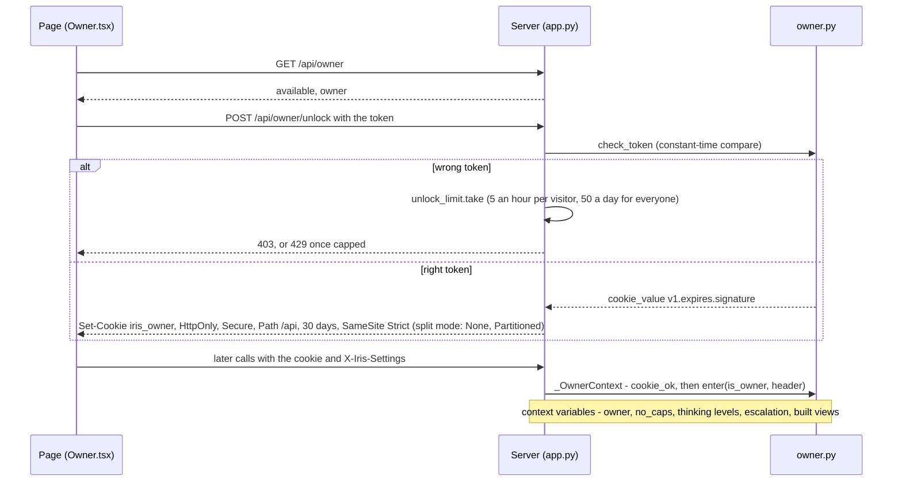
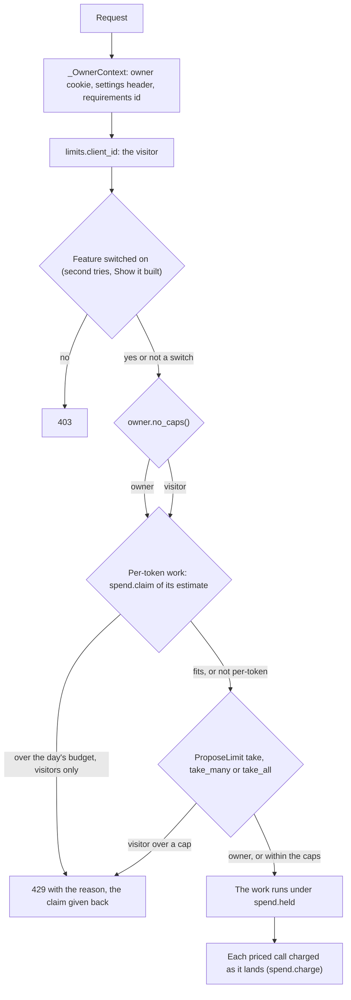

# 16 · Security, caps and cost controls

> **Covers:** `server/iris/owner.py`, `server/iris/origins.py`, `server/iris/limits.py`, `server/iris/spend.py`, the
> token side of `server/iris/agents.py`, the gates in `server/iris/app.py` (`_OwnerContext`, `_CrossOrigin`, `_take`,
> `escalation_refused`, `built_stream`, `_receive_models`, `_McpGate`, `mcp_hooks`), `voice_live.same_origin` and
> `voice_live.relay`, `model_client.load_env` and `PRICES`, the budgets in `server/iris/built.py` and
> `server/iris/drawing_reader.py`, `web/src/Owner.tsx`, the deploy identity in `deploy/github-setup.sh` ·
> **Checked against code:** re-branded on 2026-11-11; origins, the owner cookie, the voice socket's Origin rule,
> deploy identity and the cloud footprint re-checked on 2026-11-22, the drawing reader's budget and the sample drawings
> the same day · **Deeper design:**
> [docs/escalation.md](../escalation.md), [docs/show-it-built.md](../show-it-built.md), [docs/uploads.md](../uploads.md)

Iris is a public demo that spends money on every model call, on one shared set of credentials, in one process. This doc is
how it keeps the credentials on the server, tells visitors apart, trusts exactly one person (the owner) and agents holding a link
token, counts what each visitor may use, holds the day's spend on per-token models under a budget, and bounds the
memory, disk and time any one request can take. Environment variables are listed in full in
[15](15-requirements-settings-and-config.md); routes in [10](10-http-api-and-streams.md).

## Secrets

- **What they are.** Google credentials for Gemini on Vertex AI (Application Default Credentials: the Cloud Run
  service account when deployed, `gcloud auth application-default login` locally, with `GOOGLE_CLOUD_PROJECT` and
  `GOOGLE_CLOUD_LOCATION`), an optional `GEMINI_API_KEY`, and `IRIS_OWNER_TOKEN`.
- **Where they live.** The real environment, or `.env` at the repo root, which is gitignored (`.gitignore`) and read
  by `model_client.load_env` (real variables win; [15](15-requirements-settings-and-config.md)). On Cloud Run they
  come from the service's environment and Secret Manager ([17](17-deployment-and-operations.md)). The checked-in
  `.env.example` holds names only.
- **No Gemini API key in the cloud.** The GitHub deploy runs `deploy/deploy.sh` with `GEMINI_API_KEY_SECRET=""`, so
  the service gets no key secret. It calls Vertex AI as its runtime service account, `iris-run`, which holds
  `roles/aiplatform.user`. `deploy/github-setup.sh` also removes `GEMINI_API_KEY` from `deploy/setup.sh`'s
  environment.
- **The owner token in the cloud** lives in Secret Manager (`iris-owner-token`). Cloud Run reads it as `iris-run`.
  When the secret has no version yet, `deploy/github-setup.sh` makes a random one (`secrets.token_urlsafe(32)`) and
  hands it to `setup.sh` in the environment only. It is never printed; the owner reads it with
  `gcloud secrets versions access latest --secret iris-owner-token`.
- **The rule** (CLAUDE.md, AGENTS.md): secrets and `.env` contents never enter git, chat or tool output.
- **Only the server calls Gemini.** Every authenticated model request is made on the server: `GeminiModel` and its
  streaming variants, `model_client.transcribe`, `built.restyle`, and the live voice relay. The page talks only to
  Iris's own server: its own origin, or the API's origin when the web app is hosted apart (below). What the page can
  learn about credentials is a boolean: whether second tries are available (`escalation_info.available`).
- **Live voice keeps credentials on the server.** The browser cannot open the model session itself, so
  `/api/voice/live` relays: `voice_live.relay` opens the session with the server's credentials (never logged, never
  sent to the browser), and a failure reaches the browser as a short message naming only the error type, never the
  details. `/api/transcribe` failures say only the error type too (502).
- **The owner token is sent once** and never kept in the browser: the server answers with a cookie scripts cannot
  read (below).
- **Link tokens are shown once**; the server keeps only their sha256 (`agents._hash`).

### Deploys hold no keys

GitHub Actions deploys on a push to `main` without any stored Google key. There are no JSON service account keys
anywhere. `deploy/github-setup.sh` sets this up once ([17](17-deployment-and-operations.md)):

- **Workload Identity Federation.** Pool `github-actions`, OIDC provider `iris-github`, issuer
  `https://token.actions.githubusercontent.com`. The attribute condition admits only this repository's `main`:
  `assertion.repository == 'Saravana-Rajan/IRIS' && assertion.ref == 'refs/heads/main'`, plus the repository id when
  `gh` can read it (so a reused name is not let in). The workflow exchanges GitHub's OIDC token for short-lived
  Google credentials.
- **Who it may act as.** Only that repository's principal set holds `roles/iam.workloadIdentityUser` on the deploy
  service account, `iris-deploy`.
- **What the deploy account may do** (least privilege):

| Role | Granted on | Why |
|---|---|---|
| `roles/run.admin` | the project | Deploy the `iris-api` service and keep it public |
| `roles/firebasehosting.admin` | the project | Release the web app to Firebase Hosting |
| `roles/serviceusage.serviceUsageConsumer` | the project | Call the project's APIs |
| `roles/artifactregistry.writer` | the `iris` repository only | Push images |
| `roles/iam.serviceAccountUser` | `iris-run` only | Deploy the service as its runtime account, and no other |
| No Secret Manager role | | Cloud Run reads the owner token as `iris-run` |

## Who is asking

### Visitors

Iris has no accounts. A visitor is an address: `limits.client_id(headers, peer)` returns the socket's peer address,
else "unknown". Everything per visitor (caps, a link's creator) keys on it. Visitors behind one address share their
caps.

- **On Cloud Run** requests reach the app through Google's front end, which appends the caller's address to
  `X-Forwarded-For`. The value the deploy sets for `IRIS_TRUST_FORWARDED` is in
  [17](17-deployment-and-operations.md). `X-Real-IP` and `Forwarded` are never read: a client can write them freely.
- **Behind other proxies.** `IRIS_TRUST_FORWARDED=N` says N proxies in front each append the address they saw.
  The visitor is then the N-th entry from the right, the one the outermost proxy wrote. It is never the left end,
  which a client chooses and an appending proxy keeps. Header lines are joined into one list; a header with fewer
  entries than N was not written by those proxies, so the peer stands. Anything but a whole number is 0.
- **Running uvicorn yourself.** uvicorn already rewrites the peer from `X-Forwarded-For` for connections from the
  hosts it trusts (`--forwarded-allow-ips`, default `127.0.0.1`), taking the right-most untrusted entry. So a
  reverse proxy on the same machine works with the flag at 0. It also means a request made from that machine can set
  its own peer, which only matters to someone testing caps locally: send no `X-Forwarded-For` then.
- **Never the left end.** Taking the first entry would let a visitor choose their own identity and with it a
  fresh set of caps.

### Same origin, and the web app's own other origins

Iris runs in one of two modes. With `IRIS_ALLOWED_ORIGINS` empty (the default: local dev and the plain deploy), one
server serves the web app and the API from one origin. With it set (split mode: the web app on Firebase Hosting, the
API on the Cloud Run service `iris-api`), the page calls the API across origins. `origins.allowed()` reads the list;
`origins.allows(origin)` checks one ([15](15-requirements-settings-and-config.md)).

- **The live voice socket** checks it: `voice_live.same_origin` lets in an `Origin` whose host is the request's
  `Host`, an `Origin` in `IRIS_ALLOWED_ORIGINS`, or no `Origin` at all (not a browser; held to the same caps). It
  refuses any other site before accepting (close 1008), because another site's page could otherwise spend the model
  budget.
- **CORS only for the configured origins.** `_CrossOrigin` (the outermost middleware in `app.py`) answers CORS with
  credentials for exactly those origins: methods GET, POST, PUT, DELETE; request headers `Content-Type`,
  `X-Iris-Settings`, `X-Iris-Requirements`; exposed headers `X-Iris-Gone` and `Content-Disposition`; `Vary: Origin`.
  It never answers `*`. Another origin's preflight gets 400, and its plain requests are answered without
  `Access-Control-Allow-Origin`, so the browser keeps the answer from that page. With no origins configured there are
  no CORS headers at all. WebSockets bypass it (the voice socket checks its own `Origin`, above).
- **A bad list stops the server.** `origins.py` refuses `*`, a path, or any entry that is not
  `scheme://host[:port]` with `ValueError`. `app.py` reads the list once at import, so a typo stops the server at
  start: it never opens the API to every site, nor silently closes it.
- **The owner cookie** is scoped to `/api` and follows the mode (below). On one origin it is `SameSite=Strict`, so a
  request from another site never carries the owner's rights. In split mode it is `SameSite=None` and `Partitioned`:
  where the browser supports CHIPS it is kept only for pages under the site that unlocked. A request with a JSON body
  or Iris's own headers needs a preflight, which other origins fail.
- **`/mcp`** is gated by link token instead; its transport's DNS-rebinding check (meant for servers on localhost) is
  off (`app._mcp_transport`).

### The owner

The owner is whoever holds `IRIS_OWNER_TOKEN`. With no token, or one under 24 characters
(`owner.available`), nobody is the owner and `POST /api/owner/unlock` answers 404.

- **The cookie** is `v1.<expiry>.<HMAC-SHA256>` signed with a key derived from the token, so changing the token
  logs every browser out. `owner.cookie_ok` checks the version, the signature (constant time) and the expiry.
  `POST /api/owner/unlock` sets it with `owner.set_cookie`; `POST /api/owner/lock` clears it with
  `owner.clear_cookie`, with the same flags and expired (a browser replaces a cookie only when the flags match).
- **Its flags** come from `owner._cookie` and depend on the mode:

| Mode | Flags | Why |
|---|---|---|
| One origin (`IRIS_ALLOWED_ORIGINS` empty) | `HttpOnly; Secure; SameSite=Strict; Path=/api`, 30 days | The page and the API share an origin; no other site's request carries it |
| Split (`IRIS_ALLOWED_ORIGINS` set) | `HttpOnly; Secure; SameSite=None; Partitioned; Path=/api`, 30 days | The page on Firebase Hosting calls Cloud Run cross-site, so the cookie must travel on cross-site calls (`None` needs `Secure`). `Partitioned` (CHIPS) keeps it per top-level site and lets it through where third-party cookies are blocked, if the browser supports CHIPS |

`Partitioned` is appended by hand: Starlette writes it only on Python 3.14+. A browser that blocks third-party
cookies and lacks CHIPS may not send the cookie at all. Putting the web app and the API on custom domains under one
site makes the cookie first-party again ([17](17-deployment-and-operations.md); the limit is in
[20](20-decisions-limits-and-roadmap.md)).
- **Per request.** `_OwnerContext` (ASGI middleware, HTTP and WebSocket) reads the cookie and calls `owner.enter`;
  the `X-Iris-Settings` header is read only when the cookie checks out
  ([15](15-requirements-settings-and-config.md)). `owner.spawn` and `owner.submit` carry the context into stream
  workers and model-call pools.
- **The page** shows the gear only once unlocked, or on a page opened with `#owner` (`Owner.tsx`). The owner's own
  settings are kept in `localStorage` (`iris.owner`); the token is not.
- **Later:** GitHub sign-in would replace `cookie_ok` with "signed in as an allowed login"; the rest stays.

What the owner gets that visitors do not:

| | Owner | Where |
|---|---|---|
| Read and change settings for everyone | Yes; visitors get 403 | `GET` / `PUT /api/settings` |
| Their own thinking levels (main, fast, escalation), second tries, Show it built | Yes, per request | `owner.settings`, `owner.enter` |
| Demo caps | Skipped, unless the owner sends `no_caps: false` | `app._take`, plan and wider-fix streams, chat's closures (proposals, second tries, detection runs) |
| Escalation day budget (`IRIS_ESCALATION_MAX_USD_DAY`) | Never refused (still counted) | `spend.claim(exempt=True)` in `escalation_refused`, `built_stream` |
| Agent links they make | Proposals, second tries and detection runs not capped (`Link.owner`) | `mcp_hooks.charge`, `escalate`, `detect_run` |
| MCP tool-call cap on their links | **Still applies** (`agent_call_limit.take(link.id)`) | `mcp_hooks` `allow_call` |
| Settings switched off (second tries off, Show it built off) | Still off unless their own setting turns it on | `settings.escalation`, `settings.built_views` |

### Agent link tokens

"Connect an agent" makes a link ([11](11-mcp-and-agent-links.md), [docs/mcp.md](../mcp.md)):

- **The token** is `iris_` + `secrets.token_urlsafe(32)`, returned once by `POST /api/links`; only its sha256 is
  kept (`Links._links`). It is a capability: whoever holds it can act on that visitor's session until it expires or
  is revoked (`DELETE /api/links/{token}`).
- **Lifetime.** 12 hours after its last use (`TTL`), never more than 24 hours after it was made (`MAX_AGE`). Use
  renews it: a context PUT, each connection of the events stream, a capture post, and every MCP call.
  `GET /api/links/{token}` and the page's leave beacon do not. At most 200 links (`MAX_LINKS`, oldest dropped). They
  live in memory: a restart ends them.
- **`_McpGate`** answers 401 with `WWW-Authenticate: Bearer realm="iris"` unless the request carries a live token,
  as `Authorization: Bearer …` or `?key=…` (moved into the header for the tools to read).
- **Who pays.** A link's proposals, second tries and detection runs are charged to the visitor who made it
  (`link.visitor`), never when the owner made it; each tool call takes one use of `IRIS_AGENT_CALLS_PER_HOUR` for
  that link. Making a link takes one use of `IRIS_LINKS_PER_HOUR` / `_PER_DAY`.
- **The stdio server** (`python -m iris.mcp_server`, `mcp_server.main`) runs as a local link marked owner,
  with the web server's hooks: no proposal caps, and a second try only counted against the budget, still refused
  when second tries are switched off (`escalation_refused` with the owner's exemption; `mcp_server._local_escalate`
  does the same for a server built without hooks). The tool-call cap would apply to it under the id `local` if
  `IRIS_AGENT_CALLS_PER_HOUR` were set.

## Caps

`limits.ProposeLimit(per_client_hour, per_day, noun)` keeps timestamps in memory: one deque per visitor over a
rolling hour, and one for everyone over a rolling 24 hours (`time.monotonic`). 0 turns either off, and every cap
but three is 0 unless the environment (or the repo's `.env`) sets it; unset and empty are the same
(`limits.env_int`), so an empty cap takes its default. The Cloud Run deploy sets the demo's values. Refused requests are
not counted. The state is per process, which is why the deploy pins one container
([17](17-deployment-and-operations.md)).

- `take(client)` counts one, or returns why not.
- `take_many(client, n)` counts `n` at once or none: a plan of several fixes is refused whole, not half-run.
- `take_all(client, *limits)` takes one of each or none (a second try is one escalation and one proposal).
- `refusal(client)` says why one more would be refused, counting nothing.

| Cap | Env (per visitor per hour / everyone per day) | Default | Deploy | What takes it, and how many |
|---|---|---|---|---|
| Proposals | `IRIS_PROPOSE_PER_HOUR` / `IRIS_PROPOSE_PER_DAY` | 0 / 0 | 20 / 300 | 1 per proposal (`/propose`, `/propose/stream`, chat and MCP `propose_fixes`); a plan `take_many` one per clash pair (the plan stream counts at most `plans.MAX_ITEMS`, 8); a root cause 1 for the cause, then one per fix only if it needs edits; a wider fix 3 (`take_many`); 1 to start a report's triage (following a run, or carrying readings to new rules, is free; stopping one is free and only for whoever started it or the owner (`triage.Job.may_stop`, 403 for anyone else following a shared run), and going on after a stop or a failed read is 1 for a run that asks only the rest, a stopped run never donating its readings to a free run under new rules; over Iris's kept checks, 1 only when the run asks the model about an unread clash, readings carried to a new list being free and making no audit call, and 1 for a run queued behind the one under way for what it does not read); 1 for a pattern reading (once per report, scene, set of patterns and triage prompt, shared by the route, chat and MCP `find_patterns`: `plans.read_patterns`); 1 for a requirements draft; 1 for a PDF report |
| Second tries | `IRIS_ESCALATE_PER_HOUR` / `IRIS_ESCALATE_PER_DAY` | 0 / 0 | 3 / 30 | 1 per second try on the escalation model, with 1 proposal (`take_all`), after the budget claim |
| Chat messages | `IRIS_CHAT_PER_HOUR` / `IRIS_CHAT_PER_DAY` | 0 / 0 | 40 / 1500 | 1 per message; its tool calls take their own caps, as their routes do (the hand-edit tools take none: a check or a keep is geometry, no model call) |
| Built views | `IRIS_BUILT_PER_HOUR` / `IRIS_BUILT_PER_DAY` | 0 / 0 | 6 / 60 | 1 per Show it built request that is neither cached nor being drawn already |
| Titling runs | `IRIS_TITLES_PER_HOUR` / `IRIS_TITLES_PER_DAY` | 0 / 0 | off | 1 per titling run started (one shared run per report) |
| Runs after hand edits | three times the detection runs' (`app.edit_rerun_limit`) | 0 / 0 | off | 1 per detection run naming its edit in `after_edit` (once per entry), so keep, run, undo and keep again cannot farm free runs |
| Detection runs | `IRIS_DETECT_PER_HOUR` / `IRIS_DETECT_PER_DAY` | 0 / 0 | off | 1 per `/detect/stream`, chat or MCP `detect_clashes` (a check on filters refused for a name the models lack or an empty side A costs none; Run all again, every kept check, is 1; making a list of kept checks again, `GET .../checks`, is free; the one run after a hand edit kept with clashes, naming that newest entry in `after_edit`, is not charged here once (`Journal.free_rerun`) but on its own cap below), and MCP `open_models` when it checks on the server (no page following the link: the page's check is its own request) |
| Voice | `IRIS_VOICE_PER_HOUR` / `IRIS_VOICE_PER_DAY` | 0 / 0 | 60 / 2000 | 1 per clip (`/api/transcribe`) or live session, hands-free included |
| Model uploads | `IRIS_MODEL_UPLOADS_PER_HOUR` / `IRIS_MODEL_UPLOADS_PER_DAY` | 0 / 0 | 10 / 200 | 1 per upload, after the size and type checks: opening your own models, or adding them to an open scene (`/api/scenes/{scene_id}/models/upload/stream`, charged only after the mixing and "already open" refusals); adding samples and removing a model are free ([docs/add-and-remove-models.md](../add-and-remove-models.md)); a PDF drawing upload (`POST /api/scenes/{scene_id}/drawings`) is one too, while attaching the open demo's sample drawings (`POST /api/scenes/{scene_id}/drawings/samples`) is free: nothing is sent |
| Requirements files | `IRIS_REQUIREMENTS_PER_HOUR` / `IRIS_REQUIREMENTS_PER_DAY` | **120** / 0 | default | 1 per file the server does not know yet |
| Requirement previews | `IRIS_PREVIEW_PER_HOUR` / `IRIS_PREVIEW_PER_DAY` | **60** / 0 | default | 1 per preview not already cached |
| Agent links | `IRIS_LINKS_PER_HOUR` / `IRIS_LINKS_PER_DAY` | 0 / 0 | 10 / 500 | 1 per link made |
| Agent calls | `IRIS_AGENT_CALLS_PER_HOUR` (no daily) | 0 | 600 | 1 per MCP tool call, keyed by link id |
| Unlock attempts | fixed in `app.unlock_limit` | 5 / 50 | 5 / 50 | 1 per wrong owner token |

### What a refusal looks like

| Where | Reply |
|---|---|
| REST routes and stream starts | HTTP 429 with the words as `detail`, before any work starts |
| Per-day cap | "The demo has used today's {noun}. Try again tomorrow, or run Iris locally with your own key." (`take_many`: "The demo has too few {noun} left today for n more. Try fewer, or run Iris locally.") |
| Per-hour cap | "You've used n {noun} this hour. Try again later." (`take_many`: "That needs n {noun}; you have k left this hour. Pick fewer clashes or try later.") |
| A root cause's fixes | The plan comes back with each item's `error` set to the refusal and no fixes run (`plans.build_root_cause`) |
| Chat tools | The tool result `{"error": …}`, so Gemini Pro tells the visitor ("refused: allowance used", "refused: detection runs used") |
| MCP tools | The chat's tools (`propose_fixes`, `detect_clashes`, `find_patterns`, plans) return the same `{"error": …}` result; MCP's own (`triage`, `generate_report`) raise a `ToolError` with the words; `open_models` opens and adds "Opened, not checked: …" |
| Live voice | An `error` event with the words, then the socket closes |
| Escalation budget | 429 saying today's budget for second tries and checked pictures is used up, that it resets at midnight UTC, and that the main model's own proposals still work (`spend._refusal`) |
| Second tries switched off | 403 saying second tries are switched off (409 first when the requirements allow no edit: there is nothing to try) |

## Cost

### The gate a paid request passes

Plain proposals, chat, triage, titles and voice on the main or fast model skip the budget box: only second tries,
Show it built's judges (escalation or fast model), the Gemini image model and the drawing reader (fast model) are
charged to the day's budget. The order (switch, budget, caps) is the one `escalation_refused` and `built_stream`
use; routes without a per-token model only take their cap.

### The escalation day budget (`spend.py`)

- **What is priced.** `model_client.PRICES`, with `IRIS_MODEL_PRICES` over them: the escalation model's input and
  output tokens (thinking counts as output), and the fast model's when it judges pictures or reads a drawing. The
  main model and the fast model's other work are not charged here. Each picture from the Gemini image model is charged
  `built.IMAGE_USD`: `IRIS_IMAGE_USD`, default 0.04 (in `built.restyle`). No other price numbers are kept in these
  docs.
- **Charging.** `GeminiModel` counts every call's usage (`Usage`, however a stream ended) and passes its cost to
  `on_cost`, which is `spend.charge` for second tries (`model_client.escalation_model`) and Show it built's judges
  (`built.judge_model`, and `built.main_judge_model` for the lighter check).
- **The limit.** `IRIS_ESCALATION_MAX_USD_DAY` (default 25; 0 is no limit), for all visitors, per UTC
  calendar day, in memory: a restart starts the day's count again. Work is refused when today's spend plus what
  running work still holds plus its own estimate would pass the limit (`spend._refusal`).
- **Claim, then hold.** `spend.claim(estimate)` checks and holds in one step under the lock, so two requests on a
  nearly spent day cannot both pass. The work then takes the claim over with `spend.held(estimate)` and releases it
  when it ends; a request a cap refuses after its claim gives it back with `spend.unclaim`. Estimates live in code:
  `escalation.ESTIMATE_USD` a second try; `built.ESTIMATE_USD` a built view (pictures plus escalation-model
  judgements); `built.LIGHTER_ESTIMATE_USD` the lighter check (pictures plus fast-model judgements at
  `built.LIGHT_JUDGE_USD` each).
- **The owner** is never refused (`exempt`) but is still counted.

### Show it built's budget

Off unless switched on (`IRIS_BUILT_VIEWS` 0 and the `built_views` setting; 403 when off). When on, it is held by
the built caps above. In `built_stream`: a cached picture, or one being drawn for the same view, costs nothing.
Otherwise, when the day's budget can still cover `built.ESTIMATE_USD`, the request claims it and the escalation model
judges the pictures; when it cannot, the request claims `built.LIGHTER_ESTIMATE_USD` and three fast-model judges
at low thinking check them instead (`built.MAIN_JUDGES`, `built.main_judge_model`, named in the result's `judge` by
`built.main_judge_label`). A picture checked the lighter way is drawn and
checked again by the escalation model when the budget allows. Then the built cap is taken. Design:
[docs/show-it-built.md](../show-it-built.md).

### The drawing reader's budget

A drawing read (`POST /api/drawings/{drawing_id}/read`) is priced per page on the fast model, with no count cap.
`drawing_reader.read_drawing` asks `spend.refused` for the estimate of every page it has to read before its first
event (a refusal is a 429 before the stream starts), and again before each page (an `error` event mid-read); each
page's call runs inside `spend.held` and is charged as it lands (`DayBudget`; the owner is exempt but counted). Two
kinds of page are free and never checked: one read before with the same model and prompt (the reader's cache), and
one replayed from a sample sheet's saved reading (`drawing_reader.saved_reading`), which the stream marks as such
([docs/drawings.md](../drawings.md)). `evals/save_drawing_readings.py`, which makes the saved readings, runs under its
own hard cap (`--max-usd`, default 0.30 a run: no sheet starts when what is spent plus the worst a page can cost at
its output cap would pass it), not the server's day budget.

### Everything else

Main-model and fast-model calls (proposals, chat, plans, reports, drafts, triage, titles, STEP part names, voice)
are bounded by count, through the caps above, not by money; triage runs at most `IRIS_TRIAGE_WORKERS` calls at a
time. Triage, titles and part names always run on the fast model: there is no switch to move them. Voice is bounded by its cap and the clip and session limits below.

### The cloud footprint

The Google Cloud footprint is kept minimal (owner decision, 2026-11-22; [20](20-decisions-limits-and-roadmap.md)).
How to deploy and change it: [17](17-deployment-and-operations.md).

| What | Setting | Cost effect |
|---|---|---|
| Cloud Run service `iris-api` | min 0 / max 1 instance (`MIN_INSTANCES` default 0) | Scales to zero when idle: nothing billed then. The first request after an idle spell waits for a cold start and finds no open models |
| CPU | only while a request is open (`CPU_THROTTLING` default 1, `--cpu-throttling`) | Billed per request. Work that outlives its request runs slowly until the next one |
| Size | 2 vCPU, 4 GiB, unchanged | |
| Artifact Registry | one repository, `iris`; a cleanup policy keeps the newest `KEEP_IMAGES` (5) images | Old images are deleted, about once a day |
| Web app | Firebase Hosting only | |
| Not used | no load balancer, no Cloud Build trigger, no database; no custom domain unless one is added (optional) | |

`MIN_INSTANCES=1` and `CPU_THROTTLING=0` restore the always-warm service, billed all the time.

## Resource limits

| What | Limit | Where |
|---|---|---|
| Model upload | `IRIS_MODEL_UPLOAD_MAX_MB` for all files, unpacked; 1 to 8 files; `.ifc`, `.step`, `.stp` (each may be `.gz`) | `app._receive_models`: 411 without Content-Length, 413 when the length alone is over, 413 as soon as unpacking passes the cap (`_unpack`, 1 MiB per gunzip step), 400 for a truncated archive |
| Report upload | `IRIS_UPLOAD_MAX_MB` (200), `IRIS_UPLOAD_MAX_FILES` (5,000); only `.xml`, `.png`, `.jpg`, `.jpeg` kept | `app.upload_report` (no per-visitor cap) |
| Open scenes | `IRIS_MAX_SCENES` and `IRIS_SCENE_BUDGET_MB` (IFC bytes) | `Workspace._evict`: room is made before a new scene is read, or before models are added to one; the oldest go first, those a live agent link points at last (`Links.kept`), never the one just opened or being added to; the scene's folders are deleted. Adding models that would put one scene alone past the budget is refused (400, `Workspace.check_adding`: "With these the open models would be N MB, over this server's M MB for one set: open fewer models together."), since a scene grown one upload at a time is not held by the upload cap |
| Open reports | `IRIS_MAX_REPORTS` | `Workspace._keep`, the same order; a temporary report's folder is deleted |
| Wider fixes | `IRIS_WIDER_FIX_MAX_MB` (100) | `context_planner.validate_objective`: 413 before anything is charged |
| PDF drawings | `IRIS_DRAWING_MAX_MB` (50) a file, `IRIS_DRAWING_MAX_PAGES` (40) a file, 10 files a request (`MAX_FILES`), 30 a scene (`MAX_PER_SCENE`) | `app.upload_drawings`, `drawings.ingest`: 411, 413, 400, 409; the sample drawings' attach 409 when the scene has no room |
| Wider-fix search | `IRIS_CONTEXT_*` ceilings: 6 model calls, 12 trials, 120 s, 3 alternatives, 2.5 m | `context_planner.Limits` |
| STEP | `IRIS_STEP_MAX_PARTS` (20,000), `IRIS_STEP_MAX_TRIANGLES` (5 M) | `step.parts`, `step.write_ifc`: 400 with the reason |
| Voice clip | 3,000,000 bytes; mono 16-bit WAV at 16 or 24 kHz | `app.transcribe_voice`: 413, 422 |
| Live voice | First frame within 10 s; audio frames at most 32,768 bytes and even; at most the session's seconds of audio (`IRIS_VOICE_HOLD_MAX_S`, 60, hold to talk; `IRIS_VOICE_LIVE_MAX_S`, 120, hands-free), with 5 s grace on the clock; hands-free segments by loudness (`IRIS_VOICE_VAD_RMS`, 500; `IRIS_VOICE_SILENCE_MS`, 700), each transcribed on the fast model when silence ends it; 90 s for the last segments (`END_WAIT_S`) | `app.voice_live_socket`, `voice_live.relay`, `voice_live.Segmenter` |
| Chat | 8 model calls per message (`chat.MAX_STEPS`); a message cut to 4,000 characters; 40 messages kept per session, 200 sessions | `chat.py`, `app.chat_turn` |
| Plans | 8 pairs (`plans.MAX_ITEMS`) | `plans.py` |
| Pictures in | Captured clash views 4 MB, PNG only; link captures 6 MB; built passes 12,000,000 characters each, square, 256 to 2,048 px | `app.save_view`, `app.link_capture`, `app.BuiltBody`, `built._decode` |
| Requirements | 64 KB a file, 500 kept | `requirements.MAX_BYTES`, `REGISTRY_MAX` |
| Streams | 64 unread events per request; progress dropped first | `app._RequestEvents` ([10](10-http-api-and-streams.md)) |
| Kept in memory | 16 triage jobs, 32 title jobs, 24 documents, 64 previews, 200 last tries, 64 pattern readings, 200 links, 16 jobs per link, 12 kept checks per scene (`IRIS_MAX_CHECKS`) and two lists of them | `app.py`, `service.LAST_KEPT`, `service.PATTERNS_KEPT`, `agents.py` |

### Other protections

- **Paths.** `Workspace.open` and `open_report_sample` refuse a name that resolves outside `samples/` (or
  `samples/reports/`); `app._safe_relpath` drops `..` from uploaded folder paths; `reports._images` only follows an
  image link inside the report's own folder; `built.path_of` serves only names of its own pattern; document and
  scene ids are random.
- **Uploaded XML** is parsed with `defusedxml`.
- **Captured views** must start with the PNG signature (415 otherwise).

## When to update this doc

- A new cap, a changed default or deploy value, or a new place that takes one (and the cap env vars in
  [15](15-requirements-settings-and-config.md)). A chat or MCP tool that does what a capped route does takes that
  route's cap.
- A change to how a visitor is identified (`limits.client_id`, `IRIS_TRUST_FORWARDED`), or to what Cloud Run's front
  end sends.
- A new priced model or price in `model_client.PRICES` / `IRIS_MODEL_PRICES` or `IRIS_IMAGE_USD`, a new estimate,
  or a change to `spend.claim` / `held`.
- A change to the owner: token rules, the cookie (name, flags, signature), what the owner skips.
- A change to link tokens (format, lifetime, what renews them, `_McpGate`).
- A new secret, a new place that makes an authenticated model request, or a change to the voice relay.
- A change to `origins.py`, `_CrossOrigin` (methods, headers, exposed headers) or the voice socket's `Origin` rule.
- A change to the deploy identity: the Workload Identity pool or its attribute condition, the deploy service
  account's roles, or where the Gemini key and owner token come from in the cloud.
- A change to the cloud footprint: instances, CPU allocation, images kept, a new paid service.
- A new upload or input size limit, eviction rule or in-memory bound.
