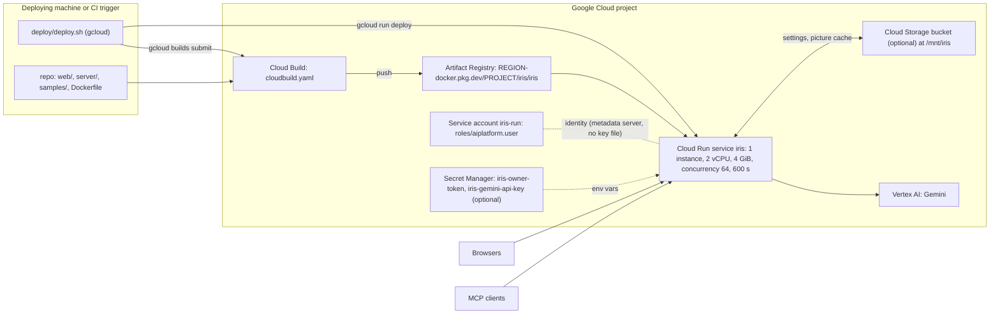
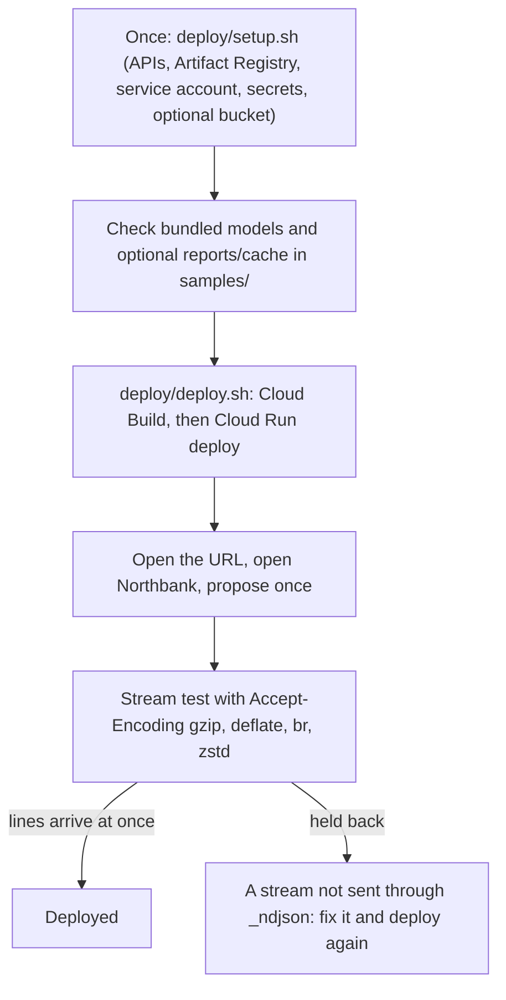

# 17 · Deployment and operations

> **Covers:** `Dockerfile`, `.dockerignore`, `cloudbuild.yaml`, `deploy/deploy.sh`, `deploy/setup.sh`,
> `deploy/env.yaml`, `deploy/.gcloudignore`, `deploy/README.md`, `server/iris/app.py` (static files, streams,
> exports), `server/iris/settings.py` (the settings file), `server/iris/service.py` (eviction), `.env.example`,
> `README.md` ("Run locally", "Deploy"), `samples/README.md`, `web/vite.config.ts`, `web/scripts/copy-wasm.mjs`.
> **Checked against code:** 2026-11-11 (the Cloud Run deploy files).
> **Deeper design:** [docs/uploads.md](../uploads.md) (memory and uploads), [docs/mcp.md](../mcp.md),
> [docs/voice.md](../voice.md) (the voice socket)

The public demo of Iris by Techjays runs on Google Cloud as one Cloud Run service. It serves the built web app and the API from one
origin. This doc covers:

- what the image contains and why;
- how the service is configured, and how to deploy and check a deploy;
- how to run Iris locally;
- how the running server behaves: what its streams need, what a restart loses, and how memory and disk are kept in
  bounds.

Env vars are listed in full in [15](15-requirements-settings-and-config.md). Caps and budgets are in
[16](16-security-caps-and-cost.md).

## Deployment topology



## The image (`Dockerfile`)

The image is built in two stages.

| Stage / step | What | Why |
|---|---|---|
| `node:22-bookworm-slim AS web` | `npm ci` (with `scripts/` copied first), then `npm run build` | `postinstall` (`scripts/copy-wasm.mjs`) puts web-ifc's `.wasm` in `public/wasm/`, which ships in `dist`. `npm run build` is `tsc --noEmit && vite build`. |
| `python:3.13-slim-bookworm AS app` | the base | the server needs Python 3.13 (`requires-python = ">=3.13"`) |
| `apt-get install libpango-1.0-0 libpangoft2-1.0-0 libharfbuzz0b libharfbuzz-subset0 fonts-dejavu-core` | Pango, HarfBuzz and a font | WeasyPrint uses them to lay out and render the PDF report (`document.py`) |
| `apt-get install libgl1` | the GL library and X11 | OpenCASCADE's Python bindings (`cadquery-ocp`, used by `step.py` for STEP models) link them |
| `uv sync --frozen --no-dev --no-install-project` in `/app/server` | the server's locked Python dependencies | they come from `server/pyproject.toml` and `server/uv.lock` ([02](02-system-architecture.md#technology-stack)). The venv is `/app/server/.venv`. |
| `COPY server/iris` | the server package | its prompts (`domain_packs/*.md`) come with it |
| `COPY --from=web /app/web/dist /app/web/dist` | the built web app | `app.WEB_DIST` resolves to `/app/web/dist`, so it is mounted at `/` |
| `COPY samples /app/samples` | only `.ifc`, `.step`, `.stp`, `.json`, `.xml`, `.png`, `.jpg`, `.jpeg` (filtered by `.dockerignore`) | the demo models, sample clash reports with their images, and `samples/step-cache`. The cache holds a converted STEP's IFC and manifest, so the first visitor after a restart does not wait for the part classes. |
| `USER iris` (uid 10001) | not root | `/app/server` and `/mnt/iris` belong to it |
| `CMD uvicorn iris.app:app --host 0.0.0.0 --port $PORT --workers 1` | one process | all state is in this process's memory (below) |

The image's layout matches the repo's: `/app/server/iris`, `/app/web/dist` and `/app/samples`. The server finds
`WEB_DIST`, `SAMPLES` and `.env` by path relative to its package, so it needs no extra settings.

The repo's `.env` is never added to the image. Both `.dockerignore` and `deploy/.gcloudignore` exclude it. In the
container, settings come from the service's env vars and secrets. `load_env()` finds no `/app/.env` and does nothing.

`gcloud builds submit` uploads the repo with `deploy/.gcloudignore`. Without that file gcloud would use `.gitignore`,
and the optional, gitignored `samples/reports/` and `samples/step-cache/` would never reach the build.

## The Cloud Run service (`deploy/deploy.sh`)

### Container settings

| Setting | Value | Why |
|---|---|---|
| `--max-instances 1` | one instance, always (fixed in the script) | open scenes and their edits, reports, links, caps and the day's spend live in the process's memory. A second instance would answer "Model not loaded" to half the requests. |
| `--min-instances 1` (`MIN_INSTANCES`) | one instance kept warm | the first visitor after a quiet spell gets an answer at once, not a cold start with no models open. Open models, edits and caps also outlive a quiet spell. |
| `--concurrency 64` | up to 64 requests at once | every page following an agent link holds an events stream, on top of the NDJSON streams of proposals, triage and the rest |
| `--cpu 2 --memory 4Gi` | 2 vCPU, 4 GiB | the scene budget is sized to fit ([docs/uploads.md](../uploads.md)) |
| `--timeout 600` | 10 minutes per request | a proposal with retries can take a few minutes. This limit is also why the link events stream ends after 240 s and `/mcp` sends one JSON reply per call. |
| `--no-cpu-throttling` | CPU stays allocated between requests | triage and title jobs, and the background work behind streams, keep running when no request is open |
| `--cpu-boost` | extra CPU while the instance starts | importing IfcOpenShell and OpenCASCADE is slow |
| `--execution-environment gen2` | second generation | needed for the Cloud Storage volume |
| `--service-account iris-run@…` | the runtime identity | Vertex AI calls use its Application Default Credentials from the metadata server. No key file exists. |
| `--allow-unauthenticated` | public demo | `ALLOW_UNAUTHENTICATED=0` makes the service IAM-only |
| `--port 8080` | the container port | uvicorn listens on `$PORT` |

WebSockets (live voice) work on Cloud Run with no extra setting. They are subject to the same 600 s request timeout.

### Environment

`deploy/deploy.sh` builds one env-vars file from two sources and passes it with `--env-vars-file`. That replaces all
of the service's env vars on every deploy.

- **Caps and limits** come from `deploy/env.yaml`:
  - the proposal, chat, voice, built-view, upload, link and agent-call caps;
  - `IRIS_MAX_SCENES` and `IRIS_MAX_REPORTS`, 8 each;
  - `IRIS_SCENE_BUDGET_MB` 300, and `IRIS_UPLOAD_MAX_MB` and `IRIS_MODEL_UPLOAD_MAX_MB`, 150 each;
  - `IRIS_ESCALATION_MAX_USD_DAY` 25;
  - `IRIS_BUILT_VIEWS` 0 and `IRIS_OPEN_WEIGHTS` 0.
- **`IRIS_TRUST_FORWARDED` 1** is also in `deploy/env.yaml`. Cloud Run's front end appends the visitor's address to
  `X-Forwarded-For`, and the socket peer is the front end, not the visitor. `limits.client_id` therefore takes the
  rightmost entry. uvicorn keeps its default proxy handling, which trusts only 127.0.0.1, so it does not rewrite the
  peer itself.
- **Vertex AI** settings come from the script:
  - `GOOGLE_CLOUD_PROJECT`;
  - `GOOGLE_CLOUD_LOCATION` (default `global`, which is independent of the Cloud Run region);
  - `GOOGLE_GENAI_USE_VERTEXAI=true`;
  - `GEMINI_MODEL`, `GEMINI_FAST_MODEL`, `GEMINI_ESCALATION_MODEL`, `GEMINI_IMAGE_MODEL`, `GEMINI_THINKING_LEVEL` and `GEMINI_ESCALATION_THINKING_LEVEL`.

  Each one defaults in the script and can be overridden from the environment. See the table in
  `deploy/README.md`.
- **`IRIS_PUBLIC_URL`** is the URL that MCP clients show as Iris's site. It defaults to the service's deterministic
  URL, `https://iris-PROJECT_NUMBER.REGION.run.app`.
- **With a bucket** (`BUCKET`), the script also sets `IRIS_SETTINGS_FILE=/mnt/iris/settings.json` and
  `IRIS_BUILT_CACHE=/mnt/iris/built`.

A changed value takes effect only in a new revision, so it needs a redeploy. The settings for everyone
([15](15-requirements-settings-and-config.md)) change live from the owner menu instead.

### Secrets

Secrets come from Secret Manager through `--set-secrets` and appear as env vars. The script and the docs refer to them
only by name. Their values never go in git, chat, logs or tool output.

| Env var | Secret | For |
|---|---|---|
| `IRIS_OWNER_TOKEN` | `iris-owner-token` (required) | the owner's unlock (at least 24 characters; [16](16-security-caps-and-cost.md)) |
| `GEMINI_API_KEY` | `iris-gemini-api-key` (optional) | an API key in place of Vertex AI's service-account auth. It is mounted only if the secret exists. |

The service account has `roles/secretmanager.secretAccessor` on each secret. `deploy/setup.sh` grants it.

### Persistent storage

Without a bucket, nothing the server writes outlives the instance. The settings for everyone go to
`server/.iris-settings.json` inside the container, and a restart loses them.

With `BUCKET` set, a Cloud Storage bucket is mounted through Cloud Storage FUSE at `/mnt/iris`:

- the settings for everyone (`IRIS_SETTINGS_FILE`) survive restarts and redeploys;
- the Show it built picture cache (`IRIS_BUILT_CACHE`) is kept, so a restart does not pay for the same picture again.

The service account needs `roles/storage.objectUser` on the bucket.

Uploads, conversions and exports stay in the container's temp folders. On Cloud Run those folders are in memory and
count against the 4 GiB, so they are not moved to the bucket. FUSE is too slow for a scene's working files.

### What warm costs

With `--min-instances 1` and `--no-cpu-throttling`, Cloud Run bills the one instance for 2 vCPU and 4 GiB all day, at
the instance-based rate, before any Gemini calls. Check the current price on Cloud Run's pricing page for the region.
After judging, deploy with `MIN_INSTANCES=0` to let the service scale to zero. The first request after that starts a
fresh instance with no models open.

## How to deploy



1. **Credentials.** Sign in with `gcloud auth login` as a person or CI identity allowed to run Cloud Build and deploy
   to Cloud Run (see `deploy/README.md`, "Prerequisites"). No key files are used anywhere.
2. **One-time setup.** Run `deploy/setup.sh`. It does the following:
   - enables `run`, `aiplatform`, `artifactregistry`, `cloudbuild`, `secretmanager`, `iam` and `storage`;
   - creates the `iris` Docker repository in the region;
   - creates the `iris-run` service account with `roles/aiplatform.user`;
   - creates the `iris-owner-token` secret from `IRIS_OWNER_TOKEN` in the environment, and `iris-gemini-api-key` if
     `GEMINI_API_KEY` is set;
   - creates the bucket if `BUCKET` is set.

   The manual commands are in `deploy/README.md`.
3. **Samples** ([samples/README.md](../../samples/README.md)):
   - six Northbank IFCs and the cell's `PC-03-Palletising-Cell-RevA.step` and `-RevB.step` are bundled;
   - optional `samples/step-cache/` stays gitignored. To fill it, create the directory and open each STEP once with
     the server running locally;
   - optional clash reports in `samples/reports/<name>/` stay gitignored (XML at the top, with linked images).

   The image builds the web app itself, so there is no `npm run build` step before deploying.
4. **Deploy.** Run `GOOGLE_CLOUD_PROJECT=<project> deploy/deploy.sh`. Add `REGION=…` (default `asia-south1`) and
   `BUCKET=…` if you need them. The script does the following:
   - runs `gcloud builds submit --config cloudbuild.yaml`, which builds and pushes
     `REGION-docker.pkg.dev/PROJECT/iris/iris:<sha>-<timestamp>` and `:latest`;
   - runs `gcloud run deploy iris` with the settings above;
   - prints the service URL.
5. **CI (optional).** Add a Cloud Build trigger on main with `cloudbuild.yaml`. It tags images with the commit's
   short SHA. `gcloud run deploy iris --image …` then rolls out a built image, keeping the service's other settings.

Before delivering a change, run the checks in [18](18-testing-and-evals.md) (server tests, `npm run build`,
`npm test`, runtime checks), as `AGENTS.md` asks.

### After a deploy

- **Open the URL** (`gcloud run services describe iris --region REGION --format='value(status.url)'`). The landing
  page should load, which shows the static mount works, and the demo cards should show.
- **Open the Northbank demo.** Four models should open and the check should run, then the list should appear. The
  clash count depends only on geometry, not on the model provider ([22](22-build-log.md)).
- **Propose once** on the duct through the girder (#042). The verified answer is an offset through the web opening.
  Re-measure proposal latency on Gemini before quoting it.
- **Test a stream the way a browser asks for it.** A front end that compresses for browsers' `Accept-Encoding` can
  hold NDJSON back. Detection makes no model call, so it is safe to test with:

  ```bash
  URL=$(gcloud run services describe iris --region asia-south1 --format='value(status.url)')
  SID=$(curl -s -X POST "$URL/api/scenes" -H 'Content-Type: application/json' \
    -d '{"samples": ["Northbank-Structure.ifc", "Northbank-MEP.ifc", "Northbank-Architecture.ifc"]}' \
    | python3 -c 'import json, sys; print(json.load(sys.stdin)["id"])')
  curl -sN -D - -X POST "$URL/api/scenes/$SID/detect/stream" -H 'Content-Type: application/json' \
    -H 'Accept-Encoding: gzip, deflate, br, zstd' -d '{}'
  ```

  Expect `content-encoding: identity` in the headers, and the `phase` and `test` lines as they happen, not all at
  the end.
- **Owner.** Open the site with `#owner`, unlock, and check that **For everyone** reads back what you saved. With a
  bucket, it should read the same after a redeploy.

## Running locally

Follow [README: Run locally](../../README.md#run-locally), the canonical setup path. It covers:

- the tools: Git, uv-managed Python 3.13, and Node LTS 22.12 or newer with npm;
- `uv sync --project server --locked --python 3.13` and `npm ci --prefix web`;
- creating a root `.env` (the Gemini settings, `GOOGLE_CLOUD_PROJECT`, `GOOGLE_CLOUD_LOCATION`, and
  `gcloud auth application-default login` for Vertex AI);
- two terminals and the URLs to open.

Eight demo models are bundled.

You can also run the production image locally with `docker build -t iris .`, then `docker run -p 8080:8080 …` (see
`deploy/README.md`).

- **`.env` loading.** `load_env()` reads `KEY=value` lines from the repo root's `.env` into the environment with
  `os.environ.setdefault`, so real environment variables win. It runs on the first import of any `iris` module,
  before any module reads a setting. Restart the server after changing `.env`.
- **Caps are off locally** unless set. The caps read `limits.env_int(…, 0)`, where unset, empty and 0 all mean no
  limit. The exceptions are requirements files (120 an hour) and previews (60 an hour), which take their own
  defaults when unset or empty; only 0 turns those two off.
- **Settings for everyone** are kept in `server/.iris-settings.json` (gitignored). Set `IRIS_SETTINGS_FILE` to move it.
- **The dev server** (`npm run dev`, port 5173) proxies `/api` to `localhost:8000` with `ws: true` (live voice). It
  keeps the `Host` header, so the voice socket's same-origin check passes (`web/vite.config.ts`).
- **One origin, as in production:** run `npm run build`, and uvicorn serves `web/dist` at `/` (or the folder in
  `IRIS_WEB_DIST`). The mount is decided when `app.py` is imported, so restart the server after the first build.
- **MCP in dev.** Vite proxies only `/api`, so point the agent at `http://localhost:8000/mcp`, or use the built app on
  port 8000.
- **Without credentials**, opening models, detection, measuring and **Check this move** all work. Anything that asks
  Gemini fails.

## Operational behaviour

### Streams and the front end

Every stream goes through `app._ndjson`, whose `NDJSON_HEADERS` are:

- `Cache-Control: no-store, no-transform`
- `X-Accel-Buffering: no`
- `Content-Encoding: identity`

A front end that compresses for browsers would otherwise hold NDJSON back until a buffer fills. `_McpGate` adds
`content-encoding: identity` to every `/mcp` response. A new stream that skips `_ndjson` can look fine locally and
stall in production. The voice WebSocket passes through untouched ([docs/voice.md](../voice.md)).

Long work stays inside the 600 s request timeout:

- the link events stream ends after about 240 s and the page reconnects. It sends a `heartbeat` every 15 s;
- `/mcp` is stateless with JSON replies. Long tools are jobs (`wait_s`, at most 55 s, then `get_job`);
- the upload stream sends a `tick` every 5 s while a big model opens;
- shared triage and title runs send `ping` after 15 s of quiet.

### What a restart loses

A redeploy (a new revision), a crash, or a scale-down when `MIN_INSTANCES` is 0 starts a fresh process. Cloud Run can
also replace an instance on its own, for maintenance. Everything in memory or in the container's temp folders is
gone. The page and agents recover as follows:

| Lost | What people see | Recovery |
|---|---|---|
| open scenes and every kept edit | A page that is still open shows one notice at its next call: "The server no longer holds your models". The 404 "Model not loaded. Open it again." carries `X-Iris-Gone`. | The notice's **Open them again** reopens the same sample models and runs the check again (for uploads, **Pick your files again**). Edits live only in memory, so export kept fixes before a redeploy. |
| open reports | the same notice, for the clash report | **Open it again** |
| registered requirements | 409 `requirements_unknown` | automatic: `api.ts` `send` registers the file again and retries once |
| triage and title runs | the Triage card shows nothing new | run triage again |
| agent links | the agent gets 401, and the page drops the link | make a new link |
| cap counters and the day's escalation spend | the counts start again | none needed (in memory by design: `limits.py`, `spend.py`) |
| built documents | 404 "That report has expired. Build it again." | build the report again |
| the built-view cache (without a bucket) | a picture is drawn again, and paid for again | deploy with `BUCKET` |
| the settings for everyone (without a bucket) | the owner's switches fall back to the env defaults | deploy with `BUCKET` |
| STEP conversions not in `samples/step-cache` | the first opening is slow again | ship the conversion in `samples/step-cache` |

These survive a restart:

- the owner's cookie, which is signed with a key made from the token, so it stays valid while the token is unchanged;
- everything in the image (`samples/`, `web/dist`);
- with a bucket, the settings and the picture cache.

### Keeping memory and disk in bounds

Cloud Run's filesystem is in memory. Every temp file counts against the same 4 GiB as the open scenes.

- **Scenes** (`Workspace._evict`): the oldest go first when there are more than `IRIS_MAX_SCENES`, or when their IFC
  bytes pass `IRIS_SCENE_BUDGET_MB`. Room is made before a new scene is read, because a scene peaks while it opens.
  Scenes that a live agent link points at go last. A dropped scene's upload or conversion folder is deleted.
- **Reports** (`Workspace._keep`): past `IRIS_MAX_REPORTS`, the oldest goes (live links' reports last), and an
  uploaded report's folder is deleted.
- **Everything else in memory** is a bounded table that drops its oldest entry. The full list is in
  [05](05-domain-model-and-state.md).
- **Bigger models** are refused before they cost anything, by the upload cap (`IRIS_MODEL_UPLOAD_MAX_MB`, counted
  unpacked) and by `IRIS_WIDER_FIX_MAX_MB` for wider fixes ([docs/uploads.md](../uploads.md)).
- **Temp folders** (`tempfile.gettempdir()`):
  - `iris-exports` holds written models, exports and PDF copies. `_tidy_exports` deletes anything older than
    `EXPORTS_KEEP_S` (3,600 s) on every file download and export;
  - `iris-models` (uploads, conversions) and `iris-reports` (uploaded reports) are deleted along with their scene or
    report;
  - `iris-built`, used when there is no bucket, is never pruned by the code. Deploy with `BUCKET` to keep it out of
    memory.

If the instance is stopped for running out of memory (shown in the logs as a memory limit exceeded), lower
`IRIS_SCENE_BUDGET_MB` or `IRIS_MAX_SCENES`, or raise `MEMORY` and redeploy.

### Logs and troubleshooting

The app logs little of its own. The container's output goes to Cloud Logging:

- a traceback for an unhandled 500;
- the settings store's warnings;
- uvicorn's access log.

Read it with `gcloud run services logs read iris --region REGION`, or in the console under Cloud Run, iris, Logs. A
failure inside a streamed job is not logged. It reaches the page as the stream's `error` event, so the browser's view
of the stream is often the quickest place to look.

| Symptom | Likely cause | Fix |
|---|---|---|
| A stream's events all arrive at once at the end, in the browser only | the stream does not go through `app._ndjson` | send it through `_ndjson`, and test with `Accept-Encoding: gzip, deflate, br, zstd` |
| "The server no longer holds your models" during a session | one of three things: a new revision (every `deploy.sh` run makes one), a scale-down (only when `MIN_INSTANCES` is 0), or eviction under the scene budget | use **Open them again** on the notice, and don't redeploy while someone is working |
| 403 or `PERMISSION_DENIED` from Vertex AI in the logs | the service account lacks `roles/aiplatform.user`, or the Vertex AI API is not enabled | run `deploy/setup.sh` again |
| Gemini answers 404 for a model | the model is not offered in `GOOGLE_CLOUD_LOCATION` | use `global`, or a location that serves the model |
| The deploy fails on a secret | the secret has no version, or the service account lacks `secretAccessor` | run `deploy/setup.sh` again with `IRIS_OWNER_TOKEN` set |
| The build fails to push | the Cloud Build service account cannot write to Artifact Registry | grant `roles/artifactregistry.writer` (see `deploy/README.md`) |
| Every visitor shares one set of caps | `IRIS_TRUST_FORWARDED` is 0, so the peer, which is the front end, is used | keep it at 1 on Cloud Run |
| The first cell opening after a restart takes about half a minute | `samples/step-cache` was not in the build | add the conversion and redeploy |
| Show it built answers 403 | it is switched off for this visitor (`IRIS_BUILT_VIEWS` 0, or the owner settings) | switch it on in the owner menu |
| A second try answers 429 about the budget | the day's escalation budget (`IRIS_ESCALATION_MAX_USD_DAY`) is spent. It resets at midnight UTC. | wait, or raise the budget and redeploy |

## When to update this doc

- Any change to the `Dockerfile`, `.dockerignore`, `cloudbuild.yaml` or `deploy/`. That includes a system package,
  a dependency step, an env var or its value, a directory added, a secret, a container setting, the entry point, or
  the service name.
- A new secret the server needs, or a new store outside the process (a bucket path, a database).
- A change to how `.env` is loaded, to `IRIS_WEB_DIST` or static serving, or to the dev proxy.
- A new kind of stream or long request. It must go through `_ndjson` and stay inside the 600 s limit.
- A change to what a restart loses, to eviction, or to temp-folder cleanup.
- A new measured deploy check, or a deploy step learned the hard way.
