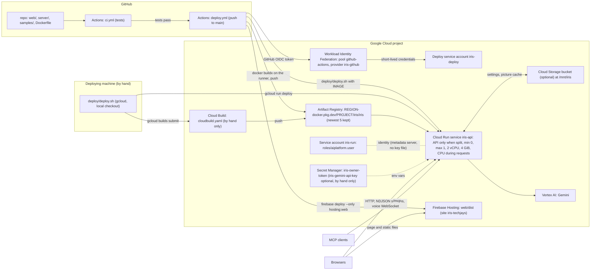
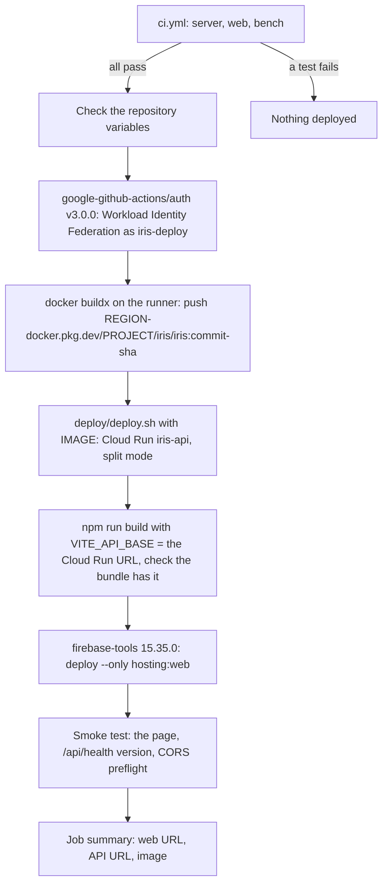
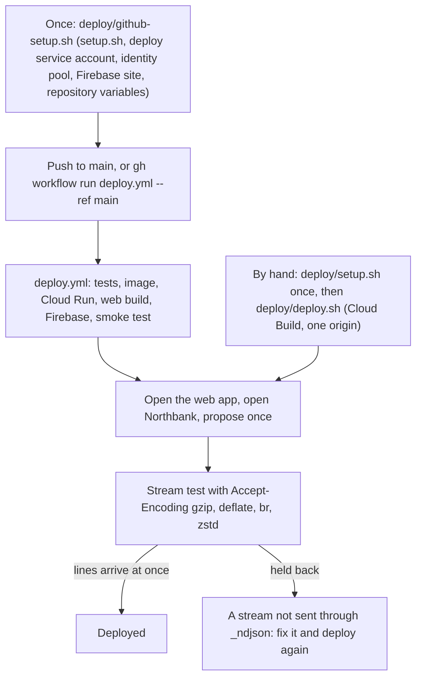

# 17 · Deployment and operations

> **Covers:** `Dockerfile`, `.dockerignore`, `cloudbuild.yaml`, `deploy/deploy.sh`, `deploy/setup.sh`,
> `deploy/github-setup.sh`, `deploy/env.yaml`, `deploy/.gcloudignore`, `deploy/README.md`,
> `.github/workflows/ci.yml`, `.github/workflows/deploy.yml`, `firebase.json`, `.firebaserc`,
> `server/iris/origins.py`, `server/iris/app.py` (static files, `/`, `/api/health`, CORS, streams, exports),
> `server/iris/settings.py` (the settings file), `server/iris/projects.py` (the projects folder),
> `server/iris/service.py` (eviction), `.env.example`, `.gitignore`,
> `README.md` ("Run locally", "Deploy"), `samples/README.md`, `web/vite.config.ts`, `web/scripts/copy-wasm.mjs`.
> **Checked against code:** 2026-11-22 (the deploy files, CI/CD, the projects folder, what `samples/` puts in the
> **Checked against code:** 2026-11-22 (the Cloud Run deploy files, the projects folder, the saved checks in the
> image).
> **Deeper design:** [docs/uploads.md](../uploads.md) (memory and uploads), [docs/mcp.md](../mcp.md),
> [docs/voice.md](../voice.md) (the voice socket), [deploy/README.md](../../deploy/README.md) (every command)

The public demo of Iris by Techjays runs on Google Cloud in two parts. The API runs on one Cloud Run service,
`iris-api`. The web app runs on Firebase Hosting. GitHub Actions deploys both on every push to main. The browser loads
the page from Firebase and calls Cloud Run directly. A deploy by hand with `deploy/deploy.sh` can still serve the web
app and the API from one Cloud Run origin. This doc covers:

- what the image contains and why;
- how the service is configured, and how to deploy and check a deploy;
- the CI/CD pipeline, and split mode against one origin;
- how to run Iris locally;
- how the running server behaves: what its streams need, what a restart loses, and how memory and disk are kept in
  bounds.

Env vars are listed in full in [15](15-requirements-settings-and-config.md). Caps and budgets are in
[16](16-security-caps-and-cost.md).

## Deployment topology



The deploy job acts as `iris-deploy` for every Google Cloud call. A deploy by hand acts as the person signed in to
`gcloud`. In a one-origin deploy (by hand, `IRIS_ALLOWED_ORIGINS` empty), Cloud Run serves the page too and Firebase
is not involved.

## The image (`Dockerfile`)

The image is built in two stages.

| Stage / step | What | Why |
|---|---|---|
| `node:22-bookworm-slim AS web` | `npm ci` (with `scripts/` copied first), then `npm run build` | `postinstall` (`scripts/copy-wasm.mjs`) puts web-ifc's `.wasm` in `public/wasm/`, which ships in `dist`. `npm run build` is `tsc --noEmit && vite build`. `VITE_API_BASE` is empty here, so this copy of the page calls its own origin. |
| `python:3.13-slim-bookworm AS app` | the base | the server needs Python 3.13 (`requires-python = ">=3.13"`) |
| `apt-get install libpango-1.0-0 libpangoft2-1.0-0 libharfbuzz0b libharfbuzz-subset0 fonts-dejavu-core` | Pango, HarfBuzz and a font | WeasyPrint uses them to lay out and render the PDF report (`document.py`) |
| `apt-get install libgl1` | the GL library and X11 | OpenCASCADE's Python bindings (`cadquery-ocp`, used by `step.py` for STEP models) link them |
| `uv sync --frozen --no-dev --no-install-project` in `/app/server` | the server's locked Python dependencies | they come from `server/pyproject.toml` and `server/uv.lock` ([02](02-system-architecture.md#technology-stack)). The venv is `/app/server/.venv`. |
| `COPY server/iris` | the server package | its prompts (`domain_packs/*.md`) come with it |
| `COPY --from=web /app/web/dist /app/web/dist` | the built web app | `app.WEB_DIST` resolves to `/app/web/dist`, so it is mounted at `/`, except in split mode (below), where it stays unused |
| `COPY samples /app/samples` | only `.ifc`, `.step`, `.stp`, `.json`, `.xml`, `.png`, `.jpg`, `.jpeg`, and `samples/drawings/*.pdf` (filtered by `.dockerignore`) | the demo models, sample clash reports with their images, `samples/step-cache`, and the sample PDF drawings with their answer keys and saved readings (`*.reading.json`, replayed instead of a model call: [docs/drawings.md](../drawings.md)). The cache holds a converted STEP's IFC and manifest, so the first visitor after a restart does not wait for the part classes. |
| `COPY samples /app/samples` | only `.ifc`, `.step`, `.stp`, `.json`, `.xml`, `.png`, `.jpg`, `.jpeg` (filtered by `.dockerignore`) | the demo models, sample clash reports with their images, `samples/step-cache` and `samples/saved-checks`. The cache holds a converted STEP's IFC and manifest, so the first visitor after a restart does not wait for the part classes. The saved checks hold what the Northbank files measure, so their first check builds no geometry, cold or warm ([06](06-geometry-and-detection.md)). |
| `USER iris` (uid 10001) | not root | `/app/server` and `/mnt/iris` belong to it |
| `CMD uvicorn iris.app:app --host 0.0.0.0 --port $PORT --workers 1` | one process | all state is in this process's memory (below) |

The image's layout matches the repo's: `/app/server/iris`, `/app/web/dist` and `/app/samples`. The server finds
`WEB_DIST`, `SAMPLES` and `.env` by path relative to its package, so it needs no extra settings.

The repo's `.env` is never added to the image. Both `.dockerignore` and `deploy/.gcloudignore` exclude it. In the
container, settings come from the service's env vars and secrets. `load_env()` finds no `/app/.env` and does nothing.

`gcloud builds submit` uploads the repo with `deploy/.gcloudignore`. Without that file gcloud would use `.gitignore`,
and the optional, gitignored `samples/reports/` and `samples/step-cache/` would never reach the build.

The pipeline builds the same `Dockerfile` on the GitHub runner from a git checkout, so its images never contain those
two gitignored folders. A deploy by hand from a machine that has them still bakes them in.

## The Cloud Run service (`deploy/deploy.sh`)

The service is `iris-api` (`SERVICE`). The pipeline runs the same script with `IMAGE` set, so the settings below hold
for both ways of deploying. An earlier manual deploy made a service named `iris`; nothing uses it now, and
[deploy/README.md](../../deploy/README.md) says how to delete it.

### Container settings

The defaults keep the footprint minimal (owner decision, 2026-11-22).

| Setting | Value | Why |
|---|---|---|
| `--max-instances 1` | one instance, always (fixed in the script) | open scenes and their edits, reports, links, caps and the day's spend live in the process's memory. A second instance would answer "Model not loaded" to half the requests. |
| `--min-instances 0` (`MIN_INSTANCES`) | scale to zero when idle | nothing is billed between visits. The first request after an idle spell waits for a cold start and finds no models open. `MIN_INSTANCES=1` keeps one instance warm, billed all the time. |
| `--concurrency 64` | up to 64 requests at once | every page following an agent link holds an events stream, on top of the NDJSON streams of proposals, triage and the rest |
| `--cpu 2 --memory 4Gi` | 2 vCPU, 4 GiB | the scene budget is sized to fit ([docs/uploads.md](../uploads.md)) |
| `--timeout 600` | 10 minutes per request | a proposal with retries can take a few minutes. This limit is also why the link events stream ends after 240 s and `/mcp` sends one JSON reply per call. |
| `--cpu-throttling` (`CPU_THROTTLING=1`) | CPU only while a request is open | billed per request. Work that outlives its request (triage and title jobs, the background work behind a stream nobody reads) runs slowly until the next request. `CPU_THROTTLING=0` gives `--no-cpu-throttling` back, billed all the time. |
| `--cpu-boost` | extra CPU while the instance starts | importing IfcOpenShell and OpenCASCADE is slow, and scale to zero makes cold starts common |
| `--execution-environment gen2` | second generation | needed for the Cloud Storage volume |
| `--service-account iris-run@…` | the runtime identity | Vertex AI calls use its Application Default Credentials from the metadata server. No key file exists. |
| `--allow-unauthenticated` | public demo | `ALLOW_UNAUTHENTICATED=0` makes the service IAM-only |
| `--port 8080` | the container port | uvicorn listens on `$PORT` |

WebSockets (live voice) work on Cloud Run with no extra setting. They are subject to the same 600 s request timeout.

### Environment

`deploy/deploy.sh` builds one env-vars file from two sources and passes it with `--env-vars-file`. That replaces all
of the service's env vars on every deploy.

- **Caps and limits** come from `deploy/env.yaml`:
  - the proposal, chat, voice, built-view, upload, link and agent-call caps;
  - `IRIS_MAX_SCENES` and `IRIS_MAX_REPORTS`, 8 each;
  - `IRIS_PROJECTS_MAX` 50;
  - `IRIS_SCENE_BUDGET_MB` 300, and `IRIS_UPLOAD_MAX_MB` and `IRIS_MODEL_UPLOAD_MAX_MB`, 150 each;
  - `IRIS_ESCALATION_MAX_USD_DAY` 25;
  - `IRIS_BUILT_VIEWS` 0 and `IRIS_OPEN_WEIGHTS` 0.
- **`IRIS_TRUST_FORWARDED` 1** is also in `deploy/env.yaml`. Cloud Run's front end appends the visitor's address to
  `X-Forwarded-For`, and the socket peer is the front end, not the visitor. `limits.client_id` therefore takes the
  rightmost entry. uvicorn keeps its default proxy handling, which trusts only 127.0.0.1, so it does not rewrite the
  peer itself.
- **Vertex AI** settings come from the script:
  - `GOOGLE_CLOUD_PROJECT`;
  - `GOOGLE_CLOUD_LOCATION` (default `global`, which is independent of the Cloud Run region);
  - `GOOGLE_GENAI_USE_VERTEXAI=true`;
  - `GEMINI_MODEL`, `GEMINI_FAST_MODEL`, `GEMINI_ESCALATION_MODEL`, `GEMINI_IMAGE_MODEL`, `GEMINI_THINKING_LEVEL` and `GEMINI_ESCALATION_THINKING_LEVEL`.

  Each one defaults in the script and can be overridden from the environment. See the table in
  `deploy/README.md`.
- **`IRIS_PUBLIC_URL`** is the URL that MCP clients show as Iris's site. It defaults to the service's deterministic
  URL, `https://iris-api-PROJECT_NUMBER.REGION.run.app`. When it is set, the script skips `gcloud projects describe`.
  The pipeline sets the web app's URL (`WEB_URL`, or `https://SITE.web.app`).
- **`IRIS_VERSION`** is what `GET /api/health` reports. It defaults to the image tag; the pipeline sets the commit SHA.
- **`IRIS_ALLOWED_ORIGINS`** is written only when it is set. It puts the service in split mode (below). The pipeline
  sets `https://SITE.web.app,https://SITE.firebaseapp.com`, plus `WEB_URL` and `EXTRA_ORIGINS` when those
  repository variables are set.
- **With a bucket** (`BUCKET`), the script also sets `IRIS_SETTINGS_FILE=/mnt/iris/settings.json` and
  `IRIS_BUILT_CACHE=/mnt/iris/built`.
  URL, `https://iris-PROJECT_NUMBER.REGION.run.app`.
- **With a bucket** (`BUCKET`), the script also sets `IRIS_SETTINGS_FILE=/mnt/iris/settings.json`,
  `IRIS_BUILT_CACHE=/mnt/iris/built` and `IRIS_PROJECTS_DIR=/mnt/iris/projects`.

A changed value takes effect only in a new revision, so it needs a redeploy. The settings for everyone
([15](15-requirements-settings-and-config.md)) change live from the owner menu instead.

Because every deploy replaces all env vars, a run by hand against `iris-api` without `IRIS_ALLOWED_ORIGINS` turns
split mode off, and the Firebase page can no longer call the API until the next push.

### Secrets

Secrets come from Secret Manager through `--set-secrets` and appear as env vars. The script and the docs refer to them
only by name. Their values never go in git, chat, logs or tool output.

| Env var | Secret | For |
|---|---|---|
| `IRIS_OWNER_TOKEN` | `iris-owner-token` (required) | the owner's unlock (at least 24 characters; [16](16-security-caps-and-cost.md)) |
| `GEMINI_API_KEY` | `iris-gemini-api-key` (optional) | an API key in place of Vertex AI's service-account auth. It is mounted only if the secret exists and `GEMINI_API_KEY_SECRET` is not empty. The pipeline sets it empty, and `github-setup.sh` makes no key secret: there is no Gemini API key in the cloud. |

The runtime service account `iris-run` has `roles/secretmanager.secretAccessor` on each secret. `deploy/setup.sh`
grants it. The deploy service account `iris-deploy` has no Secret Manager role: Cloud Run reads the secrets as
`iris-run`.

### Persistent storage

Without a bucket, nothing the server writes outlives the instance. The settings for everyone go to
`server/.iris-settings.json` inside the container, and a restart loses them. Projects go to `server/.iris-projects`
on the container's in-memory disk: they count against the 4 GiB and are lost with the instance.

With `BUCKET` set, a Cloud Storage bucket is mounted through Cloud Storage FUSE at `/mnt/iris`:

- the settings for everyone (`IRIS_SETTINGS_FILE`) survive restarts and redeploys;
- the Show it built picture cache (`IRIS_BUILT_CACHE`) is kept, so a restart does not pay for the same picture again;
- projects (`IRIS_PROJECTS_DIR=/mnt/iris/projects`: original models, saved states, kept reports) survive restarts
  and redeploys ([14](14-files-in-and-out.md)).

The service account needs `roles/storage.objectUser` on the bucket.

Uploads, conversions and exports stay in the container's temp folders. On Cloud Run those folders are in memory and
count against the 4 GiB, so they are not moved to the bucket. FUSE is too slow for a scene's working files: opening a
project copies its files into the temp folder first, so a scene never works from the bucket.

`.gitignore` and `deploy/.gcloudignore` leave out `server/.iris-projects`, so local projects never reach git or a
build.

### What warm costs

By default the service scales to zero and has CPU only while a request is open, so Cloud Run bills only for request
time, before any Gemini calls. The cost is a cold start after each idle spell, with no models open.

With `MIN_INSTANCES=1` and `CPU_THROTTLING=0`, Cloud Run bills the one instance for 2 vCPU and 4 GiB all day, at the
instance-based rate. Check the current price on Cloud Run's pricing page for the region. `deploy.yml` passes these two
from the repository variables `MIN_INSTANCES` and `CPU_THROTTLING`; unset, every push sets them back to 0 and 1. To
keep an instance warm through pushes, for example while judges use the demo, set the variables to 1 and 0.

## The pipeline (GitHub Actions)

Two workflows in `.github/workflows/` test every change and deploy main. Every action is pinned to a commit SHA.

| Event | Workflow | What runs |
|---|---|---|
| a pull request | `ci.yml` (CI) | the jobs `server`, `web` and `bench`. A newer push to the pull request cancels the older run. |
| a push to any branch except main | `ci.yml` | the same three jobs |
| a push to main, or `gh workflow run deploy.yml --ref main` | `deploy.yml` (Deploy) | `ci.yml` through `workflow_call`, then the `deploy` job if every test passed |

`ci.yml`'s jobs, on `ubuntu-24.04`:

- **`server`**: the system libraries the `Dockerfile` installs (so the WeasyPrint PDF tests pass), uv with Python
  3.13 (cache keyed on `server/uv.lock`), `uv sync --frozen`, then `uv run pytest -q --ignore=tests/bench`;
- **`web`**: Node 22 with the npm cache, `npm ci`, `npm test`, `npm run build`;
- **`bench`**: only when `server/tests/bench` exists. It installs the renderer in `bench/render` (`npm ci`,
  `npx playwright install --with-deps chromium`) when that folder has a `package-lock.json`, then runs
  `uv run pytest -q tests/bench`.

`deploy.yml`'s `deploy` job runs only on `refs/heads/main`, with `id-token: write`. Its steps, in order:



1. **Variables.** `GCP_PROJECT_ID`, `WIF_PROVIDER` and `DEPLOY_SA` must be set, or the job fails and points at
   `deploy/github-setup.sh`. `GCP_REGION` defaults to `asia-south1` and `FIREBASE_SITE` to `iris-techjays`.
2. **Sign-in.** GitHub's OIDC token is exchanged through Workload Identity Federation for the deploy service account.
   No JSON key exists anywhere. The provider's attribute condition admits only this repository's main branch (and its
   repository id, when `github-setup.sh` could read it), which is why the job does not run on other refs.
3. **Image.** `docker buildx` builds the root `Dockerfile` with the GitHub Actions cache and pushes one image per
   commit, tagged with its SHA, without provenance or SBOM manifests. Cloud Build is not used.
4. **Cloud Run.** `deploy/deploy.sh` runs with `IMAGE`, `IRIS_PUBLIC_URL`, `IRIS_ALLOWED_ORIGINS`, `BUCKET`,
   `GEMINI_API_KEY_SECRET=""` and `IRIS_VERSION=<commit sha>`, and hands the service URL on through
   `$GITHUB_OUTPUT`.
5. **Web build.** `VITE_API_BASE` is the Cloud Run URL, or the `API_URL` repository variable for a custom domain. The
   step fails if the bundle does not contain it.
6. **Firebase Hosting.** The job writes `.firebaserc` from the variables, then releases `web/dist` to the site with the
   message `iris <short sha>`, using the same Workload Identity credentials.
7. **Smoke test.** The page at `https://SITE.web.app` answers. `GET /api/health` reports this commit (a cold start may
   take a few seconds, so it retries). A preflight from the Firebase origin to `/api/owner/unlock` gets
   `Access-Control-Allow-Origin` back.
8. **Summary.** The URLs and the image go to the job summary, even when a step failed.

Deploys share the concurrency group `deploy-<ref>`. A running deploy is never cancelled; a newer push waits.

The one-time setup is `deploy/github-setup.sh`: the runtime (through `deploy/setup.sh`), the deploy service account
`iris-deploy` and its roles, the identity pool `github-actions` and its provider `iris-github`, Firebase and the
Hosting site, `.firebaserc`, and the repository variables. Each role, the attribute condition, the optional variables
(`BUCKET`, `API_URL`, `WEB_URL`, `EXTRA_ORIGINS`, `MIN_INSTANCES`, `CPU_THROTTLING`), rollback and custom domains are in
[deploy/README.md](../../deploy/README.md).

### Firebase Hosting (`firebase.json`, `.firebaserc`)

Firebase serves only the built web app. The hosting target `web` publishes `web/dist`, and every path falls back to
`/index.html`. Headers: `Cache-Control: no-cache`, `X-Content-Type-Options: nosniff` and
`Referrer-Policy: strict-origin-when-cross-origin` on everything; `/assets/**` (Vite's hashed files) public for a
year, immutable; `**/*.wasm` as `application/wasm`, public for an hour, must-revalidate; `/demos/**` public for an hour.
`.firebaserc` maps target `web` to the site (`iris-techjays`); `deploy.yml` rewrites it on each run.

Firebase does not proxy the API. Its rewrites to Cloud Run cut a request at 60 s and carry no WebSockets, and Iris
streams NDJSON for minutes and talks voice over a WebSocket. So the page calls Cloud Run directly:
`web/src/api.ts` prefixes every server path with `VITE_API_BASE` and sends credentials, and `web/src/voice.ts` opens
the voice socket on the API's host ([12](12-web-app.md)). Static files (the tour, demo clips, logos, `.wasm`) still
come from Firebase.

## Split mode and one origin (`server/iris/origins.py`)

`IRIS_ALLOWED_ORIGINS` decides how the server is reached. Empty (the default, local dev, a deploy by hand) is one
origin. Set (what the pipeline deploys) is split mode: the web app is on other origins and calls this server across
sites.

| | One origin (`IRIS_ALLOWED_ORIGINS` empty) | Split (`IRIS_ALLOWED_ORIGINS` set) |
|---|---|---|
| The page | served by this server from `web/dist`, built with `VITE_API_BASE` empty | served by Firebase Hosting, built with `VITE_API_BASE` set to this server's URL |
| `GET /` (`front_door`) | `web/dist/index.html` | JSON `{"service": "iris-api", "docs": "/docs", "health": "/api/health"}` |
| The static mount at `/` | yes, when `web/dist/index.html` exists | none. Only `/api/*`, `/docs`, `/openapi.json`, `/mcp` and the voice socket. |
| CORS (`app._CrossOrigin`) | none: no CORS headers at all | Starlette's `CORSMiddleware` for exactly those origins (below) |
| The owner cookie (`owner.set_cookie`) | `HttpOnly; Secure; SameSite=Strict; Path=/api`, 30 days | `HttpOnly; Secure; SameSite=None; Partitioned; Path=/api`, 30 days |
| The voice socket (`voice_live.same_origin`) | an `Origin` on the same host only | also an `Origin` in the list |

**The value.** A comma-separated list of `scheme://host[:port]` origins. Each is lower-cased, a trailing slash is
dropped, and duplicates are dropped. A path, `*` or any malformed entry raises `ValueError`: a typo must neither open
the API to every site nor silently close it. `origins.allowed()` reads the env on each call (cached per raw value),
and `app.py` calls it once at import, so a bad value stops the server at start. `origins.allows(origin)` answers for
one request's `Origin`.

**CORS.** `_CrossOrigin` is added after `_OwnerContext`, so it is the outermost middleware, and an answer
`_OwnerContext` gives itself (409 `requirements_unknown`) carries the headers too. For the listed origins it allows
credentials, the methods GET, POST, PUT and DELETE, and the request headers `Content-Type`, `X-Iris-Settings` and
`X-Iris-Requirements`. It exposes `X-Iris-Gone` and `Content-Disposition`, and preflights are cached for 3,600 s. A
preflight from another origin gets 400. A simple request from another origin is answered without
`Access-Control-Allow-Origin`, so the browser hides the answer. `Vary: Origin` is added. WebSockets pass by it: the
voice socket checks its own `Origin`. It only adds headers, so streams keep `Content-Encoding: identity`.

**The cookie.** In split mode the page and the API are on different sites, so the owner cookie must be
`SameSite=None` (which needs `Secure`). `Partitioned` (CHIPS) keeps it per top-level site, which also lets it through
where third-party cookies are blocked, if the browser supports CHIPS. Starlette writes `Partitioned` only on Python
3.14+, so `owner.py` appends it. `clear_cookie` expires it with the same attributes. Safari and other browsers that
block third-party cookies without CHIPS may still drop it. The split service has no page to unlock on, so the
fallbacks are custom domains under one site (the cookie is then first-party) or a one-origin deploy by hand
([deploy/README.md](../../deploy/README.md), "Custom domains" and "Limitations").

### Health (`GET /api/health`)

`GET /api/health` answers `{"status": "ok", "version": <IRIS_VERSION or "dev">}`. It needs no auth and makes no model
call, so it is cheap for deploys and uptime checks. `deploy.sh` sets `IRIS_VERSION` to the image tag; the pipeline
sets the commit SHA, and its smoke test checks that the live revision reports it.

## How to deploy



1. **Credentials.** The pipeline holds none: it signs in through Workload Identity Federation. For the one-time
   setup, sign in as a project Owner with `gcloud auth login` and `gcloud auth application-default login`, and with
   `gh auth login` so the script can set the repository variables. A deploy by hand needs `gcloud auth login` as a
   person allowed to run Cloud Build and deploy to Cloud Run (see `deploy/README.md`, "Prerequisites"). No key files
   are used anywhere.
2. **One-time setup.** Run `deploy/github-setup.sh` (defaults: project `gemini-enterprise-475109`, region
   `asia-south1`, repository `Saravana-Rajan/IRIS`). It runs `deploy/setup.sh`, which does the following:
   - enables `run`, `aiplatform`, `artifactregistry`, `cloudbuild`, `secretmanager`, `iam` and `storage`;
   - creates the `iris` Docker repository in the region, with a cleanup policy that keeps the newest `KEEP_IMAGES`
     (5) images and deletes the rest (applied about once a day);
   - creates the `iris-run` service account with `roles/aiplatform.user`;
   - creates the `iris-owner-token` secret from `IRIS_OWNER_TOKEN` in the environment, and `iris-gemini-api-key` if
     `GEMINI_API_KEY` is set. `github-setup.sh` makes a random owner token when the secret has none, and removes
     `GEMINI_API_KEY` from `setup.sh`'s environment;
   - creates the bucket if `BUCKET` is set.

   `github-setup.sh` then adds the deploy service account, the identity pool and provider, Firebase and the Hosting
   site, `.firebaserc` and the repository variables (above). For a deploy by hand only, `deploy/setup.sh` alone is
   enough. The manual commands are in `deploy/README.md`.
3. **Samples** ([samples/README.md](../../samples/README.md)):
   - six Northbank IFCs and the cell's `PC-03-Palletising-Cell-RevA.step` and `-RevB.step` are bundled, and so are
     the sample drawings in `samples/drawings/` (two PDFs, their answer keys and saved readings), so the pipeline's
     image has them too;
   - six Northbank IFCs and the cell's `PC-03-Palletising-Cell-RevA.step` and `-RevB.step` are bundled;
   - `samples/saved-checks/` is committed and generated, one entry per platform (linux/x86_64 for Cloud Run and CI,
     macOS/arm64 for development): `uv run python -m iris.saved_checks --docker` from `server/` (needs Docker for the
     linux/x86_64 entry; no AI). Regenerate it when the samples, detection's measure, box making or IfcOpenShell
     change, or the samples' first check builds its geometry again (`test_saved_checks.py` fails while either entry is
     stale);
   - optional `samples/step-cache/` stays gitignored. To fill it, create the directory and open each STEP once with
     the server running locally;
   - optional clash reports in `samples/reports/<name>/` stay gitignored (XML at the top, with linked images).

   The image builds the web app itself, so there is no `npm run build` step before deploying. Pipeline images are
   built from git, so they never contain the two gitignored folders.
4. **Deploy.** Push to main, or run `gh workflow run deploy.yml --ref main`. The pipeline (above) tests, builds,
   deploys both parts and checks them. To deploy by hand instead, run
   `GOOGLE_CLOUD_PROJECT=gemini-enterprise-475109 deploy/deploy.sh`. Add `REGION=…` (default `asia-south1`) and
   `BUCKET=…` if you need them. The script does the following:
   - runs `gcloud builds submit --config cloudbuild.yaml`, which builds and pushes
     `REGION-docker.pkg.dev/PROJECT/iris/iris:<sha>-<timestamp>` and `:latest` (skipped when `IMAGE` is set);
   - runs `gcloud run deploy iris-api` with the settings above, in one origin unless `IRIS_ALLOWED_ORIGINS` is set;
   - prints the service URL.
5. **Roll back.** For Cloud Run, send the traffic back to an earlier revision
   (`gcloud run services update-traffic iris-api --to-revisions …`, then `--to-latest` later) or deploy an older
   image tag (`gcloud run deploy iris-api --image …:<older sha>`). For Firebase, roll back in the console's release
   history, or `hosting:clone` an earlier version onto the live channel. Only the newest 5 images are kept. The
   commands are in `deploy/README.md`, "Roll back". No Cloud Build trigger is used.

Before delivering a change, run the checks in [18](18-testing-and-evals.md) (server tests, `npm run build`,
`npm test`, runtime checks), as `AGENTS.md` asks.

### After a deploy

- **Read the job summary** of the Actions run. It lists the web app's URL, the API's URL and the image. The smoke
  test has already checked the page, `/api/health` and the CORS preflight.
- **Check the version.** `curl -s "$URL/api/health"` should report the commit (pipeline) or the image tag (by hand).
  `gcloud run services describe iris-api --region REGION` shows the image, the revision and the env vars.
- **Open the web app**: `https://iris-techjays.web.app` (or the summary's URL) in split mode, or the service URL
  (`gcloud run services describe iris-api --region REGION --format='value(status.url)'`) in one origin. The landing
  page should load and the demo cards should show. In split mode the service URL answers JSON at `/`.
- **Open the Northbank demo.** Four models should open and the check should run, then the list should appear. The
  clash count depends only on geometry, not on the model provider ([22](22-build-log.md)).
- **Propose once** on the duct through the girder (#042). The verified answer is an offset through the web opening.
  Re-measure proposal latency on Gemini before quoting it.
- **Test a stream the way a browser asks for it.** A front end that compresses for browsers' `Accept-Encoding` can
  hold NDJSON back. Detection makes no model call, so it is safe to test with:

  ```bash
  URL=$(gcloud run services describe iris-api --region asia-south1 --format='value(status.url)')
  SID=$(curl -s -X POST "$URL/api/scenes" -H 'Content-Type: application/json' \
    -d '{"samples": ["Northbank-Structure.ifc", "Northbank-MEP.ifc", "Northbank-Architecture.ifc"]}' \
    | python3 -c 'import json, sys; print(json.load(sys.stdin)["id"])')
  curl -sN -D - -X POST "$URL/api/scenes/$SID/detect/stream" -H 'Content-Type: application/json' \
    -H 'Accept-Encoding: gzip, deflate, br, zstd' -d '{}'
  ```

  Expect `content-encoding: identity` in the headers, and the `phase` and `test` lines as they happen, not all at
  the end.
  The stream goes straight to Cloud Run in both modes, as the page's streams do.
- **Owner.** Open the site with `#owner`, unlock, and check that **For everyone** reads back what you saved. With a
  bucket, it should read the same after a redeploy. In split mode the cookie is cross-site: a browser that blocks
  third-party cookies without CHIPS may drop it (split mode, above).

## Running locally

Follow [README: Run locally](../../README.md#run-locally), the canonical setup path. It covers:

- the tools: Git, uv-managed Python 3.13, and Node LTS 22.12 or newer with npm;
- `uv sync --project server --locked --python 3.13` and `npm ci --prefix web`;
- creating a root `.env` (the Gemini settings, `GOOGLE_CLOUD_PROJECT`, `GOOGLE_CLOUD_LOCATION`, and
  `gcloud auth application-default login` for Vertex AI);
- two terminals and the URLs to open.

Eight demo models are bundled.

You can also run the production image locally with `docker build -t iris .`, then `docker run -p 8080:8080 …` (see
`deploy/README.md`).

- **`.env` loading.** `load_env()` reads `KEY=value` lines from the repo root's `.env` into the environment with
  `os.environ.setdefault`, so real environment variables win. It runs on the first import of any `iris` module,
  before any module reads a setting. Restart the server after changing `.env`.
- **Caps are off locally** unless set. The caps read `limits.env_int(…, 0)`, where unset, empty and 0 all mean no
  limit. The exceptions are requirements files (120 an hour) and previews (60 an hour), which take their own
  defaults when unset or empty; only 0 turns those two off.
- **Settings for everyone** are kept in `server/.iris-settings.json` (gitignored). Set `IRIS_SETTINGS_FILE` to move it.
- **The dev server** (`npm run dev`, port 5173) proxies `/api` to `localhost:8000` with `ws: true` (live voice). It
  keeps the `Host` header, so the voice socket's same-origin check passes (`web/vite.config.ts`). `VITE_API_BASE`
  stays unset locally, so the page calls its own origin and the proxy.
- **One origin, as in a deploy by hand:** run `npm run build`, and uvicorn serves `web/dist` at `/` (or the folder in
  `IRIS_WEB_DIST`). The mount is decided when `app.py` is imported, so restart the server after the first build.
  With `IRIS_ALLOWED_ORIGINS` set, nothing is mounted and `/` answers JSON, as in split mode on Cloud Run.
- **MCP in dev.** Vite proxies only `/api`, so point the agent at `http://localhost:8000/mcp`, or use the built app on
  port 8000.
- **Without credentials**, opening models, detection, measuring and **Check this move** all work. Anything that asks
  Gemini fails.

## Operational behaviour

### Streams and the front end

Every stream goes through `app._ndjson`, whose `NDJSON_HEADERS` are:

- `Cache-Control: no-store, no-transform`
- `X-Accel-Buffering: no`
- `Content-Encoding: identity`

A front end that compresses for browsers would otherwise hold NDJSON back until a buffer fills. `_McpGate` adds
`content-encoding: identity` to every `/mcp` response. A new stream that skips `_ndjson` can look fine locally and
stall in production. The voice WebSocket passes through untouched ([docs/voice.md](../voice.md)).

In split mode the streams still go straight from the browser to Cloud Run, never through Firebase, whose rewrites
would cut them at 60 s. `_CrossOrigin` only adds headers, so a stream keeps `Content-Encoding: identity`
(`server/tests/test_origins.py` checks it).

Long work stays inside the 600 s request timeout:

- the link events stream ends after about 240 s and the page reconnects. It sends a `heartbeat` every 15 s;
- `/mcp` is stateless with JSON replies. Long tools are jobs (`wait_s`, at most 55 s, then `get_job`);
- the upload stream sends a `tick` every 5 s while a big model opens;
- shared triage and title runs send `ping` after 15 s of quiet.

### What a restart loses

A redeploy (a new revision: every push to main makes one), a crash, or a scale-down after an idle spell starts a fresh
process. Scale-downs are the default now (`MIN_INSTANCES` 0). Cloud Run can also replace an instance on its own, for
maintenance. Everything in memory or in the container's temp folders is
gone. The page and agents recover as follows:

| Lost | What people see | Recovery |
|---|---|---|
| open scenes and every kept edit | A page that is still open shows one notice at its next call: "The server no longer holds your models". The 404 "Model not loaded. Open it again." carries `X-Iris-Gone`. | The notice's **Open them again** reopens the same sample models and runs the check again (for uploads, **Pick your files again**). Edits live only in memory, so export kept fixes, or save them to a project, before a redeploy. |
| projects (without a bucket) | the browser's list of projects comes back empty (`GET /api/projects` skips ids it does not know) | deploy with `BUCKET` |
| open reports | the same notice, for the clash report | **Open it again** |
| registered requirements | 409 `requirements_unknown` | automatic: `api.ts` `send` registers the file again and retries once |
| triage and title runs | the Triage card shows nothing new | run triage again |
| agent links | the agent gets 401, and the page drops the link | make a new link |
| cap counters and the day's escalation spend | the counts start again | none needed (in memory by design: `limits.py`, `spend.py`) |
| built documents | 404 "That report has expired. Build it again." | build the report again |
| the built-view cache (without a bucket) | a picture is drawn again, and paid for again | deploy with `BUCKET` |
| the settings for everyone (without a bucket) | the owner's switches fall back to the env defaults | deploy with `BUCKET` |
| STEP conversions not in `samples/step-cache` | the first opening is slow again | ship the conversion in `samples/step-cache` |

These survive a restart:

- the owner's cookie, which is signed with a key made from the token, so it stays valid while the token is unchanged;
- everything in the image (`samples/`, `web/dist`), and the web app on Firebase Hosting;
- with a bucket, the settings and the picture cache.
- everything in the image (`samples/`, `web/dist`);
- with a bucket, the settings, the picture cache and the projects.

### Keeping memory and disk in bounds

Cloud Run's filesystem is in memory. Every temp file counts against the same 4 GiB as the open scenes.

- **Scenes** (`Workspace._evict`): the oldest go first when there are more than `IRIS_MAX_SCENES`, or when their IFC
  bytes pass `IRIS_SCENE_BUDGET_MB`. Room is made before a new scene is read, because a scene peaks while it opens.
  Scenes that a live agent link points at go last. A dropped scene's upload or conversion folder is deleted.
- **Reports** (`Workspace._keep`): past `IRIS_MAX_REPORTS`, the oldest goes (live links' reports last), and an
  uploaded report's folder is deleted.
- **Projects** are capped by `IRIS_PROJECTS_MAX` (50); one more is refused (409), none is dropped. Without a bucket
  they sit on the in-memory disk.
- **Everything else in memory** is a bounded table that drops its oldest entry. The full list is in
  [05](05-domain-model-and-state.md).
- **Bigger models** are refused before they cost anything, by the upload cap (`IRIS_MODEL_UPLOAD_MAX_MB`, counted
  unpacked) and by `IRIS_WIDER_FIX_MAX_MB` for wider fixes ([docs/uploads.md](../uploads.md)).
- **Temp folders** (`tempfile.gettempdir()`):
  - `iris-exports` holds written models, exports and PDF copies. `_tidy_exports` deletes anything older than
    `EXPORTS_KEEP_S` (3,600 s) on every file download and export;
  - `iris-models` (uploads, conversions) and `iris-reports` (uploaded reports) are deleted along with their scene or
    report;
  - `iris-built`, used when there is no bucket, is never pruned by the code. Deploy with `BUCKET` to keep it out of
    memory.

If the instance is stopped for running out of memory (shown in the logs as a memory limit exceeded), lower
`IRIS_SCENE_BUDGET_MB` or `IRIS_MAX_SCENES`, or raise `MEMORY` and redeploy.

### Logs and troubleshooting

The app logs little of its own. The container's output goes to Cloud Logging:

- a traceback for an unhandled 500;
- the settings store's warnings;
- uvicorn's access log.

Read it with `gcloud run services logs read iris-api --region REGION`, or in the console under Cloud Run, iris-api,
Logs. A failure inside a streamed job is not logged. It reaches the page as the stream's `error` event, so the
browser's view of the stream is often the quickest place to look. A failed pipeline deploy shows in its Actions run:
each step's log and the job summary.

| Symptom | Likely cause | Fix |
|---|---|---|
| A stream's events all arrive at once at the end, in the browser only | the stream does not go through `app._ndjson` | send it through `_ndjson`, and test with `Accept-Encoding: gzip, deflate, br, zstd` |
| "The server no longer holds your models" during a session | one of three things: a new revision (every push to main and every `deploy.sh` run makes one), a scale-down after an idle spell (the default, `MIN_INSTANCES` 0), or eviction under the scene budget | use **Open them again** on the notice, and don't push or redeploy while someone is working. `MIN_INSTANCES=1` stops the scale-downs. |
| The first request after a quiet spell takes a few seconds | a cold start: the service scaled to zero | expected. `MIN_INSTANCES=1` keeps one instance warm (billed all the time). |
| Northbank's first check says "Building geometry for n elements" and takes far longer than a few seconds | its saved check missed: `samples/saved-checks/` is stale (the samples, detection's measure, box making or IfcOpenShell changed), has no linux-x86_64 entry, or is not in the image; or the probe measured differently (the log says "saved checks: this machine measures the saved check's probe differently") | regenerate it (`uv run python -m iris.saved_checks --docker` from `server/`), commit, push |
| The deploy job fails with "Repository variables missing" | `deploy/github-setup.sh` has not run, or `gh` could not set the variables | run it, or set the variables it printed |
| The deploy job fails at "Sign in to Google Cloud" | the identity pool or its binding is new and still propagating, or the run is not on main (the attribute condition admits only main) | wait a few minutes and run it again, on main |
| The smoke test says `/api/health` does not report this commit | the traffic is pinned to an older revision after a rollback, or the new revision did not become ready | `gcloud run services update-traffic iris-api --region REGION --to-latest`, and read the deploy step's log |
| The smoke test says Cloud Run does not allow the Firebase origin, or the browser shows CORS errors | the page's origin is not in `IRIS_ALLOWED_ORIGINS`: a deploy by hand replaced the env vars, or a custom domain lacks `WEB_URL` or `EXTRA_ORIGINS` | push again, or set the repository variable and push |
| The server stops at start with "IRIS_ALLOWED_ORIGINS: … is not an origin" | an entry has a path, a `*` or a typo | list bare origins, `https://host[:port]`, comma-separated |
| The owner unlock does not stick in Safari or with third-party cookies blocked | the split-mode owner cookie is a third-party cookie, and this browser drops it | custom domains under one site, or a one-origin deploy by hand (`deploy/README.md`, "Limitations") |
| `firebase deploy` fails with 403 while reading API keys | the deploy service account cannot list the project's API keys | grant `roles/serviceusage.apiKeysViewer` to `iris-deploy` (not granted by default: it can reveal key strings) |
| 403 or `PERMISSION_DENIED` from Vertex AI in the logs | the service account lacks `roles/aiplatform.user`, or the Vertex AI API is not enabled | run `deploy/setup.sh` again |
| Gemini answers 404 for a model | the model is not offered in `GOOGLE_CLOUD_LOCATION` | use `global`, or a location that serves the model |
| The deploy fails on a secret | the secret has no version, or the service account lacks `secretAccessor` | run `deploy/setup.sh` again with `IRIS_OWNER_TOKEN` set |
| The build fails to push (by hand) | the Cloud Build service account cannot write to Artifact Registry | grant `roles/artifactregistry.writer` (see `deploy/README.md`) |
| Every visitor shares one set of caps | `IRIS_TRUST_FORWARDED` is 0, so the peer, which is the front end, is used | keep it at 1 on Cloud Run |
| The first cell opening after a restart takes about half a minute | `samples/step-cache` was not in the build. Pipeline images never have it (it is gitignored). | add the conversion and deploy by hand from a machine that has it |
| Show it built answers 403 | it is switched off for this visitor (`IRIS_BUILT_VIEWS` 0, or the owner settings) | switch it on in the owner menu |
| A second try answers 429 about the budget | the day's escalation budget (`IRIS_ESCALATION_MAX_USD_DAY`) is spent. It resets at midnight UTC. | wait, or raise the budget and redeploy |

## When to update this doc

- Any change to the `Dockerfile`, `.dockerignore`, `cloudbuild.yaml` or `deploy/`. That includes a system package,
  a dependency step, an env var or its value, a directory added, a secret, a container setting, the entry point, or
  the service name.
- Any change to `.github/workflows/` (a trigger, a job, a step, an action, a repository variable), to `firebase.json`
  or `.firebaserc`, or to what `deploy/github-setup.sh` creates (a role, the identity pool's condition, the Hosting
  site).
- A change to split mode: `server/iris/origins.py`, the CORS middleware, the owner cookie's attributes, the voice
  socket's origin check, `GET /` or `GET /api/health`, or how the web app reaches the API (`VITE_API_BASE`).
- A new secret the server needs, or a new store outside the process (a bucket path, a database).
- A change to how `.env` is loaded, to `IRIS_WEB_DIST` or static serving, or to the dev proxy.
- A new kind of stream or long request. It must go through `_ndjson` and stay inside the 600 s limit.
- A change to what a restart loses, to eviction, or to temp-folder cleanup.
- A new measured deploy check, or a deploy step learned the hard way.
