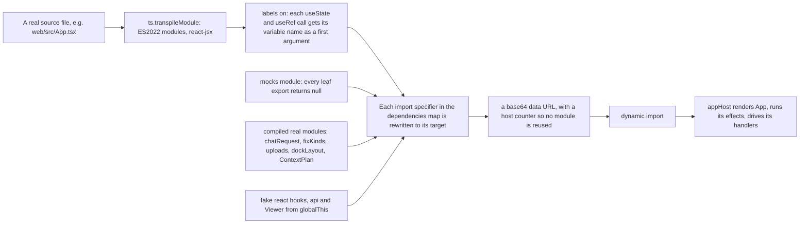
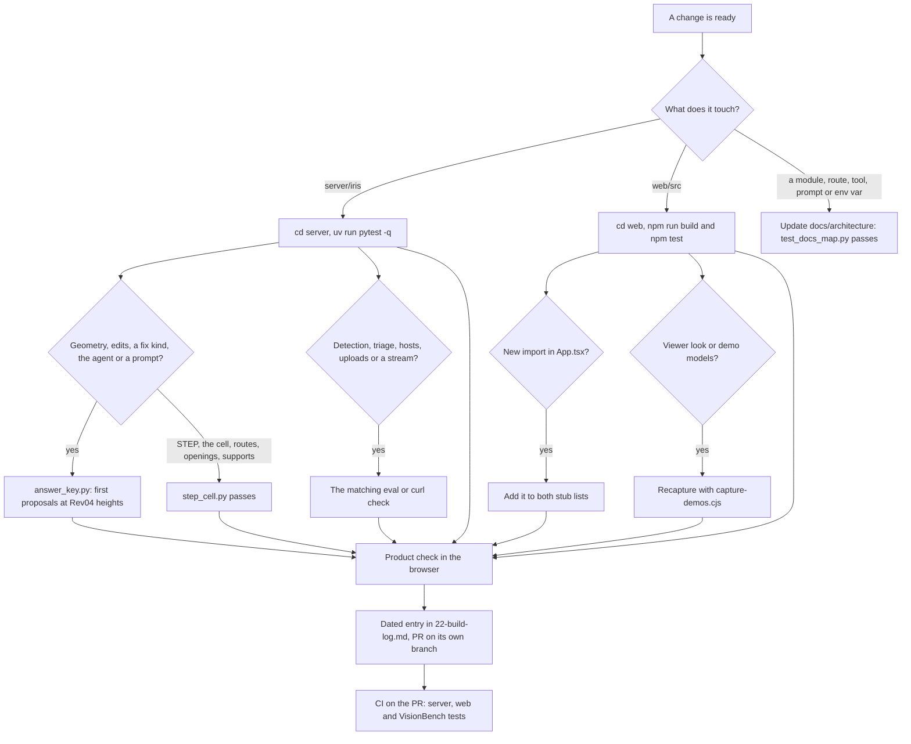

# 18 · Testing, evals and verification

> **Covers:** `server/tests/`, `server/iris/fixtures.py`, `web/tests/`, `evals/`, `spikes/`, `web/spikes/`,
> `web/scripts/capture-demos.cjs`, `evals/big_models_browser.cjs`, `assets/brand/iris/` checks,
> `.github/workflows/ci.yml` and `deploy.yml`'s smoke test · **Checked against code:** re-branded 2026-11-11; CI,
> `test_origins.py`, the voice relay's origin test, the 2D drawing test files, `evals/save_drawing_readings.py` and
> `test_saved_checks.py` checked 2026-11-22; review queue 2026-11-22 (`test_prepare.py`, `evals/prepare_saved.py`,
> `viewer-mount.test.mjs`, the server count); demo videos 2026-11-22 (`demoVideo.test.mjs`, `start-screen.test.mjs`) ·
> **Deeper detail:** [evals/README.md](../../evals/README.md) (the eval log)

Iris's promise is that no fix reaches a person unverified, so the project checks itself at five levels: fast server
tests on synthetic IFC models with scripted stand-ins for the AI models; web tests that run the real TypeScript
modules (and the real `App`) in Node; evals that run real Gemini models on the real demo data and append their scores
to append-only files; spikes that answered the day-one questions; and product checks in a real browser. This doc says
what each level covers, how to run it, where its results go, and what to run before calling a change done.

## The five levels

| Level | What it proves | Needs | Costs | Where |
|---|---|---|---|---|
| Server tests | Geometry, every fix kind, the agent loop, triage, detection, API routes, streams, MCP tools, caps, settings | Python env only: no keys, no network, no demo models | Free, local | `server/tests/` |
| Web tests | App's state handling and ownership rules, the viewer's load and patch, fix wording, layout, the dock's saved layouts and panel homes, Workings' run log and graphs, requirements file, uploads | `web/node_modules` (`npm install`) | Free, local | `web/tests/` |
| Evals | That real Gemini models, on Northbank and the PC-03 cell, still give verified fixes and good readings | Demo models, Gemini on Vertex AI (Application Default Credentials, `GOOGLE_CLOUD_PROJECT`, `GOOGLE_CLOUD_LOCATION`) or `GEMINI_API_KEY` | Paid model calls (the escalation model is billed per token) | `evals/` |
| Spikes | The day-one go/no-go questions, and Show it built's S0 | Northbank in `samples/`; model access for spike 4 and S0 | Spike 4 and S0 paid | `spikes/`, `web/spikes/` |
| Product checks | The running app does what the tests say: the golden path, the cell, phones, streams through Cloud Run | A running server and web app, Playwright's Chromium | Paid when a step proposes | ad hoc, plus two committed scripts |

GitHub Actions runs the server tests, the web tests and build, and the VisionBench tests on every pull request and
push ([CI on GitHub Actions](#ci-on-github-actions), below). Evals and product checks stay with whoever makes the
change.

## Server tests

### Running them

```bash
cd server
uv run pytest -q                         # the whole suite (1,367 tests collected at d91f0e8)
uv run pytest -q tests/test_route.py     # one file
uv run pytest -q -k penetration          # by name
```

- `server/pyproject.toml` sets `testpaths = ["tests"]` and `pythonpath = ["."]`, so run from `server/`; pytest is in
  the `dev` dependency group.
- `AGENTS.md` names the Windows venv interpreter, `server/.venv/Scripts/python.exe` (on Linux and macOS it is
  `server/.venv/bin/python`), and says to run tests from `server` with `..` paths adjusted. `uv run pytest -q` is the
  supported way everywhere.
- The suite needs nothing but the Python environment (`uv sync`; the PDF tests need WeasyPrint's system libraries,
  pango and harfbuzz, which the container image and CI also install). No test calls Gemini: model calls go to scripted
  stand-ins (`ScriptedModel` in `test_agent.py` and its relatives), the Gemini SDK client is mocked in
  `test_model_client.py` (HTTP hosts faked with httpx mock transports in `test_triage.py`, `test_context_planner.py`),
  and live voice's transcription is a scripted stand-in (`test_voice_live.py`). Every model is built on the fly by
  `iris/fixtures.py` or by the test itself (`test_step.py` writes a STEP file with OCP; `test_fix_kinds.py` and
  `test_supports.py` assemble their own scenes with `fixtures._box`). No test needs the demo models: API tests point a
  `Workspace(samples=tmp_path)` at a temporary folder holding the fixtures they wrote.
- Measured counts over time are in [22 · Build log](22-build-log.md): 66 server tests on Oct 27, 540 on Oct 30
  (CLAUDE.md's "latest validation"). 541 were collected at `104fda9`; 1,367 at `d91f0e8` (1,155 without
  `tests/bench`, the VisionBench tests CI runs as their own job).

### `conftest.py`

One autouse fixture, `settings_store`: each test gets its own file for the settings for everyone
(`IRIS_SETTINGS_FILE` pointed into `tmp_path`), so no test touches a real settings file, and
`settings.reset_cache()` runs before and after. A developer's own `server/.iris-settings.json`
therefore never leaks into a test, and a test that switches the fast model or the thinking level on cannot affect
the next. Other fixtures live in the test files that use them (`client`, `scene`, `cell`, `paths`, `fresh_budget` and so
on).

### `iris/fixtures.py`: the synthetic models

"Small synthetic IFC models for tests and spikes": Northbank is the real demo set; these run anywhere in seconds.
All are IFC4 written with `ifcopenshell.api`, in metres unless noted; `_box(model, body, element, size, origin)`
gives an element a rectangular extrusion and is reused by tests that build their own scenes.

| Builder | What it holds | The case it makes |
|---|---|---|
| `build_clash_fixture(path, millimetres=False, only=(...))` | A steel beam, a duct through it, a pipe just below the beam. `millimetres=True` writes mm like most authoring tools; `only` writes a subset so a structure file and a services file federate | The agent's "first try fails" case: down 0.40 m clears the beam but hits the pipe, 0.80 m clears both. `python -m iris.fixtures <out.ifc>` writes it (README, "Run it") |
| `build_run_fixture(path, millimetres=False)` | One straight supply main (0–6 m, 400 x 300, ports at both ends, joined to a 1 m end segment) under a slab, crossing a beam at x = 3 | A local offset: up 0.375–0.425 m keeps 25 mm both sides, 0.40 m leaves 50 mm |
| `build_joint_fixture(path)` | A curtain-wall corner like Northbank's Clash7: a transom drawn as a plan rectangle extruded 60 mm, its end 60 mm into a mullion, tops flush; a spandrel panel on the transom | Trims, and the flush-faced overlap the intersection query misses |
| `build_context_fixture(path, millimetres=False)` | A constrained service corridor (tags CTX-DUCT/BEAM/TRAY) with `KeepFixed` constraints and a fixed terminal | A wider fix: only a tray move plus a duct offset clears it |
| `build_detection_fixtures(folder, offset=(0,0,0))` | A structure and a services model with one of every detection case (crossing duct, touches, a 0.5 mm touch, a 20 mm gap, a flush strut, a door in its wall, assembly plates, a duplicate, crossing braces, a sensor inside a duct, port-joined segments), shiftable by `offset` | Every rule and measure in [docs/detection.md](../detection.md), including models far from the origin |
| `build_route_fixture(path)` | Five runs (tags RT-1 to RT-5): a compound duct, a two-column duct with a post between, a sloped duct, a waste pipe, a cold-water pipe | Routes: up-then-sideways, one detour round each column, slopes, drainage, a rolling offset |
| `build_penetration_fixture(folder, version="IFC4")` | Structure (walls W1/W2, slab S1, beam B1, column C1, a transfer beam B2 with a column on it, a 3 mm gland plate, a glazing unit) and services crossing them (tags PN-1 to PN-11) | Openings: allowed, refused, at an edge, through two walls, a fitted gland; `version="IFC2X3"` too |
| `build_resize_fixture(path)` | A 500 x 300 duct 50 mm into a beam with a slab above, a ceiling below and walls either side; a tray under a beam; a pipe and a round duct | Resize: 735 x 220 mm bottom kept clears with 30 mm; the sizes a resize keeps |
| `build_edit_fixture(path)` | Walls drawn in elevation and in plan (with a window and a door), columns, a slab, an I-beam with a column on it, a pipe, a turned post, two columns sharing one body, a fitting of two solids, a mesh, a beam with a web opening | Hand edits ([docs/manual-edits.md](../manual-edits.md)) |
| `build_parametric_fixture(path)` | What real exports carry: two walls of one type with a layer set usage, an `Axis` and a path join; a layered slab; two beams of one type with a profile set usage and an `Axis`; two fittings whose body is their type's (`IfcMappedItem`, one map turned); base quantities | Edits that must keep the model consistent ([docs/editing-parity.md](../editing-parity.md)) |
| `build_mep_fixture(path)` | Free duct ends (DA and DC on one line 1.5 m apart, DB square to DA in plan) and round pipes PA and PB joined end to end, each with ports | MEP hand edits: join in line or with a bend, disconnect ([docs/editing-parity.md](../editing-parity.md), Tier 2) |

### Every test file

Counts are tests collected at `104fda9` (parametrised cases counted separately), except `test_origins.py`, the
voice relay's origin test, the 2D drawing files, `test_detect.py`, `test_saved_checks.py` and `test_prepare.py`, counted
on 2026-11-22.

**Geometry, the check and detection** ([06](06-geometry-and-detection.md))

| File | Tests | What it covers |
|---|---|---|
| `test_verify.py` | 7 | `verify.check` on the clash fixture: the duct collides; a 0.40 m drop lands on the pipe; 0.80 m passes with the true gap; moves survive write and reload; millimetre files measure in metres; federated files clash across disciplines; the neighbourhood check skips far elements |
| `test_supports.py` | 8 | A move keeps what it stands on (`verify.supports`, `keep_supports`): a post slid along its slab keeps its footing; lifted, sunk or pushed into something is refused; the clash partner is never a support; runs stand on nothing and the plan check agrees; `verify_move` keeps footing only when told the obstacle |
| `test_detect.py` | 35 | `detect.py` on the detection fixtures: default tests, a Site model's tests off, touches, exact flush depth, an element wholly inside another, pairs meant to meet counted not reported, duplicates vs crossing braces, clearance, far from the origin, stable ids and new/resolved on a rerun, the per-test cap (`partial`), selections, a run's report naming the requirements it ran under (`requirements_id`), the detect stream API, detection from chat, `measure_pair`; checks on filters (a filter against everything or itself, each pair once, the title; a colour-by-value filter takes what it colours; Everything leaves a site model out; What the filters show as a side; the owner's case from chat, no site element; a side counted as the filter list does, its rooms said apart), a check's id from what it compares, a clash keeping its id and #N between the full check and a check on filters with no diff noise, Detect again on a check saying what was fixed, the check's defaults and the stream with a filter test; chat checking a user's filter by name or what it describes, and refusing what the models lack before a run is spent; the broad phase taking every window at once, in chunks, gives the pairs the old one-element-at-a-time sweep gave, in the same order (random boxes with ties and long boxes, two sides, an element on both sides, margins, chunks of 2^20, 500 and 1; and the fixtures' tests) |
| `test_checks.py` | 20 | Kept checks ([docs/detection.md](../detection.md), "Kept checks"): a pair keeps its id and #N whatever check finds it next (full → ducts → beams, and under new requirements); two tests of one run that find one pair stay two clashes in either order; two runs at once on one scene; views and titles outlive any one report and go with the scene; each check kept once, replaced only by itself, removed on its own, the cap; stale after a kept fix; contacts from every check; the routes (list, remove, Run all again for one detection run, a list made again with no run); `checks.key_of`; triage verdicts that follow their clash (carried free, unread in a scope for one proposal, a moved depth read again, another prompt stale) and a seed kept to the report's own clashes; a document of one check; and the review's cases: a failed read is not kept and stays unread, a run that asks nothing makes no audit call, a new list follows the titling under way, a reading of a moved clash is not shown on the new list, a scene's run kept last in line, a run under way followed or queued behind (and Triage again queued), summaries read while checks come and go |
| `test_saved_checks.py` | 7 | Saved checks (`saved_checks.py`, [docs/detection.md](../detection.md), "Saved checks for the samples"), on the detection fixtures saved as samples and on Northbank: a replayed check is the live one (report, ids, #N, measures, coverage, diff, kept checks, contacts, triage's input, Insights, the same events with the replay's phase line), again on a second run, with a check on filters beside it measured live; saved boxes equal measured ones, on open and on adding files, and are taken only when asked; another tolerance, rule, kind or test, another `detect.VERSION`, `BOXES_VERSION` or IfcOpenShell, a box moved in a trial, a kept edit, a file with one more byte and a damaged saved file all run live; the shipped `samples/saved-checks/northbank.json` has a current entry for each of `PLATFORMS` (this code, these sample files, four boxes keys, one check with `PROBES` probes; regenerate with `uv run python -m iris.saved_checks --docker`), and Northbank's replay is its live check (464 clashes in 1,732 elements), skipped where the probe refuses the saved check (that machine runs live) |
| `test_properties.py` | 11 | `properties.py`: an element's attributes, type, material, sets, quantities and size; the path from the project to the storey, and the storey's own properties; the demo models' own set as "Model data" without its scripting note; lengths, areas and volumes in SI from a millimetre file; an element with nothing but geometry; every kind of property (enumerated, list, bounded, table, reference, complex) with units and the hidden note kept out at every depth; what the type gives, marked, the element's own value winning; layers, classification, a system and a document; attributes with their units; an unnamed storey named as the level filter names it; the route, `?file=` and its 404s |
| `test_facets.py` | 16 | `facets.py`: what a filter acts on (`acted`) and what the filters show together (`shown`, the page's cases); each element's file, class, storey (as `datums.storeys`), type and material; numbers in SI from a millimetre file; the hidden note never indexed; classification, groups, layers, enumerated, list and complex values, what the type gives, no ranges or tables; `matching` as the page and `suggest`; kept until an edit; the route; `resolve` (what chat asks for as the page's rule: classes with or without Ifc, a level as the storey, a model by part of its name, properties by name or set/name) and `Unresolved` with the closest names, never the hidden note; a test with no bound or value refused, a lone number taken as the bound; a complex property's part by its name or path; yes and 1 kept apart; an unreadable element skipped, not the index; a filter named from what it finds (`name_for`) |
| `test_properties_complete.py` | 1 | `evals/properties_complete.py` on Northbank (skipped without the models): every value the file gives each object is shown, the hidden note never |
| `test_defaults.py` | 8 | Nothing fixed to one project, domain, demo or vendor: the requirements' `domain` and `stays` round-trip and older files keep their ids; the requirements decide the domain and what stays (a class list, a group never edited); a check keeps the pair's clearance; the demos and their own requirements (`demos.py`); model names and prices from settings, reasoning streams by setting; the MCP site address only when set; voice words from the domain and the open models |
| `test_datums.py` | 6 | `datums.py`: levels merged across files by name and height in metres; each element's storey; grid axes through their grid's placement and units; a sample scene with no grid reads its project's Grids file as context, a scene's own grid wins and no grid is none; the datums route |
| `test_port_frames.py` | 57 | Port frames read back from exported IFC, independently of the verifier: flow axes follow the cap normals, signed axes and profile roll, generated frames pass, unknown or two-way frames need review, offsets keep both external peers, the legacy external-frame exception stays strictly unchanged |
| `test_foundation_review_fixes.py` | 35 | Review reproductions on real IFC shapes and port graphs: tight generated bends, the bend allowance, new clearance to unrelated services, offset axis noise, single-, zero- and two-port chains through offset and export, the exact separating-axis fallback only for plain rectangles |

**Fix kinds and edits** ([07](07-fixes-and-edits.md))

| File | Tests | What it covers |
|---|---|---|
| `test_edits.py` | 16 | Offsets (`edits.apply_offset`): clears beam and slab and is undone, a kept offset chains ports, the agent offers a verified one, unsupported shapes say why, the API applies and serves the file; `edits.passages`; `/propose/stream` progress; trial pieces; trims (`butt_trim`): profile-drawn member, `SLENDER` refusal, mid-length refusal; bends like Rev04; square fallback |
| `test_route.py` | 23 | Routes (`edits.apply_route`, `agent._try_route`) on the route fixture: one step is the offset, up-then-sideways, one chain port to port, one detour per column, slopes keep their fall, drainage only sideways, rolling offsets, refusals, undo, plan and endpoint keep it, nearby clashes, free-band scan time |
| `test_resize.py` | 16 | Resize (`edits.resize_size`, `apply_resize`, `agent._try_resize`): equivalent diameter and tray cross-section, refusals, bottom kept clears the beam, transitions need room, undo, the agent offers it when offsets fail, endpoint and plan, centre-kept faces, resized pieces say their size |
| `test_seat.py` | 15 | Seats (`edits.seat`, `apply_seat`, `agent._try_seat`), in metres and millimetres: a wall and a column landing in a base are cut there and bear on its top (the recess, the volume taken, the end kept); a wall through a slab, a support wider below its top, a pipe and a block mostly inside are refused, saying why; the agent's option and review, Gemini's "Bearing" line; a seat is a trim to the requirements; proposed, kept in place through `/fix/apply`, refused with a stale key and when seated already; a plan |
| `test_penetration.py` | 18 | Penetrations (`edits.penetration`, `apply_penetration`): opening size, edge and off-line refusals, columns never, both files undone, provision for void never physical, structural review, ranking after plain fixes, cut only when the requirements allow, endpoint/plan/patch, IFC2X3, two walls, a service stopping inside the host |
| `test_hosts.py` | 18 | `hosts.py`: hard rules need no model, Gemini reads each kind once from standard facts only (a project pset never reaches it), the hole against the reading's limits, a gland plate's fitted hole, requirements win over Gemini, the transfer beam never offered, a failed reading leaves walls and slabs only, limits sanitised |
| `test_fix_kinds.py` | 7 | The registry: an unknown kind is refused, split ends checked against every obstacle, feedback names each kind and where it hit, `agent.TIERS` ranking, a lateral offset sized by how far it goes, plans refuse a kind they cannot apply, `POST /api/scenes/{scene_id}/fix/apply` keeps any kind |
| `test_journal.py` | 12 | The edit log: a kept fix is an entry with its clash and what it made (and CSV); undo puts the model back and redo makes it again (boxes, edited files, the revision moving forward); undo after trials and a checked move; a move logged and undone; only the newest is undone, an edit outside the log fences it; a follow-up follows the fix and carries its clash; nothing changed is no entry; a wider fix's swap undone and redone; one free detection rerun after a keep with clashes; a joined end pushed changes that face only (its joint left open, its neighbour as it was) and, carried, moves the joint with it (its segment stretches); a move takes the element only unless its run is carried; a joint left open kept only with `accept_joints`, undone with the edit; a carried move that cannot keep its joints offers Move it on its own |
| `test_manual.py` | 34 | Hand edits on `fixtures.build_edit_fixture`: faces named and what they allow (a beam's outer sides and inner faces); a wall end pushed, kept, logged and undone; Keep with N clashes; a stale check refused; align with a gap, by stretching or moving; faces 45° apart meet at the first corner (with Clip it flush), up to 80°; align to a corner or an edge's midpoint; level-with faces keep their side; a wall end refused through its window; a thicker wall takes its opening; a pipe's radius; a transfer beam warned, not refused, and its flange pushed (a section change); a move; the requirements; a hand edit's clash measured again; voids through, round, recessed, at an edge, on a wall's end, on a fitting's solid; cut by shape with its gap; a wall, a beam and a pipe split, through a window by clips; a section removed; a delete undone; a clip, its plane pulled in and the other end pushed; a turned rectangle; a shared body copied; the 5 mm minimum; faces only a pick places; a body of two solids pushed per solid; a mesh's faces pushed and aligned; a mesh and a fitting split by clips; a section out of a mesh, a mesh clipped |
| `test_parametric_edits.py` | 30 | The editing-parity matrix ([docs/editing-parity.md](../editing-parity.md)) on `fixtures.build_parametric_fixture`: every hand edit on every construct is kept, then the whole model read again (every layer set, profile, axis, join and base quantity matches its body; every other element, type, set and map as it was); a thicker wall's own type and the layer on each face; a split wall hands its join to the piece at its end; a wall moved off its join leaves it open only when said, undo brings it back; a mapped fitting edited alone; a deeper beam keeps its cardinal point, its twin its section; undo puts types, sets, axes and quantities back |
| `test_property_edits.py` | 8 | Editing what the model says (`property_edits.py`, Tier 3) through the panel's routes: choices from the element's own model; an attribute and a property kept in the log and undone; numbers stay numbers, yes stays yes; quantities, a layered element's type and material, an unknown attribute refused in words with nothing logged; a type's value refused; a fitting moved to another type keeping its shape, a classification added and removed; Gemini changes a property only when the person said the value; the export carries the change and its stamp |
| `test_fix_consistency.py` | 3 | Gemini's fixes keep the model true: a fix trial brings a typed beam's axis along and puts everything back; a move that would leave a wall's join open is refused with why, in its trial and when kept; a kept trim of a typed beam back to a column brings its axis and quantities along, its twin as it was |
| `test_mep_edits.py` | 11 | MEP hand edits (Tier 2): an offset up clears the run fixture's beam with four bends, hands on the far joint, undoes; sideways by compass or direction, never along the run; only a level flow segment; two ends join in line or square with a bend (both ways, undone), refusals in words; a joint left open only when kept with it; a 45° offset by hand is one joined chain, Gemini's kept as tried; a side pushed on its own warns, carried adds a transition (rectangular, and round for a pipe) and undoes; every edit schema-valid |
| `test_consistency.py` | 6 | `consistency.py`: a consistent model reads true on every rule; only what an edit makes worse counts; a type whose map changed blocks (unless the edit is to the type); a set other elements share changed in place blocks; quantities warn only when the body changed and they did not; a path join is measured in plan |
| `test_chat_edits.py` | 6 | Gemini checks and the page previews; only "keep it" keeps, "keep it with the clash" for an edit with clashes, "undo that" undoes; the consent words; proposals hear of earlier edits; the face chosen in the Edit tool reaches Gemini as its pick; an open joint kept only on "keep it with the open joint" |
| `test_edit_log_out.py` | 5 | The report's timeline and Changes section, BCF comments and Request topics; "Fix applied, then edited by hand, clash back"; `Iris_Edit` in the exported IFC while the log's undo survives; a zip carries the log; the picture route |
| `test_accept_in_place.py` | 6 | `Workspace.patch`: the revision a page starts from, an offset's pieces as triangles, moves (the whole run)/routes/plans as meshes, no meshes when one will not triangulate or there are too many vertices, which files each revision changed, unstyled elements keep no colour |
| `test_keep_verified.py` | 9 | Keeping tries the fix again (`plans.recheck`, `plans.apply`): options carry their pair; tampered moves and offsets (any split or height) refused with 409 and nothing kept; an option proposed before another edit refused; the requirements' clearance, largest move and report-only apply, not the page's; a plan all or nothing (together, a later failure, a keep refused part way); the server keeps the whole run and the joint's end; a fix must name its clash; `kept_files` restores marks and leaves a held file to the outer one |

**AI workflows and the model client** ([08](08-ai-models-prompts-and-spend.md), [09](09-agent-workflows.md))

| File | Tests | What it covers |
|---|---|---|
| `test_agent.py` | 6 | `agent.resolve` with `ScriptedModel`: a failed attempt is fed back and only verified options survive, the loaded model is unchanged, a `.env` fills missing settings only, ranking, trials before checks, reasoning summaries only when watched |
| `test_plans.py` | 8 | `plans.py`: batches dedupe pairs and are checked as a whole, `verify_together` finds colliding fixes, a combined fix in a plan, root causes and plan endpoints, patterns, root-cause charging, a moved hub against every partner, `merge_shared` |
| `test_prepare.py` | 12 | The review queue's prepared fixes (`prepare.py`, [docs/review-queue.md](../review-queue.md)), scripted models only: `POST /api/scenes/{scene_id}/prepare/stream` streams a verified fix per pair (`prepare_start`, `item`, `prepared`, `done`, `Content-Encoding: identity`), keeps nothing and charges one proposal (the next is 429); one card per pair where Fix together merges, and two pairs on an allowance of one refused whole before the stream; a model with no fix that passes gives a `failed` card with why; `prepare.deepest` skips the fixed, 422 "Nothing to prepare." and 404s; a saved set (`prepare.generate`, no `.tmp` left) replayed through the check at no cost, its options checked again and labelled with the saved model; a tampered saved reply checked and not shown; a question the set does not hold fails that item with `prepare.MISS`; the key misses on any difference (proposal model, thinking level, `VERSION`, requirements in force, a kept edit, other bytes; the same bytes elsewhere hit); a scripted set labelled scripted and used only where that model is configured; `evals/prepare_saved.py` offline unless told to call Gemini; views the page took of a clash after the set was made do not change its replay (asked with no pictures); the committed Northbank set replays 8 of 8 ready through the route with views on the first clash and no model call |
| `test_escalation.py` | 30 | `escalation.py`, `spend.py` and the combined kind (`agent._try_combined`): the brief and its budget, the second try's options with the first's, the setting and caps (both or neither), token usage and the day's budget, stale first tries, structure never moved, the apply endpoint returns every run |
| `test_triage.py` | 10 | `triage.py`: sure rules cost no call, JSON-mode fallback, the fast model only when switched on, the shared and replayed stream, rule verdicts say why, settled facts correct answers, reasoning streams, late subscribers, alike clashes read once |
| `test_titles.py` | 5 | `titles.py`: batches, facts, finding a clash by number, titles survive Detect again, the shared titles stream |
| `test_chat.py` | 12 | `chat.py`: tools run and images reach the model, tool errors go back to the model, `/api/chat` streams, filters set and cleared from chat (resolved against the index), the page's filters reaching chat by name and a name the models lack refused with the closest, root causes and plans from chat, history ordering on resume and cancellation |
| `test_built.py` | 12 | `built.py`: passes and key, the pixel gate, two judges, retries, the cache, the API switch and caps, the setting, the PDF takes a built view by URL only, oversized passes refused, one picture made once, a lighter check (`main_judge_model`) redone with the full one, the image model charged per picture (`IMAGE_USD`), both judges charged and on their own models |
| `test_model_client.py` | 10 | `GeminiModel` with the SDK client mocked: JSON calls with system, images, schema and thinking; usage and cost (thinking counted as output); prices and labels overridable; model ids from env (`DEFAULT_MODELS`); streamed thought summaries then the JSON, and the fallback when `GEMINI_INCLUDE_THOUGHTS=0` or empty; chat messages, tools and thought signatures; `transcribe` sends audio and vocabulary; `generate_image`; the backend choice (project or `GEMINI_API_KEY`) |

**Wider fixes (the context planner)** ([09](09-agent-workflows.md), [07](07-fixes-and-edits.md))

| File | Tests | What it covers |
|---|---|---|
| `test_context_eval.py` | 34 | `context_eval`: compound arrangements, lateral offsets keep endpoints and profile, invalid candidates change nothing, connected move groups, review conditions, revisions, three groups and cross-file rollback, the slender-trim gate, system mismatch at joints, missing port placements, baseline conflicts, square-fallback/compound/along-run offsets rejected |
| `test_context_planner.py` | 25 | `context_planner`: blocker feedback, every model and geometry limit, no model call holds the lock, dedupe and structural ranking, deadlines and cancellation keep earlier passes, bounded storage, timeouts and owner effort, malformed model replies |
| `test_context_api.py` | 29 | The wider-fix stream and accept endpoints and chat: charged once, owner bypass, accept needs the canonical id, every acknowledgement and a fresh revision, atomic failures, remeasured report pairs, disconnects and overflow cancel cleanly, interleaved allowances |
| `test_context_fixture.py` | 3 | The context fixture itself: the corridor needs the tray edit; fixed constraints check expanded members |
| `test_context_offset_profiles.py` | 16 | Real IFC profiles: an unpreserved profile is rejected without changing the model, whole-run moves keep profiles offsets cannot, plain profiles still offset and export |

**Files in and out** ([14](14-files-in-and-out.md))

| File | Tests | What it covers |
|---|---|---|
| `test_api.py` | 8 | Open → verify → apply → export (a move still clashing is refused), sample names cannot escape `samples/`, a federated export writes only the edited file, export carries kept fixes and no tried ones (as `iris-export.zip`; an offset the other model's beam blocks is refused until that beam moves), a multi-file export named for its project (`<project>-iris.zip`), reopening a held scene, a scene or report the server let go of answers 404 with `X-Iris-Gone` (only for ids it could have made), eviction spares linked scenes |
| `test_reports.py` | 8 | `reports.py`: Navisworks grouped tags and three views, upload/match/measure/images, no-XML uploads refused, sample report folders, report clashes send their images and distance, a port's owner, `SAMPLE_EXCLUDE` renumbering, `/api/transcribe` biased to clash names |
| `test_step.py` | 10 | `step.py`: names, groups, colours and metres survive conversion, detection finds the ladder through the post, group runs move together, export writes moves back, classes from the model, upload accepts STEP and IFC only, caps, older conversions still read; a part deleted by hand leaves the STEP and a pushed box changes shape; a part clipped by hand is written clipped (`service.reshaped`) |
| `test_uploads.py` | 10 | Bigger uploads: gzipped parts unpacked, the cap on the unpacked size, 411/413 before reading, broken or repeated archives refused, the streamed open's events and errors, the scene byte budget, wider fixes refused on big models, bounded gunzip steps, room made first |
| `test_scene_models.py` | 27 | Adding and removing models in an open scene ([docs/add-and-remove-models.md](../add-and-remove-models.md)): `IfcScene.add_files` measures only the new file's boxes and `index_of` finds them, a file that will not open leaves the scene as it was, `remove_file` of the middle file drops its boxes and shifts `_edited` and `history`, both bump `revision` and `layout` and drop the file caches, `snapshot` carries the layout; `Workspace.add_models` refusals in words (a name already open or given twice, STEP among building models and the reverse, past the byte budget), room made by evicting other scenes, caches cleared, STEP into a STEP scene and out again with its folder; `remove_model` refuses a stale position (`StaleLayout`) and the only model, takes its clashes out of every kept check (state and contacts too) with the checks still current and numbers kept on the next run, deletes an upload and never a sample; edits in the removed model stay marked `model_removed`, never undone or redone, undo passes over them, the other entries' indexes move down (redo and export of the rest), a wider fix refused once the layout changed; the routes (add samples then Run all again finds the new pair, refusals 400/404, an added upload is one model upload and a refusal is charged nothing, a broken upload changes nothing, the delete route's 409 and 400); on Northbank, Architecture added to Structure + MEP (every #N kept, new ones carry on, a reading carried) and Structure removed from all three (its clashes gone, the MEP edit stays, the Structure edit marked and refused, only MEP written) |
| `test_document.py` | 9 | `document.py`: team guess from content, who acts and who reviews, PDFs per team plus BCF (`iris-report.zip`, `iris-issues.bcfzip`), one combined PDF stays DRAFT (`iris-report.pdf`), the triage model the PDF names, screenshot facts, a kept fix page's built view or why not |

**Requirements, settings, owner and caps** ([15](15-requirements-settings-and-config.md), [16](16-security-caps-and-cost.md))

| File | Tests | What it covers |
|---|---|---|
| `test_requirements.py` | 25 | `requirements.py`: parsing and clamping, the content id, level and strictness to numbers (L3 Balanced is today's numbers and finds what the default tests find), groups, the matrix, `min_size`, policy, by-design rules, strict distrust of low-confidence by-design, prompt lines say only what differs, `model_key` |
| `test_requirements_wiring.py` | 18 | Requirements reaching the agent, triage and the API: unchanged prompt without a file, move limits, `meets`, recommendations, rules settling without a call, Gemini's audit, seeded jobs, registration and 409 `requirements_unknown`, detection and preview, suggest, the report, agent links |
| `test_settings.py` | 9 | `settings.py`: the store survives a restart, refuses unknown values, ignores a retired setting, falls back when broken; effort precedence owner > everyone > environment; thinking-level defaults from the environment; triage always on the fast model; owner-only `/api/settings`; `/api/models` |
| `test_owner.py` | 7 | `owner.py`: the HttpOnly cookie, a new token logs everyone out, no token no owner, wrong tokens capped, settings count only for the owner, unknown settings dropped, the owner skips the demo caps |
| `test_origins.py` | 10 | The web app on another origin (`origins.py`, `IRIS_ALLOWED_ORIGINS`): its preflight allowed with credentials, another site's refused (400); a credentialed call readable, the owner cookie `SameSite=None; Secure; Partitioned` and cleared with the same flags; another site's call answered with no `Access-Control-Allow-Origin`; nothing configured means no CORS and a `SameSite=Strict` cookie; a stream through `_CrossOrigin` keeps `Content-Encoding: identity`; origins normalised, a malformed one (`*`, a path, no scheme) refused; `GET /api/health` names `IRIS_VERSION`; split, `GET /` is the API's JSON and no web app; one origin, `GET /` is the web app |
| `test_limits.py` | 5 | `limits.ProposeLimit`: per-visitor hour, the daily cap for everyone (refusals not counted), no limits by default, 429 on propose, `Workspace` keeps only the newest scenes |
| `test_env_file.py` | 3 | Configuration: a fresh interpreter on a copy of the package beside its own `.env` (the package's `__init__.py` loads it) reads `.env` for the settings read at import and the caps, a real environment variable wins, and empty numbers take their defaults (`limits.env_int` / `env_float`); a value that is not a number still raises |

**Agents and voice** ([11](11-mcp-and-agent-links.md), [10](10-http-api-and-streams.md))

| File | Tests | What it covers |
|---|---|---|
| `test_mcp.py` | 12 | `mcp_server.py` and `agents.py`: the tools and their `readOnlyHint`s, 401 without a live token, an agent finds, checks, proposes, applies and exports, the page answers for pictures and follows `set_view`, `set_filters` and `clear_filters`, a person's filter shared with the link checked by name, link expiry (sliding, 24 h at most) and caps, long proposals become jobs, stdio on its own session, a closed page |
| `test_voice_live.py` | 14 | `voice_live.py` with transcription scripted: hold to talk transcribes the clip once on release (an empty clip calls nothing), hands-free sends each RMS segment when the speaker pauses and ignores a click, the time limit (flushing a segment in progress), non-microphone audio refused, a failed or missing model said in words, other origins refused, the web app's own origin let in only when it is in `IRIS_ALLOWED_ORIGINS`, the page leaving ends the session, the loudness measure, one voice cap use per session |

**2D drawings** ([docs/drawings.md](../drawings.md), [14](14-files-in-and-out.md))

| File | Tests | What it covers |
|---|---|---|
| `test_drawings.py` | 27 | `drawings.py` and its routes: pages rendered and every word placed in pixels, the title block as printed (never guessed), a scan has no text layer, tags on the sample sheets read whole (dense, turned, upside down), the page and size caps, refusals in words that keep nothing, an upload is one model upload; reading streams the reader's events and keeps its items, the comparison gets every read item, the real reader and comparison offline through the routes, drawings go with their scene; the sample drawings: listed with Northbank (`demos.listing`, `drawings_for`, `sample_names`), attached once by `POST .../drawings/samples` and read from their saved reading with no model call, 409 for any other models, an upload of the very same PDF has its saved reading and any other has none; two issues of one sheet (`sheet_key`) each compared whole; a project keeps its drawings and items |
| `test_drawing_reader.py` | 67 | `drawing_reader.py` with `FakeReader`: a large page sent whole and as four quarters, boxes mapped back, sizes and tags parsed, `reconcile` (confirmed, AI only, text only, one label one item, the radius, no text layer), the event stream, some pages only, a page read once per model and prompt; saved readings (`model_name`; replayed with no call, `cost_usd` 0 and a cap that would refuse a live read, the same items as the read that was saved, `saved_info`; another PDF, a changed `VERSION` or another page size falls through to the model; `write_saved` needs the page read first); the day's budget and a run's cap; the Gemini request, a reply that is not JSON, the strict schema, the prompt |
| `test_drawing_compare.py` | 47 | `drawing_compare.py`: the model's index (families, identifiers, sizes, storey; a shared tag is no element's own), matching by tag, Name or `Mark`, a split run, sizes within the tolerance either way round, type differences, what is missing in the model or the drawing on its storey and families, AI-only results flagged; the sample sheets give exactly their planted mismatches; Northbank services carry their tags and sections |
| `test_make_drawings.py` | 11 | `evals/make_drawings.py`: a clean and a mismatch sheet, every truth tag and size in the text layer inside its box, page size, title block, labels apart and off the title strip, the clean sheet is the model, the mismatch sheet differs by exactly `PLANTED`, `drawing_compare` agrees, output is deterministic, and the generator's files in `samples/drawings/` are up to date |

**The docs map**

| File | What it covers |
|---|---|
| `test_docs_map.py` | Being added alongside this map: fails when a server module, prompt, web source file, route, MCP tool or env var is missing from `docs/architecture/`, or a link in it is broken. Fix it by adding the doc line, never by loosening the test (`AGENTS.md`) |

## Web tests

### Running them

```bash
cd web
npm install            # once; postinstall copies web-ifc's wasm into public/wasm
npm run build          # tsc --noEmit (type-check src/ and vite.config.ts), then vite build
npm test               # node --test tests/*.test.mjs (193 tests on Oct 31)
```

There is no test framework beyond Node's own runner: the tests use `node:test` and `node:assert`, and the
TypeScript compiler (a dev dependency) to run the real sources. `web/spikes/` is not in `tsconfig.json`'s `include`,
so the build never type-checks it.

### The harness: real modules, stubbed edges

`web/tests/app-host.mjs` exports `compiled(path, dependencies = {}, labels = false)`, which turns one real source file
into an importable module:



- `appHost({ initial, api, effects, layout })` runs the production `App` with fake hooks keyed by the labelled names (so a
  test reads `state.context` or `state.planRun`), real effect bodies with cleanup before replacement, a fake `api`
  whose stream calls hand the test their `onEvent` and `resolve`, and a `Proxy` viewer that records every call. It
  returns helpers to find buttons and components, feed chat events, run timers, settle and unmount. `find` walks a
  node's children and the app shell's element props (the top bar's `actions` and `search`, a page header's `status`);
  `menu()` opens Settings through the Sidebar's `onSettings` and returns that `MenuSheet`. The page's layout
  is none (not desktop, phone or tablet) unless a test passes `layout` (`useLayout` then returns it). "Only external
  IO, the GPU viewer and leaf components are replaced"; the assertions drive App's own handlers.
- **Why App's imports are stubbed:** App imports the GPU viewer, the network and every pane. A data-URL module cannot
  resolve a relative import, so every `./X` App imports must be in the dependencies map: the leaf panes and helpers map
  to one `mocks` module (functions returning `null`, plus the few constants App reads: `TOUR`, `CELL`, `clashLabel`,
  `noClash`, a `Pilot` and `Viewer` class), lucide icons to an `icons` module, and five modules are compiled for real
  (`./chatRequest`, `./fixKinds`, `./uploads`, `./signoffs`, `./ContextPlan` with its own `./ReportList` mocked).
- **The rule:** a new import in `web/src/App.tsx` (a new module, a new named export from a mocked module, or a new
  icon) must be added to **both** stub lists: the `names`, `icons` and module lists in `app-host.mjs` **and** the copies
  in `app-replacement.test.mjs`, which has its own minimal host and its own `compiled`. Otherwise `npm test` fails to
  resolve it. The same holds for the narrower harnesses: `async-ownership.test.mjs` compiles `Chat.tsx` with stubs for
  `react`, three lucide icons (`AudioLines`, `Mic`, `Square`), `./api` and `./voice`; `viewer-load.test.mjs` compiles
  `viewer/Viewer.ts` with real `three` (and its OrbitControls and BufferGeometryUtils), a stubbed `./ifcLoader` and the
  real `./patch`; `built-view.test.mjs` and `workings.test.mjs` compile the real `./api` for `apiUrl` (Node has no
  `VITE_API_BASE`, so paths stay as they are).
- **The transform limit:** `app-replacement.test.mjs`'s state-label transform checks
  `ts.isCallExpression(node.initializer)` on every variable declaration with an array pattern. A
  `for (const [a, b] of …)` declaration has no initializer, so the check throws and the test file fails to load. In
  App, iterate keys instead (CLAUDE.md, "Traps").

### Every web test file

| File | Tests | Harness | What it covers |
|---|---|---|---|
| `app-replacement.test.mjs` | 4 | its own minimal App host | Direct work retires a pending chat wider-fix search or batch plan, keeps a completed context proposal, and regenerating from the Plan tab is not retired by the old plan |
| `review-fixes.test.mjs` | 20 | `appHost` | Manual previews and who owns the viewer, choosing and deselecting options, accepting single and wider fixes, aborting wider streams on chat takeover, model or report replacement, stale loads and parse failures that must not publish, `api.ts` NDJSON abort and truncation, model download HTTP failures |
| `async-ownership.test.mjs` | 8 | own `source()` compile | `pilot.ts` cancellation between animation waits, camera takeover, `chatRequest.ts` ownership after workspace replacement, `ChatPanel` unmount aborting its stream (only its `asked` note reaches the page), NDJSON events after abort |
| `viewer-patch.test.mjs` | 4 | `compiled` + `appHost` | `viewer/patch.ts` on real three.js batches: swapping an element's geometry, growing past the batch's room, packing first; accepting patches in place at the page's revision and reloads what it missed; an opening the host's team must cut is recorded as requested (Accept sends the clash pair) |
| `accept.test.mjs` | 1 | `compiled` | `api.accept`: every kind to `/fix/apply` with its pair (the option's own, else the clash on screen), meshes dropped, a 409 refusal's reason reaches the page |
| `scene-models.test.mjs` | 8 | `compiled` | `sceneModels.ts`: hidden models moved down after a removal, only samples of the open models' kind offered, mixing and "already open" refused in the server's words, what to wait for, the warning's wording and its counts; `api.ts`: the add and remove routes, an upload added streamed to the scene and resolved with `added` |
| `viewer-load.test.mjs` | 11 | `compiled` | `Viewer.add` parses from the models' origin and appends only when every file parsed (a failure or superseded add disposes its staging); `Viewer.remove` disposes one file, moves the later ones and their hidden marks down, drops focus, selection, previews and measurements on it. `Viewer.load` stages every parse before replacing a usable federation, discards obsolete parses, disposes partial failures, adopts solid and glass batches together |
| `fix-kinds.test.mjs` | 6 | `compiled` | `fixKinds.ts`: each kind's words, framing, clearance/change/recommendation lines, an opening's host reading and hole, a combined fix's steps, rejected options as the next proposal's notes |
| `about.test.mjs` | 5 | `compiled` | `aboutRoute.ts`: `#about` and `#about/<tab>` open the right tab, other hashes leave it closed, every tab's address round-trips, arrow keys wrap, no window means no hash |
| `layout.test.mjs` | 5 | `compiled` (React stubbed) | `layout.ts`: breakpoints, sheet snapping, flicks, handle taps, `follow()` |
| `requirements.test.mjs` | 8 | `compiled` | `reqFile.ts`: round trip, refusing other files, cell edits, who moves, by-design rules, browser storage, opening rules, the domain and the classes fixed in place |
| `names.test.mjs` | 2 | `compiled` | `names.ts`: files lose the prefix their set shares whatever the project is called; a lone file, or files with nothing worth cutting, keep their names |
| `signoffs.test.mjs` | 5 | `compiled` + `appHost` | `signoffs.ts`: an imported report's are kept by its title and files (opening it again finds them); a detection run's per clash id (a rerun, other requirements or fewer models open find them; another project's ids don't); empty entries dropped, junk read as none, no storage no throw; title-keyed entries move over for the report's clashes, never over newer ones, the rest stay for their reports; the page shows each run its own and writes per clash |
| `uploads.test.mjs` | 3 | `compiled` | `uploads.ts`: the cap checked before sending, stage progress words, an uploaded IFC read from the visitor's own file |
| `gateway-retry.test.mjs` | 2 | `compiled` | `api.ts`: a patterns reading the gateway drops (502, 504, no answer) is asked for again up to twice, then the failure stands; a refusal (429) or a server error (500) is not asked again |
| `upload-retry.test.mjs` | 1 | `compiled` | `api.ts`: a 409 `requirements_unknown` re-registers the file and resends once |
| `gone.test.mjs` | 3 | `compiled` + `appHost` | Models the server let go of: `api.ts` hands a 404's `X-Iris-Gone` (and only that) to the page with the server's words; the page shows one notice instead of the calls' errors, stops claiming kept fixes and hides Export, ignores late answers about replaced models, and reopens the same samples and check; the visitor's own files go back to the picker, a sample report reopens, and Show it built offers the reopen instead of Try again |
| `views.test.mjs` | 11 | `compiled` | `viewer/views.ts`: layouts tile the stage; a plan's view range, presets and clash default; sections look to the line's left and run along the moving run; which elevation and grid axes; the nearest standard scale and scale bar; the view cube's 26 directions; camera history; visibility (hidden, isolated, class and level filters); the Esc chain, never leaving a clash Iris works on |
| `properties.test.mjs` | 5 | `compiled` (React stubbed) | `Properties.tsx`: values as people read them (lengths in mm), the sections in order (element, type, materials, classification, groups, documents, then each set) with ranges, complex parts and type badges, each row's facet key and value for the filters, an object with nothing but geometry, the filter |
| `workings.test.mjs` | 15 | `compiled` | `runlog.ts` (event times, one end, finished runs let go of first and never a live one, stopping all, meshes dropped, a trial's pieces kept for the newest three proposals) and `workingsGraph.ts` against the tour's recordings and small fixtures: a proposal whole and part way (rounds, ideas, checks with clearances and hits, stop, rank, options, the paths not taken), refused and moved ideas, a trim, a second try on the escalation model, a second round fed by the first's failure, stopped and failed runs, a recommendation, ideas named by `ideas.candidates`, the server's check times and counts, a check's trial for the viewer; the girder's root cause whole and part way; triage; Show it built (a judge without a verdict too); Iris's check (each phase until the next event); a chat turn (question, calls, a tool with its result and the page's filters, the answer; part way, spoken, stopped) |
| `dock.test.mjs` | 9 | `compiled` | `dockLayout.ts`: every panel's home (only the model in the middle); which saved layouts load (floating, closed, beside the model, a window split in several groups) and which give way to the default (the model elsewhere, a panel twice or nowhere, a stranger, another component); the widths the classic panes and the side bars share; pop-outs back in their bars on save; storage and versions; what showing a panel takes; dockview pinned at 8.5.1 and its paid package or options never used |
| `edit-helpers.test.mjs` | 8 | `compiled` (real three.js) | `viewer/edit.ts`: the push/pull matrix holds the far side and moves the face; a face's coplanar triangles; a drag in metres, snapped; the palette's states and keys; `alignDistance` (parallel only, with a gap); `faceRef` (picks for faces only a pick places); `pointDistance`; `keepLabel` |
| `edit-panel.test.mjs` | 1 | `compiled` (icons stubbed) | `EditPanel.tsx` called as a function: an undone entry says Undone in its header and hides its clash state; Redo only on the entry next to redo, at the row's foot; Undo to here below the newest |
| `measure.test.mjs` | 6 | `compiled` (real three.js) | `viewer/measure.ts`: a box cut by a plane gives its sides joined into runs, corners once each; collinear runs with a gap stay apart; clipping to a view's planes; the snap order (end, midpoint, edge) and tolerances; the edge point in perspective from the pointer's ray; the words and the line to copy |
| `drawing.test.mjs` | 4 | `compiled` (real three.js) | `viewer/drawing.ts`: what a plan, a section (far clip, crop, flip) and an elevation keep; the section's far clip from the pair; framing, panning and zooming about the pointer |
| `links.test.mjs` | 4 | `compiled` | `links.ts`: direct links by kind (rests on read the other way as supports), an element lit once in its first kind, Shift walking the run to equipment, a whole assembly |
| `navigate.test.mjs` | 11 | `compiled` (real three.js), `viewerModule` | `viewer/navigate.ts` and the Viewer's moving and zooming: the zoom's limits from the scene's size (never inside the near plane, never so far the model is lost, never backing the wrong way from beyond one), the eased zoom (monotone, scale-free), the wheel's step, the key map (+ − arrows F H), Rotate / Move (`mouseFor`, `touchesFor`, a press in Move looks for no pivot), the hint's memory with storage that throws; on a stub Viewer: + and − and a hold change the distance about the target, the wheel zooms toward the point under the pointer, the arrows move camera and target together |
| `viewer-orbit.test.mjs` | 6 | `compiled` | `Viewer.orbitAround`: orbiting round a pivot (the selection, the clash) keeps it at the same place on screen and as far away, with no roll; a sideways drag keeps the camera's height; a long drag down stops short of straight down. `Viewer.press`: with a clash in focus and nothing selected the drag orbits round the clash, a flight under way stops; with none, it turns about what is under the pointer. `Viewer.orbit`: the pilot's turn glides sideways to the clash keeping angle and distance, and a flight under way (the golden path's to its clash) counts from where it lands |
| `review-queue.test.mjs` | 23 | `compiled` (React, icons, `api.ts` and `fetch` stubbed) | The review queue ([docs/review-queue.md](../review-queue.md)): `reviewQueueModel.ts`'s pick rule (ticked, then triage's real clashes by severity and depth, then the server's deepest), progress and review words, auto-advance and wrap, the keys (A, R, arrows; never while typing or with a modifier), the prepare store from the stream's events and the saved label, NDJSON split across chunks, a refusal as `ApiError`; `ReviewFixesEntry`'s three states; `ReviewQueue`: Accept sends reviewer, `clash_key`, number, `clash_id` and the option's `pair` to `fix/apply` and moves on, Reject needs a reason and sends it to `/decisions`, Before / After / Both and moving only call the viewer (nothing applied without Accept), a 409 shows the server's words and is not accepted, a failed clash says why, Request another sends notes and replaces the clash's fix, closing gives the viewer back with the camera as it was and holds the pair after the page's own effects; in App the entry, opening, `onKept` marking the clash fixed and Close; `plainError` (a server exception or a model's status as a plain sentence, the raw words as detail; plain words pass through) and a failed clash's why never printing `RuntimeError`, its words in the tooltip; one friendly title (the pair by name, never the raw IFC label too) and Accept, Reject and Request another in the decision bar (`.rq-decide`), not the scrolling card |
| `report-queue-kept.test.mjs` | 2 | `appHost` | Fixes kept through the review queue (`onKept`) are the report's applied fixes: each kept clash's evidence with its title and before and after pictures, `reportCounts` gives them pages and the report dialog says "2 applied, 0 proposed"; a penetration kept but not cut is a recommendation, not an applied fix |
| `review-queue-phone.test.mjs` | 3 | `appHost` (phone and tablet layouts) | The review queue's entry is the compact top bar's primary action on phones and tablets and opens the queue; Propose fixes once on a phone: the peek line's (on screen at every height of the sheet), the Fix tab's copy hidden while the peek line has one (the CSS rule and both peek actions tagged) |
| `viewer-mount.test.mjs` | 5 | `viewerModule` | `Viewer.mountIn`: moves the viewer's own elements to another place in order, leaving the page's children of the stage; `mountIn(null)` puts each back in its place (one made while away at the end); one the viewer took out while away does not come back; the same place twice, or null at home, does nothing; a pointer over the new place draws, its listeners added once |
| `viewer-empty-stage.test.mjs` | 2 | `compiled` | `Viewer.drawFrame` in the four-view layout: with nothing open, one empty 3D view over the whole stage and the layout kept; with models, each view in its own pane |
| `dock-cover.test.mjs` | 2 | `appHost` (desktop) | Opening the first models from the start page: the loading screen is a cover with the load card (none under it), held after the models open while the model is not in its dock panel, fading after three frames there and then gone; no cover for models opened again over open ones or on a phone |
| `corner.test.mjs` | 3 | `appHost` | The workspace's actions at the right of the top bar (once the corner over the model): a kept fix counts on Export (its name says how many were kept), not in a chip of its own; the owner's settings go on their button's tip, not in a chip; Settings shows only the sections that apply (with nothing open, no session or layout section) |
| `viewer-links.test.mjs` | 4 | `compiled` | The connection highlight never shows in a captured picture and is back on screen afterwards; nor does a preview (an option, the idea Iris is trying and what it hit), and a picture frames the pair where it is in the model, not where a previewed move put it; in Both, the before ghost is translucent, writes no depth, is pushed back by a polygon offset and draws after the opaque solid (no z-fighting on a face they share); After the solid only, Before nothing hidden |
| `viewer-frames.test.mjs` | 5 | `compiled` | Frames on demand: none when nothing asked, a change draws for a moment; questions and pictures draw nothing; frames go on while the camera glides, a flight runs or a drawing waits; the pilot's slow turn is not a move thumbnails wait for (a flight or a drag is); an async change draws when it settles, a disposed viewer never |
| `built-view.test.mjs` | 4 | `compiled` + `react-dom/server` | `BuiltView.tsx` drawn to HTML: the picture is the wipe's control (half and half to start, a handle, each side named and cut at the wipe, no slider beside it; `wipeAt` keeps a press within the picture), the check a labelled chip with its numbers in the tip, the label one block beside its icon; with no Iris view, the picture whole and no drag |
| `filters-check.test.mjs` | 12 | `compiled` (React stubbed) + `appHost` | Checks on filters: `checks.ts` (sides, a colour-by-value filter's side, Everything from the server, What the filters show (`viewOf`, `shownCounts`), the list's numbers and the rooms line, names, the test with no id and the defaults, what a side can test, whether a run was a check), `filters.shareable`; What do these hit? and Check clashes in `FiltersPanel`, and The rest (show, grey or hide, one at a time); App runs a check, Detect again repeats it, Check the open models sends every test; chat's context carries the filters, and Detect again repeats a check chat ran |
| `checks-list.test.mjs` | 8 | `compiled` + `appHost` | Kept checks on the page: `checks.narrow`, `pruneFixes`, `checkLabel`; a run keeps the work on the list (selected clash, marks, a fix's mark, the chat), a late older list is ignored, Remove shows what is left; triage reads the unread clashes of the check on screen (`scope`); a reload resumes the list on the check it showed; a list the server let go of is made again with no run; back from an import to Iris's checks; a verdict holds only for a clash that did not change (`sameClash`), and a titling run of an earlier list is followed, then asked again |
| `clash-list.test.mjs` | 2 | `compiled` | The clash list under a verdict filter: a fixed clash keeps its verdict when selected, an unfixed one with no overlap here is still read as not a clash, a mark still applies (`noClash.shownVerdicts`); the selected row stays though its shown verdict changed, the others are filtered (`ReportList` drawn with stubbed imports) |
| `row-actions.test.mjs` | 4 | `compiled` + `appHost` | A clash row's quick actions: the clashes sharing either element (`sameElements`, with and without the open models); Propose fixes, Mark as not a clash and same elements each only when it applies (not on a fixed or reviewed clash, no proposal with one side outside the model); on the page a row's Propose fixes proposes for that clash, Mark sets it aside, same elements narrow the list |
| `proposal-status.test.mjs` | 2 | `compiled` + `appHost` | A clash's proposal on its row: Proposing…, "N fixes ready" / "No fix found", View only when it is not on screen, View in the hover actions instead of Propose, no Propose while one runs; on the page a proposal runs on for its clash while another is opened (that one's panel stays its own), a second waits, the result is kept for its clash, and View brings it up with no new request |
| `isolate-clash.test.mjs` | 2 | `appHost` | A row's Isolate: only the clash's pair isolated and flown to; each clash opened after isolated in turn, with a kept fix's pieces; Isolate on the clash isolated, the chip's Show all and the toolbar's Reset show everything again; the element card's own isolation replaces it |
| `filters-chat.test.mjs` | 2 | `appHost` | Chat's filters replace its own, pause the user's that were on, and give them back when it clears; chat's `hide_rest` and `grey_rest` are one or the other |
| `record-demo.test.mjs` | 17 | the script itself (`web/scripts/record-demo.cjs`), Recordly faked | The take script for recorded demo clips: its arguments and refusals (the opening's filters and X-ray on unless turned off), shots in the script's order whatever `--only` says, a missing Recordly checkout named with `--recordly`, an ambiguous window title falling back to the one window named exactly so, a failed take still detached and stopped with its footage kept, a take never started not stopped; Ctrl+C during a take detaching then stopping it once, and during its start stopping it once started (nothing clicked) or doing nothing when the start is refused; the summary's RETAKE and FAILED with why, either making the exit code non-zero; the sign-in line and the built shot's refusal naming Show it built (the Gemini image model); the opening tidied first when the browser keeps a filter, Four views, Workings off or Activity off its bar or not at `WORKINGS_HEIGHT`; the chat's fix read from the steps under its answer, and its verified options counted only once the page has landed the run (Iris plays the run's ideas after the chat's turn ends); Chat's line typed only into its focused box, checked there before Send, and a Send that adds no turn failing at once; the window maximized with its page size said, or the run stopped with why; the clash list nudged only outside a take |
| `filters.test.mjs` | 14 | `compiled` | the filters' styles never reuse another part's class (`.fseg`, not a fix option's `.fact`); `filters.ts`: conditions as the server's `facets.matching`; every condition, unfinished ones left out, invert; hide, isolate and colour together (top colour wins, isolates add up, grey the rest); hide the rest (what is kept, in its colour; hide filters within it; nothing coloured, colours off); colour by value and its count; counts, names, sets, a new filter's colour; the key (only colours on screen); `applied` (what counts as applying) and `zoomTarget` (what it frames); `migrate`; the palette of twenty and Other clear of every reserved colour; past twenty values, Other in the key; `withBy` |
| `viewer-filters.test.mjs` | 7 | `viewerModule` | `Viewer.setRules`: hides, isolates and colours reach the batch (grey for the rest); captures never see them; lit links leave out what a filter hides; `setDrawingsShow` (filtered, whole, follow); `useDrawingPaint` colours a drawing's fill pass and gives the 3D colours back; `frameEverywhere` moves the 3D view and every unpinned drawing; `ofLevel`, and `isShown` built once per change |
| `landing.test.mjs` | 21 | `compiled` | The landing: `landing/timeline.ts` (the replay's order: the check, the pins, each idea tried, checked and kept, the tray's round with its whole lift failing first, the opening's band as Iris tells the model (+375 to +425 mm, the hands-on check's too), 3 of 3 at the end, the still frames per chapter, the log's numbers the recorded ones, the loop's turn dimmed); `landing/check.ts` (the duct as modelled runs 300 mm into the web, +400 mm gives 50 mm all round, only +375 to +425 mm passes at 25 mm and +400 mm at 50 mm, past the opening it hits the web and then the slab, lowered it hits the flange); `landing/northbank.ts` (an offset's centreline and its mirror, cutting a run, a swept duct's faces pointing out, a mitred corner keeping the depth, each answer-key run clearing its own opening by the recorded amount); `landing/logos.ts` (every logo is a file in `web/public/logos/`, and the strip names each format once and says which way it goes) |
| `tour.test.mjs` | 5 | `compiled` (React and icons stubbed) | `Tour.tsx`: the cell tour's numbers, the ladder's copy per option kind, accepting without a reload, the recorded-run offer when a live proposal fails or finds nothing, a failed plan moving on |
| `sidebar.test.mjs` | 16 | `compiled` + `react-dom/server` (real React and lucide) | The app shell (`AppShell.tsx`, `shellNav.ts`): Home and Projects as real links, Help, Settings and no log out; Workspace for a session outside a project; exactly the page shown marked current; the open project's group with its seven steps in order, their links and counts only where given; the rail (icons only, each name an aria-label and a tip); the footer ("Built by Techjays" with the small mark, no person's name or avatar); the drawer on phones and tablets over a light scrim; a plain click goes to the item and closes the drawer; the top bar (toggle or menu and logo, middle, search, actions) and its handlers; the search box's combobox; the rail remembered apart for pages and the 3D workspace in `iris.sidebar`, the defaults when storage is missing or throws; the pure helpers |
| `shell.test.mjs` | 4 | `appHost` | The app shell in the real `App`: the sidebar's pages and their addresses (Home over the open session, which stays open behind it; the projects; back to the workspace), the top bar's primary action per page; the collapse (the 3D workspace starts on the rail, the other pages expanded, each remembered on its own); the open project's group with its counts and the step marked on its page; Settings and Help open from the sidebar, the ☰ Menu button gone |
| `how-iris-works.test.mjs` | 8 | `compiled` + `react-dom/server` (real React and lucide; the mark stubbed, reduced motion on) | Home's How Iris works (`HowIrisWorks.tsx`): `PROJECT_FLOW`'s eight steps and its own stylesheet; the kicker, a regular-weight title and one line; eight cards in order with the step pill, the name, the step's line unchanged and exactly the measured proof chip; the four phases (Bring in, Find, Fix, Share) above the first card of each; Propose's holo edge and AI badge, Validate's geometry check, the bridge between them; static without `onStep`, else each card a button that opens its step on the sample building; everything shown in a static render; the stylesheet (light, 4, 2 and 1 columns, a dashed line, a 150 ms lift, still under reduced motion) |
| `viewer-toolbar.test.mjs` | 6 | `compiled` (React hooks, icons, `IconButton` and `Popover` stubbed) | `ViewerToolbar.tsx`: six core tools on the rail (Home view, Go to the clash, Section box, Measure, Visibility, Screenshot), the rest by name under More tools; a menu pick does what the rail's button did and closes the menu; the core tools still act; several panes put each view's tools at the stage's left and the 3D view's in its pane, each with its own More; a phone keeps its Tools sheet |
| `clash-fixed.test.mjs` | 3 | `compiled` + `appHost` | A fixed clash's calm state: `coordination.undoableFix` (only the newest kept edit, and only when it is this clash's fix, by id or pair); `ClashPanel`'s Fixed ✓, what was kept, Undo and Propose a different fix as a secondary; on the page, no Propose fixes, Explore wider fix or Go to the clash for a fixed clash |
| `report-dialog.test.mjs` | 3 | `compiled` (hooks labelled) | `ReportDoc.tsx`: triage is optional; `reportCounts` gives a fix its page without triage and counts the rest as not triaged; Build the report works without Triage all; while triage runs the report can still be built, and it waits for the teams table |
| `start-screen.test.mjs` | 25 | `compiled` + `react-dom/server` (real React and lucide) + `appHost` | Home (`StartScreen.tsx`): the greeting, the hero, the start tiles and their Watch the demo buttons (the tile a button of its own beside its Watch button, the 3D video on the building tile, the 2D on the drawings tile), Watch the full demo under the tagline, recent projects, See it work (`DemoClips.tsx`), the eight steps, the resume card, the ribbon; `sampleDrawings.ts`; the sample drawings' ways in in the real `App` |
| `demoVideo.test.mjs` | 16 | `react-dom/server` (real React and lucide) + its own stand-in React (hooks in call order, effects with cleanups, refs given stand-in nodes) over a stand-in `document` | `DemoVideo.tsx`: `DEMO_VIDEOS`; closed it renders nothing (no `<video>`, poster or captions fetched); open, a modal `<dialog>` named by its title with the video, its poster and a default English captions track; opening shows the modal, locks the page's scroll, focuses Close, turns captions on and plays (a refused `play()` caught), closing undoes it and gives focus back; Escape on the document (stopped) and the dialog's `cancel` close it; the focus guards wrap and bring focus in; the scrim closes it, a drag from the card doesn't; a load error shows "The video couldn't load." (a captions error doesn't); `WatchDemoButton` opens its own id; the stylesheet stays light |
| `demos-page.test.mjs` | 2 | `react-dom/server` (real React and lucide), `PageHeader` and `projectRoute` compiled | The Demos page (`DemosPage.tsx`, `/videos`): the page header (Demos, the demos' line), then the same three demo cards as Home's row in `ul.demos-grid`, each a button that opens its lightbox, nothing of a video before a click; `DEMOS_PATH` is `/videos` and `isDemosPath` reads it (a trailing slash too), never `/demos`, the video files' folder |

## Evals

Evals run real Gemini models on the real demo data and record scores so that runs on new prompts and models stay
comparable. Run them from `server/` with `uv run python ../evals/<script>.py`, with Gemini access set up
(Vertex AI with Application Default Credentials, `GOOGLE_CLOUD_PROJECT` and `GOOGLE_CLOUD_LOCATION`, or
`GEMINI_API_KEY`; model names from `GEMINI_MODEL`, `GEMINI_FAST_MODEL` and `GEMINI_ESCALATION_MODEL`). They read the
Northbank IFCs from `samples/` (see [19](19-demo-data.md)) and the palletising cell from `$DEMO_MODELS` (default: a
`demo-models` folder beside the repo). The cell's answer key is the demo-models repo's own `verify_cell.PLANTED` /
`by_design`, imported from `<cell>/Code`.

**Results on Gemini:** every eval that calls a model (`answer_key.py`, `navisworks_triage.py`, `not_a_clash.py`,
`penetration_hosts.py`, `step_cell.py`, `escalation.py`) is still to be re-measured on Gemini, and `prepare_saved.py`
has not yet run on Gemini (only on its scripted stand-in). Results recorded on the
earlier model provider are not quoted here and are not comparable with Gemini runs. The evals that call no model
(detection, properties, big models) are model-independent, and their recorded results stand.

Where results go:
- **`evals/results.csv`**: one row per model call for proposal evals (date, dataset, clash, model, images, run,
  latency, candidates, passing, top-1 pass, top-1 delta, clearance, reference, notes). Append-only, never rewritten
  (`evals/README.md`). The `model` column tells Gemini rows from earlier ones.
- **`evals/not_a_clash.csv`** and **`evals/penetration_hosts.csv`**: one row per case, append-only.
- **`evals/runs/<date>-<name>/`**: each larger run's replies, tables and `summary.md` or `README.md`.

| Script | Measures | Data | Run | Writes | Latest recorded result |
|---|---|---|---|---|---|
| `answer_key.py` | Gemini Pro's proposals on Northbank's answer key (#042 duct, #057 tray, #061 cold water vs girder `TB-L02-01`), one round, `want=3`: top-1 pass, its delta against Rev04's, clearance, latency | `samples/` Structure + MEP + Architecture; Navisworks images from `samples/reports/northbank-navisworks` (#061 has none: text only) | `--runs N`, `--clash '#057'`, `--no-images`, `--effort` (the thinking level), `--requirements demo|<file>` (through `Workspace.fix_settings`, as the app) | rows in `results.csv` | Not yet measured on Gemini |
| `navisworks_triage.py` | Triage verdicts on a Navisworks three-view package, scored against a metadata reference (non-physical, touches, answer key) | The package dir (demo-models repo `northbank/StructuredOutputs/<run>/`) | `<package> --out ...`, `--limit 5` (smoke), `--open` (the fast model) or `--base-url/--model/--api-key-env`, `--score-only`; resumes | `runs/<date>-...-triage/` (`replies.jsonl`, `triage.csv`, `summary.md`) | Not yet measured on Gemini |
| `not_a_clash.py` | Joints built that way (pad/ground beam, transom/mullion, beam/column): triage verdict, whether any option touches what must stay, whether every option is marked cleanup | `samples/` Northbank + the Navisworks sample report | no arguments | rows in `not_a_clash.csv` | Not yet measured on Gemini |
| `penetration_hosts.py` | `hosts.decide` on 25 labelled hosts (16 Northbank, 9 cell): verdict, reviewer, fit | `samples/` Northbank IFCs and `PC-03-Palletising-Cell-RevA.ifc` | no arguments | rows in `penetration_hosts.csv` | Not yet measured on Gemini |
| `detection_navisworks.py` | Iris's detection against the Navisworks package: timing, coverage of sampled results (and why not), the answer key, per-discipline counts | `samples/` four Northbank models incl. Site, `samples/reports/northbank-navisworks` | `--out ../evals/runs/<date>-northbank-detection` | `summary.md`, `pairs.csv`, `coverage.json` | Oct 28: 633 clashes in 1,961 elements, 117/117 real overlaps, answer key 3/3 (#057 −100 mm, #061 −77 mm) |
| `detection_cell.py` | Detection on the cell: every planted pair in Rev A, none in Rev B, nothing unexpected | `$DEMO_MODELS/palletising-cell` | `--cell ... --out ...` | `summary.md` | Oct 30 (`runs/2026-10-30-cell-detection/`): Rev A 112 clashes over 161 parts, 17/17 planted, 95 by design, 0 unexpected; Rev B 0 planted, 93 by design |
| `step_cell.py` | The cell from STEP end to end: conversion and classes, detection, C1 (Fix together), C2 (+150 mm and export), C3 (trim), C6 (route), C7 (wall opening), C8 (gland hole), export back to STEP, Rev B | `$DEMO_MODELS/palletising-cell` STEP files | `--cell ... --out ...`, `--no-classes`, `--requirements demo|<file>` | `README.md` in the run folder | Not yet measured on Gemini (it names parts and proposes fixes with the model) |
| `escalation.py` | E0: does the escalation model fix what Gemini Pro cannot, and is it the model or the brief? Three arms on the unfixed cases (Pro again, Pro + brief, escalation model + brief), with their cost | Cell Rev A (from STEP) and Northbank IFC | `--cell ... --northbank ... --out ...`, `--reuse`, `--workers` | `results.json`, `summary.md`, `sweep.json`, rows in `results.csv` | Not yet measured on Gemini |
| `properties_complete.py` | Whether the Properties panel shows every value the model gives: an independent count from the raw relationships (sets on the object and its type, IFC4 sets of sets, complex parts, predefined sets) against `properties.Reader.read`, per object; and that the hidden note never shows | `$DEMO_MODELS/northbank/IFC` or `samples/` (all six Northbank files), or any IFC paths | no arguments, or paths | console | Oct 31: complete; 5,666 objects, 16,303 values, 2.2 s for all six files |
| `prepare_saved.py` | Makes the review queue's saved AI proposals for Northbank ([19](19-demo-data.md#saved-ai-proposals-for-the-sample-samplesprepared)): Iris's detection with the default tests, the answer key's three girder pairs plus `prepare.deepest`, each pair prepared through the queue's own run with every reply recorded (`prepare.generate`, no host reading). `--dry-run` counts the calls and prices them with no model call | Northbank's demo files from `samples/` (`demos.DEMOS`, as the card opens them) | `--model scripted\|gemini` (default gemini), `--yes` (required to call Gemini), `--dry-run`, `--out`, `--samples`, `--deepest N` (default `plans.MAX_ITEMS`), `--output-tokens` (assumed per call for the estimate, default 2,000). Gemini only with `--model gemini --yes`, after the owner approves the spend; every other mode runs offline | `samples/prepared/Northbank.json` (`--model scripted`: a temp folder), written atomically | Nov 22, scripted only (free): 464 clashes, 8 pairs, 6 ready / 2 failed, 13 replies, ~55 s; dry run: 16 calls at most, about $0.31 on gemini-3.8-flash at thinking low. Not yet run on Gemini |
| `big_models.py` | How big a model the server takes: `make --mb N --out F` writes a synthetic IFC4 of a realistic mix; `server F` times open, boxes and detection with peak RSS | none (generated) | see the script's docstring | numbers in `evals/README.md` | Oct 29: 150 MB 5/37/5 s, 1.4 GB; 500 MB 17/174/18 s, 2.8 GB |
| `big_models_browser.cjs` | The browser half: uploads a file through **Use your own models** and times each stage the page shows, then the JS heap | a file from `big_models.py make`; server with the web built | `node ../evals/big_models_browser.cjs http://localhost:8000 /tmp/big-150.ifc` | console | Oct 29: 150 MB 123 s end to end, 500 MB 484 s |
| `make_drawings.py` | Not a measure: draws the 2D drawing reader's sample sheets from the model (M-201 and its mismatch issue) with their truth files, no AI ([19](19-demo-data.md)) | `samples/` Northbank Structure, MEP and Grids | `--out`, `--samples`, `--scale`, `--preview <png>` | `samples/drawings/*.pdf`, `*.truth.json` | Deterministic: the same models give the same bytes |
| `save_drawing_readings.py` | Not a measure: the drawing reader's Gemini reading of each sample sheet, saved once so the server replays it at no cost ([19](19-demo-data.md), "Saved readings"). Each PDF is taken in as an upload is (`drawings.ingest`), read by the real reader on the fast model (`read_drawing`, the reader's own prompt, schema and images; the call through `CappedReader` at `--thinking`, held to `--max-output-tokens`, with no retries) and written with `drawing_reader.write_saved`, the call's `settings` in the file; a page already in the reader's cache (`drawing_reader.CACHE`) costs nothing. `--check` calls no model: it replays each saved reading against the Northbank models and prints, per sheet, items by status, the truth file's labels confirmed, and the mismatches found beside the planted ones, then both sheets through `drawings.compare_scene` | `samples/drawings/*.pdf`, `*.truth.json`; `--check` also Northbank's models from `samples/` | `--max-usd` (a hard cap on the run, default 0.30: no sheet starts when what is spent plus the worst a page can cost, five images at the output cap, or the last page's cost when higher, would pass it, and no page when its estimate would), `--thinking` (default `low`; the reader's own is `high`), `--max-output-tokens` (default 18000, thinking included), `--timeout` (default 300 s), `--only <name.pdf>`, `--check`; exits 2 when the cap stops it, 3 when a page's reply failed (that sheet is not saved; the run stops there), and with `--check` 4 when a sheet has no saved reading, 1 when the mismatches found are not exactly the planted ones | `samples/drawings/<stem>.reading.json`; console: items by status, this run's cost, the reading's cost | Not quoted here |

Notes:
- Paid: `answer_key.py`, `navisworks_triage.py`, `not_a_clash.py`, `penetration_hosts.py`, `step_cell.py` (class
  names and proposals), `escalation.py` (the escalation model bills every token) and `save_drawing_readings.py`
  (the fast model, within its own `--max-usd`). `prepare_saved.py` is paid only with `--model gemini --yes` (the
  proposal model, up to `PLAN_ROUNDS` calls per pair), and only with the owner's approval:
  `uv run --directory server python ../evals/prepare_saved.py --model gemini --yes` from the repo root. The detection
  evals, `big_models` and `make_drawings.py` call no model.
- `detection_navisworks.py` calls `detect.run(scene)` with the default tests. Its recorded run (633 clashes) predates
  Site's tests being off by default; a rerun now checks Structure, MEP and Architecture (464 clashes).
- `detection_cell.py`'s docstring still says five planted problems and 13 pairs; it reads the answer key from the
  demo-models repo, which now has eight problems and 17 pairs.
- `evals/README.md` has no section for `step_cell.py`; its results live in the run folders and in
  [docs/step.md](../step.md), [docs/edits.md](../edits.md).

### The answer-key check: first proposals at Rev04 heights

The benchmark is the designer's own fix, Northbank's `Northbank-MEP-Rev04.ifc`: a local offset of each service
through the girder's openings, duct +400, tray +250, cold water +280 mm ([19](19-demo-data.md)). After any change to
geometry, edits, a fix kind, the agent loop or the fixes prompt:

1. Put the Northbank IFCs (and the Navisworks sample report, for #042 and #057's images) in `samples/`, and set up
   Gemini access (Vertex AI with Application Default Credentials, `GOOGLE_CLOUD_PROJECT` and `GOOGLE_CLOUD_LOCATION`,
   or `GEMINI_API_KEY`).
2. `cd server && uv run python ../evals/answer_key.py` (one run of each; `--effort` sets the thinking level, low by
   default).
3. Read the three new rows at the end of `results.csv`: each should have `top1_pass` `yes` and `top1_delta_m`
   `0,0,0.4` / `0,0,0.25` / `0,0,0.28`, the offset Rev04 made, with its clearance. All three passing is "3/3 first
   try at Rev04 heights". The rows stay in the file as the record.

The answer key has not yet been measured on Gemini; the first Gemini rows will set the baseline.

## Spikes

| Spike | What it proved |
|---|---|
| Spike 4 (a model proposal from the clash's text and images) | Run on the earlier model provider; its findings are not quoted here and it is not yet repeated on Gemini. It is why opening heights are measured and given as text (`edits.passages`) and why local offsets exist alongside whole-element moves |

## Browser and product checks

Tests prove parts; the product check proves the running app. Run the server and the web app the way the README does
(`uv run uvicorn iris.app:app --reload --reload-dir iris --port 8000` and `npm run dev`, which proxies `/api` and the voice socket
to port 8000), or build the web app and let the server serve `web/dist` on one port (`app.py` mounts it when
`web/dist/index.html` exists).

- **The golden path** (Northbank in `samples/`, a key set): **Open the Northbank demo** → the check runs and lists the
  clashes → No. 1, the duct through the girder → **Propose fixes** → a verified "offset up 400 mm through the web
  opening" (Rev04's height) → **Accept this fix** updates the model in place with no file download → **Detect again**
  says it was resolved.
- **The cell:** open it from its landing card; Gemini Pro should propose the ladder +150 mm (C2); Fix together on C1 and C6;
  the C7 and C8 openings; export gives the STEP back.
- **Playwright:** the scripts `require("playwright")`. In the cloud session it is installed globally with its
  browsers (`PLAYWRIGHT_BROWSERS_PATH`), so run them with `NODE_PATH=$(npm root -g)` as the capture scripts do;
  locally install it yourself. Headless Chromium draws with software GL: the scripts launch with
  `--use-gl=swiftshader` (`capture-demos.cjs`, `big_models_browser.cjs`) or `--use-angle=swiftshader
  --enable-unsafe-swiftshader`.
- **`web/scripts/capture-demos.cjs`** captures the two demo pictures in Iris's own viewer: it opens each demo as a
  visitor does, waits for the check, picks the iso view, saves the canvas with the viewer's Screenshot button, crops to
  16:10 and writes `web/public/demos/northbank.webp` and `cell.webp` with Pillow from the server's env. Run against a
  server with the demo models (`--url`, default `http://localhost:8765`). Recapture after the viewer's look or the demo
  models change; the README's "Two demos" table shares these pictures and the landing cards' numbers.
- **`web/scripts/capture-drawings.cjs`** records the first screen's "2D drawing reader" clip (and with `--clash` the
  3D clash check) in the app as a visitor tries it, against one origin (the server serving `web/dist`): Try the sample
  drawings, both sample sheets read from their saved readings (no Gemini call; it needs no credentials), the
  Mismatches tab, one mismatch shown on the sheet. It writes `web/public/demos/drawings.webp` with its still, and a
  full-size MP4 to `~/Downloads/Iris-demo/` for the hackathon video, and prints each read's line, chips and
  mismatches, so a run doubles as a product check of the demo path.
- **`web/scripts/capture-proposals.cjs`** records the README's proposal clips: for each run (Northbank #1, #2, #3 and
  the cell's #66) it opens the demo, picks the clash, chooses Propose fixes (a live Gemini Pro call), waits for the
  verified options, flips Before / After, and for #1 and #66 opens Activity in its own window and replays the
  Workings there. Frames come from Chromium's screencast (Playwright's own video recording starved the page of CPU
  under SwiftShader and the proposal never finished); `web/scripts/timelapse.py` (Pillow, server env) speeds the waits
  up 2-6× and stamps the speed on each frame. Writes `docs/media/proposals/*.webp`; the clips made there from the
  pre-Iris UI were removed and are to be recaptured on Gemini. Each capture is a fresh proposal.
  With `--landing` it records the landing's clips in a small window at twice the pixels and writes them to
  `web/public/demos/`, each with a `-still.webp` (its last frame, for reduced motion): the cards' `fix-northbank` and
  `fix-cell` (#1 and #66, the 3D view alone) and one per step of "What Iris does" (`check`, a run that only opens
  and checks Northbank; `understand`, `workings` and `keep`, all from #1's run, which keeps the fix after Before /
  After). `--keep` keeps the frames. Its frames are screenshots of the whole window, about ten a second
  (`Page.captureScreenshot` at scale 2), each clip cropping its part afterwards: the screencast sends the page at
  its CSS size whatever the pixel ratio, so a small window came out blurred. Step 2 watches the Clash panel, scrolled
  to its pictures, then kept on Gemini Pro's thought summaries every second as it grows (scrolled once, the panel stopped at
  its end and the reasoning arrived below the crop); being words throughout, it carries no speed badge and the page
  says it is sped up. It presses F to fly to the clash: Playwright, reaching the rail's button, scrolled the short stage.
  Under SwiftShader Northbank's run drew about one frame a second while the server checked ideas, too few to show
  the ideas being tried; `--gpu` launches Chromium on the graphics card (Direct3D on Windows: 20 frames a second).
  `--from <kept folder>` encodes a `--keep` recording again (another pace or badge) without a new proposal; the
  landing's pace runs the wait for Gemini Pro at 6× but its last 5 s at 2×, and Workings' checks and rank at 0.5×
  (on the graphics card they took 1.2 s of the replay).
- **`evals/big_models_browser.cjs`**: the timed upload above (start the server with `IRIS_MODEL_UPLOAD_MAX_MB`
  raised).
- **Phones and tablets** ([docs/mobile.md](../mobile.md), Oct 29): Playwright device profiles iPhone 13, iPhone SE,
  Pixel 7, iPad Mini (portrait and landscape) and desktop, plus the desktop compared box for box at 1280, 1440 and
  1920 px. Checked: no sideways scroll in any state, every visible control at least 40 px (20 px checkboxes) on touch
  profiles and named, and the golden path by touch on iPhone 13 and Pixel 7. These runs were ad hoc; no script for
  them is committed.
- **Streams:** an edge in front of the server may compress NDJSON for browsers and hold it back, so every stream goes out through
  `app._ndjson` with `Content-Encoding: identity` (`NDJSON_HEADERS`). Test a stream the way a browser asks for it,
  `curl -sN -D - -H 'Accept-Encoding: gzip, deflate, br, zstd' -X POST <host>/api/reports/<rid>/triage/stream`: the
  response must say `content-encoding: identity` and the first events must arrive at once, not with the result.
- **Voice:** recognition was checked with espeak-ng speech through the relay and in Chromium with a fake microphone
  ([docs/voice.md](../voice.md)); a human voice on a real microphone is not yet checked.
- **After a deploy:** `deploy.yml`'s smoke test checks both ends ([CI on GitHub Actions](#ci-on-github-actions));
  then open the web app (Firebase Hosting, `https://<site>.web.app`), load Northbank, try one proposal, and unlock as
  the owner once to see the cookie travel cross-site (see [17](17-deployment-and-operations.md)). A plain one-origin
  deploy is checked on the Cloud Run service URL.

## CI on GitHub Actions

`.github/workflows/ci.yml` (named CI) runs the tests on GitHub's machines. It runs on every pull request, on a push
to any branch except `main`, when another workflow calls it (`workflow_call`), and by hand (`workflow_dispatch`). A
push to `main` runs it through `deploy.yml` instead, so the tests do not run twice. A newer run of the same pull
request cancels the older one. Every action is pinned to a commit SHA.

| Job | Machine | What it runs |
|---|---|---|
| `server` | ubuntu-24.04, 30 min | apt installs `libpango-1.0-0`, `libpangoft2-1.0-0`, `libharfbuzz0b`, `libharfbuzz-subset0`, `fonts-dejavu-core` and `libgl1` (what the Dockerfile installs), so WeasyPrint's PDF tests and OpenCASCADE's STEP tests pass; `astral-sh/setup-uv` with Python 3.13, cached on `server/uv.lock`; `uv sync --frozen`; `uv run pytest -q --ignore=tests/bench` |
| `web` | ubuntu-24.04, 20 min | Node 22 with the npm cache; `npm ci` (its postinstall copies web-ifc's wasm), `npm test`, `npm run build` |
| `bench` | ubuntu-24.04, 30 min | VisionBench, only when `server/tests/bench` exists: the same system libraries; when `bench/render` exists, `npm ci` there and `npx playwright install --with-deps chromium` (without the renderer the render tests skip); then `uv sync --frozen` and `uv run pytest -q tests/bench` |

**On `main`:** `.github/workflows/deploy.yml` (named Deploy) runs on every push to `main` and by hand. Its job `ci`
reuses `ci.yml`; its job `deploy` needs `ci`, so nothing deploys unless all three jobs pass. After both deploys its
smoke test checks the two ends: the web app's page on Firebase Hosting answers 200, `GET /api/health` on Cloud Run
reports this commit (`IRIS_VERSION`), and a CORS preflight to `/api/owner/unlock` from the Firebase origin gets
`Access-Control-Allow-Origin` back. A failed check fails the run. The deploy itself is in
[17](17-deployment-and-operations.md).

CI calls no model: evals and the product checks in a browser are not in it.

## Before you call a change done

From `AGENTS.md` ("Verify tests and the running product before claiming completion") and CLAUDE.md ("Run the relevant
server tests, web build (`npm run build`, `npm test`) and product runtime checks before delivery"):



| The change touches | Run, besides the server tests and the web build and tests |
|---|---|
| Geometry, `verify`, `edits`, a fix kind, `agent`, `plans`, the fixes prompt (`domain_packs/construction.md`) | `answer_key.py` (each first proposal at Rev04 heights); `step_cell.py` when the cell's cases can be affected |
| Detection | `detection_navisworks.py`, `detection_cell.py` |
| Triage or its prompt, trims at joints | `navisworks_triage.py` (or **Triage all** on Northbank in the app), `not_a_clash.py` |
| Hosts and openings | `penetration_hosts.py`, `step_cell.py` (C7, C8) |
| Escalation | `escalation.py` (billed), sparingly |
| The review queue's prepared fixes (`prepare.py`, its route), or what the fix agent asks once a saved set ships in `samples/prepared/` | `test_prepare.py`; `prepare_saved.py --dry-run`, then a remade set only with the owner's approval (a question the set does not hold fails its card with `prepare.MISS`); bump `prepare.VERSION` when what a prepared fix is made of changes |
| Scene loading, boxes, uploads | `big_models.py`, `big_models_browser.cjs`; Northbank's boxes and its 464 clashes unchanged |
| What detection measures or how boxes are made, the sample models' bytes, the IfcOpenShell version | Bump `detect.VERSION` or `saved_checks.BOXES_VERSION` (for a code change), then `uv run python -m iris.saved_checks --docker` from `server/` (this machine's entry, then linux/x86_64's in Docker; geometry only, no AI) and commit `samples/saved-checks/`; `test_saved_checks.py` fails until then |
| A stream or a route behind Cloud Run | The `Accept-Encoding` curl check, on the live URL after deploy |
| Calls from the web app on another origin: `origins.py`, CORS, the owner cookie, the voice socket's `Origin` | `test_origins.py`, `test_voice_live.py`; after deploy, the smoke test, then unlock as the owner and talk once on the Firebase page |
| App's imports | Both stub lists (`app-host.mjs`, `app-replacement.test.mjs`) |
| The viewer's look, the demo models | `capture-demos.cjs` and `capture-proposals.cjs --landing`; then the landing, the README's "Two demos" table and the demo cards together |
| The proposal flow's look, the Workings graph | `capture-proposals.cjs`, and with `--landing`; then the README's "See it work" captions and the landing clips' alt text from that run |
| Numbers people see (landing, README, tour) | Iris's own: only from a measured run, and say where it was measured. An industry figure (rework's cost on the landing and About Iris): only from its primary source, linked beside it, worded as the source states it |
| Any core part | The matching doc in `docs/architecture/` in the same PR, and a dated entry at the end of [22](22-build-log.md) |

Always: the product check in the browser for anything a person sees, and the work on its own branch (`feature/…`,
`fix/…`, `docs/…`) with a PR; never on `main`, never merged without authorisation.

## Brand and motion asset checks

The standalone brand/motion library has its own checks in [`assets/brand/iris/`](../../assets/brand/iris/):
`source/build-print.py --validate-only --skip-package` checks existing static exports;
`motion/source/package-motion.py --package-only` checks animated exports; `npm run check:types` checks the React
wrappers; `npm run check:browser` runs `motion/source/check-browser.cjs` against a temporary loopback server and a
fresh headless Chromium browser. It checks changing motion, centring, pause, size/speed/theme controls, reduced
motion, final reveal states, accessible labels, safe dynamic text, controlled phases and mobile layout. These checks
write manifests/reports alongside the assets; temporary frames, browser screenshots, dependencies and ZIPs are ignored.
They do not replace the application checks when a later redesign integrates the library. Brand harness inventory
checked 2026-10-30 against `0390a12` plus this slice. Details: [brand asset design](../brand-assets.md).

## When to update this doc

- A test file is added, renamed or removed in `server/tests/` or `web/tests/`, or one changes what it covers.
- A new builder in `iris/fixtures.py`, or a builder changes its case.
- The web test harness changes: `compiled`, `appHost`, the stub lists, or a narrower harness's stubs.
- An eval script is added or changes its data, arguments or output file; a new append-only CSV; a new kind of run
  folder; a generator of committed data (`prepare_saved.py`, `make_drawings.py`) changes what it writes or what it
  costs.
- A new recorded result worth quoting (the "Latest recorded result" column), or the answer-key procedure changes.
- A new committed browser script, or the delivery checklist in `AGENTS.md` or `CLAUDE.md` changes.
- `.github/workflows/ci.yml` changes (a job, a trigger, a system library), or `deploy.yml`'s smoke test does.
