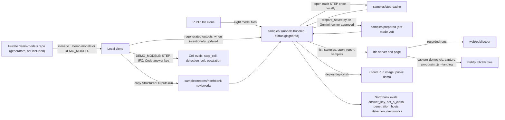

# 19 · Demo data

> **Covers:** `samples/` (and `samples/README.md`), `server/iris/service.py` (`SAMPLES`, `SAMPLE_EXCLUDE`,
> `Workspace.list_samples`, `Workspace.step_cache`, `Workspace.list_report_samples`), `server/iris/step.py`
> (`convert`, the cache), `server/iris/fixtures.py`, `server/iris/demos.py` and `demos/*.json`,
> `web/src/DemoVideo.tsx` (`DEMO_VIDEOS`), `web/src/App.tsx` (default pick, `cellSample`,
> `replayPropose`, `replayPlan`), `web/src/Tour.tsx` (`TOUR`, `CELL`), `web/public/tour/`, `web/public/demos/`,
> `web/scripts/capture-demos.cjs`, `deploy/deploy.sh`, `evals/*.py`, `samples/drawings/` (with the saved readings in
> `server/iris/drawing_reader.py`), `server/iris/saved_checks.py` and `samples/saved-checks/`, `server/iris/prepare.py`
> (`saved_dir`, `saved_key`, `generate`) and `samples/prepared/` · **Checked against code:** re-branded on 2026-11-11;
> the sample drawings, their saved readings and how they go with Northbank, and the saved checks, checked 2026-11-22;
> review queue 2026-11-22 (`samples/prepared/`, `evals/prepare_saved.py`); demo videos 2026-11-22 (`DEMO_VIDEOS`) ·
> **Deeper design:** [docs/step.md](../step.md), [docs/detection.md](../detection.md)

Iris is shown on two model sets, both synthetic models generated by the team's scripts (generator source not
included), each with an answer key: **Northbank**, a small office building (four IFC models plus a grid file and a later MEP
revision), and **PC-03**, a robot palletising cell (one STEP file, with the same parts as IFC). None of it is customer
data. Eight generated files now ship in `samples/`: six Northbank IFCs and two
PC-03 STEP revisions, about 15 MB total. Other local data, Navisworks packages and caches stay gitignored through an
explicit filename allowlist. Both sets are synthetic and bundled in `samples/`; the generator source is not
included (see [sample provenance](../../samples/README.md)).
This doc says what each set contains, its answer key and what Iris does with it, how to set the data up, how
the app, the evals and the deploy find it, and the recordings and pictures made from it.

**The rule:** no customer data, ever. Everything in `samples/` is deployed to the public demo (below), so only
the team's synthetic demo models and the reports exported from them go there.

## Where the data comes from

The team's private demo-models repo (not included here) holds the generators and their outputs. Its IFCs are generated, never hand-edited:
Northbank from its layout modules (`nblayout.py` and the `nb*.py` modules, built by `generate_northbank.py`, checked
by `verify_northbank.py` for Rev03 and `--rev04`), the cell from one parts list (`palletising-cell/Code/celllayout.py`,
built by `generate_cell.py`, checked by `verify_cell.py`). Generation is byte-identical with stable GlobalIds, so an
unexpected change in a file is a real change. The generators pin IfcOpenShell 0.8.5; Iris's server runs 0.9 (the
cell's IFC check needs 0.9, whose clash tree reads these files).

| Folder in the demo-models repo | What Iris uses from it |
|---|---|
| `northbank/IFC/` | `Northbank-Structure.ifc`, `-MEP.ifc`, `-Architecture.ifc`, `-Site.ifc`, `-Grids.ifc`, `-MEP-Rev04.ifc` |
| `northbank/StructuredOutputs/<run>/` | A Navisworks three-view export: `sampled-clashes.xml`, `manifest.json` and `tests/**/*.png` (A/B/C per clash) |
| `palletising-cell/STEP/` | `PC-03-Palletising-Cell-RevA.step`, `-RevB.step` |
| `palletising-cell/IFC/` | `PC-03-Palletising-Cell-RevA.ifc`, `-RevB.ifc` (the same parts as IFC4) |
| `palletising-cell/Code/` | `celllayout.build`, `cellcore.gid`, `verify_cell.PLANTED`, `verify_cell.by_design`: imported by the cell evals as the answer key |

The renders committed in the demo-models repo predate the event; Iris's landing and README pictures are captured in
Iris's own viewer instead (below).

## Northbank

A fictional three-storey steel-framed office by a river, with its street and neighbours: 21.6 × 12.6 m on a 7 m by 6 m
grid (axes 1-4, A-C), Levels 01 / 02 / 03 at 0.0 / 4.0 / 8.0 m, roof at 12.0 m. All six files share one origin with
no transform (finished floor 0.00 = IFC Z 0), which is why the viewer keeps `COORDINATE_TO_ORIGIN` off.

| File | Contents (demo-models README) | Role in Iris |
|---|---|---|
| `Northbank-Structure.ifc` | 230 elements: footings, ground beams, lift pit, base plates and bolts, columns, beams, bracing, composite slabs, the Level 02 transfer plate girder (six web openings, stiffeners), roof plant frame | Coordination set |
| `Northbank-MEP.ifc` (Rev03) | 844 elements, 1,319 ports, 9 systems: air, extract, water and drainage, LV; every segment joined port to port | Coordination set |
| `Northbank-Architecture.ifc` | 670 elements, 36 spaces, 4 zones: curtain walls, doors, stairs, core, ceilings, furniture | Coordination set |
| `Northbank-Site.ifc` | 229 elements: streets, river, car park, planting, five neighbouring buildings | Context: opened by default, its tests listed but off |
| `Northbank-Grids.ifc` | The column grid as visible lines and an `IfcGrid`, the five levels; no building elements | Context only: never in a check (its lines run through every column by design) |
| `Northbank-MEP-Rev04.ifc` | Rev03 with the three Level 02 services rerouted; 868 elements | The designer's fix: the benchmark, and a recheck demo |

**Coordination set vs context.** The page opens Structure, MEP, Architecture and Site by default: the samples whose
names end in `structure.ifc`, `mep.ifc`, `architecture.ifc` or `site.ifc` (the effect after `api.samples()` in
`App.tsx`), so not Grids and not Rev04. Detection gives every model file a team from its contents
(`document.guess_team`) and turns off by default every test involving a Site model (`detect.default_tests`); the
duplicates test then covers the building models only. So Northbank's default check covers Structure, MEP and
Architecture.

### The answer key

Three scripted clashes on the Level 02 transfer girder `TB-L02-01` (`1eVHoPtl1IhAbbhivqVqb0`). Column 3B is omitted on
Level 02, so grid line 3 carries a 1000 mm deep plate girder with six web openings, one per crossing service. Three
services pass through theirs; the other three were dropped 250-400 mm in a later reroute and now hit solid steel, with
their openings just above them.

| Label | Service | GlobalId | Clash point (IFC X, Y, Z m) | Iris's depth | Navisworks |
|---|---|---|---|---|---|
| #042 | Supply air main 600x300 `SA-MAIN-L02-5` | `2AbvqKF25LGeR0M34N_jld` | 3.50, −2.45, 7.18 | −300 mm | −150 mm |
| #057 | Cable tray 300x100 `LV-TRAY-L02-1` | `3tQ7zxxRDMefPXL6hbHmO2` | 3.50, −1.00, 6.90 | −100 mm | reported |
| #061 | Cold water main DN54 `CW-MAIN-L02-2` | `1RHD_I4ibLDuUhW1LBAckc` | 3.50, −3.05, 6.90 | −77 mm | no result stored |

- The labels #042 / #057 / #061 are the demo's story, not Iris's numbers: Iris numbers its own clashes (#1 for the
  duct on a fresh check, per CLAUDE.md), and an imported report numbers by position.
- Iris's depth is how far one element must move to clear the other ([06](06-geometry-and-detection.md),
  [docs/detection.md](../detection.md)). CLAUDE.md's older table gives −300 / −400 / −400 mm: the intersection figure
  detection used before, which reads a thin pipe or tray as far deeper than it is.
- Every other test in the demo-models answer key returns 0. The deliberate near-misses: the three coordinated services
  pass through their openings with 50 mm all round.
- A whole-element raise of #042 by 0.40 m passed with exactly 50 mm all round on Oct 27 (the spike findings, CLAUDE.md), and the
  duct alone lifted 400 mm passed through `verify.check` on Nov 4 ([below](#the-landings-own-picture-of-the-answer-key)).
  As the fix agent tries it now, the move keeps the run's joints and carries the tee, branch and damper, which hit
  secondary beams: the whole-run raise fails, and only offsets pass for all three (a scripted run, Nov 22,
  [below](#a-scripted-run-not-geminis)).
- Beyond the key, triage of a detected run reads a few more real problems (CLAUDE.md, Oct 28): the B1 pad footing
  against the lift-pit wall (−471 mm), and, with the Site tests on, site trees and paving.

**Rev04, the benchmark.** `Northbank-MEP-Rev04.ifc` is the designer's next issue. Each service lifts into its own web
opening with a four-bend offset between about x 2.7 and 4.3 m (demo-models README; CLAUDE.md says about 2.6-4.4 m):
the duct up 400 mm (180 mm radius bends), the tray 250 mm, the cold water main 280 mm, each with 50 mm clearance. All
844 Rev03 elements keep their GlobalIds; each offset adds four segments and four bends (24 new elements). Iris's
evals score proposals against these heights (`evals/answer_key.py`, `KEY`: dz 0.40, 0.25, 0.28 m): "answer key 3/3
first try at Rev04 heights" is the regression check after every change to fixes ([18](18-testing-and-evals.md)).

### What Iris's check finds

Measured runs (README; `evals/README.md`; CLAUDE.md):

| Run | Result |
|---|---|
| Default tests (Site off) | 464 clashes in 1,732 elements, about 4 s; the answer key 3/3, all in MEP vs Structure |
| Every test on (Site included) | 633 clashes in 1,961 elements, 7-12 s |
| Against the Navisworks sample package | 117 of 117 sampled real overlaps; the other 200 sampled results are not physical (129), touches (46), one element (24) or joined by ports (1) |

### The Navisworks sample report

The imported-report path (Coordinate › Import a Navisworks clash report) uses Navisworks' own results on Northbank.
Navisworks ran 1,275 automatic class-pair tests and stored 7,668 results (`evals/detection_navisworks.py`); the
three-view package samples at most five per test: 317 results in 73 tests, each with A/B/C pictures.

- **Set up:** copy `sampled-clashes.xml` and `tests/**/*.png` from the demo-models repo's
  `northbank/StructuredOutputs/<run>/` into `samples/reports/northbank-navisworks/` (`samples/README.md`). The app
  lists every folder under `samples/reports/` with an XML at its top (`Workspace.list_report_samples`); the evals expect
  that folder name.
- **Trimmed for the demo:** a sample report drops every clash test that involves one of the classes in
  `service.SAMPLE_EXCLUDE` (env `IRIS_SAMPLE_EXCLUDE`, default `IfcGeographicElement,IfcSpace,IfcBuildingElementProxy`;
  `reports.load(exclude=)`): site context, rooms and proxies are not coordination problems. Uploaded reports are kept
  whole. Northbank's sample: 217 clashes in 52 tests (was 317 in 73), with #042 as `c0053`, numbered #53. The evals
  read the full package.
- **Matching:** each clash is matched to the open models by GlobalId, else a unique class and name. With Site open,
  all of them link (CLAUDE.md: 290 of 317 without Site).

## The palletising cell (PC-03)

The end of a fictional food packaging line, made to show that coordination is not only for buildings: a belt
conveyor, a four-axis palletising robot with its restricted space (a see-through cylinder, radius 2.7 m), two pallet
stations, mesh guarding on bolted posts with light curtains and a gate, an electrical panel (EP-301) with its working
space (a see-through box), an HMI stand, a cable ladder, two compressed-air lines, and the plant's walls (drawn
see-through) and two columns.

| File | What it is |
|---|---|
| `PC-03-Palletising-Cell-RevA.step` | STEP AP214 in millimetres: an assembly tree with named parts and colours; zones carry alpha. 161 parts, eight planted problems (17 part pairs). |
| `PC-03-Palletising-Cell-RevB.step` | The designer's next issue: all eight fixed. 185 parts. |
| `PC-03-Palletising-Cell-RevA.ifc` / `-RevB.ifc` | The same parts as IFC4 in metres, with real classes, extrusions, revolved bends and ports. |

Iris opens the **STEP** (the point of the demo): `step.convert` turns it into IFC on open, the fast model (`GEMINI_FAST_MODEL`) names each
part's class, plain boxes and cylinders become exact extrusions so offsets and trims work on them, and parts of one STEP
group that touch move together (`IfcScene.step_run`). Design: [docs/step.md](../step.md); code: [14](14-files-in-and-out.md).

### The planted problems and what fixes them

C1-C3 and C6-C8 are hard clashes between physical parts; C4 and C5 are clearance problems modelled as see-through
volumes nothing may enter, so they show in a plain hard check too. The "Iris" column is what the evals and CLAUDE.md
record; those runs predate the move to Gemini, and the fix kinds have not yet been measured on Gemini.

| | Problem (Rev A) | Rev B fix | Iris's fix kind | Recorded by |
|---|---|---|---|---|
| **C1** | Air line `PL-301 compressed air DN25 segment 2` through both conveyor rails (`CV-301 side rail north` / `south`) | Local offset 250 mm down under the frame | **Fix together**: the two clashes become one job (`plans.merge_shared`) and one verified fix clears both. Which kind varies by run: an offset (CLAUDE.md, Oct 28), a route 900 mm west (`evals/runs/2026-10-30-cell-supports`, and the Oct 30 tour recording), a move west (the Oct 28 tour recording). | `evals/step_cell.py` |
| **C2** | Cable ladder `CT-301 run 2 along the west fence` into `Fence post W5` (62 mm) | Whole ladder 150 mm higher | **Move** +150 mm: the ladder's five touching parts move as one; written back to the STEP. The model's own proposals vary: on Oct 30 a 120 mm local offset ranked first and a 100 mm whole-ladder raise second (the tour recording) | `evals/step_cell.py` |
| **C3** | `Fence top rail S5-SE` 40 mm into `Fence post SE` | Rail trimmed 40 mm | **Trim** to the post's face | `evals/step_cell.py` |
| **C4** | North fence line inside the robot's restricted space (posts N3, N4, their plates, two panels, a light curtain) | Fence line moved to Y 2.8 | **Move**: posts N3 / N4 350 mm north, first try, since a move keeps what it stands on (`verify.supports`) | CLAUDE.md, Oct 30 |
| **C5** | `Operator HMI stand OP-301` in `EP-301 working space` | HMI moved by the infeed | **None verified**: every direction hits a conveyor, tray or filter (a real limit, not a bug) | CLAUDE.md, Oct 30 |
| **C6** | Air branch `PL-302 … segment 3` through plant columns C3 and C4 | A detour round each column, 200 mm out | **Reroute**: Fix together → one job → a detour round each column (Oct 30 run: 250 mm north; the designer's 200 mm route also passes, 33 mm clear). Built so that only a two-step detour clears. | `evals/step_cell.py` |
| **C7** | Plant compressed-air main DN50 through the west wall, no opening | A 150 mm square opening | **Opening** (penetration): Ø130 mm, 220 mm deep, with clearance and an architecture review; cut when kept with no requirements; the STEP's wall cut and a provision for void added | `evals/step_cell.py` |
| **C8** | `C-302 400 V feed` (32 mm conduit) into EP-301 through its 3 mm top gland plate, no hole | A gland hole 1 mm round the conduit | **Opening**, fitted: a Ø34 mm gland hole (the model reads the gland plate as allowed, a fitted gland) | `evals/step_cell.py` |

Besides the planted pairs, the cell has contacts it is built with (anchors through their plates, drums through their
rails, the robot's reach over the conveyor and pallets, the gland plate on its panel): 95 by design in Rev A, 93 in
Rev B. Latest run (`evals/runs/2026-10-30-cell-supports/README.md`): Rev A 161 of 161 parts converted, classes 161 of
161, 112 clashes in 1.7 s, 17 of 17 planted pairs, 0 unexpected; Rev B 185 parts, 0 planted.

### The STEP cache

Converting a STEP asks the fast model (`GEMINI_FAST_MODEL`) for each part's class, which takes about 30-35 s the first time. `step.convert`
reuses a conversion of the same bytes: it looks for `<sha256>.ifc` and `<sha256>.json` (the converted IFC and its
manifest, the source path written as a placeholder) in the cache, and writes them there after a conversion whose
classes the model gave. `Workspace.step_cache` is `samples/step-cache/` when that folder exists, else
`<tmp>/iris-models/step-cache`. So:

- **To ship the cell's conversion:** create `samples/step-cache/`, start the server locally with a model key, and open
  each STEP once. The files land there and are deployed with the samples; the demo's first opening after a restart
  then takes about 1.5 s.
- **After the STEP changes** (C6-C8 were added on Oct 29), regenerate the cache: the old entries are keyed by the old
  bytes and simply stop matching.
- STEP part GlobalIds are derived from the file's hash and each part's label path (`step.py`, uuid5), so they differ
  from the cell IFC's GlobalIds and change whenever the STEP's bytes change. That is why the cell tour finds its clashes
  by part names (`CELL`, `clashOfNames`), not by GlobalId.

## The demos in the code (`demos.py`)

Only `server/iris/demos.py` knows the demos by name (with the tour, the landing and the evals): `DEMOS` lists
each one's default files and context files (Northbank's Grids and Rev04 are in its set but not opened by default), the
start button's words, its tour, and its **default requirements**, checked in as `server/iris/demos/northbank.json`
and `palletising-cell.json` (`iris-requirements/1`: L3 Coordinated, balanced, groups per team for Northbank and per
kind of part for the cell, Site off, the domain named and its classes fixed in place listed). A demo may also name
its **sample drawings** (`Demo.drawings`, PDFs in `samples/drawings/`): Northbank names `Northbank-M-201.pdf` and
`Northbank-M-201-mismatch.pdf`, the cell none ([below](#sample-drawings-samplesdrawings)). `GET /api/samples`
returns the demos among the samples (`demos.listing`, each with the sample drawings of its own that are there); the
page picks the first demo's files and labels the start button from it. While requirements are off, a demo's file
decides only its domain and what stays in place
(`Workspace.requirements_for`); switched on in the dialog (its starting draft for a demo), it applies in full. The
evals run either way: `evals/answer_key.py --requirements demo`, `evals/step_cell.py --requirements demo`. The demo
models' own property set (`Iris_Demo`, shown as "Model data", its `ClashRole` note hidden) and smart tags are
named there too (`PSET_NAMES`, `HIDDEN_PROPERTIES`, `SMART_TAG_SET`).

## Setting the data up in a session

Both demo cards work from a normal clone: their eight IFC/STEP files are already in `samples/`. They are copied
byte for byte from the generator repository; `.gitattributes` disables newline conversion to preserve original
metadata, geometry, federation coordinates, GlobalIds and STEP cache identities. No separate public download or
Git LFS is needed. For local development, follow [the README](../../README.md#run-locally).

The following extra setup is only for private generator-side evals and Navisworks report packages:

1. Add the team's private demo-models repo (not included here) to the session and clone it next to this repo as `../demo-models`, or set
   `DEMO_MODELS` to wherever it is (the cell evals and `detection_navisworks.py` read `DEMO_MODELS`, else
   `../demo-models`).
2. The model outputs are already bundled. Copy an optional Navisworks report into `samples/`:

```bash
# from the repo root, in the cloud session's bash (GNU cp)
dest="$PWD/samples/reports/northbank-navisworks" && mkdir -p "$dest"
run=$(ls -d "$DEMO_MODELS"/northbank/StructuredOutputs/*/ | head -1)
cp "$run"/sampled-clashes.xml "$dest"/
(cd "$run" && find tests -name '*.png' -exec cp --parents {} "$dest"/ \;)
```

3. Optionally `cp "$DEMO_MODELS"/palletising-cell/IFC/PC-03-Palletising-Cell-RevA.ifc samples/` (only
   `evals/penetration_hosts.py` needs it; it also shows in the Models menu), and the STEP cache (above).
4. For a small model independent of the full demo: from the repo root,
   `uv run --directory server --locked python -m iris.fixtures ../samples/fixture-clash.ifc`
   writes a small test model (`fixtures.build_clash_fixture`).

### What `samples/` holds

| Path | Needed by |
|---|---|
| `Northbank-Structure.ifc`, `-MEP.ifc`, `-Architecture.ifc`, `-Site.ifc` | The Northbank demo card, the golden path, the building tour; `answer_key.py`, `detection_navisworks.py`, `not_a_clash.py`, `penetration_hosts.py` |
| `Northbank-Grids.ifc`, `Northbank-MEP-Rev04.ifc` | Optional: listed in Models (Rev04 for a recheck); not opened by default |
| `PC-03-Palletising-Cell-RevA.step` | The cell demo card and the cell tour (`cellSample`); without it the card is not shown |
| `PC-03-Palletising-Cell-RevB.step` | Optional: the fixed revision, from the Models menu |
| `step-cache/<sha256>.ifc`, `.json` | Optional: the cell's ready conversion |
| `reports/northbank-navisworks/` | The imported-report path; images for `answer_key.py`; `not_a_clash.py`, `detection_navisworks.py` |
| `PC-03-Palletising-Cell-RevA.ifc` | Optional: `penetration_hosts.py` |
| `fixture-clash.ifc` | Optional: a small model for local work |
| `drawings/Northbank-M-201*.pdf`, `*.truth.json` | The 2D drawing reader's sample sheets and their answer key ([below](#sample-drawings-samplesdrawings)); the Northbank demo's sample drawings (`POST /api/scenes/{scene_id}/drawings/samples`); `server/tests/test_make_drawings.py`, `test_drawings.py` |
| `drawings/Northbank-M-201*.reading.json` | Each sample sheet's saved reading: the model's reply, replayed instead of a model call (`drawing_reader.saved_reading`) |
| `prepared/*.json` | Optional, none yet: the review queue's saved AI proposals for the unedited Northbank ([below](#saved-ai-proposals-for-the-sample-samplesprepared)), written by `evals/prepare_saved.py` |
| `saved-checks/northbank.json` | Generated: what Northbank's four files measure, so the demo's first check builds no geometry ([below](#saved-checks-samplessaved-checks)); `server/tests/test_saved_checks.py` |

### How the app finds them

| Code | What it does |
|---|---|
| `service.SAMPLES` | The repo's `samples/` folder (`Workspace(samples=)` overrides it; tests and evals pass their own folders). |
| `Workspace.list_samples` → `GET /api/samples` | Every `*.ifc`, `*.step`, `*.stp` at the top of `samples/` (`MODEL_SUFFIXES`). |
| `POST /api/scenes` → `Workspace.open` | Opens samples by name; a name that resolves outside `samples/` is refused (404). A STEP goes through `step.convert` with the cache. |
| `Workspace.list_report_samples` → `GET /api/reports/samples` | Folders under `samples/reports/` with an XML at their top. |
| `POST /api/reports` → `Workspace.open_report_sample` | Reads the folder's XMLs with `SAMPLE_EXCLUDE`. |
| The samples effect in `App.tsx` | Default pick: `listed[0]?.files` from the server's demo registry, else the first sample. `startLabel` comes from the selected demo's `label`, else "Open the models". |
| `cellSample` in `App.tsx` | First file of the listed demo whose `tour` is `cell`: shows the cell card and enables the cell tour. |
| `drawings.sample_names` → `GET /api/samples` | Every `*.pdf` in `samples/drawings/`; `demos.listing` gives each demo those its `Demo.drawings` names, as `drawings`. |
| `POST /api/scenes/{scene_id}/drawings/samples` | `demos.drawings_for` the open files (`demos.find`: every open file in the demo's set), read from `samples/drawings/` and taken in as an upload is (`drawings.ingest`); 409 for any other set. |
| `drawing_reader.SAVED` | The repo's `samples/drawings/`, where a read looks for saved readings (`*.reading.json`, `SAVED_SUFFIX`), whichever samples folder the `Workspace` was given. |
| `prepare.saved_dir`, `prepare.load_saved` → `POST /api/scenes/{scene_id}/prepare/stream` | `IRIS_PREPARED_DIR`, else the samples folder's `prepared/`: the first `*.json` whose key equals the scene's (each file read once per path, size and time). |

### In the deploy

`deploy/deploy.sh` builds the Cloud Run image with `samples/` in it, so the public demo serves exactly what
`samples/` held at deploy time, the STEP cache included, and a saved set in `samples/prepared/` once there is one
(`.dockerignore` lets `samples/**/*.json` in). Put the data in place before deploying
([17](17-deployment-and-operations.md)).



## Sample drawings (`samples/drawings/`)

No public set of MEP drawings exists ([docs/drawings.md](../drawings.md), "Sample data"), so `evals/make_drawings.py`
draws one from Northbank (Structure, MEP and Grids from `samples/`): sheet **M-201, "Level 02 — Mechanical services"**,
A1 landscape at 1:50 (the largest standard scale that fits), vector PDF with a real text layer (reportlab, standard
fonts). It shows the grid with bubbles and dimensions, the Level 02 structure as a grey background (beams dashed, the
transfer girder heavier, columns solid), and every MEP element on the level in plan: ducts as double lines (round ones
with a centreline), risers crossed, pipes as single centrelines (cold solid, hot dashed, soil and waste dash-dot),
trays hatched, diffusers and grilles as symbols, dampers, valves, fittings and sanitaryware untagged. Labels are the
model's own Tag over its size (`600x300`; `DN54` and `D250` drawn `Ø54`, `Ø250`); short pieces of one run share a label
with one tag per line; placement avoids collisions and uses leaders. A north arrow, scale bar, legend, notes and a
title block (project "Northbank (sample)", sheet, scale, date, level "Level 02", "Iris by Techjays — generated
sample") complete it.

| File | What it is |
|---|---|
| `Northbank-M-201.pdf` | The sheet as the model says: 123 labelled items (67 ducts, 34 pipes, 5 cable carriers, 16 terminals by size only, 1 board) |
| `Northbank-M-201-mismatch.pdf` | The same sheet with `PLANTED` differences: `SA-MAIN-L02-12` sized 600x250 (`size_differs`), `SA-BR-L02-N2-2` left out (`missing_in_drawing`), an extra tray `LV-TRAY-L02-2` (`missing_in_model`), the pipe `HW-MAIN-L02-6` drawn as a 150x100 duct (`type_differs`) |
| `*.truth.json` | Per sheet: every item (tag, kind, size, size_mm, `box` in page pixels at 150 dpi with origin top left, GlobalId, tag and size text boxes, leader), `scope` (the GlobalIds the sheet must show), the model-to-pixel transform, title block fields, source model hashes and the planted `mismatches` |

Regenerate after a model or generator change (`cd server && uv run python ../evals/make_drawings.py`, about 2 s; the
same models give the same bytes). `server/tests/test_make_drawings.py` builds into a temporary folder and checks that
the text layer holds every tag and size inside its box (pdfplumber, both word modes), that the clean sheet is the
model and `drawing_compare.compare` finds nothing on it and exactly the planted list on the other, that output is
deterministic, and that `samples/drawings/` is up to date. `.gitignore` allows the folder; `.dockerignore` lets its
PDFs and JSON (truth files and saved readings) into the image.

### With the Northbank demo

The two sheets are the Northbank demo's sample drawings (`Demo.drawings`), so a visitor can try the drawing reader
with no upload and no live model call. With Northbank's models open (any files of its set),
`POST /api/scenes/{scene_id}/drawings/samples` attaches both to the scene as an upload does (`drawings.ingest`: pages
rendered, text layer and title block read). It takes nothing from the upload allowance, and a sheet the scene already
holds (same sha256) is not attached again. Both sheets are M-201, two issues of one sheet, so the comparison takes
each as a whole sheet (`drawings.sheet_key`): the clean sheet showing `SA-BR-L02-N2-2` does not excuse the mismatch
sheet leaving it out ([docs/drawings.md](../drawings.md)). The page's side is in [12](12-web-app.md).

### Saved readings

Each sheet ships with the drawing reader's reply to it, `<stem>.reading.json` (`Northbank-M-201.reading.json`,
`Northbank-M-201-mismatch.reading.json`), written once by `evals/save_drawing_readings.py` through
`drawing_reader.write_saved`. A file holds the PDF's name and `drawing_sha256`, the reader's `VERSION`, the
`prompt_hash`, the `model` that read it, `settings` (how the call was made: `thinking_level`, `max_output_tokens`,
`timeout_s`) and `at`, and per page its `tiles`, the model's `reply` as given and its `usage`. Nothing secret is in it.
The model, prompt, schema and images are the reader's own; the thinking level is not. The reader's own level
(`drawing_reader.THINKING`, high) did not finish the A1 sample sheet within its 240 s deadline (the script's
docstring, Nov 22), so the script reads at `--thinking low` by default, with an output cap and a longer timeout, and
the file's `settings` say so. The page shows the model's name only, not the thinking level.

A read replays a page from it (`drawing_reader.saved_reading`) only when the PDF's sha256 is the file's
`drawing_sha256`, `prompt_hash()` is the file's `prompt_hash`, and the file's whole-sheet tile is the page's pixel
size. Otherwise the page is read by the model as any other. A replayed reply is still checked against the page's text
layer (`reconcile`), so every status comes from the PDF. A replayed page makes no call and costs nothing, and the
stream and the page say it is a saved reading and name the model that made it
([docs/drawings.md](../drawings.md), "Saved readings").

A saved reading goes stale, and reads of that sheet go to the live model again, when:

- the PDF changes (a model or generator change; the same models give the same bytes, so running `make_drawings.py`
  again changes nothing);
- the prompt changes: `domain_packs/drawing_reader.md`, `PAGE_TEXT`, `TILE_TEXT`, the schema, the tiling
  (`TILE_ABOVE_PX`, `TILE_OVERLAP`) or `VERSION`, all in `prompt_hash`;
- the page renders at another size (`drawings.DPI`, `MAX_PAGE_PIXELS`).

A new fast model (`GEMINI_FAST_MODEL`) does not make it stale: the label names the model that made the reading.

To make them again: `cd server && uv run python ../evals/make_drawings.py` when the sheets change, then
`uv run python ../evals/save_drawing_readings.py` (Gemini access, the fast model, a hard cap of `--max-usd` a run,
default 0.30; a page already in the reader's own cache costs nothing) ([18](18-testing-and-evals.md)). Then
`uv run python ../evals/save_drawing_readings.py --check`, which calls no model: it replays each saved reading against
the Northbank models and prints, per sheet, the items by status, how many of the truth file's labels were confirmed,
and the mismatches found beside the planted ones, then both sheets compared together (`drawings.compare_scene`). It
exits 4 when a sheet has no saved reading for its PDF and prompt, 1 when the mismatches found are not exactly the
planted ones. Commit the PDFs and their `.reading.json` files together.

## Saved checks (`samples/saved-checks/`)

On one machine detection is deterministic, so the shipped Northbank files carry what their geometry gives, and the
demo's first check builds none (Nov 22; design in [docs/detection.md](../detection.md), "Saved checks for the samples";
code in [06](06-geometry-and-detection.md)). The same files measure a little differently on another processor, so
everything is kept per platform: `linux-x86_64` (Cloud Run and CI) and `darwin-arm64` (development Macs,
`saved_checks.PLATFORMS`). `samples/saved-checks/northbank.json` (about 550 KB with both platforms, generated by
`server/iris/saved_checks.py`, committed) holds:

- `about`: what the file is and how it is made;
- `platforms`: per platform, what it was made with (`detect`, `boxes`, `ifcopenshell`), `files` (each file's
  SHA-256) and `live` (the live run it was made from: 464 clashes in 1,732 elements), which the test reads;
- `boxes`: the element boxes of each of the four files the demo opens (`saved_checks.SETS`), keyed by the file's
  SHA-256, whether the scene is big, `BOXES_VERSION`, the IfcOpenShell version and the platform;
- `checks`: per platform, the default check's measurement (each test's hits and touches) under one key for the whole
  run, with its `probe`: 8 clashes a process measures again before it first replays the check.

It holds geometry only: no AI output and nothing beyond the sample models themselves. A scene opened from these files
unchanged takes the saved boxes and, until a fix is kept or a model added or removed, the saved measurement, once its
probe measures the same on this machine; anything else runs live.

**Regenerate** after any change to the samples' bytes, to what detection measures (bump `detect.VERSION`), to how
boxes are made (bump `saved_checks.BOXES_VERSION`), or to the IfcOpenShell version: `cd server && uv run python -m
iris.saved_checks --docker` (no AI). It writes this machine's entry, then linux/x86_64's in Docker
(`python:3.13-slim-bookworm`, `--platform linux/amd64`, the same IfcOpenShell, NumPy and defusedxml versions), both
merged into the one file. `server/tests/test_saved_checks.py` fails while either platform's entry is stale and checks
that Northbank's replay is its live check (skipped on a machine whose probe refuses it). `.gitignore` allows the
folder; `.dockerignore` lets its JSON into the image, so the public demo's first check replays it too.

## Saved AI proposals for the sample (`samples/prepared/`)

The review queue ([docs/review-queue.md](../review-queue.md), [09](09-agent-workflows.md)) can replay the proposal
model's recorded replies on the unedited Northbank instead of asking the model again. A saved set holds the model's
replies only, never the geometry's results: each reply goes back through `agent.resolve`, so every option is tried,
checked and ranked on the server exactly as a live one is before anyone sees it. A replayed pair is free (no proposal
is charged and nothing waits on the model). The page labels it with the file's sentence, "Saved AI proposals for this
sample (<model>, <date>)" (`Saved.info`).

**Not in the repo yet.** `samples/prepared/` does not exist: the Gemini run that makes it waits for the owner's
approval. Until then every pair is prepared live. `.gitignore` allows the folder (`!samples/prepared/`) and
`.dockerignore` lets `samples/**/*.json` into the image, so once made it is committed and deployed with the models.

- **Where:** `samples/prepared/*.json`, or the folder `IRIS_PREPARED_DIR` names
  ([15](15-requirements-settings-and-config.md)); the first file whose key equals the scene's (`prepare.saved_dir`,
  `prepare.load_saved`).
- **The key** (`prepare.saved_key`): the files the scene was opened from, by name and sha256, in the scene's order
  (`Workspace.original_paths`); revision 0 (no edit kept); no coordination requirements in force; the default
  clearance (`requirements.DEFAULT_CLEARANCE_M`); `plans.PLAN_ROUNDS`; `agent.OPTIONS`; the proposal model's id and
  thinking level; the domain prompt's sha256; `prepare.VERSION`. Any difference is a miss, and every pair is prepared
  live. The key names the model that made the replies, so a set is used only where that model is the configured
  proposal model.
- **Per question:** a reply is used only for the exact question it answered (sha256 of the system prompt and the
  question text). Images are not part of it: the set is made from model data alone. A question the file does not hold
  fails that card with `prepare.MISS`; it is never asked live behind the reviewer's back.
- **No hosts:** made and replayed with no host reading, so a service may pass through walls and slabs only, each
  opening reviewed by its host's team.

### How it is made

`evals/prepare_saved.py` ([18](18-testing-and-evals.md)) opens the Northbank demo files as the demo card does
(`demos.DEMOS`: Architecture, MEP, Site, Structure), runs Iris's detection with the default tests, picks the answer
key's three girder clashes (#042, #057, #061) and the deepest open hard clashes (`prepare.deepest`, 8 pairs), and
prepares each pair through the review queue's own run, recording every reply (`prepare.generate` with a
`prepare.Recorder`). It writes `samples/prepared/Northbank.json` atomically: a temporary file in the same folder
(`mkstemp`), made readable to all (0644, since the server's image may run as another user), then `os.replace` over
the target. A pair the model failed on is left out of the file and prepared live.

1. Price it: `cd server && uv run python ../evals/prepare_saved.py --dry-run`. It counts the calls; no model is called.
2. The owner approves the spend. Nothing calls Gemini before that.
3. From the repo root: `uv run --directory server python ../evals/prepare_saved.py --model gemini --yes`. This is the
   only mode that calls a model; every other mode runs offline (the credentials are dropped and building a client
   raises).
4. Commit the file; the next deploy carries it.

The dry run on 2026-11-22: 8 pairs × 2 rounds = 16 calls at most (a round that verifies a fix ends its pair), about
43,976 input tokens (characters / 4), 32,000 output tokens assumed (2,000 a call), no images. That is about $0.31 on
gemini-3.8-flash at thinking low, the proposal model `.env` and `deploy/deploy.sh` configure; about $0.41 on
gemini-4-argon. It is an estimate, not a bill.

Make the set again after anything in its key changes (the files, the proposal model or its thinking level, the fixes
prompt, `PLAN_ROUNDS`, `agent.OPTIONS`, `prepare.VERSION`), or after a change to what the fix agent asks: each changed
question is a miss.

### A scripted run (not Gemini's)

`--model scripted` makes a set with `prepare.ScriptedModel`, a free, offline, deterministic stand-in (it moves the
service up or down by set amounts and offsets it through an opening the question names), written to a temp folder.
These numbers are that stand-in's, measured on 2026-11-22. They say nothing about Gemini's proposals.

| | Result |
|---|---|
| Detection | 464 clashes (default tests) |
| Pairs | 8: the answer key's three fall within the deepest 8 |
| Made | 6 ready, 2 failed; 13 replies recorded; about 55 s |
| Replayed in a fresh process, with a model that raises if called | The key matched; 0 live calls; the same 6 ready and 2 failed; every option checked again (about 60 s: the geometry checks) |

One finding: a whole-run raise of #042 by 0.40 m now fails. The move keeps the run's joints
([docs/connections.md](../connections.md)), so it carries the tee, branch and damper joined to the main, and those hit
secondary beams. Of the scripted ideas, only the offsets through the girder's openings pass for #042, #057 and #061.

For a local click-through, make a scripted set with `--out /tmp/prepared/Northbank.json`, then run the server with
`IRIS_PREPARED_DIR=/tmp/prepared GEMINI_MODEL=scripted GEMINI_THINKING_LEVEL=` (empty) so the key matches.

## Tour recordings (`web/public/tour/`)

Real runs, recorded and committed (before the move to Gemini; re-record them on Gemini), that the guided tours
replay when a live model step errors or is slow ("Watch a
recorded run"). Each file is `{events: [{t, event}], …}`: the stream's events with their times in seconds, replayed at
the recorded pace through the same pilot and panels (`replayPropose`, `replayPlan` in `App.tsx`) and labelled as
recorded. Accepting a replayed fix edits the model for real.

| File | Recorded | What it replays | Used by |
|---|---|---|---|
| `c0053.json` | Oct 27, on the imported report (`c0053`, the duct × girder) | A single proposal: "Offset duct up 400mm through beam opening" and a whole-run raise | Building tour, "One fix, live" (`replay("duct")`) |
| `c0051.json` | Oct 27 (`c0051`, the curtain-wall transom 30 mm into a mullion) | A single proposal: "Trim transom end to mullion face" | Building tour, "A joint, not a move" (`replay("joint")`) |
| `girder-plan.json` | Oct 27, hub `1eVHoPtl1IhAbbhivqVqb0` | The root cause plan: offsets up 400 / 250 / 280 mm through the web openings for the duct, tray and pipe | Building tour, "The root cause" (`replayPlan("girder")`) |
| `cell-ladder.json` | Oct 30, the 161-part Rev A STEP | A single proposal on the ladder × post W5 (#61): "Local offset tray up 120 mm over post" (50 mm clear, ranked first) and "Raise tray 100 mm over post" (the ladder's five parts as one move, 38 mm) | Cell tour, "One fix" (`replay("ladder")`) |
| `cell-pipe-plan.json` | Oct 30, the same STEP | Fix together on the pipe × both rails (#66, #67): one merged item, "Side-step pipe 900 mm west past both rail ends" (a route, 83 mm clear), alternative "Dip pipe down 150 mm under each rail" | Cell tour, "Together" (`replayPlan("pipe")`) |

- The building recordings were made on the imported Navisworks report, so they name `c0053` / `c0051`. The tour finds
  its clashes in whatever report is open by element pair (`TOUR.duct`, `TOUR.joint`, `clashOfPair`), and
  `replayPlan` re-points a recorded plan's clash ids to the open report's clashes of the same pairs, so "not in the
  report" reflects this report.
- The cell recordings carry the part GlobalIds of the STEP they were recorded on (the ladder `0PKSyDjLDRt8iXC1mscRPM`,
  post W5 `23HNLt2prKbAyvOqzfkEeZ`), and STEP GlobalIds follow the file's bytes (above). The Oct 28 recordings named
  parts of the 144-part STEP, so their fixes could not be drawn or accepted on the Oct 29 cell; they were re-recorded on
  Oct 30. Re-record them after any change to the cell's STEP: run the cell tour in a browser on a local server and save
  the propose and plan streams with their times (`{t, event}` from the request's start). Checked Oct 30 in headless
  Chromium with the live streams refused: both recordings offered, replayed and accepted in place (one model download,
  at open), all 12 steps.
- The model's ideas vary by run, and Iris ranks comfortable clearance before the smallest change, so the ladder's best option
  is often a local offset rather than the designers' 150 mm whole-ladder raise: the cell tour's copy describes the
  option on screen (`optionKinds`) rather than assuming a move.

## Demo pictures (`web/public/demos/`)

`northbank.webp` and `cell.webp` are the pictures in the README's "Two demos" table and About Iris's overview.
The landing's demo cards play a recorded fix instead (below, "Landing clips"). `web/scripts/capture-demos.cjs` makes them in Iris's own viewer: with the server running
on the demo models (`uv run uvicorn iris.app:app --port 8765`), it opens each demo the way a visitor does in
headless Chromium (Playwright, SwiftShader WebGL), waits for the check, picks the iso view and zooms in, saves the
canvas with the viewer's screenshot button, and crops it to 16:10 WebP with Pillow from the server's environment.
Recapture after the viewer's look or the demo models change; the cards, the README table and the landing numbers move
together and only from measured runs.

### The demo clips (once Home's "See it work")

Home no longer shows them (the owner removed "See it work" on Nov 22, and `DemoClips.tsx` with it); the files stay in
`web/public/demos/` for the submission video. There were two clips: `check.webp` (the 3D clash check,
from `capture-proposals.cjs --landing`, below) and `drawings.webp` (the 2D drawing reader), each 1000 × 625 with a
`-still.webp`. `web/scripts/capture-drawings.cjs` records `drawings.webp` in the app from a fresh browser: Try the
sample drawings, the sample building opening (sped up), the clean sheet read (its boxes, items and status chips),
the mismatch sheet read, its Mismatches tab and one size that differs shown on the sheet. Both reads replay the
saved readings ("Saved readings" above): no Gemini call, $0, and the page says so on screen. The same run writes a
1920 px MP4 to `~/Downloads/Iris-demo/iris-drawings.mp4` for the hackathon video (`--clash`: `iris-3d-clash.mp4`).
Recapture after the Drawings step's look, the sample sheets or their saved readings change.

### Demo videos

Home plays three narrated videos in a light lightbox (`DemoVideo.tsx`, [12](12-web-app.md)): **Watch the demo** on the
Try the sample building tile (the `3d` video) and on the Try the sample drawings tile (the `2d` video), and **Watch the
full demo** under the hero's tagline (the `full` video). `DEMO_VIDEOS` names their files in `web/public/demos/`:

| Id | Files | Title | What it shows | Duration |
|---|---|---|---|---|
| `3d` | `iris-3d-demo.mp4`, `.vtt`, `.webp` | Fix clashes in your building models | The sample building's clash review: the check, a clash's pictures, fixes proposed by AI and verified by geometry, reviewed in 3D before and after, and kept | 2:35 |
| `2d` | `iris-2d-demo.mp4`, `.vtt`, `.webp` | Check drawings against the model | The sample PDF drawings read by AI (the saved readings), checked against the PDF's own text, then compared with the 3D model's elements to list the mismatches | 1:51 |
| `full` | `iris-full-demo.mp4`, `.vtt`, `.webp` | Iris: does AI truly see? | The hackathon submission video: the problem, both of the above in short, then Iris VisionBench (Track 2): synthetic scenes, geometry-only answers, Gemini 3.8 Flash's results | 4:18 |

They are to be recorded from the sample building with its saved data: the saved checks, the saved drawing readings and
the saved prepared proposals ("Saved checks", "Saved readings" and "Saved AI proposals for the sample", above), so no
live Gemini call happens in them. The narration is Gemini TTS (text-to-speech); the captions are WebVTT (`.vtt`,
English, on by default); the posters are `.webp` stills. Neither a video nor its poster is fetched until its lightbox
opens. The durations are the narrated timeline's lengths (the narration is fixed; only the screen recording reruns).

Until the files are committed, opening a video shows "The video couldn't load." in its frame. When they land, check
each duration in `DEMO_VIDEOS` against the file.

### Landing clips

`fix-northbank.webp` (#1, the duct through the girder) and `fix-cell.webp` (#66, the air pipe into the conveyor's
side rail) play on the demo cards (`DemoCard` → `Clip` in `About.tsx`). "How it works" (`Loop` in
`landing/Story.tsx`) shows its four steps as tabs beside one 16:10 frame that plays the chosen step's
clip: `check.webp` (Northbank checked and its list
appearing), `understand.webp` (the Clash panel while the model reads #1), `workings.webp` (#1's run in the Workings
graph) and `keep.webp` (#1's fix kept); a clip of another shape sits on a dotted ground. It moves on when a clip has
played through (its length read from the file, `stepClips.ts`), until the visitor picks a step; it fetches nothing
before it scrolls into view, then the clip on screen and the next, and plays each from a fresh object URL so it starts
from its first frame. They are
recorded by `capture-proposals.cjs --landing` ([18](18-testing-and-evals.md)) as animated WebP time-lapses of one part
of the window each, so their words read at a card's width (the whole app, as in the README's clips, is too small
there); the card and steps 2-4 come from one live proposal on #1. Each has a `-still.webp`, its last frame, shown
instead to people who ask for less motion (`prefers-reduced-motion`). The alt text describes the run on screen:
rewrite it from the new run after a recapture.

For now only `check.webp` (and its still) is in the repo: the proposal clips (`fix-northbank`, `fix-cell`,
`understand`, `workings`, `keep`) were recorded from the pre-Iris UI, removed, and are to be recaptured on Gemini.
Until then the demo cards show `northbank.webp` and `cell.webp` (from `capture-demos.cjs`), the hero's no-WebGL
fallback shows `northbank.webp`, and steps 2-4 of "How it works" show a single picture each (`still: true` in
`LOOP_STEPS`: `northbank.webp`, `check-still.webp`, `cell.webp`), moving on after 7 s. Put the clips back in
`DemoCard` and `LOOP_STEPS` (`About.tsx`) once recaptured.

### The landing's own picture of the answer key

The landing's hero replay and its "Try the check yourself" draw Northbank's Level 02 girder and the services round it
from numbers read out of the sample models with IfcOpenShell (Nov 4), kept in `web/src/landing/northbank.ts`: the girder
`TB-L02-01` (400 x 40 flanges, a 20 mm web 920 deep with six openings), the three answer-key runs (the supply air main
600x300, the cable tray 300x100, the cold water main DN54) and their neighbours (the return air main and the hot water
main, each already through an opening of its own; the secondary beams, the Level 03 slab, the ceiling and its lights,
the supply branches and the return spigots). The fixes it shows are the recorded ones (README, "See it work": +400,
+250, +280 mm, clear by 50, 50 and 53 mm). What the model is told about #1's opening (`agent.py` from
`edits.passages`: from z 7.380 to 7.780 m, a rise of +0.375 to +0.425 m clears it by 25 mm) is the band the hands-on
check finds. The tray's round is the recorded root-cause plan's (`web/public/tour/girder-plan.json`, Oct 27: "Lift full
tray run 250mm" failed, "Offset tray up 250mm through web opening" passed). Run through `verify.check` on Structure,
MEP and Architecture (Nov 4): the whole tray lifted 250 mm hits a return spigot D250 (-249 mm) and Core wall E - Level 02
(-200 mm), 57 elements checked; the whole cold water main lifted 280 mm hits a volume control damper (-200 mm); the whole
duct lifted 400 mm passes with 50 mm (29 elements); that is the duct alone, and the fix agent's whole-run move now
carries what is joined to it and fails (the answer key, above). `landing.test.mjs` checks that each run clears its own opening by
the recorded amount, that the check gives 50 mm at +400 mm and the band the model is told. If the models change, read
the numbers again.

## Proposal clips (`docs/media/proposals/`)

To be recaptured on Gemini: the clips here were recorded from the pre-Iris UI and removed, and the README no longer
links them. A capture writes live proposal runs as animated WebP time-lapses: `duct`, `tray`, `cold-water`
(Northbank #1-#3, the answer key) and `cell` (the cell's #66, the air line under the conveyor rails), plus
`duct-workings` and `cell-workings`, the same runs replayed in the Activity panel's Workings graph.
`web/scripts/capture-proposals.cjs` records them against a running server with Gemini credentials (Vertex AI or `GEMINI_API_KEY`; see
[18](18-testing-and-evals.md)); every capture is a new proposal, so the README's captions are rewritten from the run
that made the clips. They live under `docs/`, not `web/public/`, so the deployed app does not carry them.

## Which evals use which data

Details, commands and results: [18](18-testing-and-evals.md). The server's unit tests use none of this: they build
small synthetic models with `iris.fixtures` in temporary folders.

| Eval | Data |
|---|---|
| `evals/answer_key.py` | Northbank Structure, MEP, Architecture from `samples/`; A/B/C images from `samples/reports/northbank-navisworks` (#042, #057; #061 runs on text alone); scores against Rev04's heights |
| `evals/navisworks_triage.py` | The Navisworks three-view package (a `northbank/StructuredOutputs/<run>/` folder, given as an argument) |
| `evals/detection_navisworks.py` | Northbank's four models from `samples/`, the package in `samples/reports/northbank-navisworks`, the run's manifest from `$DEMO_MODELS/northbank/StructuredOutputs` |
| `evals/not_a_clash.py` | `samples/` Northbank files (not Rev04 or Grids) and the sample report |
| `evals/penetration_hosts.py` | Northbank Structure, Architecture, MEP and `PC-03-Palletising-Cell-RevA.ifc` from `samples/` |
| `evals/detection_cell.py` | `$DEMO_MODELS/palletising-cell/IFC/` Rev A and B, and its `Code/` answer key |
| `evals/step_cell.py` | `$DEMO_MODELS/palletising-cell/STEP/` Rev A and B, and its `Code/` answer key |
| `evals/escalation.py` | The cell's Rev A STEP and `Code/`, and `$DEMO_MODELS/northbank/IFC` |
| `evals/big_models.py`, `big_models_browser.cjs` | Synthetic IFC files of a given size, written by the script |
| `evals/make_drawings.py` | Northbank Structure, MEP and Grids from `samples/`; writes `samples/drawings/` |
| `evals/save_drawing_readings.py` | The sample PDFs in `samples/drawings/` (`--only` one); writes each one's `<stem>.reading.json` beside it; `--check` reads those, the truth files and Northbank's default models from `samples/` |
| `evals/prepare_saved.py` | Northbank's demo files (Architecture, MEP, Site, Structure) from `samples/` (or `--samples`); writes `samples/prepared/Northbank.json` (`--model scripted`: a temp folder) |

## When to update this doc

- A new demo model set, a new revision, or a change to a set's answer key or planted problems (the demo-models repo).
- A new or renamed file the app expects in `samples/`, or a change to how it finds them (`list_samples`,
  `list_report_samples`, `step_cache`, `SAMPLE_EXCLUDE`, the default pick, `cellSample`).
- A new or re-recorded file in `web/public/tour/`, or a recapture of `web/public/demos/`.
- A new or re-recorded demo video (`web/public/demos/iris-*-demo.mp4` with its `.vtt` and `.webp`): update its
  duration in `DEMO_VIDEOS` (`web/src/DemoVideo.tsx`) and its row in "Demo videos".
- A new eval that reads demo data, or a change to where an eval reads it (`DEMO_MODELS`).
- New measured results on the demo sets (detection counts, fix kinds per planted problem).
- A change to what the deploy copies from `samples/` (`deploy/deploy.sh`).
- A change to the sample drawings (`evals/make_drawings.py`: sheet, labelling rule, `PLANTED`, truth format).
- A change to which demo has which sample drawings (`Demo.drawings`), to how they are attached, or to the saved
  readings: their format (`write_saved`), what keys them (`saved_reading`), or a new run of
  `evals/save_drawing_readings.py`.
- A change to the saved checks: a new demo set in `saved_checks.SETS`, a new platform in `PLATFORMS`, a new file
  format, or a regenerated `samples/saved-checks/` after the samples, detection's measure, box making or IfcOpenShell
  changed.
- A saved set made or remade in `samples/prepared/` (`evals/prepare_saved.py`), its measured run or cost, or a change
  to what its key holds (`prepare.saved_key`, `prepare.VERSION`) or where it is read from (`IRIS_PREPARED_DIR`).
